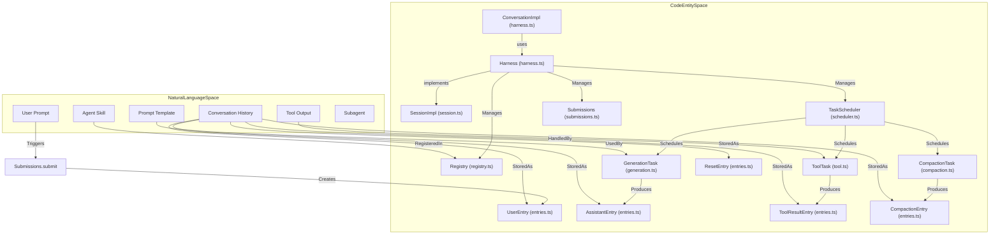

# Durable Harness API (packages/durable)

Relevant source files

The following files were used as context for generating this wiki page:

- [packages/ai/test/openai-completions-empty-tools.test.ts](packages/ai/test/openai-completions-empty-tools.test.ts)
- [packages/durable/CHANGELOG.md](packages/durable/CHANGELOG.md)
- [packages/durable/README.md](packages/durable/README.md)
- [packages/durable/docs/spec.md](packages/durable/docs/spec.md)
- [packages/durable/src/harness/agent.ts](packages/durable/src/harness/agent.ts)
- [packages/durable/src/harness/compaction.ts](packages/durable/src/harness/compaction.ts)
- [packages/durable/src/harness/context.ts](packages/durable/src/harness/context.ts)
- [packages/durable/src/harness/generation.ts](packages/durable/src/harness/generation.ts)
- [packages/durable/src/harness/harness.ts](packages/durable/src/harness/harness.ts)
- [packages/durable/src/harness/inbox.ts](packages/durable/src/harness/inbox.ts)
- [packages/durable/src/harness/scheduler.ts](packages/durable/src/harness/scheduler.ts)
- [packages/durable/src/harness/tool.ts](packages/durable/src/harness/tool.ts)
- [packages/durable/src/harness/types.ts](packages/durable/src/harness/types.ts)
- [packages/durable/src/index.ts](packages/durable/src/index.ts)
- [packages/durable/src/session/session.ts](packages/durable/src/session/session.ts)
- [packages/durable/src/types.ts](packages/durable/src/types.ts)
- [packages/durable/test/harness-compaction.test.ts](packages/durable/test/harness-compaction.test.ts)
- [packages/durable/test/harness-context.test.ts](packages/durable/test/harness-context.test.ts)
- [packages/durable/test/harness-generation.test.ts](packages/durable/test/harness-generation.test.ts)
- [packages/durable/test/harness-inbox.test.ts](packages/durable/test/harness-inbox.test.ts)
- [packages/durable/test/harness-ownership.test.ts](packages/durable/test/harness-ownership.test.ts)

The durable harness in `@earendil-works/pi-durable` (`packages/durable/src/harness`) provides lower-level orchestration for long-running agent sessions, combining atomic storage commits, task scheduling, multi-lane conversation trees, and crash recovery. This page documents the core modules comprising the harness: the `Harness` class, `Registry`, `TaskScheduler`, inbox management, generation and tool tasks, submissions, live state / context tracking, the hook system, error patterns, compaction, the resume contract, and subagent patterns.

---

## 1. Overview and Scope

`Harness` orchestrates agent conversation sessions by enforcing atomic commits over append-only entries, task records, and Chord-backed documents. If a process crashes mid-turn, reopening the storage resumes tasks where they stopped [packages/durable/README.md:5](). 

The core architectural components in `packages/durable/src/harness` include:
- **Registry:** Maps extension definitions, tools, prompt sections, and task types [packages/durable/src/harness/registry.ts:51]().
- **Scheduler (`TaskScheduler`):** Drives task states (`pending`, `running`, `waiting`, `sleeping`, `completing`, `terminal`) across attempts [packages/durable/src/harness/scheduler.ts:40-68]().
- **Inbox:** Manages queued inputs (`steer`, `followUp`, `nextRun`, `write`) processed at run boundaries [packages/durable/src/harness/inbox.ts:1-10]().
- **Generation & Tool Tasks:** Built-in tasks (`GenerationTask`, `ToolTask`, `CompactionTask`) handling LLM stream requests and parallel/sequential tool calls [packages/durable/src/harness/generation.ts:115-121](), [packages/durable/src/harness/tool.ts:123-126]().
- **Submissions:** Durably admits user inputs and passive writes [packages/durable/src/harness/submissions.ts:54-59]().
- **Live State & Context (`LiveDoc`, `ConversationView`):** Tracks progress slots, running tools, and context window slices [packages/durable/src/harness/live.ts:47-52]().

Sources:
- [packages/durable/README.md:5]()
- [packages/durable/src/harness/harness.ts:163-182]()
- [packages/durable/src/harness/scheduler.ts:40-68]()

---

## 2. Natural Language to Code Entity Mapping

The following diagram bridges natural language concepts to the precise code entities and files within `packages/durable`:

Sources:
- [packages/durable/src/harness/harness.ts:82-182]()
- [packages/durable/src/harness/registry.ts:51]()
- [packages/durable/src/harness/submissions.ts:54-59]()
- [packages/durable/src/harness/generation.ts:115-121]()
- [packages/durable/src/entries.ts:5-10]()

---

## 3. Registry, Scheduler, and Inbox

### Registry (`packages/durable/src/harness/registry.ts`)
The registry manages installed extensions, task definitions, tools, and prompt sections. It produces immutable `RegistrySnapshot` views used by running tasks [packages/durable/src/harness/scheduler.ts:138-141](). Built-in tasks include `GenerationTask`, `ToolTask`, and `CompactionTask` [packages/durable/src/index.ts:39-65]().

### Scheduler (`packages/durable/src/harness/scheduler.ts`)
`TaskScheduler` executes task state machines. Tasks progress through phases (`pending`, `running`, `waiting`, `sleeping`, `completing`, `terminal`). 
- **Crash-Loop Guard:** If a task fails or crashes consecutively without committing new state beyond `settings.restartLimit` (default `10`), it is parked (`task_parked`) rather than endlessly looping [packages/durable/CHANGELOG.md:39]().
- **Read-Only Mode:** `HarnessOptions.readOnly` opens the harness as a viewer; tasks run as committed without recovery, and any commit with writes rejects with `ReadOnlySession` [packages/durable/CHANGELOG.md:17]().

### Inbox (`packages/durable/src/harness/inbox.ts`)
Conversations maintain an inbox queue (`InboxDoc`) for incoming submissions (`steer`, `followUp`, `nextRun`, `write`). When a conversation is busy executing a run, incoming inputs are staged in the inbox and drained at boundary conditions [packages/durable/src/harness/inbox.ts:1-10]().

Sources:
- [packages/durable/src/harness/registry.ts:1-60]()
- [packages/durable/src/harness/scheduler.ts:40-98]()
- [packages/durable/src/harness/inbox.ts:1-50]()
- [packages/durable/CHANGELOG.md:17,39]()

---

## 4. Generation, Submissions, and Tools

### Submissions (`packages/durable/src/harness/submissions.ts`)
Submissions admit user input or passive entry writes durably. The `Submission` interface exposes `status()`, `wait()`, and `abort()` methods [packages/durable/src/harness/types.ts:90-95](). Duplicate `requestId` values preserve the original submission and delivery carrier [packages/durable/README.md:84]().

### GenerationTask (`packages/durable/src/harness/generation.ts`)
`GenerationTask` manages model turns:
1. **Prepare:** Renders system prompt sections and tool loadouts [packages/durable/src/harness/generation.ts:133-136]().
2. **Request / Poll:** Invokes model streaming via `pi-ai`, handling context overflow checks and retries [packages/durable/src/harness/generation.ts:12-14]().
3. **Tools:** Owns and dispatches tool execution rounds [packages/durable/src/harness/generation.ts:89-94]().

### ToolTask (`packages/durable/src/harness/tool.ts`)
`ToolTask` resolves called tools against the active agent definition, validates parameters, invokes `beforeTool` hooks, executes the tool, stores progress streams (with deferred commit optimizations), and records `ToolResultEntry` [packages/durable/src/harness/tool.ts:123-166]().

Sources:
- [packages/durable/src/harness/submissions.ts:1-80]()
- [packages/durable/src/harness/generation.ts:115-136]()
- [packages/durable/src/harness/tool.ts:123-166]()

---

## 5. Live State, Context, and Compaction

### LiveDoc and Context (`packages/durable/src/harness/live.ts`, `context.ts`)
`LiveDoc` tracks ephemeral running state (active tool slots, nested execution slots, run status) separate from immutable transcript entries. Throttled commits (`CommitPersistence`) defer storage writes for partial streaming output up to `persistWithinMs` (default `1,000` ms) to reduce I/O while publishing immediately to in-memory watches [packages/durable/CHANGELOG.md:12,16]().

### CompactionTask (`packages/durable/src/harness/compaction.ts`)
When token counts exceed thresholds defined in `CompactionPolicy`, `CompactionTask` summarizes older conversation history into a `CompactionEntry`, keeping recent messages intact while reducing context size [packages/durable/src/harness/compaction.ts:1-30]().

Sources:
- [packages/durable/src/harness/live.ts:1-60]()
- [packages/durable/src/harness/compaction.ts:1-40]()
- [packages/durable/CHANGELOG.md:12,16]()

---

## 6. Hook System, Error Pattern, and Telemetry

### Hook System
Extensions and tasks register hooks (e.g., `beforeTool`, `afterTool`, generation hooks) via definition builders (`defineExtension`, `hook`, `wrapTool`) [packages/durable/src/index.ts:27-124](). Hooks intercept execution without breaking the storage mutation line.

### Result Error Pattern and Reports
The harness avoids throwing exceptions for expected operational failures, returning discriminated outcomes (`done`, `unanswered`, `faulted`, `orphaned`) and reporting diagnostics via `HarnessOptions.onReport` [packages/durable/README.md:86]().

### Telemetry Spans (`packages/durable/src/harness/telemetry.ts`)
`DURABLE_TELEMETRY_SCHEMA` defines typed spans (`pi.durable.submit`, `pi.durable.phase`, `pi.durable.entry`) and metrics (`pi.durable.phase.duration`, `pi.durable.tasks.active`) to trace agent execution without recording sensitive message content or tool arguments [packages/durable/README.md:82-90]().

Sources:
- [packages/durable/src/harness/telemetry.ts:1-50]()
- [packages/durable/README.md:82-90]()
- [packages/durable/src/index.ts:27-124]()

---

## 7. Resume Contract and Subagent Examples

### Resume Contract
Every task state, timer, and active phase checkpoint is committed atomically. When a harness opens over storage, `TaskScheduler` scans for active/sleeping tasks and resumes execution from their latest valid checkpoint [packages/durable/README.md:5]() [packages/durable/src/harness/scheduler.ts:40-60]().

### Subagent Execution Pattern
Subagents are implemented by spawning child tasks or nested conversation forks within a tool or harness workflow, utilizing `ConversationHandle` and `executeTool()` to delegate sub-tasks while inheriting telemetry and cancellation contexts [packages/durable/src/harness/types.ts:131-138]().

Sources:
- [packages/durable/README.md:5]()
- [packages/durable/src/harness/scheduler.ts:40-60]()
- [packages/durable/src/harness/types.ts:131-138]()