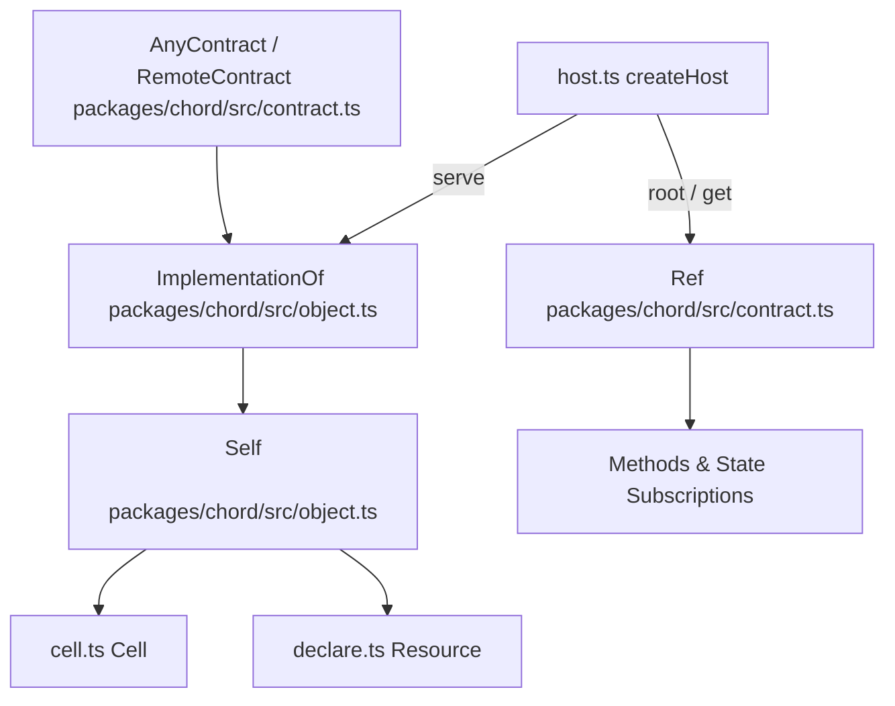
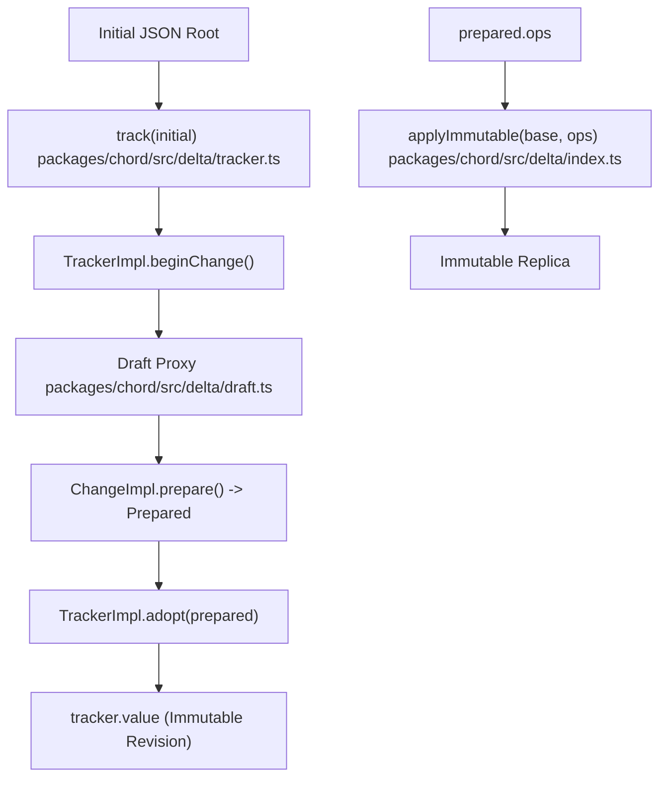

# Chord Replication Runtime (packages/chord)

Relevant source files

The following files were used as context for generating this wiki page:

- [packages/chord/CHANGELOG.md](packages/chord/CHANGELOG.md)
- [packages/chord/README.md](packages/chord/README.md)
- [packages/chord/docs/guide.md](packages/chord/docs/guide.md)
- [packages/chord/docs/spec.md](packages/chord/docs/spec.md)
- [packages/chord/src/cluster.ts](packages/chord/src/cluster.ts)
- [packages/chord/src/connection.ts](packages/chord/src/connection.ts)
- [packages/chord/src/contract.ts](packages/chord/src/contract.ts)
- [packages/chord/src/delta/README.md](packages/chord/src/delta/README.md)
- [packages/chord/src/delta/diff.ts](packages/chord/src/delta/diff.ts)
- [packages/chord/src/delta/index.ts](packages/chord/src/delta/index.ts)
- [packages/chord/src/delta/tracker.ts](packages/chord/src/delta/tracker.ts)
- [packages/chord/src/errors.ts](packages/chord/src/errors.ts)
- [packages/chord/src/host.ts](packages/chord/src/host.ts)
- [packages/chord/src/index.ts](packages/chord/src/index.ts)
- [packages/chord/src/link.ts](packages/chord/src/link.ts)
- [packages/chord/src/manager.ts](packages/chord/src/manager.ts)
- [packages/chord/src/object.ts](packages/chord/src/object.ts)
- [packages/chord/src/reload.ts](packages/chord/src/reload.ts)
- [packages/chord/src/remote.ts](packages/chord/src/remote.ts)
- [packages/chord/src/sqlite/node.ts](packages/chord/src/sqlite/node.ts)
- [packages/chord/src/types.ts](packages/chord/src/types.ts)
- [packages/chord/src/watch.ts](packages/chord/src/watch.ts)
- [packages/chord/src/websocket.ts](packages/chord/src/websocket.ts)
- [packages/chord/src/wire.ts](packages/chord/src/wire.ts)
- [packages/chord/test/cluster.test.ts](packages/chord/test/cluster.test.ts)
- [packages/chord/test/delta-append-text.test.ts](packages/chord/test/delta-append-text.test.ts)
- [packages/chord/test/delta.test.ts](packages/chord/test/delta.test.ts)
- [packages/chord/test/flow.test.ts](packages/chord/test/flow.test.ts)
- [packages/chord/test/generations.test.ts](packages/chord/test/generations.test.ts)
- [packages/chord/test/host.test.ts](packages/chord/test/host.test.ts)
- [packages/chord/test/link.test.ts](packages/chord/test/link.test.ts)
- [packages/chord/test/links-review.test.ts](packages/chord/test/links-review.test.ts)
- [packages/chord/test/manager.test.ts](packages/chord/test/manager.test.ts)
- [packages/chord/test/reload.test.ts](packages/chord/test/reload.test.ts)
- [packages/chord/test/review.test.ts](packages/chord/test/review.test.ts)
- [packages/chord/test/sqlite/node.test.ts](packages/chord/test/sqlite/node.test.ts)
- [packages/chord/test/watch.test.ts](packages/chord/test/watch.test.ts)
- [packages/chord/test/websocket.test.ts](packages/chord/test/websocket.test.ts)
- [packages/durable/src/harness/events.ts](packages/durable/src/harness/events.ts)
- [packages/durable/src/harness/json.ts](packages/durable/src/harness/json.ts)
- [packages/durable/src/harness/live.ts](packages/durable/src/harness/live.ts)
- [packages/durable/src/harness/partial-changes.ts](packages/durable/src/harness/partial-changes.ts)
- [packages/durable/src/harness/task-graph.ts](packages/durable/src/harness/task-graph.ts)
- [packages/durable/src/harness/view.ts](packages/durable/src/harness/view.ts)
- [packages/durable/test/harness-events.test.ts](packages/durable/test/harness-events.test.ts)
- [packages/durable/test/harness-partial-changes.test.ts](packages/durable/test/harness-partial-changes.test.ts)
- [packages/durable/test/session-watches.test.ts](packages/durable/test/session-watches.test.ts)
- [scripts/check-entry-graphs.mjs](scripts/check-entry-graphs.mjs)

## Purpose and Scope

The `@earendil-works/chord` package (`packages/chord`) is a portable, application-neutral runtime designed for building distributed systems out of stateful **objects** that span multiple processes (servers, worker threads, browser tabs) and support live **hot reloading** [packages/chord/README.md:1-5](). 

Chord provides:
- **Contracts and Factories**: Runtime type declarations using TypeBox schemas that define object inputs, variant states, methods, and placement rules [packages/chord/README.md:11]().
- **Object References**: Late-bound handles (`Ref<C>`) that abstract whether an object is local or remote, surviving process restarts and code reloads [packages/chord/README.md:5-7]().
- **Delta Synchronization (`@earendil-works/chord/delta`)**: Transactional JSON revision tracking, immutable structural diffing, and exact operational batches for synchronized replicas [packages/chord/README.md:74-87](), [packages/chord/src/delta/index.ts:7-12]().
- **Watch Handles & Observation (`WatchHandle<T>`, `Watch`)**: Serialized asynchronous observation of immutable and native values with pending op folding [packages/chord/CHANGELOG.md:11-15](), [packages/chord/src/watch.ts:21-72]().
- **Hosts and Links**: Facet management (`createHost`, `defineFacet`) and pluggable transport links (in-memory, IPC, WebSocket) exchanging typed JSON frames (`Frame`) [packages/chord/README.md:11]().
- **Host Manager and Process Locking (`@earendil-works/chord/node`)**: Process lifecycle management via `createHostManager`, `forkDriver`, and kernel-backed `processLock` [packages/chord/README.md:18](), [packages/chord/src/manager.ts:1-123]().
- **Storage and Output**: Portable SQLite interfaces (`@earendil-works/chord/sqlite`) and bounded output streams (`@earendil-works/chord/output`) [packages/chord/README.md:21-25]().

Sources:
- [packages/chord/README.md:1-72]()
- [packages/chord/src/index.ts:1-82]()
- [packages/chord/src/delta/index.ts:7-12]()

---

## Core Concepts: Contracts, Objects, and References

Chord applications define interfaces using runtime contract descriptors created via `remote()` or `local()` [packages/chord/src/contract.ts]().

- **Remote Contracts**: Addressable across hosts. They specify `input` schemas, `host` placement rules, and `variants` containing `state` schemas and `method` definitions [packages/chord/README.md:34-44]().
- **Local Contracts**: Restricted to a single host. Their members can include functions, native objects via `opaque()`, and methods [packages/chord/src/index.ts:17-20]().
- **Factories**: Functions taking `(input, principal, self)` that return an `ImplementationOf<C>` containing state cells and method implementations [packages/chord/README.md:48-57]().
- **References (`Ref<C>`)**: Returned by `ctx.get()` or `host.hold()`, providing typed access to remote or local objects [packages/chord/README.md:60-64]().

### Diagram: Contract and Object Lifecycle Mapping (Code Entity Space)

*Title: Contract and Object Lifecycle Mapping*

Sources:
- [packages/chord/src/contract.ts:1-26]()
- [packages/chord/src/object.ts:70-90]()
- [packages/chord/src/host.ts:31-43]()

---

## State Management and Delta Synchronization (`@earendil-works/chord/delta`)

The standalone delta module (`@earendil-works/chord/delta`) handles immutable JSON revision tracking and operational transformation without depending on the rest of the host runtime [packages/chord/src/delta/index.ts:7-12]().

### Key Entities and Operations
- **`Tracker`**: Maintains the authoritative immutable JSON value (`tracker.value`), opening overlay drafts via `beginChange()`, preparing atomic change revisions (`prepare()`), and swapping pointers via `adopt()` [packages/chord/src/delta/README.md:12-22](), [packages/chord/src/delta/tracker.ts:153-159]().
- **`Op` Tuples**: Exact structural modification operations over plain JSON [packages/chord/src/delta/index.ts:32-40]():
  - `["r", value]`: Replace root [packages/chord/src/delta/index.ts:33]()
  - `["s", path, value]`: Set property [packages/chord/src/delta/index.ts:34]()
  - `["d", path]`: Delete property [packages/chord/src/delta/index.ts:35]()
  - `["a", path, text]`: Append string text [packages/chord/src/delta/index.ts:36]()
  - `["t", path, truncateLen]`: Truncate string [packages/chord/src/delta/index.ts:37]()
  - `["p", path, index, removeCount, items]`: Array splice [packages/chord/src/delta/index.ts:38]()
  - `["m", path, permutation]`: Array reorder [packages/chord/src/delta/index.ts:39-40]()
- **Delta Optimization Utilities**: `ownedSlice(text, start, end)` prevents V8 string slice leakage, and `appendText(draft, key, text)` appends directly to string drafts at $O(\text{text})$ cost [packages/chord/CHANGELOG.md:16-18](), [packages/chord/src/delta/index.ts:118-120]().

### Diagram: Delta Tracker and Immutable Apply Flow (Code Entity Space)

*Title: Delta Tracker and Immutable Apply Flow*

Sources:
- [packages/chord/src/delta/index.ts:32-66]()
- [packages/chord/src/delta/README.md:12-51]()
- [packages/chord/src/delta/tracker.ts:153-159]()

---

## Watch Handles and Asynchronous Observation (`packages/chord`)

Chord provides serialized observation abstractions for both immutable JSON values and arbitrary in-process states [packages/chord/src/watch.ts:1-73]().

- **`WatchHandle<T>`**: Represents a serialized observation of an immutable value where listener calls occur sequentially; concurrent changes fold into the pending queue using `PendingOps` [packages/chord/src/watch.ts:23-34](), [packages/chord/src/delta/pending.ts]().
- **`NativeWatchHandle<T>`**: In-process counterpart delivering each new value in order without operational deltas [packages/chord/CHANGELOG.md:11-15](), [packages/chord/src/watch.ts:63-72]().
- **`WatchLifecycle`**: The underlying shared state machine managing scheduled microtask execution, listener re-entrancy protection, cancellation signals (`observeCancellation`), and resource teardown (`stop()`, `end()`) [packages/chord/src/watch.ts:91-175]().

Sources:
- [packages/chord/CHANGELOG.md:11-18]()
- [packages/chord/src/watch.ts:1-175]()

---

## Hosts, Facets, and Lifetimes

Hosts coordinate object instantiation, method dispatch, and facet loading [packages/chord/src/host.ts]().

### Lifetimes and Serving Options
- **`lifetime: "referenced"`** (default): Objects are created on demand at the first `get` and disposed after the last reference is released plus an optional `linger` duration [packages/chord/CHANGELOG.md:48]()].
- **`lifetime: "host"`**: Exactly one object per type is created when its facet loads and persists until the host closes or unloads [packages/chord/CHANGELOG.md:48]().

Sources:
- [packages/chord/src/host.ts:31-43]()
- [packages/chord/src/object.ts:48-74]()

---

## Wire Protocol, Links, and Remote Execution

Hosts communicate across boundaries using pluggable `Link` implementations (`memoryLinkPair`, `ipcLink`, `webSocketLink`) [packages/chord/src/link.ts:45-55]().

### Wire Frames and Relays
- **`Frame`**: Union of wire messages (`hello`, `hold`, `release`, `call`, `result`, `state`, `error`, `ping`, `pong`) governed by `PROTOCOL_VERSION` (currently version 2) [packages/chord/CHANGELOG.md:47](), [packages/chord/src/wire.ts:1-92]().
- **`RelayRef`**: Manages holds forwarded from an origin link to a downstream link, handling window flow control and delta streams across hops [packages/chord/src/connection.ts:127-156]().

Sources:
- [packages/chord/src/connection.ts:127-156]()
- [packages/chord/src/link.ts:45-55]()
- [packages/chord/src/wire.ts:1-92]()

---

## Host Manager, Process Locking, and Child Execution (`@earendil-works/chord/node`)

The Node-specific submodule (`@earendil-works/chord/node`) handles child process orchestration and exclusive singleton locking [packages/chord/src/manager.ts:1-123]().

- **`forkDriver()`**: Spawns child host processes with IPC channels, environment sanitization, and tree-killing supervision (`killTree`) [packages/chord/src/manager.ts:46-54](), [packages/chord/src/manager.ts:164-172]().
- **`processLock(name)`**: Secures exclusive process execution across managers and OS processes using kernel-enforced abstract sockets (Linux/Android), named pipes (Windows), or scoped lock files in `/tmp` [packages/chord/src/manager.ts:82-123]().

Sources:
- [packages/chord/src/manager.ts:1-144]()

---

## Generations, Hot Reload, and SQLite Persistence

Chord supports zero-downtime hot reloading of facet code while preserving state and active references [packages/chord/src/reload.ts](). 

- **Code Versions (`Ctx.codeVersion`)**: Server-issued integers tracking committed sets of implementations and plugin registrations [packages/chord/CHANGELOG.md:14]().
- **Migration Runner**: `@earendil-works/chord/sqlite` provides portable SQLite database wrappers (`SqliteDatabase`, `SqliteExecutor`) and atomic schema migration runners (`applySqliteMigrations`) with schema-prefix validation [packages/chord/README.md:23-25]().

Sources:
- [packages/chord/CHANGELOG.md:14-25]()
- [packages/chord/src/reload.ts:1-20]()