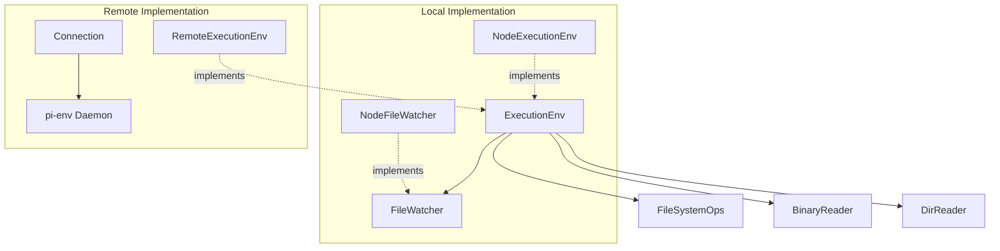
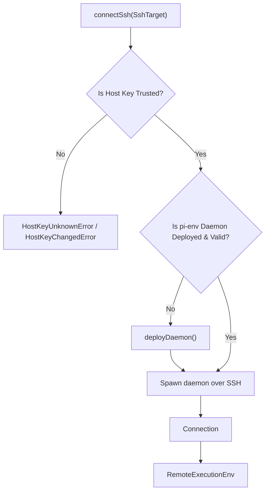

# Execution Environments and Remote Env (packages/env)

Relevant source files

The following files were used as context for generating this wiki page:

- [packages/chord/test/output-skip.test.ts](packages/chord/test/output-skip.test.ts)
- [packages/durable/src/env/index.ts](packages/durable/src/env/index.ts)
- [packages/durable/src/testing/env-conformance.ts](packages/durable/src/testing/env-conformance.ts)
- [packages/durable/src/testing/index.ts](packages/durable/src/testing/index.ts)
- [packages/durable/src/testing/runner.ts](packages/durable/src/testing/runner.ts)
- [packages/durable/src/testing/types.ts](packages/durable/src/testing/types.ts)
- [packages/durable/src/tools/read.ts](packages/durable/src/tools/read.ts)
- [packages/durable/src/truncate.ts](packages/durable/src/truncate.ts)
- [packages/durable/test/env-node-conformance.test.ts](packages/durable/test/env-node-conformance.test.ts)
- [packages/durable/test/env-truncate.test.ts](packages/durable/test/env-truncate.test.ts)
- [packages/durable/test/tools-read-differential.test.ts](packages/durable/test/tools-read-differential.test.ts)
- [packages/env/README.md](packages/env/README.md)
- [packages/env/daemon/Cargo.lock](packages/env/daemon/Cargo.lock)
- [packages/env/daemon/Cargo.toml](packages/env/daemon/Cargo.toml)
- [packages/env/daemon/src/exec.rs](packages/env/daemon/src/exec.rs)
- [packages/env/daemon/src/frame.rs](packages/env/daemon/src/frame.rs)
- [packages/env/daemon/src/fs.rs](packages/env/daemon/src/fs.rs)
- [packages/env/daemon/src/list.rs](packages/env/daemon/src/list.rs)
- [packages/env/daemon/src/main.rs](packages/env/daemon/src/main.rs)
- [packages/env/daemon/src/pty.rs](packages/env/daemon/src/pty.rs)
- [packages/env/daemon/src/sys/mod.rs](packages/env/daemon/src/sys/mod.rs)
- [packages/env/docs/protocol.md](packages/env/docs/protocol.md)
- [packages/env/docs/semantics.md](packages/env/docs/semantics.md)
- [packages/env/src/connection.ts](packages/env/src/connection.ts)
- [packages/env/src/index.ts](packages/env/src/index.ts)
- [packages/env/src/list-files.ts](packages/env/src/list-files.ts)
- [packages/env/src/remote-env.ts](packages/env/src/remote-env.ts)
- [packages/env/src/ssh.ts](packages/env/src/ssh.ts)
- [packages/env/src/terminal.ts](packages/env/src/terminal.ts)
- [packages/env/test/conformance.test.ts](packages/env/test/conformance.test.ts)
- [packages/env/test/old-daemon.ts](packages/env/test/old-daemon.ts)
- [packages/env/test/remote.test.ts](packages/env/test/remote.test.ts)
- [packages/env/test/ssh-external.test.ts](packages/env/test/ssh-external.test.ts)
- [packages/env/test/ssh.test.ts](packages/env/test/ssh.test.ts)
- [packages/env/test/terminal.test.ts](packages/env/test/terminal.test.ts)

This page details the `ExecutionEnv` abstraction, which provides a unified interface for interacting with file systems and executing shell commands. It covers two primary implementations: `NodeExecutionEnv` for local execution and `RemoteExecutionEnv` for remote execution over SSH. The page also describes the Rust-based `pi-env` daemon, its framed stdin/stdout protocol, host-key trust mechanisms, and deployment process. Finally, it explores the conformance and differential tests that ensure consistent behavior across environments.

## ExecutionEnv Abstraction

The `ExecutionEnv` interface defines a portable set of capabilities for interacting with a file system and executing shell commands. This abstraction allows the core agent logic to remain agnostic to whether it is operating locally or remotely.

Key types and error classes include:
*   `Result<TValue, TError>` [packages/durable/src/env/index.ts:4-12](): A type for fallible operations, returning either a value or an error instead of throwing.
*   `FileError` [packages/durable/src/env/index.ts:45-55](): Represents errors encountered during file system operations with specific codes like `"not_found"`, `"permission_denied"`, and `"aborted"`.
*   `ExecutionError` [packages/durable/src/env/index.ts:65-75](): Represents errors encountered during shell command execution (`"timeout"`, `"aborted"`, `"spawn_error"`).
*   `BinaryReader` [packages/durable/src/env/index.ts:96-108]() and `DirReader` [packages/durable/src/env/index.ts:160-168](): Interfaces for streaming reads on files and directories.

The `ExecutionEnv` interface exposes methods for path manipulation, file reads/writes, directory traversal, shell command execution via `exec()`, and file watching via `watch()` [packages/durable/src/env/index.ts:1-180]().

Diagram: Execution Environment Abstraction and Code Entities

Sources:
* [packages/durable/src/env/index.ts:1-180]()

---

## NodeExecutionEnv and Local Implementation

`NodeExecutionEnv` is the local implementation of `ExecutionEnv`, utilizing Node.js built-in modules (`node:fs/promises`, `node:child_process`) for local file system access and process management.

Key characteristics:
*   **Path Resolution**: Resolves paths relative to the environment's configured working directory (`cwd`), handling tilde expansion and file URLs [packages/env/src/connection.ts:46-47]().
*   **Shell Execution**: Spawns local processes via `node:child_process.spawn`, handling stdout/stderr streaming, environment variables, output windowing, and timeouts.
*   **File Watching**: Implemented via polling or native OS events (`fs.watch`), tracking file modifications, creations, and deletions with safeguards against budget overflows [packages/durable/test/env-node-conformance.test.ts:62-90]().

Sources:
* [packages/durable/src/env/index.ts:1-180]()
* [packages/durable/test/env-node-conformance.test.ts:62-90]()
* [packages/env/src/connection.ts:46-47]()

---

## RemoteExecutionEnv and SSH Connection Handling

`RemoteExecutionEnv` provides an `ExecutionEnv` implementation that operates on a remote machine by communicating with a `pi-env` daemon over SSH [packages/env/README.md:3-10]().

Key components:
*   `SshTarget` [packages/env/src/ssh.ts:23-37](): Defines SSH connection properties including host, port, user, identity file, known hosts file, and host key alias.
*   `HostKeyUnknownError` and `HostKeyChangedError` [packages/env/src/ssh.ts:39-43](): Custom errors thrown when host key verification fails or changes unexpectedly.
*   `sshArguments()` [packages/env/src/ssh.ts:77-120](): Assembles a secure set of arguments for the system `ssh` command, disabling agent forwarding, port forwarding, and shared control channels, while enforcing strict host key checking.
*   `connectSsh()` [packages/env/src/ssh.ts:300-340](): Establishes an SSH connection, detects the remote platform, verifies or deploys the `pi-env` daemon, and returns a `Connection` instance.

Diagram: SSH Bootstrap and Connection Lifecycle

Sources:
* [packages/env/src/ssh.ts:23-120]()
* [packages/env/src/connection.ts:181-192]()
* [packages/env/README.md:3-29]()

---

## The Rust pi-env Daemon and Wire Protocol

The `pi-env` daemon is a Rust program that runs on the remote host, receiving framed requests over stdin and writing responses to stdout [packages/env/README.md:6-7]().

*   **Framed Protocol (`docs/protocol.md`)**: Frames consist of a 4-byte big-endian length, a 1-byte type (`REQUEST`, `RESULT`, `ERROR`, `EVENT`, `CANCEL`, `PING`), a 4-byte request ID, a 4-byte JSON length, UTF-8 JSON metadata, and an optional raw binary payload [packages/env/src/connection.ts:4-118]().
*   **Server Dispatching (`packages/env/daemon/src/main.rs`)**: The `Server` struct handles operations such as `hello`, `lstat`, `write`, `writeChunk`, `open`, `pread`, `scanLines`, and `listFiles` [packages/env/daemon/src/main.rs:74-193]().
*   **Liveness and Heartbeats**: Both sides send `ping` frames every 5 seconds. If the daemon experiences 30 seconds of silence, it exits and terminates all spawned process groups [packages/env/docs/protocol.md:62-67]().

Sources:
* [packages/env/src/connection.ts:4-118]()
* [packages/env/daemon/src/main.rs:74-193]()
* [packages/env/docs/protocol.md:1-114]()

---

## Documentation, Conformance, and Differential Testing

To ensure correctness across implementations, the codebase provides comprehensive documentation and testing suites:
*   `docs/protocol.md`: Specifies the exact framing, message types, and serialization rules of the wire protocol [packages/env/docs/protocol.md:1-114]().
*   `docs/semantics.md`: Defines error codes, atomic guarantees, and lifecycle expectations for operations.
*   `createEnvConformance()` [packages/durable/src/testing/env-conformance.ts:114-140](): A test factory that runs a comprehensive battery of assertions against any `ExecutionEnv` implementation, covering binary readers, line scanners, file mutations, processes, and watchers.
*   **Differential Tests**: Validates that `RemoteExecutionEnv` mirrors `NodeExecutionEnv` behavior identically under matching conditions [packages/env/README.md:63-66]().

Sources:
* [packages/durable/src/testing/env-conformance.ts:114-140]()
* [packages/env/docs/protocol.md:1-114]()
* [packages/env/README.md:61-66]()