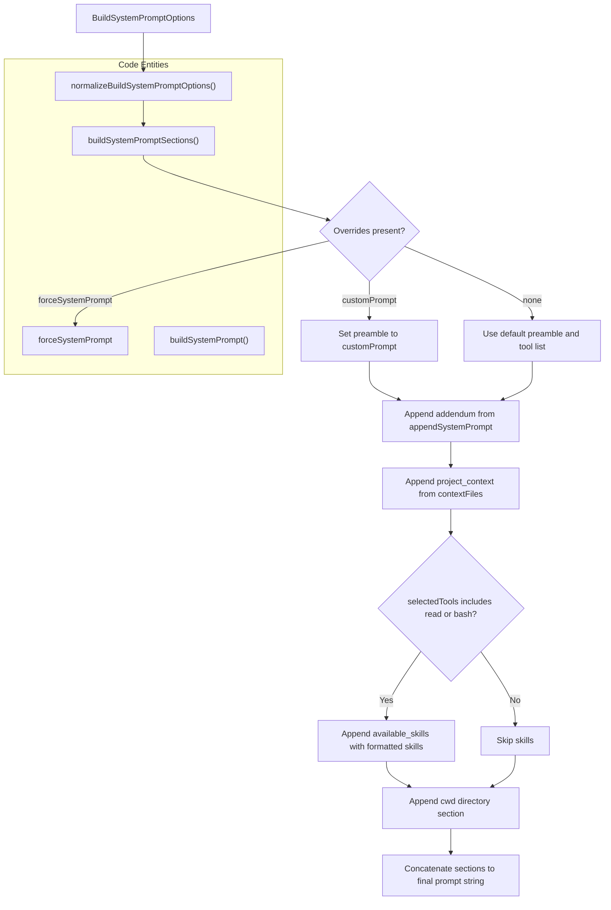
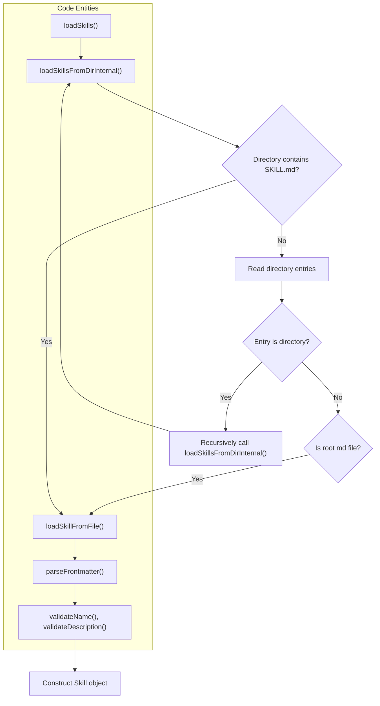
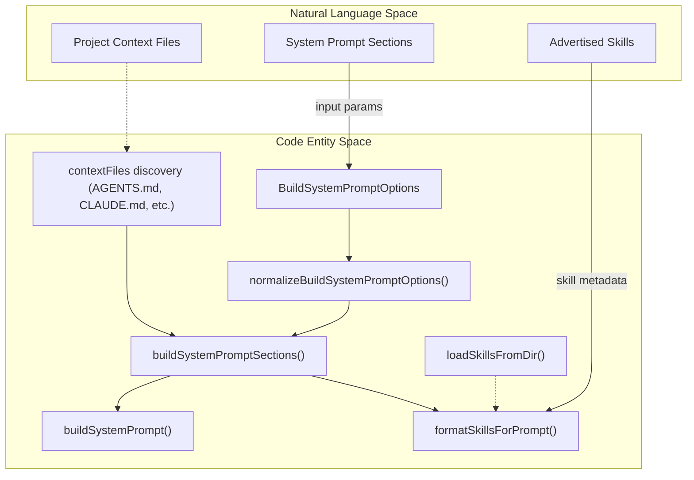

# System Prompt, Skills, and Context Discovery

<details>
<summary>Relevant source files</summary>

The following files were used as context for generating this wiki page:

- [packages/coding-agent/docs/skills.md](packages/coding-agent/docs/skills.md)
- [packages/coding-agent/examples/extensions/dynamic-tools.ts](packages/coding-agent/examples/extensions/dynamic-tools.ts)
- [packages/coding-agent/src/core/skills.ts](packages/coding-agent/src/core/skills.ts)
- [packages/coding-agent/src/core/system-prompt.ts](packages/coding-agent/src/core/system-prompt.ts)
- [packages/coding-agent/test/agent-session-dynamic-tools.test.ts](packages/coding-agent/test/agent-session-dynamic-tools.test.ts)
- [packages/coding-agent/test/fixtures/skills/root-skill-preferred/SKILL.md](packages/coding-agent/test/fixtures/skills/root-skill-preferred/SKILL.md)
- [packages/coding-agent/test/fixtures/skills/root-skill-preferred/nested-child/SKILL.md](packages/coding-agent/test/fixtures/skills/root-skill-preferred/nested-child/SKILL.md)
- [packages/coding-agent/test/sdk-session-manager.test.ts](packages/coding-agent/test/sdk-session-manager.test.ts)
- [packages/coding-agent/test/skills.test.ts](packages/coding-agent/test/skills.test.ts)
- [packages/coding-agent/test/system-prompt.test.ts](packages/coding-agent/test/system-prompt.test.ts)

</details>


This page details the system prompt construction (`system-prompt.ts`), the on-demand discovery and integration of Skills adhering to the Agent Skills standard (`skills.ts`), and project context loading including `AGENTS.md`/`CLAUDE.md` auto-discovery and `SYSTEM.md`/`APPEND_SYSTEM.md` overrides.

---

## System Prompt Composition

The system prompt defines the AI assistant's behavior and is dynamically assembled by `buildSystemPromptSections` and `buildSystemPrompt` in `packages/coding-agent/src/core/system-prompt.ts` [packages/coding-agent/src/core/system-prompt.ts:1-165](). It consolidates tool descriptions, usage guidelines, project-specific context files, and Skills into ordered XML-tagged sections for stable replacement and fine-grained context updates.

### Key Interfaces and Functions

- `BuildSystemPromptOptions` [packages/coding-agent/src/core/system-prompt.ts:9-37]() defines the inputs controlling prompt construction including:
  - `customPrompt` (full preamble replacement).
  - `forceSystemPrompt` (exact prompt override).
  - `selectedTools` (tools made available, default `["read", "bash", "edit", "write"]`).
  - `hiddenTools` (tools whose declarations are omitted from the prompt, even if selected) [packages/coding-agent/src/core/system-prompt.ts:17-20]().
  - `toolSnippets` and `toolGuidelines` (tool descriptions and behavioral rules).
  - `promptGuidelines` (additional custom rules).
  - `appendSystemPrompt` (free text appended before context).
  - `sections` (extra named XML sections).
  - `cwd` (working directory).
  - `contextFiles` (project context documents).
  - `skills` (loaded skills metadata).

- `normalizeBuildSystemPromptOptions(input)` [packages/coding-agent/src/core/system-prompt.ts:60-76]() normalizes and defaults options for consistent downstream use.

- `buildRules(selectedTools, toolGuidelines, promptGuidelines)` builds a deduplicated list of guideline bullets reflecting selected tools and user rules [packages/coding-agent/src/core/system-prompt.ts:88-124]().

- `buildSystemPromptSections(input)` [packages/coding-agent/src/core/system-prompt.ts:127-165]() composes a `Record<string, string>` of named prompt sections wrapped in XML tags for replaceable slots.

### System Prompt Structure

By default (without `customPrompt` or `forceSystemPrompt`), sections include:

- `<preamble>`: General assistant intro and overall instructions.
- `<tools>`: Available tools with brief snippets.
- `<rules>`: Behavior rules deduced from selected tools plus default and custom guidelines.
- `<docs>`: Pi documentation references with absolute paths.
- `<addendum>`: User-provided appended instructions (`appendSystemPrompt`).
- `<project_context>`: Instruction blocks parsed from project files.
- `<available_skills>`: Skills metadata if `read` or `bash` are selected.
- `<cwd>`: Current working directory path.

---

### System Prompt Data Flow



*Diagram: System Prompt Assembly Flow and Code Entities*

Sources:
- [packages/coding-agent/src/core/system-prompt.ts:9-37]()
- [packages/coding-agent/src/core/system-prompt.ts:60-76]()
- [packages/coding-agent/src/core/system-prompt.ts:88-124]()
- [packages/coding-agent/src/core/system-prompt.ts:127-165]()
- [packages/coding-agent/test/system-prompt.test.ts:55-57]()

---

## Skills

Skills are modular capability packages containing instructions and resources to support specialized workflows. They enable Pi to extend its behavior without executable plugins, based on the [Agent Skills specification](https://agentskills.io/specification) [packages/coding-agent/docs/skills.md:3-7]().

### Skill Structure

A skill is a directory containing a `SKILL.md` file with YAML frontmatter and Markdown instructions:

```text
pdf-tools/
├── SKILL.md
├── scripts/
│   └── extract.sh
├── references/
│   └── formats.md
└── assets/
    └── template.json
```

The frontmatter must specify:
- `name` (unique, lowercase letters/numbers/hyphens, max 64 chars).
- `description` (routing hint, max 1024 chars).
- Optional `disable-model-invocation` boolean to hide automatic model loading [packages/coding-agent/docs/skills.md:11-42](), [packages/coding-agent/src/core/skills.ts:67-81]().

### Skill Discovery and Loading

Skills are discovered recursively from configured directories using `loadSkillsFromDir` and related functions [packages/coding-agent/src/core/skills.ts:168-241](). The discovery rules are:

- If a skill directory contains `SKILL.md`, it is treated as a root skill; recursion does not descend further inside it [packages/coding-agent/src/core/skills.ts:195-220]().
- Otherwise, recursive traversal continues for subdirectories [packages/coding-agent/src/core/skills.ts:223-241]().
- Direct `.md` files in root directories are loaded but not recursively scanned.
- Files or directories matching `.gitignore`, `.ignore`, `.fdignore` patterns are excluded [packages/coding-agent/src/core/skills.ts:47-65](), [packages/coding-agent/src/core/skills.ts:210-212]().

Skill YAML frontmatter is parsed and validated for:
- Name character set and length constraints [packages/coding-agent/src/core/skills.ts:92-112]().
- Description presence and length constraints [packages/coding-agent/src/core/skills.ts:117-127]().

### Skill Loading Flow



*Diagram: Skill Discovery and Loading Pipeline*

Sources:
- [packages/coding-agent/docs/skills.md:3-7]()
- [packages/coding-agent/docs/skills.md:11-42]()
- [packages/coding-agent/src/core/skills.ts:47-65]()
- [packages/coding-agent/src/core/skills.ts:67-81]()
- [packages/coding-agent/src/core/skills.ts:92-112]()
- [packages/coding-agent/src/core/skills.ts:117-127]()
- [packages/coding-agent/src/core/skills.ts:168-241]()
- [packages/coding-agent/src/core/skills.ts:195-220]()
- [packages/coding-agent/src/core/skills.ts:210-212]()
- [packages/coding-agent/src/core/skills.ts:223-241]()
- [packages/coding-agent/test/skills.test.ts:30-194]()

---

### Skill Integration into System Prompt

Loaded skills are advertised to the model in the system prompt only when tools capable of loading them (`read` or `bash`) are active. Formatting is done via `formatSkillsForPrompt(skills: Skill[])` [packages/coding-agent/src/core/system-prompt.ts:7]().

Skills appear in the `<available_skills>` prompt section as XML blocks indicating name and description. The model can then dynamically load full skill instructions via commands like `/skill:<name>` [packages/coding-agent/docs/skills.md:41-45]().

Sources:
- [packages/coding-agent/src/core/system-prompt.ts:7]()
- [packages/coding-agent/docs/skills.md:41-45]()
- [packages/coding-agent/test/system-prompt.test.ts:183-195]()

---

## Context Discovery and Overrides

Project-specific instruction files supplement the system prompt to tailor agent behavior per repository or project.

### AGENTS.md / CLAUDE.md Auto-Discovery

The agent automatically traverses parent directories from the current working directory (`cwd`) upwards to repository root or filesystem root, searching for recognized context files:
- Typical files: `AGENTS.md`, `CLAUDE.md`, `AGENTS.override.md`, etc.
- These documents' contents are embedded into `<project_context>` / `<project_instructions>` XML tags in the prompt [packages/coding-agent/src/core/system-prompt.ts:79-85]().

### SYSTEM.md and APPEND_SYSTEM.md Overrides

- The system prompt can be fully replaced by setting `customPrompt` or `forceSystemPrompt` in `BuildSystemPromptOptions`, e.g., by extension lifecycle hooks (`before_agent_start`) [packages/coding-agent/src/core/system-prompt.ts:11](), [packages/coding-agent/src/core/system-prompt.ts:14]().
- `appendSystemPrompt` is a text snippet appended after default rules but before project context and skills [packages/coding-agent/src/core/system-prompt.ts:28]().

Sources:
- [packages/coding-agent/src/core/system-prompt.ts:11]()
- [packages/coding-agent/src/core/system-prompt.ts:14]()
- [packages/coding-agent/src/core/system-prompt.ts:28]()
- [packages/coding-agent/src/core/system-prompt.ts:79-85]()
- [packages/coding-agent/test/system-prompt.test.ts:60-74]()

---

## Summary Diagram: Bridging Natural Language System Components to Code Entities



*Diagram: Logical connection of system prompt, skill loading, and project context discovery*

---

### Sources

- [packages/coding-agent/src/core/system-prompt.ts:1-165]()
- [packages/coding-agent/src/core/system-prompt.ts:7]()
- [packages/coding-agent/src/core/system-prompt.ts:9-37]()
- [packages/coding-agent/src/core/system-prompt.ts:60-76]()
- [packages/coding-agent/src/core/system-prompt.ts:79-85]()
- [packages/coding-agent/src/core/system-prompt.ts:88-124]()
- [packages/coding-agent/src/core/system-prompt.ts:127-165]()
- [packages/coding-agent/src/core/skills.ts:1-241]()
- [packages/coding-agent/src/core/skills.ts:47-65]()
- [packages/coding-agent/src/core/skills.ts:67-81]()
- [packages/coding-agent/src/core/skills.ts:92-112]()
- [packages/coding-agent/src/core/skills.ts:117-127]()
- [packages/coding-agent/src/core/skills.ts:167-241]()
- [packages/coding-agent/src/core/skills.ts:195-220]()
- [packages/coding-agent/src/core/skills.ts:210-212]()
- [packages/coding-agent/src/core/skills.ts:223-241]()
- [packages/coding-agent/docs/skills.md:1-93]()
- [packages/coding-agent/docs/skills.md:3-7]()
- [packages/coding-agent/docs/skills.md:11-42]()
- [packages/coding-agent/docs/skills.md:41-45]()
- [packages/coding-agent/test/system-prompt.test.ts:1-210]()
- [packages/coding-agent/test/system-prompt.test.ts:55-57]()
- [packages/coding-agent/test/system-prompt.test.ts:60-74]()
- [packages/coding-agent/test/system-prompt.test.ts:183-195]()
- [packages/coding-agent/test/skills.test.ts:1-194]()
- [packages/coding-agent/test/skills.test.ts:30-194]()