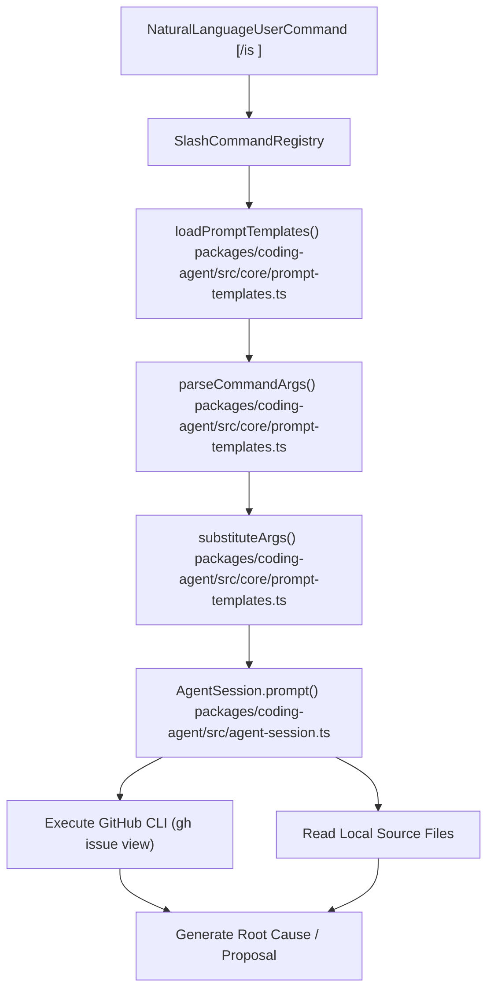
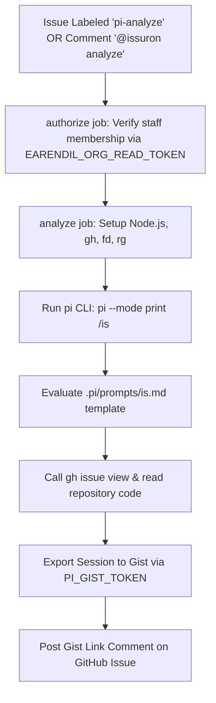

# Project-Local .pi Directory and Dogfooding Setup

<details>
<summary>Relevant source files</summary>

The following files were used as context for generating this wiki page:

- [.github/workflows/issue-analysis.yml](.github/workflows/issue-analysis.yml)
- [.github/workflows/nix.yml](.github/workflows/nix.yml)
- [.pi/extensions/import-repro.ts](.pi/extensions/import-repro.ts)
- [.pi/prompts/is.md](.pi/prompts/is.md)
- [.pi/prompts/pr.md](.pi/prompts/pr.md)
- [.pi/prompts/wr.md](.pi/prompts/wr.md)
- [.pi/skills/add-llm-provider.md](.pi/skills/add-llm-provider.md)
- [.pi/skills/release.md](.pi/skills/release.md)
- [flake.lock](flake.lock)
- [flake.nix](flake.nix)
- [nix/model-catalog.json](nix/model-catalog.json)
- [nix/package.nix](nix/package.nix)
- [packages/ai/scripts/hydrate-model-catalog.ts](packages/ai/scripts/hydrate-model-catalog.ts)
- [packages/coding-agent/docs/environment-variables.md](packages/coding-agent/docs/environment-variables.md)
- [packages/coding-agent/docs/prompt-templates.md](packages/coding-agent/docs/prompt-templates.md)
- [packages/coding-agent/docs/slash-commands.md](packages/coding-agent/docs/slash-commands.md)
- [packages/coding-agent/src/core/prompt-templates.ts](packages/coding-agent/src/core/prompt-templates.ts)
- [packages/coding-agent/src/utils/clipboard-image.ts](packages/coding-agent/src/utils/clipboard-image.ts)
- [packages/coding-agent/src/utils/clipboard.ts](packages/coding-agent/src/utils/clipboard.ts)
- [packages/coding-agent/test/clipboard-image-bmp-conversion.test.ts](packages/coding-agent/test/clipboard-image-bmp-conversion.test.ts)
- [packages/coding-agent/test/clipboard-image.test.ts](packages/coding-agent/test/clipboard-image.test.ts)
- [packages/coding-agent/test/clipboard.test.ts](packages/coding-agent/test/clipboard.test.ts)
- [packages/coding-agent/test/prompt-templates.test.ts](packages/coding-agent/test/prompt-templates.test.ts)
- [scripts/release.mjs](scripts/release.mjs)
- [scripts/update-model-catalog-pin.mjs](scripts/update-model-catalog-pin.mjs)
- [scripts/update-model-catalog-pin.test.mjs](scripts/update-model-catalog-pin.test.mjs)

</details>


This page details the structure and technical implementation of the `.pi/` directory within the `pi` repository. It covers project-local prompt templates (`is.md`, `pr.md`, `wr.md`), local extensions (`import-repro.ts`), skills (`release.md`, `add-llm-provider.md`), git/npm configurations, and how maintainers utilize `pi` on `pi` for development, automated issue triage, and reproduction workflows.

## Project-Local `.pi/` Directory Structure

The `.pi/` directory located at the root of the `pi` repository serves as a project-specific configuration and resource hub for the `pi` agent. It provides prompt templates, extensions, and skills tailored specifically to the development, testing, and maintenance of the codebase.

The directory layout is structured as follows:

```
.pi/
├── prompts/
│   ├── is.md
│   ├── pr.md
│   └── wr.md
├── extensions/
│   └── import-repro.ts
└── skills/
    ├── release.md
    └── add-llm-provider.md
```

The `.pi/prompts/` directory contains Markdown templates parsed by `loadPromptTemplates()` [packages/coding-agent/src/core/prompt-templates.ts:164-203](), `.pi/extensions/` contains custom TypeScript extension files loaded by the extension runtime, and `.pi/skills/` contains domain-specific agent skills.

Sources: [packages/coding-agent/docs/prompt-templates.md:1-59](), [/.pi/prompts/is.md:1-28](), [/.pi/prompts/pr.md:1-37](), [/.pi/prompts/wr.md:1-41](), [/.pi/skills/release.md:1-52](), [/.pi/extensions/import-repro.ts:1-189]()

---

### Prompt Templates and Argument Substitution

Prompt templates from project-local and global configuration directories are discovered and loaded by `loadPromptTemplates()` in `packages/coding-agent/src/core/prompt-templates.ts` [packages/coding-agent/src/core/prompt-templates.ts:216-222](). Each template is a Markdown file containing YAML frontmatter (`description`, `argument-hint`) parsed via `parseFrontmatter()` [packages/coding-agent/src/core/prompt-templates.ts:124-132]().

Command arguments passed via slash commands are parsed into argument arrays using `parseCommandArgs()`, which handles bash-style quoted strings and escape handling [packages/coding-agent/src/core/prompt-templates.ts:25-61](). Substitution of placeholders (`$1`, `$2`, `$@`, `$ARGUMENTS`, and default/slice patterns) is executed by `substituteArgs()` without performing recursive evaluation on argument values [packages/coding-agent/src/core/prompt-templates.ts:76-108]().

#### `is.md` - Issue Analysis Template

The `is.md` prompt template coordinates GitHub issue analysis:
- Conditionally adds the `inprogress` label and assigns the issue via GitHub CLI (`gh`), skipping assignment under CI environments (`CI=true`) [/.pi/prompts/is.md:9-9]().
- Reads full issue contents, comments, and references via `gh issue view` [/.pi/prompts/is.md:11-14]().
- Enforces independent code verification rather than trusting issue-provided root-cause analysis [/.pi/prompts/is.md:16-17]().
- Implements specialized flows for bugs (tracing execution paths and proposing fixes) versus feature requests (verifying proposals and listing affected files) [/.pi/prompts/is.md:19-27]().
- Restricts execution to analysis and proposal generation without direct implementation [/.pi/prompts/is.md:28-28]().

#### `pr.md` - Pull Request Review Template

The `pr.md` template automates structured pull request reviews:
- Adds the `inprogress` label to the PR via `gh` [/.pi/prompts/pr.md:8-8]().
- Inspects PR descriptions, comments, commits, and diffs using `gh pr diff` and related git references without switching branches [/.pi/prompts/pr.md:9-12]().
- Reads linked issues in full [/.pi/prompts/pr.md:13-13]().
- Enforces contribution guidelines (e.g., omitting changelog modifications on contributor PRs) [/.pi/prompts/pr.md:15-16]().
- Emits a structured review containing sections for intent, merits, problems, risks, test coverage, and open questions [/.pi/prompts/pr.md:14-35]().

#### `wr.md` - Wrap Up Template

The `wr.md` prompt handles end-to-end task completion:
- Updates package changelogs under `## [Unreleased]` [/.pi/prompts/wr.md:18-18]().
- Drafts, previews, and posts a single final AI attribution comment on linked GitHub issues/PRs [/.pi/prompts/wr.md:19-23]().
- Commits modified files selectively and pushes current branches with validation against the `main` branch [/.pi/prompts/wr.md:24-27]().
- Closes resolved GitHub issues with status `completed` using `gh issue close` [/.pi/prompts/wr.md:28-33]().

Sources: [packages/coding-agent/src/core/prompt-templates.ts:1-222](), [/.pi/prompts/is.md:1-28](), [/.pi/prompts/pr.md:1-37](), [/.pi/prompts/wr.md:1-41]()

---

### Prompt Template Loading and Invocation Pipeline

Title: "PromptTemplateLoadingAndInvocationPipeline"


Sources: [packages/coding-agent/src/core/prompt-templates.ts:1-222](), [/.pi/prompts/is.md:1-28](), [/.pi/prompts/pr.md:1-37](), [/.pi/prompts/wr.md:1-41]()

---

### Local Extensions: `import-repro.ts`

Extensions placed in `.pi/extensions/` extend session capabilities via the `ExtensionAPI` interface. The repository includes a critical local extension:

#### `import-repro.ts` - Reproduction Importer (`/ir`)

The `import-repro.ts` extension implements the `/ir` command, enabling maintainers to load sessions exported as GitHub Gists, `pi.dev` share URLs, or JSONL files into their local interactive environment [/.pi/extensions/import-repro.ts:1-189]().

Key technical mechanisms:
- **Reference Parsing**: Identifies Gist IDs, Gist URLs, `pi.dev` share URLs, issue URLs, and `.jsonl`/`.html` files via regex matchers [/.pi/extensions/import-repro.ts:25-88]().
- **Decoding**: Parses raw JSONL session streams [/.pi/extensions/import-repro.ts:90-104]() or extracts and decodes base64-encoded session script blocks from exported HTML files [/.pi/extensions/import-repro.ts:106-128]().
- **CWD Normalization**: Rewrites recorded working directory paths (`cwd`) from ephemeral CI container checkouts or research VMs to match the local developer repository checkout [/.pi/extensions/import-repro.ts:164-180]().
- **Session Installation**: Installs the session into the active session directory and switches the active runtime state for continued debugging [/.pi/extensions/import-repro.ts:1-189]().

Sources: [/.pi/extensions/import-repro.ts:1-189](), [/.github/workflows/issue-analysis.yml:43-46]()

---

### Dogfooding Setup and Automated Issue Triage

Maintainers dogfood `pi` directly on the `pi` monorepo using integrated automation and local development tools.

#### Automated Issue Analysis Workflow

The GitHub Actions workflow `.github/workflows/issue-analysis.yml` automates issue triage using `pi` itself:
- **Triggers**: Activated when the `pi-analyze` label is applied to an issue, or when a staff member comments `@issuron analyze` with optional runner tags (`#run-on-linux`, `#run-on-windows`, `#run-on-mac`) [/.github/workflows/issue-analysis.yml:1-54]().
- **Authorization**: Verifies that the triggering user is an active member of `earendil-works/staff` [/.github/workflows/issue-analysis.yml:74-79]().
- **Execution**: Checks out the repository, installs dependencies, and runs the `pi` CLI in print mode executing the issue analysis template: `pi --mode print /is <issue-url>` [/.github/workflows/issue-analysis.yml:1-158]().
- **Persistence & Feedback**: Uploads the resulting session as a private Gist using `PI_GIST_TOKEN` and posts a comment on the GitHub issue linking to the analysis session [/.github/workflows/issue-analysis.yml:20-22]() [/.github/workflows/issue-analysis.yml:405-405]().

#### Issue Analysis Workflow Architecture

Title: "IssueAnalysisWorkflowArchitecture"


Sources: [/.github/workflows/issue-analysis.yml:1-158](), [/.pi/prompts/is.md:1-28]()

---

### Manual Dogfooding and Release Workflows

Maintainers interactively apply `pi` to the monorepo during development:
- **Interactive Triage and Review**: Using slash commands `/is`, `/pr`, and `/wr` directly in terminal sessions against active repository PRs and issues.
- **Session Reproduction**: Importing CI diagnostic sessions locally using `/ir <gist-id>` [/.pi/extensions/import-repro.ts:10-18]().
- **Release Automation**: Executing release scripts such as `node scripts/release.mjs` which validates workspace packages, pins model catalogs in `nix/model-catalog.json`, performs offline builds, and updates changelogs [scripts/release.mjs:1-129]().

Sources: [scripts/release.mjs:1-129](), [/.pi/extensions/import-repro.ts:1-189](), [/.pi/prompts/is.md:1-28](), [/.pi/prompts/wr.md:1-41]()