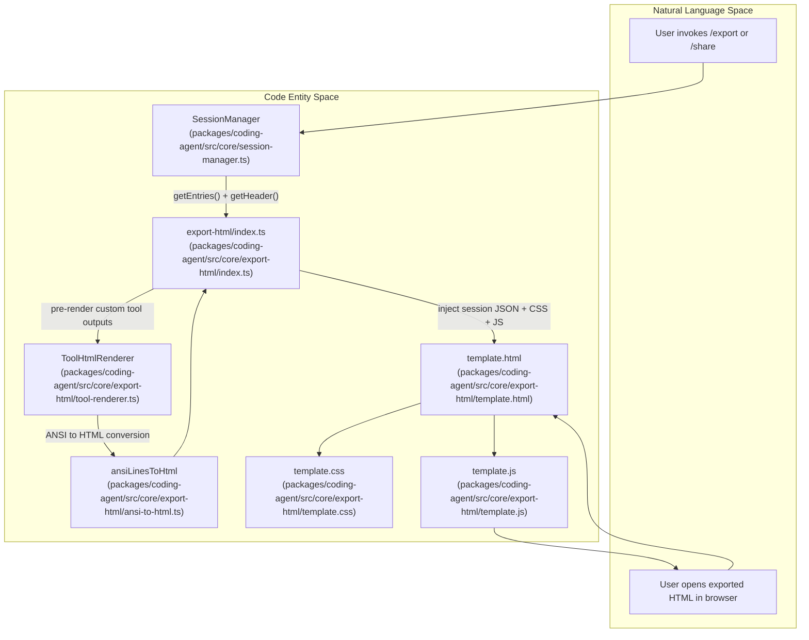
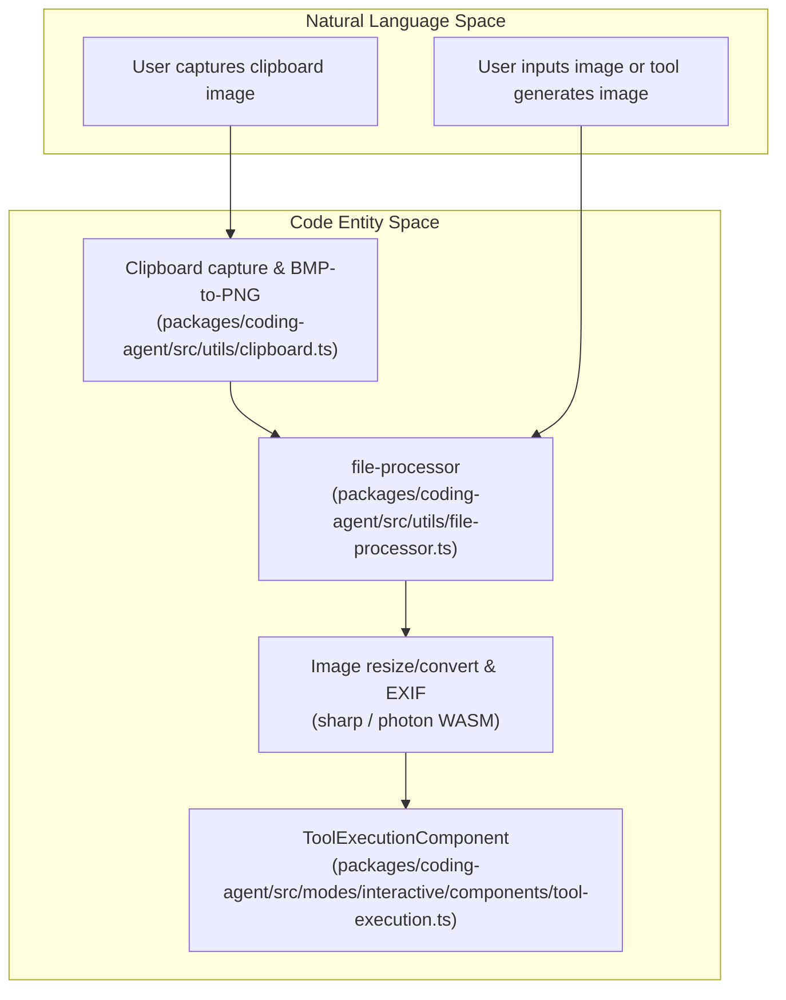

# Session Export, HTML Regulations, and Media

Relevant source files

The following files were used as context for generating this wiki page:

- [packages/coding-agent/src/core/export-html/index.ts](packages/coding-agent/src/core/export-html/index.ts)
- [packages/coding-agent/src/core/export-html/template.css](packages/coding-agent/src/core/export-html/template.css)
- [packages/coding-agent/src/core/export-html/template.html](packages/coding-agent/src/core/export-html/template.html)
- [packages/coding-agent/src/core/export-html/template.js](packages/coding-agent/src/core/export-html/template.js)
- [packages/coding-agent/src/core/export-html/vendor/marked-cjk-friendly.min.js](packages/coding-agent/src/core/export-html/vendor/marked-cjk-friendly.min.js)
- [packages/coding-agent/src/core/export-html/vendor/marked.min.js](packages/coding-agent/src/core/export-html/vendor/marked.min.js)
- [packages/coding-agent/test/export-html-cjk.test.ts](packages/coding-agent/test/export-html-cjk.test.ts)
- [packages/coding-agent/test/export-html-deep-tree.test.ts](packages/coding-agent/test/export-html-deep-tree.test.ts)
- [packages/coding-agent/test/export-html-skill-block.test.ts](packages/coding-agent/test/export-html-skill-block.test.ts)
- [packages/coding-agent/test/export-html-system-messages.test.ts](packages/coding-agent/test/export-html-system-messages.test.ts)
- [packages/coding-agent/test/export-html-whitespace.test.ts](packages/coding-agent/test/export-html-whitespace.test.ts)
- [packages/coding-agent/test/export-html-xss.test.ts](packages/coding-agent/test/export-html-xss.test.ts)

This page provides a high-level overview of the session export and sharing system, the architecture of the HTML export subsystem, and how image and clipboard media are handled within the `pi` codebase. The system lets users export agent sessions into an interactive, completely self-contained HTML file suitable for local storage or easy sharing.

The main user-facing features supported are the `/export` and `/share` slash commands. The `/export` command produces a static HTML file embedding the entire session data and rendering logic, while `/share` builds on this by uploading the export to GitHub Gist, enabling convenient web-based sharing.

This overview introduces key concepts and how the components relate to each other; detailed implementation details are covered in child pages:
- [Export HTML Architecture](#9.1) — Deep dive into the export-html module’s template rendering, tool output rendering, ANSI-to-HTML conversion, syntax highlighting, XSS sanitization, whitespace handling, and skill-block rendering.
- [Image Processing and Clipboard](#9.2) — Detailed explanation of image processing utilities, EXIF orientation handling, clipboard capture integration, BMP-to-PNG conversion, and embedding images in tool results.

---

## High-Level Flow: Session Export Pipeline

The export and share features start when a user executes the `/export` or `/share` slash command within the interactive TUI. The process proceeds as follows:

1. **Session Data Retrieval:** The session manager collects all relevant session data—conversation entries, metadata (session header), tool call information, and optionally rendered HTML snippets of tool outputs.
2. **HTML Generation:** The export-html subsystem serializes this session snapshot into a Base64-encoded JSON blob. It loads static template files—an HTML shell (`template.html`), CSS styles (`template.css`), and client-side JavaScript (`template.js`)—and injects the session data plus theme-dependent CSS variables into them.
3. **Tool Output Rendering:** For custom tools defined via extensions, tool output is pre-rendered before export using the `ToolHtmlRenderer`, which invokes TUI renderers to produce ANSI-formatted output, then converts it to sanitized HTML. Standard tool outputs (e.g. `bash`, `read`) are rendered dynamically in the browser via `template.js`.
4. **Resulting HTML:** The system produces a single, fully self-contained HTML file with all CSS, JS, and session data embedded inline.
5. **Local Save or Upload:** For `/export`, this file is saved locally. For `/share`, the file is uploaded as a gist to GitHub, and the resulting URL is reported back to the user.

Once opened, the exported HTML renders the entire session interactively in any modern browser, allowing search, tree navigation, filtering, message rendering with markdown and syntax highlighting, and expandable tool outputs.

### Code Entity Mapping for Export Flow

**Summary:**
- `SessionManager` gathers session data for export.
- `export-html/index.ts` orchestrates the export, injecting statically loaded template files and serialized data.
- `ToolHtmlRenderer` pre-renders complex tool outputs using their TUI renderers, converting ANSI output to HTML.
- ANSI terminal codes are converted to inline styled HTML with `ansiLinesToHtml`.
- The final standalone HTML file leverages the embedded `template.js` for client-side rendering and interactivity.

Sources:
[packages/coding-agent/src/core/export-html/index.ts:1-176](),
[packages/coding-agent/src/core/export-html/tool-renderer.ts:1-172](),
[packages/coding-agent/src/core/export-html/template.html:1-55](),
[packages/coding-agent/src/core/export-html/template.css:1-298](),
[packages/coding-agent/src/core/export-html/template.js:1-189]()

---

## HTML Export Subsystem

The `export-html` module in `packages/coding-agent/src/core/export-html` implements the core export functionality. It utilizes three main template files to produce the final HTML:

- **`template.html`**: The HTML scaffold of the exported page, containing the main DOM structure and placeholders for CSS, JS, and session data. [packages/coding-agent/src/core/export-html/template.html:1-55]()
- **`template.css`**: Style definitions with CSS custom properties dynamically set from the current TUI theme to maintain visual consistency. [packages/coding-agent/src/core/export-html/template.css:1-298]()
- **`template.js`**: Client-side JavaScript responsible for parsing session data, building the conversation tree sidebar, handling filtering and searching, rendering messages with markdown and syntax highlighting, and supporting navigation and expansion interaction. [packages/coding-agent/src/core/export-html/template.js:1-189]()

The function `generateHtml(sessionData, themeName)` in `export-html/index.ts` reads these template files, injects theme-derived CSS variables, encodes the full session snapshot as Base64 JSON, and inserts all assets inline to produce a fully self-contained HTML document. [packages/coding-agent/src/core/export-html/index.ts:143-175]()

For details on the template rendering pipeline, template architecture, and deep-dive technical specifications, see [Export HTML Architecture](#9.1).

Sources:
[packages/coding-agent/src/core/export-html/index.ts:108-175](),
[packages/coding-agent/src/core/export-html/template.html:1-55](),
[packages/coding-agent/src/core/export-html/template.css:1-298](),
[packages/coding-agent/src/core/export-html/template.js:1-189]()

---

## Tool Output Rendering in Export

A critical challenge in session export is faithfully rendering the output of various tools, some of which produce highly formatted or interactive results.

The solution is twofold:
- **Standard Tools** such as `bash`, `read`, `edit`, and `ls` have their output rendered dynamically by JavaScript in the exported HTML file at runtime.
- **Custom Tools**, typically defined by extensions, are pre-rendered during export using the `ToolHtmlRenderer` abstraction (defined in `tool-renderer.ts`). [packages/coding-agent/src/core/export-html/tool-renderer.ts:1-172]() This module looks up tool definitions, invokes their TUI rendering functions, and converts ANSI output to HTML.

For details on tool-renderer implementation, ANSI conversion, and whitespace handling, see [Export HTML Architecture](#9.1).

Sources:
[packages/coding-agent/src/core/export-html/tool-renderer.ts:1-172](),
[packages/coding-agent/src/core/export-html/index.ts:130-138](),
[packages/coding-agent/test/export-html-whitespace.test.ts:9-42]()

---

## Security and XSS Mitigations in HTML Export

Because session content includes untrusted user input, tool outputs, model-generated texts, and potentially embedded URLs, preventing Cross-Site Scripting (XSS) vulnerabilities in the exported HTML is paramount.

The export subsystem employs multiple robust sanitization layers:
- Overriding built-in markdown parser link and image renderers to enforce a strict scheme allow-list (`http`, `https`, `mailto`, `tel`, `ftp`). [packages/coding-agent/test/export-html-xss.test.ts:7-17]()
- Escaping attributes like `href`, `src`, and `mimeType`. [packages/coding-agent/test/export-html-xss.test.ts:23-38]()
- Escaping all dynamic fields injected via `innerHTML`. [packages/coding-agent/test/export-html-xss.test.ts:40-65]()
- Stripping internal skill block wrapper XML and rendering them as structured blocks. [packages/coding-agent/test/export-html-skill-block.test.ts:7-39]()

For complete details on XSS mitigations and test coverage, see [Export HTML Architecture](#9.1).

Sources:
[packages/coding-agent/test/export-html-xss.test.ts:4-67](),
[packages/coding-agent/test/export-html-skill-block.test.ts:4-40]()

---

## Media Handling: Images and Clipboard Integration

Image content forms an important part of tool results and user input (e.g., clipboard images) within sessions. The export and rendering system manages media by encoding images as Base64 data URIs for HTML exports [packages/coding-agent/src/core/export-html/template.js:8-14](), transcoding non-PNG images for terminal display [packages/coding-agent/src/modes/interactive/components/tool-execution.ts:50-62](), correcting EXIF orientations, and capturing clipboard content across platforms.

### Media and Clipboard Processing Architecture

**Summary:**
- `ToolExecutionComponent` manages terminal image output and transcoding triggers.
- `file-processor` coordinates file handling and attachments.
- Clipboard utilities handle platform-specific captures and BMP-to-PNG conversions.
- Sharp and WebAssembly tools handle resizing, format conversion, and EXIF orientation normalization.

For in-depth technical details on image processing utilities, clipboard capture per OS, and format conversions, see [Image Processing and Clipboard](#9.2).

Sources:
[packages/coding-agent/src/core/export-html/template.js:8-14](),
[packages/coding-agent/src/modes/interactive/components/tool-execution.ts:50-62](),
[packages/coding-agent/test/tool-execution-component.test.ts:48-66]()

---

## GitHub Gist Upload Flow for `/share`

The `/share` command extends the `/export` functionality to allow publishing exported sessions as GitHub Gists using the user's stored GitHub authentication token, returning a shareable public or unlisted URL directly within the TUI interface.

Sources:
[packages/coding-agent/src/core/export-html/index.ts:143-175]()

---

## Child Pages

For further detailed technical information, consult the child pages:
- [Export HTML Architecture](#9.1) — Deep technical dive into the export-html module, client template rendering, tool rendering pipeline, ANSI conversion, syntax highlighting, whitespace handling, and XSS security.
- [Image Processing and Clipboard](#9.2) — Detailed explanation of image-related utilities, clipboard capture per OS, EXIF handling, image format conversions, and media embedding.