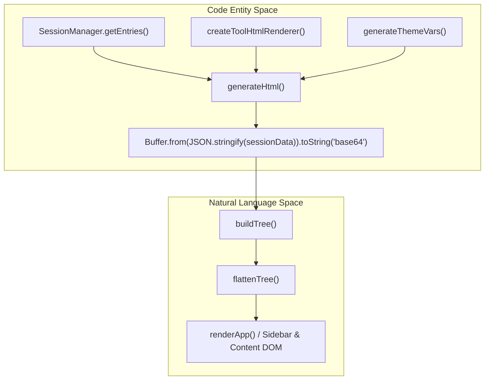
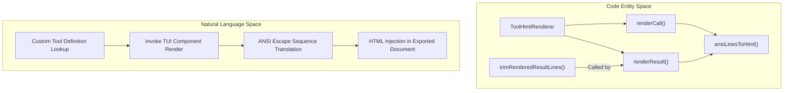

# Export HTML Architecture

Relevant source files

The following files were used as context for generating this wiki page:

- [packages/coding-agent/src/core/export-html/index.ts](packages/coding-agent/src/core/export-html/index.ts)
- [packages/coding-agent/src/core/export-html/template.css](packages/coding-agent/src/core/export-html/template.css)
- [packages/coding-agent/src/core/export-html/template.html](packages/coding-agent/src/core/export-html/template.html)
- [packages/coding-agent/src/core/export-html/template.js](packages/coding-agent/src/core/export-html/template.js)
- [packages/coding-agent/src/core/export-html/vendor/marked-cjk-friendly.min.js](packages/coding-agent/src/core/export-html/vendor/marked-cjk-friendly.min.js)
- [packages/coding-agent/src/core/export-html/vendor/marked.min.js](packages/coding-agent/src/core/export-html/vendor/marked.min.js)
- [packages/coding-agent/test/export-html-cjk.test.ts](packages/coding-agent/test/export-html-cjk.test.ts)
- [packages/coding-agent/test/export-html-deep-tree.test.ts](packages/coding-agent/test/export-html-deep-tree.test.ts)
- [packages/coding-agent/test/export-html-skill-block.test.ts](packages/coding-agent/test/export-html-skill-block.test.ts)
- [packages/coding-agent/test/export-html-system-messages.test.ts](packages/coding-agent/test/export-html-system-messages.test.ts)
- [packages/coding-agent/test/export-html-whitespace.test.ts](packages/coding-agent/test/export-html-whitespace.test.ts)
- [packages/coding-agent/test/export-html-xss.test.ts](packages/coding-agent/test/export-html-xss.test.ts)

## Purpose and Scope

This page provides a technical deep dive into the `export-html` subsystem of `@earendil-works/pi-coding-agent` [packages/coding-agent/src/core/export-html/index.ts:1-175](). This module generates standalone, interactive HTML exports from an `AgentSession`, faithfully reproducing the Terminal UI (TUI) experience in standard web browsers. Topics covered include the template rendering pipeline, custom tool rendering via `ToolHtmlRenderer` [packages/coding-agent/src/core/export-html/index.ts:15-26](), ANSI-to-HTML conversion [packages/coding-agent/src/core/export-html/ansi-to-html.ts:1-258](), whitespace handling [packages/coding-agent/test/export-html-whitespace.test.ts:1-42](), XSS mitigations [packages/coding-agent/test/export-html-xss.test.ts:1-67](), skill-block and system-message processing [packages/coding-agent/test/export-html-skill-block.test.ts:1-40](), [packages/coding-agent/test/export-html-system-messages.test.ts:1-83](), deep tree scaling [packages/coding-agent/test/export-html-deep-tree.test.ts:1-93](), CJK-friendly Markdown [packages/coding-agent/src/core/export-html/vendor/marked-cjk-friendly.min.js:1-6](), syntax highlighting [packages/coding-agent/src/core/export-html/vendor/highlight.min.js](), and session sharing via Radius or GitHub gists [packages/coding-agent/src/modes/interactive/session-share.ts:57-201]().

---

## Overview and Pipeline

The export subsystem transforms structured session entries (`SessionEntry` list) and metadata into a single-file distributable HTML document. This file embeds a Base64-encoded JSON payload containing the session data, alongside vendor scripts, styles, and a client-side JavaScript runtime (`template.js`) that handles tree navigation, sidebar filtering, and dynamic Markdown rendering.

### Code-Entity to Natural Language Bridge: Export Pipeline

The pipeline owner in Node.js (`generateHtml`) collects session data and theme colors, reads static template parts (`template.html`, `.css`, `.js`), optionally pre-renders tool calls/results using a `ToolHtmlRenderer`, and emits a single HTML string. The client browser unpacks the session JSON from Base64, builds an interactive tree of session entries using `buildTree()`, and renders conversation messages accordingly.

Sources:  
`[packages/coding-agent/src/core/export-html/index.ts:143-175]()`  
`[packages/coding-agent/src/core/export-html/template.js:8-15]()`  
`[packages/coding-agent/src/core/export-html/tool-renderer.ts:58-172]()`

---

## Template Rendering Pipeline

The core HTML generation orchestrates reading layout templates, calculating dynamic theme variables, encoding state, and assembling the final document string.

### Steps in the Pipeline

1. **Reading Template and Vendor Assets:**  
   Reads `template.html`, `template.css`, `template.js`, and vendored runtimes (`marked.min.js`, `marked-cjk-friendly.min.js`, `highlight.min.js`) from disk via `getExportTemplateDir()`. These are loaded as UTF-8 strings for substitution into the final output HTML file.  
   `[packages/coding-agent/src/core/export-html/index.ts:143-150]()`

2. **Theme Variable Injection:**  
   CSS custom properties are generated by resolving theme colors with `getResolvedThemeColors(themeName)` and optionally applying export-specific overrides from `getThemeExportColors(themeName)`. If explicit export colors are missing, `deriveExportColors()` calculates suitable page, card, and info background colors by analyzing the luminance of the `userMessageBg` base color. Variables like `--exportPageBg`, `--exportCardBg`, and `--exportInfoBg` are emitted for CSS usage.  
   `[packages/coding-agent/src/core/export-html/index.ts:81-129]()`

3. **Session Data Serialization:**  
   Structured session state including header metadata, session entries, currently active leaf ID, system prompt, list of tools, and any pre-rendered tool HTML outputs are serialized to JSON and Base64-encoded. This avoids escaping problems embedding raw JSON inside HTML script elements.  
   `[packages/coding-agent/src/core/export-html/index.ts:130-175]()`

4. **Template Substitution:**  
   The placeholders in `template.html` (`{{CSS}}`, `{{SESSION_DATA}}`, `{{JS}}`, `{{MARKED_JS}}`, `{{HIGHLIGHT_JS}}`) are substituted with runtime values, CSS with injected variables, the Base64 data payload, and JavaScript runtime code. The final string is the complete HTML export artifact.  
   `[packages/coding-agent/src/core/export-html/index.ts:169-174]()`

### Key Functions and Types

| Function / Type                | Description                                                                                           |
|-------------------------------|---------------------------------------------------------------------------------------------------|
| `generateThemeVars(themeName?)`| Returns CSS custom property declarations for resolved theme colors, integrating export colors with fallback derivation. |
| `deriveExportColors(baseColor)` | Calculates contrast-appropriate background colors based on luminance to maintain readability. |
| `generateHtml(sessionData, themeName?)` | Primary export function assembling HTML as a string with embedded session state, styles, scripts, and theming. |

Sources:  
`[packages/coding-agent/src/core/export-html/index.ts:81-174]()`  
`[packages/coding-agent/src/core/export-html/template.html:7-55]()`

---

## Tool Rendering Architecture

Tool executions are rendered differently depending on whether they belong to built-in system tools (`bash`, `read`, `write`, `edit`, `ls`) or custom extension tools with specific renderers.

### Built-in vs. Custom Tool Rendering

| Tool Category                    | Implementation Strategy                                              | Location                                                  |
|---------------------------------|--------------------------------------------------------------------|-----------------------------------------------------------|
| **Built-in Tools** (`bash`, `read`, `edit`, etc.) | Rendered at runtime dynamically inside the exported HTML's browser environment via JavaScript code in `template.js`. | `[packages/coding-agent/src/core/export-html/template.js]()` |
| **Custom Extension Tools**       | Pre-rendered at export time server-side by invoking each tool's TUI render methods to obtain ANSI output, then converting ANSI to HTML. This produces static HTML fragments for tool calls and results embedded in the export. | `[packages/coding-agent/src/core/export-html/tool-renderer.ts:58-172]()` |

### `createToolHtmlRenderer` Details

- Factory function accepting dependencies (`ToolHtmlRendererDeps`):
  - `getToolRenderers`: Lookup function retrieving tool definitions (`renderCall` and `renderResult`). `[packages/coding-agent/src/core/export-html/tool-renderer.ts:15-16]()`
  - `theme`: Active theme for styling. `[packages/coding-agent/src/core/export-html/tool-renderer.ts:18]()`
  - `cwd`: Working directory applied to render context. `[packages/coding-agent/src/core/export-html/tool-renderer.ts:20]()`
  - `width`: Optional terminal width (default 100). `[packages/coding-agent/src/core/export-html/tool-renderer.ts:22]()`
- Maintains caches for rendered call components, result components, states, and arguments indexed by `toolCallId`. `[packages/coding-agent/src/core/export-html/tool-renderer.ts:61-64]()`
- Provides methods (`ToolHtmlRenderer` interface):
  - `renderCall(toolCallId, toolName, args)`: Invokes the tool definition's `renderCall` producing a TUI `Component` that renders ANSI lines, then converts these lines to HTML with `ansiLinesToHtml()`. Returns `undefined` if no custom renderer exists or on error. `[packages/coding-agent/src/core/export-html/tool-renderer.ts:101-120]()`
  - `renderResult(toolCallId, toolName, result, details, isError)`: Invokes `renderResult` twice (collapsed and expanded), producing two TUI `Component`s rendering ANSI lines. Trims leading/trailing blank lines via `trimRenderedResultLines()` before HTML conversion. Returns HTML snippets or `undefined`. `[packages/coding-agent/src/core/export-html/tool-renderer.ts:123-172]()`

### Code-Entity to Natural Language Bridge: Tool Rendering Architecture

Sources:  
`[packages/coding-agent/src/core/export-html/tool-renderer.ts:38-172]()`  
`[packages/coding-agent/src/core/export-html/ansi-to-html.ts:1-258]()`

---

## ANSI-to-HTML Conversion Details

The ANSI-to-HTML converter processes terminal escape sequences in tool output to produce semantically equivalent HTML spans with inline CSS styles.

### Features and Implementation

- Supports ANSI SGR codes for text styles (bold, dim, italic, underline, reset) and colors (16 standard, bright variants, 256-color palette, and truecolor RGB).
- Maintains a `TextStyle` object representing current style state, updated incrementally by SGR codes.
- Uses regex matching of ANSI escape sequences (`\x1b\[([\d;]*)m`) to identify styling commands.
- Generates inline CSS style strings (`styleToInlineCSS`) to apply colors and text styles in HTML spans.
- Escapes all non-style text content safely for HTML and minimizes nesting.

Sources:  
`[packages/coding-agent/src/core/export-html/ansi-to-html.ts:1-258]()`

---

## Whitespace Handling

Whitespace preservation ensures terminal output text maintains proper formatting in the exported HTML.

- `.ansi-line` CSS class is styled with `white-space: pre` to exactly preserve spacing and alignment typical for terminal output. `[packages/coding-agent/test/export-html-whitespace.test.ts:15-16]()`
- Output preview and full output containers use `white-space: pre-wrap` to enable responsive wrapping while preserving indentation and blank lines. `[packages/coding-agent/test/export-html-whitespace.test.ts:12-14]()`
- The tool renderer trims leading and trailing empty lines before HTML conversion, avoiding excessive vertical gaps. `[packages/coding-agent/src/core/export-html/tool-renderer.ts:50-56]()`, `[packages/coding-agent/test/export-html-whitespace.test.ts:24-41]()`
- No source whitespace is injected between ANSI-rendered lines, keeping output compact and visually consistent. `[packages/coding-agent/test/export-html-whitespace.test.ts:20-22]()`

Sources:  
`[packages/coding-agent/test/export-html-whitespace.test.ts:1-42]()`  
`[packages/coding-agent/src/core/export-html/tool-renderer.ts:50-56]()`

---

## Security and Sanitization (XSS Protection)

The exported HTML must safely handle untrusted user input, logs, and file contents without exposing the user to Cross-Site Scripting (XSS) attack vectors.

### Multi-Layer Defenses

- **Markdown URI Scheme Filtering:**  
  The embedded Markdown renderer (`marked`) overrides link and image renderers to apply a strict URL scheme allow-list (`http`, `https`, `mailto`, `tel`, `ftp`). This prevents JavaScript or data URI injections.  
  `[packages/coding-agent/test/export-html-xss.test.ts:7-16]()`

- **Control Character Stripping:**  
  URLs have C0 ASCII control characters (`[\x00-\x1f\x7f]`) removed before validation to prevent bypasses via invisible characters.  
  `[packages/coding-agent/test/export-html-xss.test.ts:18-21]()`

- **Escaping Dynamic HTML Attributes:**  
  Entry IDs, MIME types, and image data embedded in attributes are escaped using `escapeHtml()` to prevent attribute injection or HTML breaking.  
  `[packages/coding-agent/test/export-html-xss.test.ts:23-38]()`

- **Escaping Sidebar Tree Metadata:**  
  Sidebar tree labels and other metadata derived from session entries are sanitized before insertion into `innerHTML` to avoid code injection vectors.  
  `[packages/coding-agent/test/export-html-xss.test.ts:40-66]()`

Sources:  
`[packages/coding-agent/test/export-html-xss.test.ts:1-67]()`

---

## Skill Blocks and System Messages

Agent skills and system instructions embed structured metadata requiring special processing in client-side rendering.

### Key Aspects

- **Skill Wrapper Parsing:**  
  The client runtime in `template.js` parses skill blocks to detect and separate `<skill name="..." location="..."> ... </skill>` XML wrappers enclosing skill metadata from the raw user prompt text.  
  `[packages/coding-agent/test/export-html-skill-block.test.ts:7-14]()`

- **Separate Blocks in UI:**  
  Skill invocation blocks and the associated raw user message are rendered as separate sibling DOM elements, mirroring the TUI layout.  
  `[packages/coding-agent/test/export-html-skill-block.test.ts:16-33]()`

- **System Message Updates:**  
  System messages and updates (tracked via `isLeadingSystemEntry`, `getSystemMessageText`, and `renderSystemMessageUpdate`) are rendered into system prompt blocks and tool modification summaries within the transcript.  
  `[packages/coding-agent/test/export-html-system-messages.test.ts:1-83]()`

- **Sidebar Tree Labeling:**  
  Sidebar tree entries for skills display both the skill name and user prompt, styled distinctly with `.tree-role-skill` CSS.  
  `[packages/coding-agent/test/export-html-skill-block.test.ts:35-39]()`

Sources:  
`[packages/coding-agent/test/export-html-skill-block.test.ts:1-40]()`  
`[packages/coding-agent/test/export-html-system-messages.test.ts:1-83]()`

---

## Deep Session Tree Navigation and Performance

Long-running sessions can form chains deeper than the standard JavaScript call stack (e.g. depth > 20,000). 

- **Iterative Post-Order Traversal:**  
  Functions like `buildTree()` and active path resolution utilize iterative loops rather than recursive calls to prevent call stack overflow errors.  
  `[packages/coding-agent/test/export-html-deep-tree.test.ts:1-93]()`
- **Lazy Tree Node Mapping:**  
  `findNewestLeaf()` builds tree node maps lazily on-demand to allow instant branch discovery when clicking any node in the tree selector.  
  `[packages/coding-agent/src/core/export-html/template.js:146-174]()`, `[packages/coding-agent/test/export-html-deep-tree.test.ts:1-93]()`

Sources:  
`[packages/coding-agent/test/export-html-deep-tree.test.ts:1-93]()`  
`[packages/coding-agent/src/core/export-html/template.js:73-186]()`

---

## Syntax Highlighting Architecture

Syntax highlighting is applied to fenced code blocks in Markdown through an embedded `highlight.min.js` library.

- The export template bundles `highlight.min.js` for client-side dynamic syntax highlighting.  
  `[packages/coding-agent/src/core/export-html/template.html:48]()`
- Highlighting generates `` tokens styled consistently by theme CSS variables across light and dark modes.  
  `[packages/coding-agent/src/core/export-html/template.css:1-298]()`

Sources:  
`[packages/coding-agent/src/core/export-html/vendor/highlight.min.js]()`  
`[packages/coding-agent/src/core/export-html/template.html:48]()`  
`[packages/coding-agent/src/core/export-html/template.css:1-298]()`

---

## Session Sharing and Distribution

Sessions can be shared directly from interactive mode via `/share` or exported to HTML for manual distribution.

- **Trailing Share Entries:**  
  `createShareTrailingEntries()` appends a `pi.share` custom entry carrying the system prompt and available tool schemas into the session export data so that viewers have full context.  
  `[packages/coding-agent/src/modes/interactive/session-share.ts:25-47]()`
- **Destination Routing (`sessionShareDestination`):**  
  The `/share` workflow attempts to upload the session as a NDJSON artifact to a Radius gateway when authenticated (`tryShareViaRadius`), falling back to creating a private GitHub gist (`shareViaGist`) containing the generated HTML export.  
  `[packages/coding-agent/src/modes/interactive/session-share.ts:69-95]()`

Sources:  
`[packages/coding-agent/src/modes/interactive/session-share.ts:25-201]()`  
`[packages/coding-agent/schemas/settings.schema.json:53-70]()`