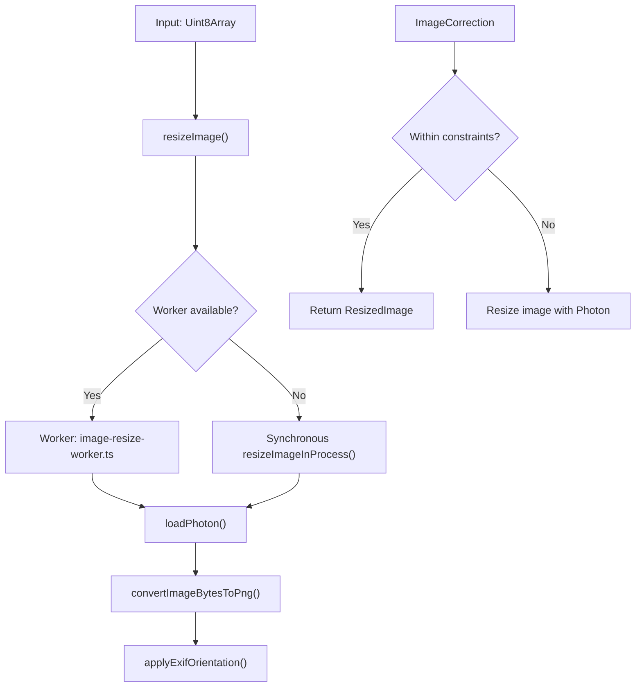
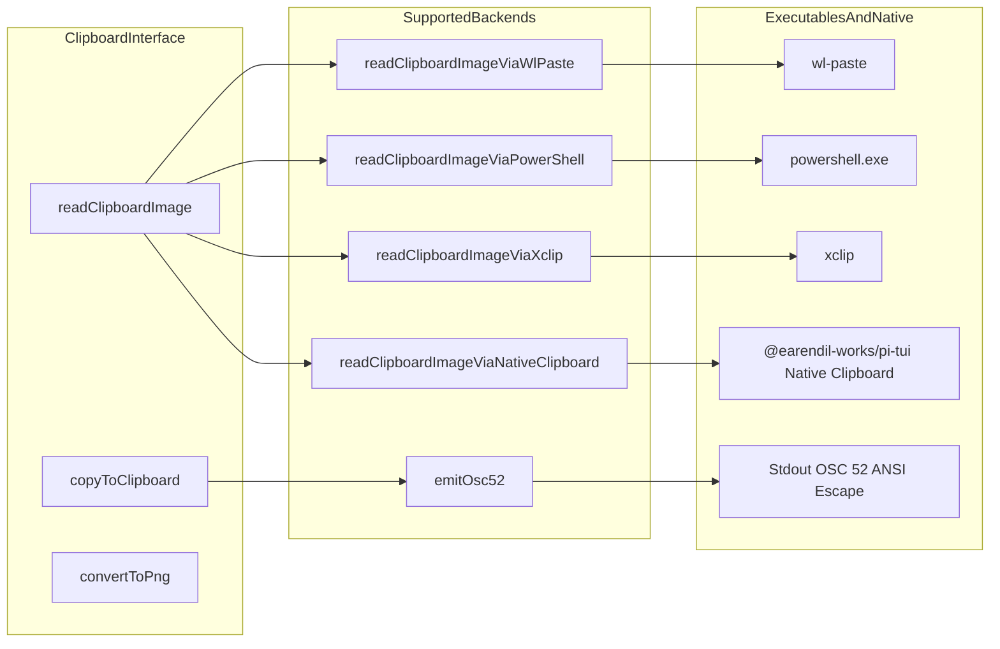
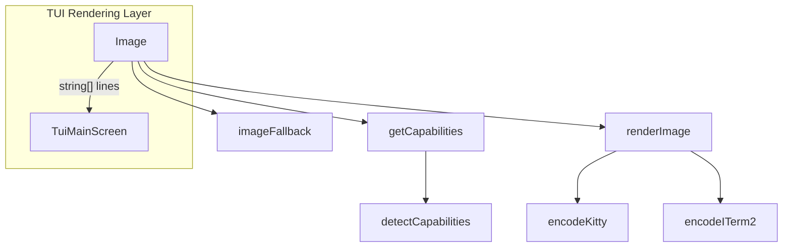

# Image Processing and Clipboard

<details>
<summary>Relevant source files</summary>

The following files were used as context for generating this wiki page:

- [.pi/skills/add-llm-provider.md](.pi/skills/add-llm-provider.md)
- [packages/agent/tsconfig.build.json](packages/agent/tsconfig.build.json)
- [packages/coding-agent/docs/environment-variables.md](packages/coding-agent/docs/environment-variables.md)
- [packages/coding-agent/docs/slash-commands.md](packages/coding-agent/docs/slash-commands.md)
- [packages/coding-agent/src/cli/file-processor.ts](packages/coding-agent/src/cli/file-processor.ts)
- [packages/coding-agent/src/utils/clipboard-image.ts](packages/coding-agent/src/utils/clipboard-image.ts)
- [packages/coding-agent/src/utils/clipboard.ts](packages/coding-agent/src/utils/clipboard.ts)
- [packages/coding-agent/src/utils/exif-orientation.ts](packages/coding-agent/src/utils/exif-orientation.ts)
- [packages/coding-agent/src/utils/image-convert.ts](packages/coding-agent/src/utils/image-convert.ts)
- [packages/coding-agent/src/utils/image-resize-core.ts](packages/coding-agent/src/utils/image-resize-core.ts)
- [packages/coding-agent/src/utils/image-resize-worker.ts](packages/coding-agent/src/utils/image-resize-worker.ts)
- [packages/coding-agent/src/utils/image-resize.ts](packages/coding-agent/src/utils/image-resize.ts)
- [packages/coding-agent/src/utils/photon.ts](packages/coding-agent/src/utils/photon.ts)
- [packages/coding-agent/test/clipboard-image-bmp-conversion.test.ts](packages/coding-agent/test/clipboard-image-bmp-conversion.test.ts)
- [packages/coding-agent/test/clipboard-image.test.ts](packages/coding-agent/test/clipboard-image.test.ts)
- [packages/coding-agent/test/clipboard.test.ts](packages/coding-agent/test/clipboard.test.ts)
- [packages/coding-agent/test/image-processing.test.ts](packages/coding-agent/test/image-processing.test.ts)
- [packages/coding-agent/tsconfig.build.json](packages/coding-agent/tsconfig.build.json)

</details>


The `pi` codebase provides a comprehensive suite of utilities for image processing and clipboard management. This encompasses image resizing and format conversion using WASM-based Photon, EXIF orientation correction, file argument processing for CLI, clipboard text and image capture across platforms, BMP-to-PNG conversion, and terminal image rendering with support for protocols such as Kitty and iTerm2. The system includes cross-platform strategies to ensure optimal integration of media into prompts and terminal UI.

---

## Image Processing Pipeline

Image processing is centered on resizing, format conversion, and orientation normalization using Photon WASM. These steps optimize images to meet LLM payload constraints and are essential for rendering in terminals that expect inline images in specific formats.

### Photon WASM Loading and Standalone Bundling

Photon operations rely on `@silvia-odwyer/photon-node`. In standalone distributions (such as Bun compiled binaries), the underlying CJS entry attempts to load `photon_rs_bg.wasm` via `fs.readFileSync` using absolute build paths [packages/coding-agent/src/utils/photon.ts:1-14](). To support standalone binaries without requiring hardcoded paths, `loadPhoton()` patches `fs.readFileSync` to intercept missing WASM reads and fall back to searching relative execution directories (`execDir`, `execDir/photon`, and `process.cwd()`) [packages/coding-agent/src/utils/photon.ts:45-110]().

Sources: [packages/coding-agent/src/utils/photon.ts:1-139]()

### Resizing and Optimization

The primary interface for resizing images is the async function `resizeImage(inputBytes: Uint8Array, mimeType: string, options?: ImageResizeOptions): Promise<ResizedImage | null>` [packages/coding-agent/src/utils/image-resize.ts:84-88](). It attempts to perform resizing in a separate worker thread (`image-resize-worker.ts`) to prevent blocking the main TUI event loop [packages/coding-agent/src/utils/image-resize.ts:77-83](). If this is not possible, it falls back to synchronous resizing within the main process [packages/coding-agent/src/utils/image-resize.ts:104-108]().

Key details include:

- Transferable byte buffers are sent to the worker thread via `toTransferableBytes()` to minimize copying overhead [packages/coding-agent/src/utils/image-resize.ts:12-16]().
- The resize respects options such as max dimensions (`maxWidth`, `maxHeight`) and max encoded byte size (`maxBytes`) [packages/coding-agent/src/utils/image-resize-core.ts:10-15]().
- There is a Bun runtime-specific heuristic that tries to load the worker by string path first to support bundled releases [packages/coding-agent/src/utils/image-resize.ts:98-102]().
- The returned `ResizedImage` includes metadata such as whether the image was actually resized and original vs resized dimensions [packages/coding-agent/src/utils/image-resize-core.ts:17-24]().
- The helper `formatDimensionNote()` generates a textual note explaining coordinate scaling between original and resized images useful for downstream LLM reasoning [packages/coding-agent/src/utils/image-resize.ts:115-122]().


Sources: [packages/coding-agent/src/utils/image-resize.ts:11-122](), [packages/coding-agent/src/utils/image-resize-core.ts:10-24](), [packages/coding-agent/src/utils/exif-orientation.ts:147-182](), [packages/coding-agent/src/utils/image-convert.ts:1-49]()

### EXIF Orientation Correction

The EXIF orientation metadata present in many image formats is handled by the function `applyExifOrientation(photon, image, bytes)` which uses Photon to apply necessary flips and rotations to output a normalized image [packages/coding-agent/src/utils/exif-orientation.ts:147-182](). This ensures images display correctly regardless of the original camera rotation metadata.

This step is integrated into the conversion flow before encoding to PNG or further processing [packages/coding-agent/src/utils/image-convert.ts:10]().
Sources: [packages/coding-agent/src/utils/exif-orientation.ts:147-182]()

### Image Conversion to PNG

Terminal inline image protocols, such as the Kitty graphics protocol, require images in PNG format. The function `convertToPng(base64Data: string, mimeType: string)` asynchronously converts JPEG, WebP, GIF, and other formats to PNG [packages/coding-agent/src/utils/image-convert.ts:36-39](). If the image is already PNG, no conversion is done [packages/coding-agent/src/utils/image-convert.ts:41-43]().

Internally, it decodes base64 to bytes, runs the conversion using Photon via `convertImageBytesToPng()`, applies EXIF correction, and returns base64 PNG encoded data or null if conversion fails [packages/coding-agent/src/utils/image-convert.ts:23-30](). Additionally, `ensurePngTranscoder()` registers Photon as a synchronous PNG transcoder for `pi-tui` on Kitty-protocol terminals [packages/coding-agent/src/utils/image-convert.ts:78-89]().
Sources: [packages/coding-agent/src/utils/image-convert.ts:23-89]()

---

## Clipboard Image and Text Capture

Clipboard interaction supports rich image and text copy-paste across multiple platforms including Linux (X11 and Wayland), macOS, Windows, and WSL. The system chooses appropriate platform-specific strategies, falling back gracefully.

### Clipboard Image Capture

The main API is the async function:

```ts
async function readClipboardImage(options?: { env?: NodeJS.ProcessEnv; platform?: NodeJS.Platform }): Promise<ClipboardImage | null>
```

It attempts the following backends in order, depending on platform and environment:

- **Wayland:** Calls `wl-paste --list-types` to list clipboard formats, then requests the preferred image MIME type data with `wl-paste --type` [packages/coding-agent/src/utils/clipboard-image.ts:91-111]().
- **X11:** Uses `xclip` to enumerate MIME types via `TARGETS`, then reads preferred image types accordingly [packages/coding-agent/src/utils/clipboard-image.ts:172-191]().
- **WSL:** Because Linux clipboard APIs do not capture Windows screenshots, the fallback calls PowerShell via `readClipboardImageViaPowerShell()` to directly read Windows clipboard images, saving temporarily to disk [packages/coding-agent/src/utils/clipboard-image.ts:118-170]().
- **Native clipboard API:** Calls `@earendil-works/pi-tui` system clipboard bindings when available via `readClipboardImageViaNativeClipboard()` [packages/coding-agent/src/utils/clipboard-image.ts:193-198]().

Image type detection and conversion are coordinated to ensure terminal compatibility [packages/coding-agent/src/utils/clipboard-image.ts:67-87]().
Sources: [packages/coding-agent/src/utils/clipboard-image.ts:67-198]()

### Clipboard Text Copy with OSC 52 Fallback

Text copy to clipboard uses the function:

```ts
async function copyToClipboard(text: string): Promise<void>
```

The strategy is:

- Use native clipboard APIs on non-Linux platforms where available [packages/coding-agent/src/utils/clipboard.ts:92-102]().
- On Linux, use platform executables like `pbcopy` (macOS), `clip` (Windows), `wl-copy`/`xclip`/`xsel` (Linux) [packages/coding-agent/src/utils/clipboard.ts:104-120]().
- For remote or headless Linux sessions, emit OSC 52 ANSI escape sequences via `emitOsc52()` as a fallback to send clipboard text through the terminal connection, provided it does not exceed `MAX_OSC52_ENCODED_LENGTH` (100,000 bytes) [packages/coding-agent/src/utils/clipboard.ts:9-27, 131-135](). Remote sessions are identified via `isRemoteSession()` checking `SSH_CONNECTION`, `SSH_CLIENT`, `MOSH_CONNECTION`, or `PI_CLIPBOARD_OSC52=1` [packages/coding-agent/src/utils/clipboard.ts:16-18]().
- Specifically handles WSL scenarios where it prefers Windows Terminal OSC 52 or PowerShell commands (`copyViaWindowsClipboard()`) to avoid encoding mangling [packages/coding-agent/src/utils/clipboard.ts:34-56, 122-126]().
Sources: [packages/coding-agent/src/utils/clipboard.ts:1-150]()

### Clipboard Workflow Architecture


Sources: [packages/coding-agent/src/utils/clipboard-image.ts:91-198](), [packages/coding-agent/src/utils/clipboard.ts:20-135](), [packages/coding-agent/src/utils/image-convert.ts:23-55]()

---

## File Processing for `@file` CLI Arguments

The CLI utility `processFileArguments(fileArgs: string[], options?: ProcessFileOptions)` converts a list of file path arguments into usable text content and image attachments for prompts [packages/coding-agent/src/cli/file-processor.ts:25-88]().

Highlights:

- Uses `resolveReadPath` to normalize file paths (e.g., expand `~`, handle Unicode spaces in macOS) [packages/coding-agent/src/cli/file-processor.ts:32]().
- Detects if a file is an image with `detectSupportedImageMimeTypeFromFile` [packages/coding-agent/src/cli/file-processor.ts:49]().
- For images, reads and processes them via `processImage`, which includes resizing and base64 encoding [packages/coding-agent/src/cli/file-processor.ts:53-54]().
- For text files, loads UTF-8 content with BOM stripping [packages/coding-agent/src/cli/file-processor.ts:77]().
- Incorporates processing hints and embeds file references as XML-like `<file name="...">...</file>` tags [packages/coding-agent/src/cli/file-processor.ts:69-73]().
- Emits errors and terminates the CLI on missing or unreadable files [packages/coding-agent/src/cli/file-processor.ts:38-40, 80-82]().

```ts
async function processFileArguments(fileArgs: string[], options?: ProcessFileOptions): Promise<ProcessedFiles>
```
Sources: [packages/coding-agent/src/cli/file-processor.ts:25-88]()

---

## Terminal Image Rendering

The `Image` component (in package `@earendil-works/pi-tui`) is responsible for rendering images in terminals supporting inline graphics:

- It detects terminal capabilities with `getCapabilities()` to determine supported protocols (`kitty`, `iterm2`, or none) [packages/tui/src/components/image.ts:103]().
- Converts images to PNG if needed to meet Kitty protocol requirements [packages/tui/src/components/image.ts:106-111]().
- Resizes images to fit cell widths and heights using terminal cell pixel dimensions [packages/tui/src/components/image.ts:98-101]().
- Manages Kitty image IDs for reuse and updates [packages/tui/src/components/image.ts:115-117]().
- Renders terminal escape sequences for supported image protocols or falls back to an ASCII description with colorized placeholder text [packages/tui/src/components/image.ts:118-156]().
- Ensures TUI scroll region and cursor positioning align with image height [packages/tui/src/components/image.ts:136-152]().

Sources: [packages/tui/src/components/image.ts:55-167]()

### Terminal Image Rendering Architecture


Sources: [packages/tui/src/components/image.ts:25-127](), [packages/tui/src/terminal-image.ts:139-169]()

---

## Summary of Key Code Entities in Image and Clipboard Handling

| Code Entity | Description | Location |
|-------------|-------------|----------|
| `resizeImage` | Entrypoint to resize images asynchronously via worker or inline | [packages/coding-agent/src/utils/image-resize.ts:84-110]() |
| `loadPhoton` | Async loader for Photon WASM with bundled fallback path patching | [packages/coding-agent/src/utils/photon.ts:112-139]() |
| `applyExifOrientation` | Applies EXIF orientation adjustments to an image using Photon | [packages/coding-agent/src/utils/exif-orientation.ts:147-182]() |
| `convertToPng` | Converts image data to PNG base64 format for terminal display | [packages/coding-agent/src/utils/image-convert.ts:36-55]() |
| `readClipboardImage` | Multi-platform image clipboard reader with fallback strategies | [packages/coding-agent/src/utils/clipboard-image.ts:200-220]() |
| `copyToClipboard` | Copies text to clipboard, supports native APIs, commands, OSC52 | [packages/coding-agent/src/utils/clipboard.ts:86-150]() |
| `processFileArguments` | Processes CLI @file arguments, reads/resizes images or text files | [packages/coding-agent/src/cli/file-processor.ts:25-88]() |
| `Image` (TUI Component) | Terminal UI component for image rendering with protocol support | [packages/tui/src/components/image.ts:25-127]() |

Sources: [packages/coding-agent/src/utils/image-resize.ts:84-110](), [packages/coding-agent/src/utils/image-convert.ts:36-55](), [packages/coding-agent/src/utils/photon.ts:112-139](), [packages/coding-agent/src/utils/exif-orientation.ts:147-182](), [packages/coding-agent/src/utils/clipboard-image.ts:200-220](), [packages/coding-agent/src/utils/clipboard.ts:86-150](), [packages/coding-agent/src/cli/file-processor.ts:25-88](), [packages/tui/src/components/image.ts:25-127]()