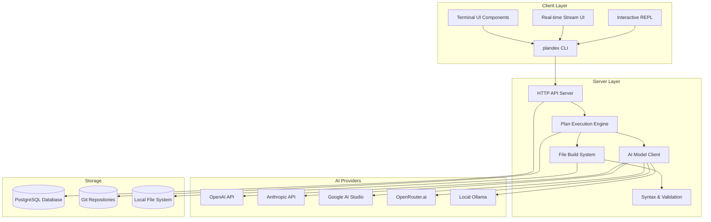
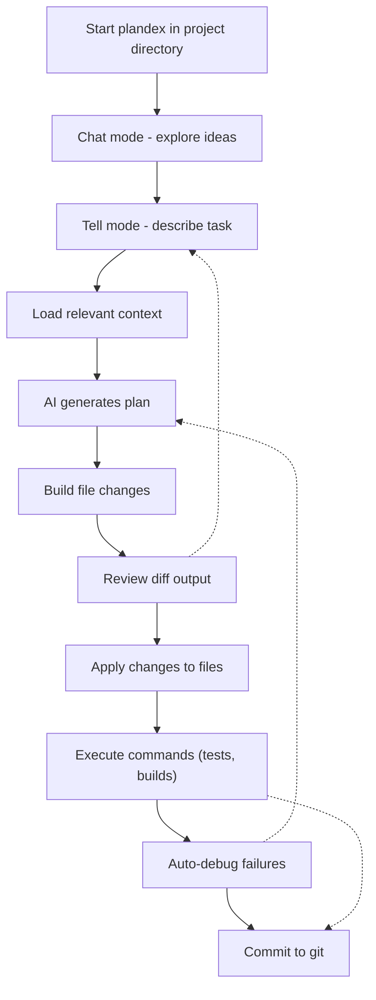

# Introduction to Plandex

<details>
<summary>Relevant source files</summary>

The following files were used as context for generating this wiki page:

- [README.md](README.md)
- [docs/docs/cli-reference.md](docs/docs/cli-reference.md)
- [docs/docs/environment-variables.md](docs/docs/environment-variables.md)
- [docs/docs/hosting/cloud.md](docs/docs/hosting/cloud.md)
- [docs/docs/hosting/self-hosting/_category_.json](docs/docs/hosting/self-hosting/_category_.json)
- [docs/docs/hosting/self-hosting/advanced-self-hosting.md](docs/docs/hosting/self-hosting/advanced-self-hosting.md)
- [docs/docs/hosting/self-hosting/local-mode-quickstart.md](docs/docs/hosting/self-hosting/local-mode-quickstart.md)
- [docs/docs/install.md](docs/docs/install.md)
- [docs/docs/models/claude-subscription.md](docs/docs/models/claude-subscription.md)
- [docs/docs/models/models-overview.md](docs/docs/models/models-overview.md)
- [docs/docs/quick-start.md](docs/docs/quick-start.md)

</details>


## Purpose and Scope

This document provides a comprehensive introduction to Plandex, an AI-powered coding agent designed for large-scale software development tasks. It covers the system's core architecture, fundamental concepts, and key components to help developers understand how Plandex operates and integrates into development workflows.

For detailed CLI command reference, see [CLI Reference](#2). For specific configuration and setup instructions, see [Installation and Quick Start](#1.1). For in-depth technical implementation details, see [System Architecture Overview](#1.3).

## What is Plandex

Plandex is a terminal-based AI development tool that can plan and execute large coding tasks spanning multiple steps and files. It operates through a client-server architecture where the CLI client communicates with a server that orchestrates AI model interactions, file operations, and plan execution.

The system is designed to handle projects with up to 2M tokens of context directly and can index directories with 20M+ tokens using tree-sitter project maps. It maintains AI-generated changes in a sandbox environment separate from project files until they are ready to be applied.

**Sources:** [README.md:81-90](), [README.md:65-66](), [README.md:83-84]()

## System Architecture Overview

Plandex follows a layered client-server architecture with distinct responsibilities for user interaction, plan execution, AI integration, and data persistence.



The architecture separates concerns between user interaction (Client Layer), business logic (Server Layer), external AI services (AI Providers), and data persistence (Storage). The CLI provides multiple interfaces including an interactive REPL and streaming UI for real-time feedback during plan execution.

**Sources:** [README.md:121-124](), [docs/docs/cli-reference.md:34-46](), [docs/docs/hosting/self-hosting/local-mode-quickstart.md:8]()

## Core Components

The following diagram shows the key components and their relationships within the Plandex system:

```mermaid
graph TB
    subgraph "User Interface"
        plandex_cmd["plandex command"]
        pdx_alias["pdx alias"]
        repl_mode["REPL mode"]
        chat_mode["chat mode"]
        tell_mode["tell mode"]
    end
    
    subgraph "Plan Management"
        new_cmd["new command"]
        plans_cmd["plans command"]
        current_cmd["current command"]
        cd_cmd["cd command"]
        branches_cmd["branches command"]
        checkout_cmd["checkout command"]
    end
    
    subgraph "Context Operations"
        load_cmd["load command"]
        ls_cmd["ls command"]
        rm_cmd["rm command"]
        update_cmd["update command"]
        clear_cmd["clear command"]
    end
    
    subgraph "Execution Control"
        tell_cmd["tell command"]
        continue_cmd["continue command"]
        build_cmd["build command"]
        apply_cmd["apply command"]
        debug_cmd["debug command"]
    end
    
    subgraph "Model Configuration"
        models_cmd["models command"]
        set_model_cmd["set-model command"]
        model_packs_cmd["model-packs command"]
        providers_cmd["providers command"]
    end
    
    subgraph "Changes Management"
        diff_cmd["diff command"]
        reject_cmd["reject command"]
        log_cmd["log command"]
        rewind_cmd["rewind command"]
    end
    
    plandex_cmd --> repl_mode
    pdx_alias --> repl_mode
    repl_mode --> chat_mode
    repl_mode --> tell_mode
    
    repl_mode --> Plan Management
    repl_mode --> Context Operations
    repl_mode --> Execution Control
    repl_mode --> Model Configuration
    repl_mode --> Changes Management
```

### Key Component Descriptions

- **CLI Entry Points**: The `plandex` command and `pdx` alias serve as the primary entry points to the system
- **REPL Mode**: Interactive shell providing fuzzy auto-complete and command processing
- **Plan Management**: Commands for creating, listing, and switching between plans and branches
- **Context Operations**: File and directory loading, listing, and management within plan context
- **Execution Control**: Core workflow commands for implementing tasks and applying changes
- **Model Configuration**: Settings and management for AI models and providers
- **Changes Management**: Review, diff, and version control operations for pending changes

**Sources:** [docs/docs/cli-reference.md:10-15](), [docs/docs/cli-reference.md:34-46](), [docs/docs/cli-reference.md:80-210](), [docs/docs/cli-reference.md:212-292](), [docs/docs/cli-reference.md:294-433]()

## Key Concepts

### Plans and Branches
Plans are the fundamental unit of work in Plandex, representing a conversation and associated context for a specific task. Each plan can have multiple branches, similar to Git branches, allowing exploration of different implementation approaches.

Plans maintain their own conversation history, context files, and pending changes. The `current` command shows the active plan, while `plans` lists all available plans with their status and token counts.

### Context Management
Context refers to the files, directories, notes, and other information loaded into a plan to provide the AI with necessary background. Context can include:
- Source code files loaded via the `load` command
- Directory structures and file maps using `--tree` and `--map` flags
- URLs, images, and notes
- Piped command output

The system automatically manages context freshness and can auto-load relevant files during execution.

### Model Packs and Roles
Plandex uses specialized AI models for different roles in the development process:
- **Planner**: Creates high-level implementation plans
- **Architect**: Designs system structure and file organization  
- **Coder**: Implements specific code changes
- **Builder**: Processes and validates file modifications
- **Validator**: Ensures syntax and logical correctness
- **Namer**: Generates appropriate names for plans and files

Model packs group these role assignments into coherent configurations like `daily`, `strong`, `cheap`, and `oss` (open source).

### Plan Lifecycle
The typical workflow follows a `tell` → `build` → `apply` cycle:
1. **Tell**: Describe the task or feature to implement
2. **Build**: Generate and validate specific file changes
3. **Apply**: Write changes to the local file system

Plans can be paused, resumed, rewound to previous states, and branches can be created for alternative approaches.

**Sources:** [docs/docs/cli-reference.md:80-124](), [docs/docs/cli-reference.md:212-292](), [docs/docs/cli-reference.md:295-370](), [docs/docs/cli-reference.md:675-690](), [README.md:102-118]()

## Workflow Overview

The following diagram illustrates the typical development workflow using Plandex:



The workflow supports both fully automated execution and step-by-step manual control through configurable autonomy levels ranging from `none` (manual) to `full` (automatic apply and execution).

**Sources:** [README.md:128-131](), [docs/docs/cli-reference.md:48-63](), [docs/docs/cli-reference.md:295-370](), [docs/docs/cli-reference.md:371-401]()

## Hosting and Deployment Options

Plandex supports multiple deployment configurations:

| Option | Description |
|--------|-------------|
| **Plandex Cloud (Integrated)** | Hosted service with built-in model credits |
| **Plandex Cloud (BYO Key)** | Hosted service using your API keys |
| **Self-hosted Local** | Local Docker deployment for single users |
| **Self-hosted Production** | Remote server deployment for multiple users |

Each option requires different setup procedures and has distinct authentication, billing, and model provider configurations.

**Sources:** [docs/docs/quick-start.md:18-25](), [docs/docs/hosting/cloud.md:13-33](), [docs/docs/hosting/self-hosting/local-mode-quickstart.md:10-51]()

## Next Steps

For hands-on experience with Plandex:
- Follow the [Installation and Quick Start](#1.1) guide to set up Plandex
- Review [Core Concepts](#1.2) for detailed explanations of plans, context, and model packs  
- Explore the [CLI Reference](#2) for comprehensive command documentation
- Learn about [Plan Execution System](#3) for understanding the workflow implementation
- See [AI Model Integration](#5) for configuring models and providers

For system administrators and developers:
- Review [System Architecture Overview](#1.3) for implementation details
- See [Self-Hosting Plandex](#7.3) for deployment guidance
- Explore [Development and Deployment](#7) for contribution guidelines

**Sources:** [README.md:178-207](), [docs/docs/quick-start.md:34-63](), [docs/docs/cli-reference.md:1-9]()