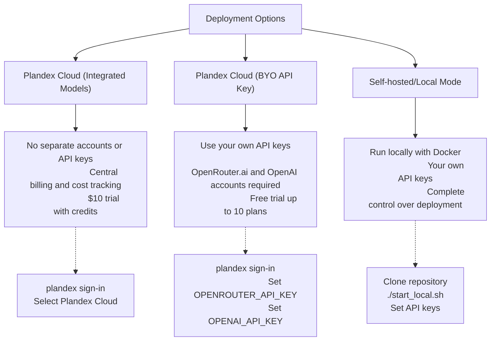
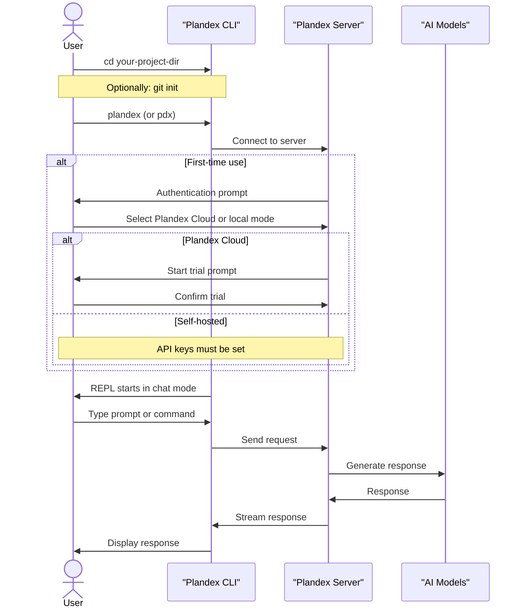
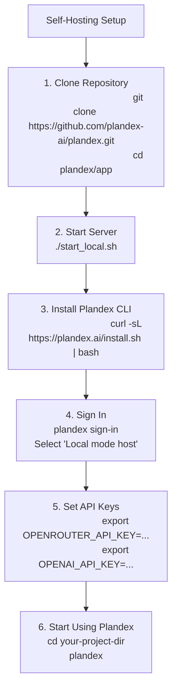

# Installation and Quick Start

<details>
<summary>Relevant source files</summary>

The following files were used as context for generating this wiki page:

- [README.md](README.md)
- [docs/docs/cli-reference.md](docs/docs/cli-reference.md)
- [docs/docs/environment-variables.md](docs/docs/environment-variables.md)
- [docs/docs/hosting/cloud.md](docs/docs/hosting/cloud.md)
- [docs/docs/hosting/self-hosting/_category_.json](docs/docs/hosting/self-hosting/_category_.json)
- [docs/docs/hosting/self-hosting/advanced-self-hosting.md](docs/docs/hosting/self-hosting/advanced-self-hosting.md)
- [docs/docs/hosting/self-hosting/local-mode-quickstart.md](docs/docs/hosting/self-hosting/local-mode-quickstart.md)
- [docs/docs/install.md](docs/docs/install.md)
- [docs/docs/models/claude-subscription.md](docs/docs/models/claude-subscription.md)
- [docs/docs/models/models-overview.md](docs/docs/models/models-overview.md)
- [docs/docs/quick-start.md](docs/docs/quick-start.md)

</details>


This guide walks you through installing the Plandex CLI and getting started with basic usage patterns. Plandex uses a client-server architecture where the CLI communicates with either Plandex Cloud or a self-hosted server to orchestrate AI-powered development tasks.

## Installation Methods

Plandex offers several installation methods to suit different needs and preferences.

### Quick Install

The fastest way to install Plandex is using the provided install script:

```bash
curl -sL https://plandex.ai/install.sh | bash
```

This script will download and install the appropriate binary for your system.

### Manual Install

Alternatively, you can manually download and install the binary:

1. Download the appropriate binary for your platform from the latest [release](https://github.com/plandex-ai/plandex/releases)
2. Place it somewhere in your `PATH`

### Build from Source

For those who prefer to build from source:

```bash
git clone https://github.com/plandex-ai/plandex.git
cd plandex/app/cli
go build -ldflags "-X plandex/version.Version=$(cat version.txt)"
mv plandex /usr/local/bin # adapt as needed for your system
```

### Platform Support

Plandex works on:
- Linux
- macOS
- Windows (via WSL only)

Note: On Windows, Plandex only works correctly in the WSL shell. It doesn't work in Windows CMD prompt or PowerShell.

Sources: [README.md:146-152](), [docs/docs/install.md:10-32]()

## Deployment Options

There are three primary ways to deploy and use Plandex:



### 1. Plandex Cloud (Integrated Models)
- No separate accounts or API keys required
- Easy multi-device usage
- Centralized billing, budgeting, usage tracking, and cost reporting
- Start with a $10 trial (includes $10 in credits)
- After the trial, upgrade to a paid plan for $45 per month (includes $20 in credits that never expire)

### 2. Plandex Cloud (BYO API Key)
- Use Plandex Cloud with your own OpenRouter.ai and OpenAI keys
- Start with a free trial up to 10 plans and 20 model responses per plan
- After the trial, upgrade to a paid plan for $30 per month

### 3. Self-hosted/Local Mode
- Run Plandex locally with Docker or host on your own server
- Use your own OpenRouter.ai and OpenAI keys
- Complete control over your deployment environment
- Best for organizations with specific security requirements

Sources: [README.md:154-161](), [docs/docs/quick-start.md:19-24](), [docs/docs/hosting/cloud.md:10-34](), [docs/docs/hosting/self-hosting/local-mode-quickstart.md:1-8]()

## API Key Setup

If you're using the "BYO API Key" option with Plandex Cloud or self-hosting, you'll need to set up API keys for the AI model providers.

### OpenRouter.ai API Key
1. Sign up at [OpenRouter.ai](https://openrouter.ai/signup) if you don't have an account
2. Generate an API key at [OpenRouter.ai/keys](https://openrouter.ai/keys)
3. Set the environment variable:
   ```bash
   export OPENROUTER_API_KEY=<your-openrouter-api-key>
   ```

### OpenAI API Key
1. Sign up at [OpenAI Platform](https://platform.openai.com/signup) if you don't have an account
2. Generate an API key at [OpenAI API Keys](https://platform.openai.com/account/api-keys)
3. Set the environment variable:
   ```bash
   export OPENAI_API_KEY=<your-openai-api-key>
   ```

Sources: [README.md:163-169](), [docs/docs/quick-start.md:26-31](), [docs/docs/hosting/self-hosting/local-mode-quickstart.md:35-46]()

## Quick Start Guide

Once you've installed Plandex, follow these steps to start using it:



### Basic Steps

1. Change to your project directory:
   ```bash
   cd your-project-dir
   ```

2. Optionally initialize a git repository (if starting a new project):
   ```bash
   git init
   ```

3. Start the Plandex REPL:
   ```bash
   plandex
   ```
   or use the shorter alias:
   ```bash
   pdx
   ```

4. If using Plandex Cloud for the first time, you'll be prompted to start a trial.

5. The REPL starts in chat mode by default. You can ask questions about your project or discuss ideas.

6. To implement code changes, follow the prompts to switch to "tell mode".

### Using REPL Flags

You can customize your REPL experience with various flags:

```bash
# Start in tell mode for implementation
plandex --tell

# Set autonomy level
plandex --full     # Full automation
plandex --semi     # Semi-automation
plandex --basic    # Basic automation
plandex --no-auto  # No automation

# Choose model pack
plandex --daily      # Default balanced models
plandex --strong     # More capable models (higher cost)
plandex --cheap      # Less capable models (lower cost)
plandex --oss        # Open source models
```

Sources: [README.md:173-193](), [docs/docs/quick-start.md:33-61](), [docs/docs/cli-reference.md:34-53](), [docs/docs/repl.md:10-53]()

## Self-Hosting Setup

If you choose to self-host Plandex, there are several options available.

### Local Mode Quickstart

The easiest way to self-host Plandex is using the provided local mode script:



1. Clone the repository and start the local server:
   ```bash
   git clone https://github.com/plandex-ai/plandex.git
   cd plandex/app
   ./start_local.sh
   ```

2. In a new terminal, install the Plandex CLI if you haven't already:
   ```bash
   curl -sL https://plandex.ai/install.sh | bash
   ```

3. Sign in to the local server:
   ```bash
   plandex sign-in
   ```
   When prompted, select "Local mode host" and confirm the default host (`http://localhost:8099`).

4. Set up your API keys:
   ```bash
   export OPENROUTER_API_KEY=<your-openrouter-api-key>
   export OPENAI_API_KEY=<your-openai-api-key>
   ```

5. Start using Plandex in a project directory:
   ```bash
   cd your-project-dir
   plandex
   ```

### Docker Compose Configuration

The Docker Compose setup includes:

- PostgreSQL database container for data storage
- Plandex server container for the backend
- Shared network for communication
- Volumes for persistent data storage

The docker-compose.yml file configures both containers with appropriate environment variables and port mappings.

### Advanced Self-Hosting

For more complex deployments, Plandex supports running the server directly:

- Development or production mode (set via `GOENV` environment variable)
- Custom PostgreSQL database connection (via `DATABASE_URL`)
- Custom base directory for file storage (via `PLANDEX_BASE_DIR`)
- SMTP configuration for email in production mode
- Options to run from Docker or source code

See [Advanced Self-Hosting](#6.2) for more details.

Sources: [docs/docs/hosting/self-hosting/local-mode-quickstart.md:10-52](), [app/docker-compose.yml:1-38](), [app/start_local.sh:1-36](), [docs/docs/hosting/self-hosting/advanced-self-hosting.md:1-154]()

## Environment Variables

Here are the key environment variables that can be configured for Plandex:

| Variable | Description | Default |
|----------|-------------|---------|
| `OPENROUTER_API_KEY` | OpenRouter.ai API key | Required for BYO API Key mode |
| `OPENAI_API_KEY` | OpenAI API key | Required for BYO API Key mode |
| `PLANDEX_ENV` | Environment for development | Defaults to production |
| `PLANDEX_API_HOST` | Custom API host | `http://localhost:8099` in development, `https://api.plandex.ai` in production |
| `OPENAI_API_BASE` | Custom OpenAI server URL | Empty (uses OpenAI's default) |
| `OPENAI_ORG_ID` | OpenAI organization ID | Empty |
| `GOENV` | Server mode (development/production) | Required for self-hosting |
| `DATABASE_URL` | PostgreSQL connection string | Required for self-hosting |
| `PLANDEX_BASE_DIR` | Base directory for server files | `$HOME/plandex-server` (dev) or `/plandex-server` (prod) |

For a complete list of environment variables, see [Environment Variables](#11).

Sources: [docs/docs/environment-variables.md:10-97]()

## Next Steps

Now that you have Plandex installed and running, you can:

1. Explore the [CLI Reference](#3) to learn about all available commands
2. Learn more about the [Core Concepts](#1.2) to understand Plandex's capabilities
3. Set up [Context Management](#3.3) to help AI models understand your codebase
4. Configure [Model Settings](#5.1) to customize AI behavior

For help or feedback, you can join the [Discord community](https://discord.gg/plandex-ai) or check the [GitHub repository](https://github.com/plandex-ai/plandex).