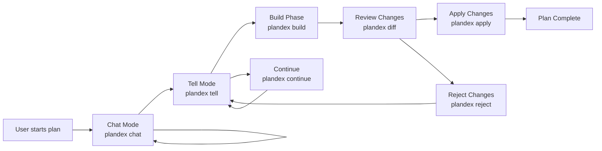
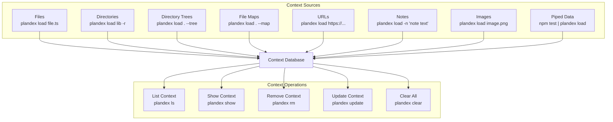
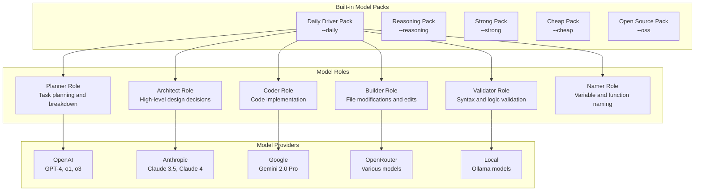
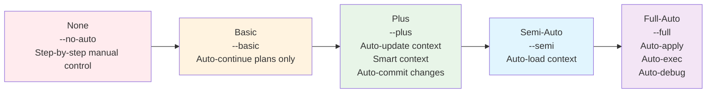
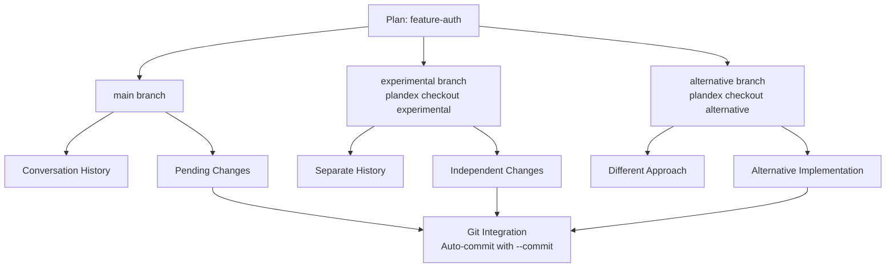
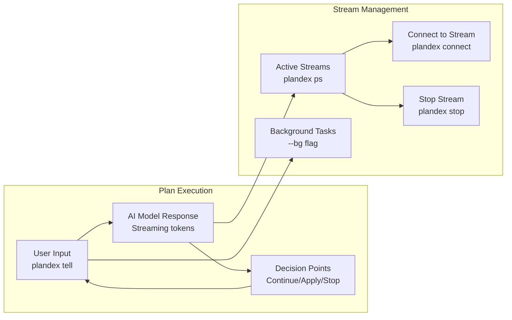
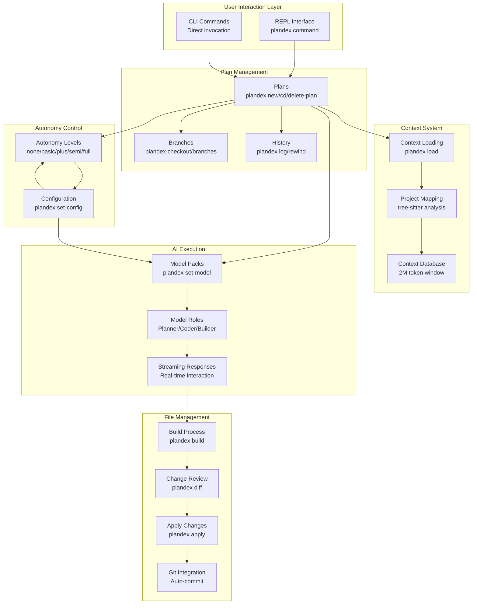

# Core Concepts

Relevant source files

The following files were used as context for generating this wiki page:

- [README.md](README.md)
- [docs/docs/cli-reference.md](docs/docs/cli-reference.md)
- [docs/docs/environment-variables.md](docs/docs/environment-variables.md)
- [docs/docs/hosting/cloud.md](docs/docs/hosting/cloud.md)
- [docs/docs/hosting/self-hosting/_category_.json](docs/docs/hosting/self-hosting/_category_.json)
- [docs/docs/hosting/self-hosting/advanced-self-hosting.md](docs/docs/hosting/self-hosting/advanced-self-hosting.md)
- [docs/docs/hosting/self-hosting/local-mode-quickstart.md](docs/docs/hosting/self-hosting/local-mode-quickstart.md)
- [docs/docs/install.md](docs/docs/install.md)
- [docs/docs/models/claude-subscription.md](docs/docs/models/claude-subscription.md)
- [docs/docs/models/models-overview.md](docs/docs/models/models-overview.md)
- [docs/docs/quick-start.md](docs/docs/quick-start.md)

This document explains the fundamental concepts that form the foundation of Plandex's AI-assisted development workflow. Understanding these concepts is essential for effectively using Plandex to plan and execute coding tasks.

For information about installing and getting started with Plandex, see [Installation and Quick Start](#1.1). For details about the overall system architecture, see [System Architecture Overview](#1.3). For comprehensive command reference, see [CLI Reference](#2).

## Plans and Plan Lifecycle

A **plan** is the central unit of work in Plandex. Each plan represents a specific coding task or feature implementation that progresses through a defined lifecycle of chat, implementation, building, and application phases.

### Plan States and Commands

Plans progress through distinct phases, each with associated CLI commands:

| Phase | Command | Purpose |
|-------|---------|---------|
| Chat | `plandex chat` | Discussion and exploration without making changes |
| Tell | `plandex tell` | Describe implementation tasks |
| Continue | `plandex continue` | Continue plan execution |
| Build | `plandex build` | Convert plan responses into file modifications |
| Apply | `plandex apply` | Write changes to project files |

**Sources:** [docs/docs/cli-reference.md:295-400](), [README.md:128-131]()

## Context Management

**Context** encompasses all information that Plandex uses to understand your project: files, directories, project structure, notes, images, and URLs. Effective context management is crucial for getting accurate results from AI models.

### Context Types and Token Management

Plandex supports a 2M token effective context window and uses context caching to reduce costs and latency. Context is categorized by type and managed efficiently:

| Context Type | Command Example | Token Impact |
|--------------|-----------------|--------------|
| File content | `plandex load component.ts` | Full file tokens |
| Directory tree | `plandex load . --tree` | File names only |
| File map | `plandex load . --map` | Signatures and types |
| Notes | `plandex load -n "instructions"` | Note text tokens |
| Images | `plandex load mockup.png` | Vision model tokens |

**Sources:** [docs/docs/cli-reference.md:213-292](), [README.md:91-100]()

## AI Model Integration: Roles and Model Packs

Plandex uses specialized AI models for different aspects of development work. Each **role** handles specific responsibilities, and **model packs** define which models are assigned to each role.

### Model Configuration Commands

| Command | Purpose |
|---------|---------|
| `plandex models` | Show current plan's model settings |
| `plandex models default` | Show default model settings |
| `plandex set-model` | Change current plan's models |
| `plandex set-model default` | Set default models for new plans |
| `plandex model-packs` | List available model packs |
| `plandex providers` | Show available model providers |

**Sources:** [docs/docs/cli-reference.md:674-799](), [docs/docs/models/models-overview.md:10-17]()

## Autonomy Levels

**Autonomy levels** control how much automation Plandex performs during plan execution. These levels range from step-by-step manual control to full automation.

### Autonomy Configuration

| Level | Features | Use Case |
|-------|----------|----------|
| **None** | Manual confirmation for every step | Maximum control, learning Plandex |
| **Basic** | Auto-continue plans | Moderate oversight |
| **Plus** | Context management automation | Balanced workflow |
| **Semi-Auto** | Smart context loading | Streamlined development |
| **Full-Auto** | Complete automation | Maximum productivity |

Configuration commands:
- `plandex set-auto [level]` - Set autonomy for current plan
- `plandex set-auto default [level]` - Set default for new plans

**Sources:** [docs/docs/cli-reference.md:646-672](), [docs/docs/cli-reference.md:48-76]()

## Branches and Version Control

**Branches** allow exploration of different implementation approaches within a single plan. Each branch maintains its own conversation history and file modifications.

### Branch Management Commands

| Command | Purpose |
|---------|---------|
| `plandex branches` | List all branches for current plan |
| `plandex checkout [branch]` | Switch to or create branch |
| `plandex delete-branch [branch]` | Delete a branch |

Each branch maintains:
- Independent conversation history
- Separate pending file changes
- Individual context state
- Branch-specific configuration

**Sources:** [docs/docs/cli-reference.md:537-571]()

## Streaming and Real-time Interaction

**Streaming** provides real-time interaction with AI models during plan execution. Users can monitor progress, make decisions, and intervene as needed through the terminal UI.

### Stream States and Control

| State | Description | Actions Available |
|-------|-------------|-------------------|
| **Active** | Currently processing | Connect, stop, monitor |
| **Finished** | Completed successfully | Review results |
| **Stopped** | Manually halted | Resume or start new |
| **Errored** | Failed with error | Debug and retry |
| **Waiting** | Needs user input | Provide missing information |

**Sources:** [docs/docs/cli-reference.md:574-602]()

## Core Concept Relationships

**Sources:** [README.md:80-90](), [docs/docs/cli-reference.md:1-50](), Architecture diagrams from system overview