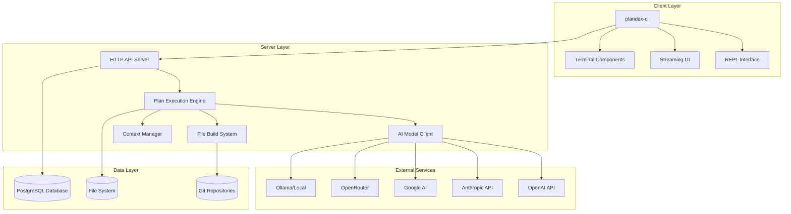
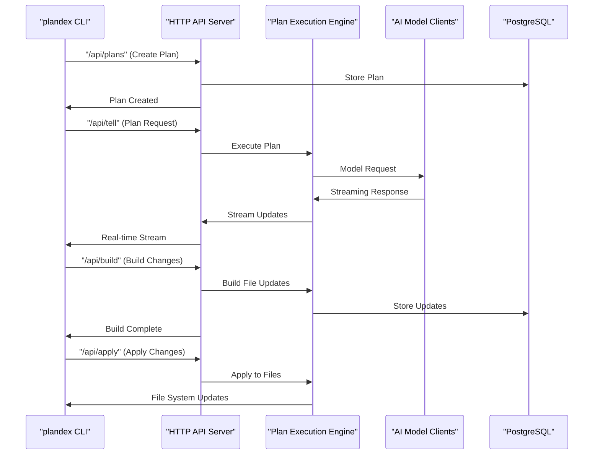
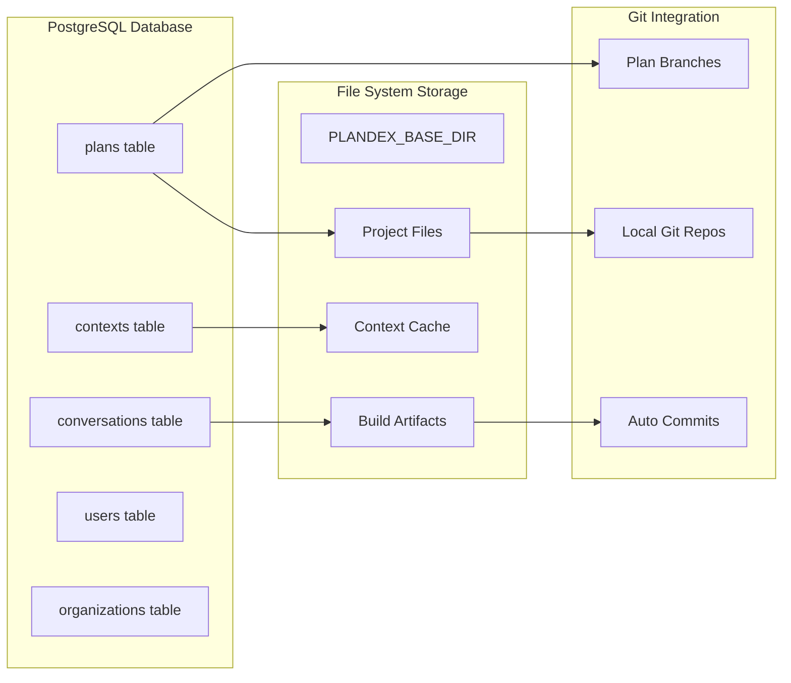
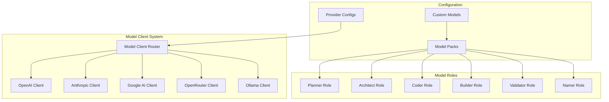
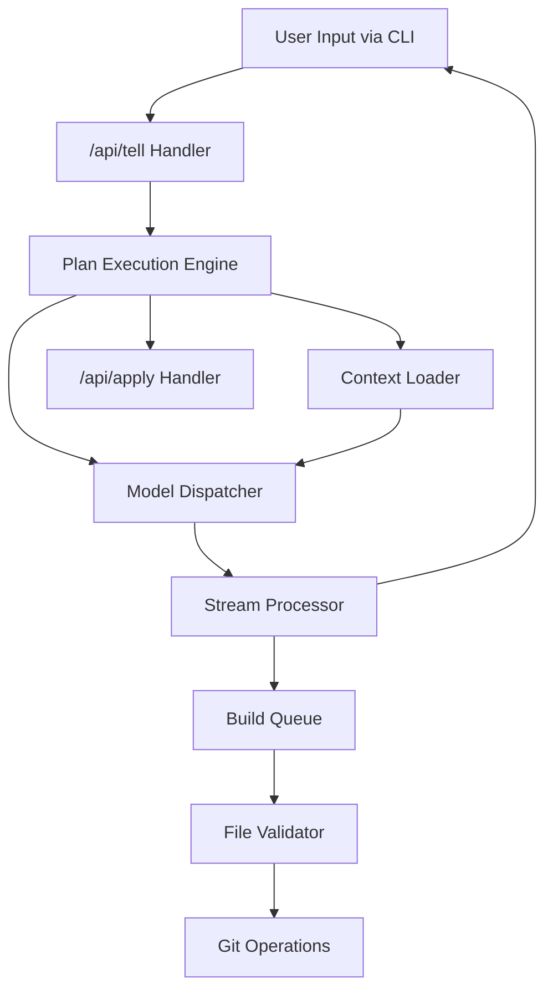
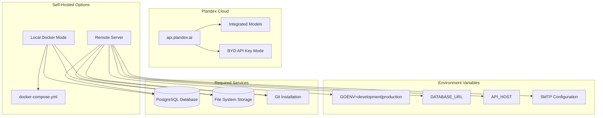

# System Architecture Overview

Relevant source files

The following files were used as context for generating this wiki page:

- [README.md](README.md)
- [app/cli/go.mod](app/cli/go.mod)
- [app/cli/go.sum](app/cli/go.sum)
- [app/server/go.mod](app/server/go.mod)
- [app/server/go.sum](app/server/go.sum)
- [app/shared/go.mod](app/shared/go.mod)
- [app/shared/go.sum](app/shared/go.sum)
- [docs/docs/cli-reference.md](docs/docs/cli-reference.md)
- [docs/docs/environment-variables.md](docs/docs/environment-variables.md)
- [docs/docs/hosting/cloud.md](docs/docs/hosting/cloud.md)
- [docs/docs/hosting/self-hosting/_category_.json](docs/docs/hosting/self-hosting/_category_.json)
- [docs/docs/hosting/self-hosting/advanced-self-hosting.md](docs/docs/hosting/self-hosting/advanced-self-hosting.md)
- [docs/docs/hosting/self-hosting/local-mode-quickstart.md](docs/docs/hosting/self-hosting/local-mode-quickstart.md)
- [docs/docs/install.md](docs/docs/install.md)
- [docs/docs/models/claude-subscription.md](docs/docs/models/claude-subscription.md)
- [docs/docs/models/models-overview.md](docs/docs/models/models-overview.md)
- [docs/docs/quick-start.md](docs/docs/quick-start.md)
- [releases/cli/versions/2.0.8.md](releases/cli/versions/2.0.8.md)

This document provides a high-level technical overview of Plandex's system architecture, covering the client-server design, module structure, and key components. It focuses on how the major subsystems interact and the overall data flow through the system.

For detailed information about individual CLI commands and their usage, see [CLI Reference](#2). For specifics about plan execution workflows, see [Plan Execution System](#3). For server-side implementation details, see [Server Architecture](#4).

## Architecture Overview

Plandex follows a client-server architecture built in Go, with three main modules: CLI, Server, and Shared components. The system is designed to handle AI-assisted coding tasks through a sophisticated plan execution pipeline that integrates with multiple AI model providers and maintains state in PostgreSQL.

### High-Level System Components

Sources: [README.md:81-125](), [app/cli/go.mod:1-107](), [app/server/go.mod:1-54](), [app/shared/go.mod:1-25]()

### Module Structure and Dependencies

```mermaid
graph TB
    subgraph "plandex-cli Module"
        CLIMain["main.go"]
        REPLCmd["REPL Commands"]
        StreamProcessor["Stream Processor"]
        UIComponents["UI Components"]
        ConfigManager["Config Manager"]
    end
    
    subgraph "plandex-server Module"
        ServerMain["main.go"]
        HTTPHandlers["HTTP Handlers"]
        PlanExec["Plan Execution"]
        ModelIntegration["Model Integration"]
        DBOperations["Database Operations"]
    end
    
    subgraph "plandex-shared Module"
        SharedTypes["Shared Types"]
        APIContracts["API Contracts"]
        CommonUtils["Common Utilities"]
        TokenUtils["Token Management"]
    end
    
    subgraph "External Dependencies"
        Cobra["github.com/spf13/cobra"]
        Mux["github.com/gorilla/mux"]
        SQLX["github.com/jmoiron/sqlx"]
        OpenAISDK["github.com/sashabaranov/go-openai"]
        PostgreSQL["github.com/lib/pq"]
        TreeSitter["github.com/smacker/go-tree-sitter"]
    end
    
    CLIMain --> SharedTypes
    CLIMain --> APIContracts
    REPLCmd --> Cobra
    UIComponents --> CommonUtils
    
    ServerMain --> SharedTypes
    ServerMain --> APIContracts
    HTTPHandlers --> Mux
    ModelIntegration --> OpenAISDK
    DBOperations --> SQLX
    DBOperations --> PostgreSQL
    
    SharedTypes --> TokenUtils
    CommonUtils --> TreeSitter
```

Sources: [app/cli/go.mod:5-28](), [app/server/go.mod:5-12](), [app/shared/go.mod:5-10]()

## Client-Server Communication

The CLI communicates with the server through HTTP APIs, with support for both synchronous requests and streaming responses for real-time plan execution.

### API Communication Flow

Sources: [docs/docs/cli-reference.md:296-370](), [app/server/go.mod:8]()

## Data Storage Architecture

Plandex uses a hybrid storage approach combining PostgreSQL for structured data and the file system for project files and Git repositories.

### Data Storage Components

Sources: [docs/docs/hosting/self-hosting/advanced-self-hosting.md:28-36](), [docs/docs/environment-variables.md:87](), [app/server/go.mod:46]()

## AI Model Integration

The system supports multiple AI model providers through a unified client interface with role-based model assignment and fallback mechanisms.

### Model Provider Architecture

Sources: [docs/docs/models/models-overview.md:10-12](), [docs/docs/environment-variables.md:22-58](), [app/server/go.mod:10]()

## Plan Execution Pipeline

The core plan execution system processes user requests through multiple stages, from initial planning to file modifications.

### Plan Execution Flow

Sources: [docs/docs/cli-reference.md:295-333](), [README.md:128-131]()

## Hosting and Deployment

Plandex supports multiple deployment modes including cloud hosting and self-hosting with Docker.

### Deployment Architecture

Sources: [docs/docs/hosting/cloud.md:14-33](), [docs/docs/hosting/self-hosting/local-mode-quickstart.md:12-19](), [docs/docs/environment-variables.md:84-111]()

This architecture enables Plandex to scale from single-user local development to multi-tenant cloud deployments while maintaining consistent functionality across all deployment modes.