# CLI Reference

Relevant source files

The following files were used as context for generating this wiki page:

- [app/cli/cmd/current.go](app/cli/cmd/current.go)
- [app/cli/cmd/new.go](app/cli/cmd/new.go)
- [app/cli/cmd/plan_start_helpers.go](app/cli/cmd/plan_start_helpers.go)
- [app/cli/cmd/repl.go](app/cli/cmd/repl.go)
- [app/cli/cmd/root.go](app/cli/cmd/root.go)
- [app/cli/term/help.go](app/cli/term/help.go)

This document provides comprehensive documentation of the Plandex command-line interface, covering command structure, REPL functionality, and command execution patterns. For server-side API details, see [Server Architecture](#4). For AI model integration specifics, see [AI Model Integration](#5). For plan execution workflows, see [Plan Execution System](#3).

## Command Structure and Organization

The Plandex CLI provides both standalone command execution and an interactive REPL environment. Commands are organized into logical categories based on their functional purpose in the plan lifecycle.

**Command Organization by Category**

```mermaid
graph TD
    CLI["plandex / pdx CLI"]
    
    subgraph "Plan Management"
        NewCmd["new - Start new plan"]
        PlansCmd["plans (pl) - List plans"]
        CdCmd["cd - Set current plan"]
        CurrentCmd["current (cu) - Show current"]
        RenameCmd["rename - Rename plan"]
        DeletePlanCmd["delete-plan (dp) - Delete plan"]
        ArchiveCmd["archive (arc) - Archive plan"]
        UnarchiveCmd["unarchive (unarc) - Unarchive plan"]
    end
    
    subgraph "Context Management"
        LoadCmd["load (l) - Load context"]
        LsCmd["ls - List context"]
        RmCmd["rm - Remove context"]
        ClearCmd["clear - Remove all context"]
        UpdateCmd["update (u) - Update context"]
        ShowCmd["show - Show context"]
    end
    
    subgraph "Plan Execution"
        TellCmd["tell (t) - Describe task"]
        ChatCmd["chat (ch) - Ask questions"]
        ContinueCmd["continue (c) - Continue plan"]
        BuildCmd["build (b) - Build changes"]
        DebugCmd["debug (db) - Debug commands"]
    end
    
    subgraph "Change Management"
        DiffCmd["diff - Review changes"]
        ApplyCmd["apply (ap) - Apply changes"]
        RejectCmd["reject (rj) - Reject changes"]
    end
    
    subgraph "History & Branches"
        LogCmd["log - Show history"]
        RewindCmd["rewind (rw) - Rewind state"]
        ConvoCmd["convo - Show conversation"]
        SummaryCmd["summary - Show summary"]
        BranchesCmd["branches (br) - List branches"]
        CheckoutCmd["checkout (co) - Switch branch"]
        DeleteBranchCmd["delete-branch (dlb) - Delete branch"]
    end
    
    subgraph "Configuration"
        ConfigCmd["config - Show config"]
        SetConfigCmd["set-config - Update config"]
        SetAutoCmd["set-auto - Set autonomy"]
        ModelsCmd["models - Show models"]
        SetModelCmd["set-model - Update models"]
        ModelPacksCmd["model-packs - Show packs"]
    end
    
    CLI --> NewCmd
    CLI --> PlansCmd
    CLI --> LoadCmd
    CLI --> TellCmd
    CLI --> DiffCmd
    CLI --> LogCmd
    CLI --> ConfigCmd
```

Sources: [app/cli/term/help.go:19-145]()

## REPL Architecture

The REPL (Read-Eval-Print Loop) is implemented through the `go-prompt` library and provides the primary interactive interface for Plandex usage.

**REPL Component Architecture**

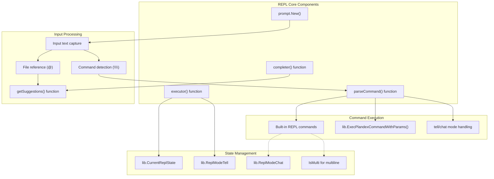

Sources: [app/cli/cmd/repl.go:31-220](), [app/cli/cmd/repl.go:521-762]()

## Command Execution Flow

Command execution follows different paths depending on whether commands are invoked directly or through the REPL interface.

**CLI Command Execution Pipeline**

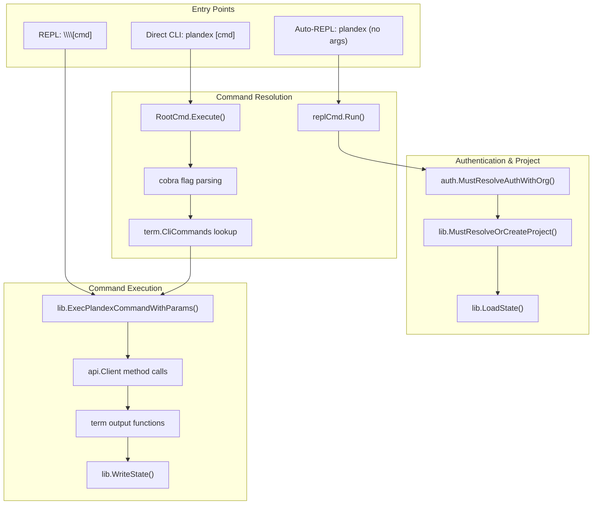

Sources: [app/cli/cmd/root.go:15-70](), [app/cli/cmd/repl.go:72-220]()

## REPL Command Processing

The REPL implements sophisticated command processing with fuzzy matching, auto-completion, and context-aware suggestions.

**REPL Input Processing Flow**

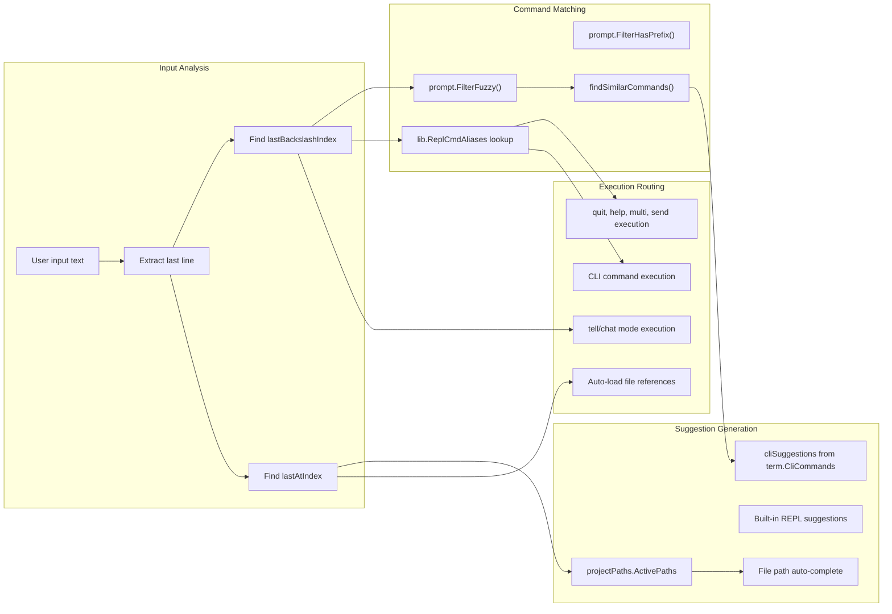

Sources: [app/cli/cmd/repl.go:521-762](), [app/cli/cmd/repl.go:914-1035]()

## Plan Management Commands

Plan management commands handle the complete lifecycle of Plandex plans from creation through deletion.

| Command | Alias | Function | Implementation |
|---------|-------|----------|----------------|
| `new` | `n` | Create new plan | [app/cli/cmd/new.go]() |
| `plans` | `pl` | List all plans | Via `term.CliCommands` |
| `cd` | - | Switch current plan | Via `term.CliCommands` |
| `current` | `cu` | Show current plan | [app/cli/cmd/current.go]() |
| `delete-plan` | `dp` | Delete plan(s) | Via `term.CliCommands` |
| `archive` | `arc` | Archive a plan | Via `term.CliCommands` |
| `unarchive` | `unarc` | Unarchive a plan | Via `term.CliCommands` |

**Plan Creation Workflow**

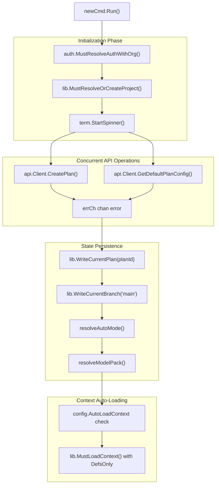

Sources: [app/cli/cmd/new.go:39-134]()

## Context Management Commands

Context management provides control over what information is available to AI models during plan execution.

| Command | Alias | Purpose | Supported Types |
|---------|-------|---------|-----------------|
| `load` | `l` | Add context to plan | Files, URLs, Notes, Images, Piped data |
| `ls` | - | List current context | All context types |
| `rm` | - | Remove context items | By index/name/glob pattern |
| `clear` | - | Remove all context | All context types |
| `update` | `u` | Refresh outdated context | File-based context only |
| `show` | - | Display context content | Individual context items |

**Context Loading Strategies**

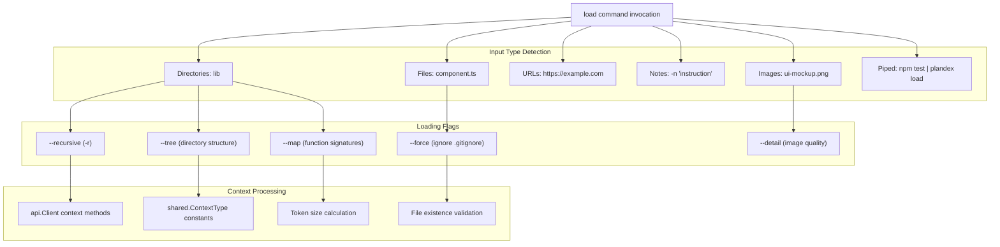

Sources: [app/cli/term/help.go:71-76](), [docs/docs/cli-reference.md:200-229]()

## Configuration Management

Configuration commands control plan behavior through the `shared.PlanConfig` struct and autonomy level settings.

**Configuration Command Architecture**

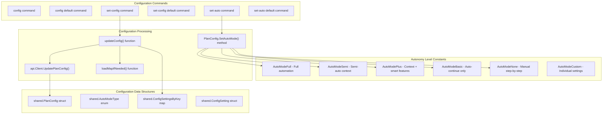

Sources: [app/cli/cmd/set_config.go:26-367](), [app/shared/plan_config.go:19-477]()

## Model Management Commands

Model management commands control AI model selection and configuration for the different roles in plan execution.

| Command | Purpose | Scope |
|---------|---------|-------|
| `models` | Show current model settings | Current plan |
| `models default` | Show org default settings | Organization-wide |
| `models available` | List available models | All providers |
| `set-model` | Update model configuration | Current plan |
| `set-model default` | Update default models | Organization-wide |
| `model-packs` | Show available model packs | Built-in and custom |

**Model System Architecture**

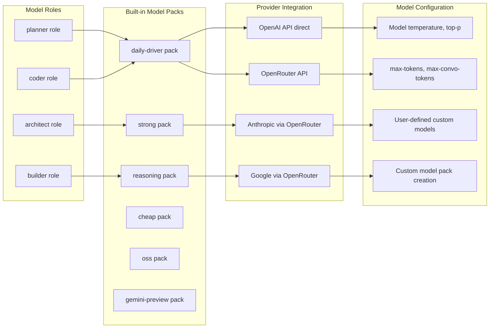

Sources: [app/cli/term/help.go:106-127](), [docs/docs/cli-reference.md:652-796]()

## Streaming and Background Execution

Plandex supports background task execution through stream management for long-running plan operations.

**Stream Management Architecture**

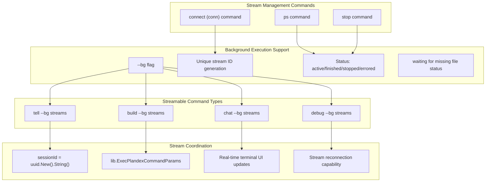

Sources: [app/cli/term/help.go:128-131](), [app/cli/cmd/repl.go:72-74]()

## Command Auto-completion and Suggestions

The REPL provides intelligent command completion based on multiple suggestion sources and context analysis.

**Suggestion System Architecture**

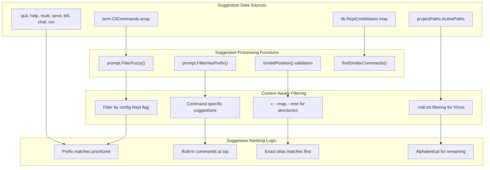

Sources: [app/cli/cmd/repl.go:521-762](), [app/cli/cmd/repl.go:222-292]()

## Command Help System

The CLI provides comprehensive help through multiple interfaces using structured command definitions.

**Help System Architecture**

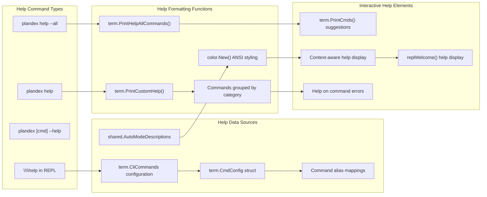

Sources: [app/cli/term/help.go:218-344](), [app/cli/cmd/root.go:77-91]()