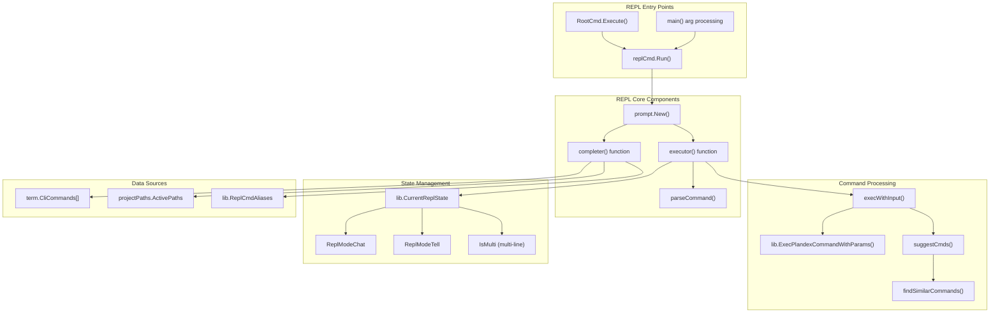
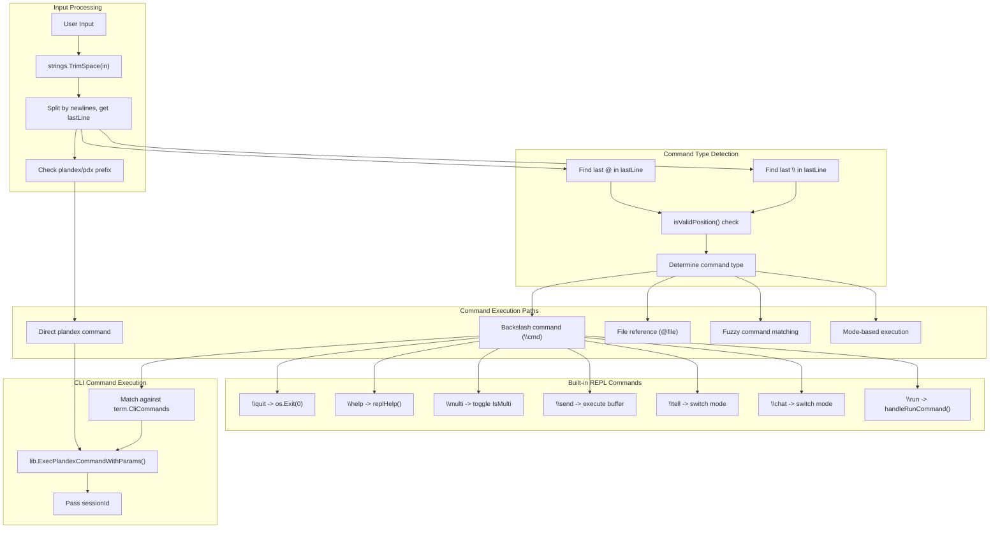
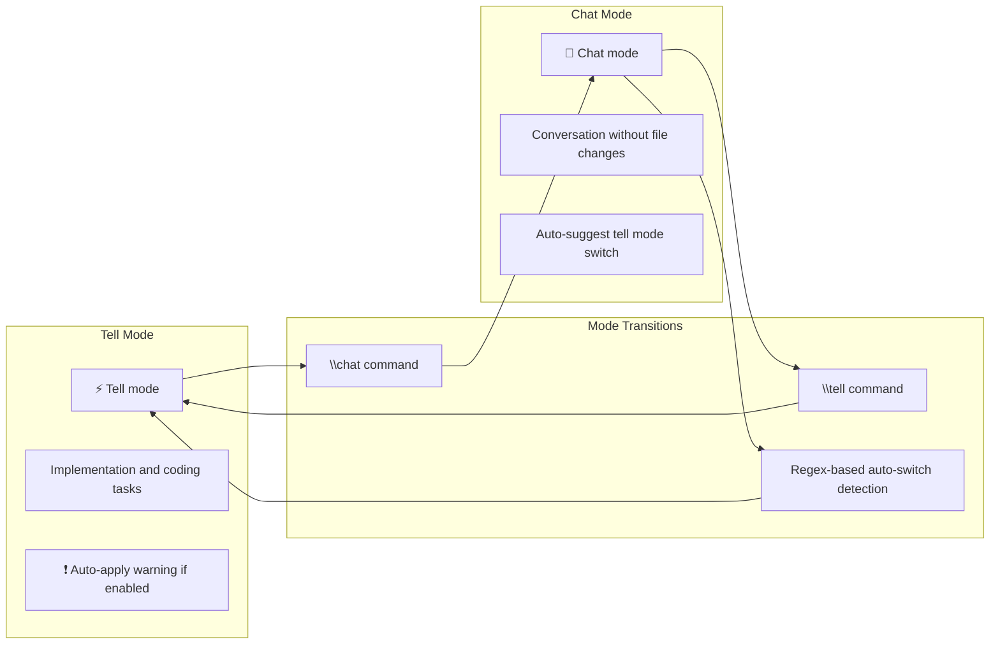
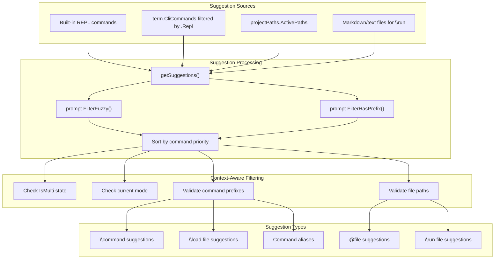
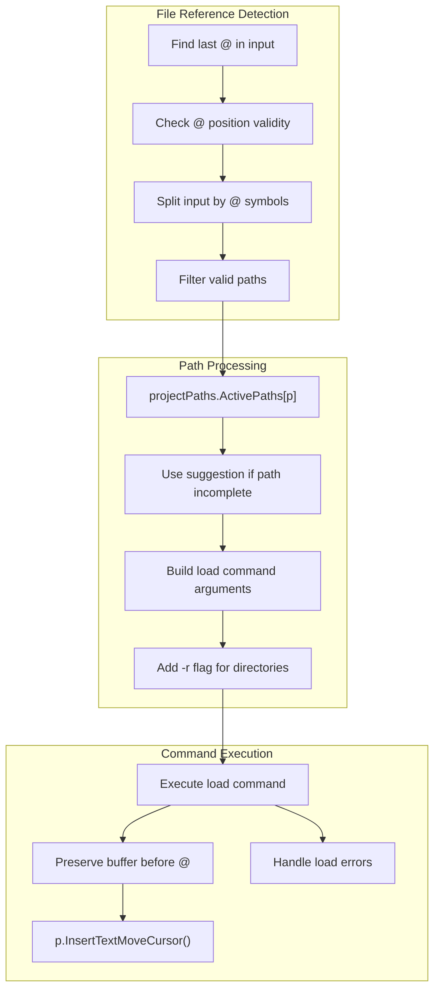
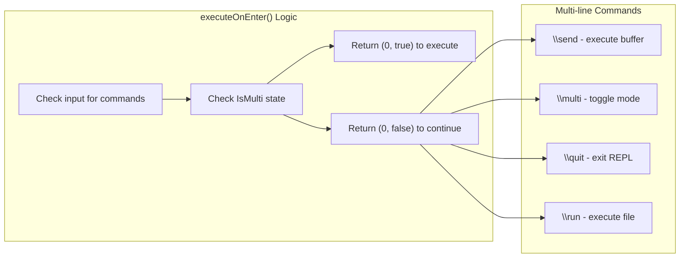
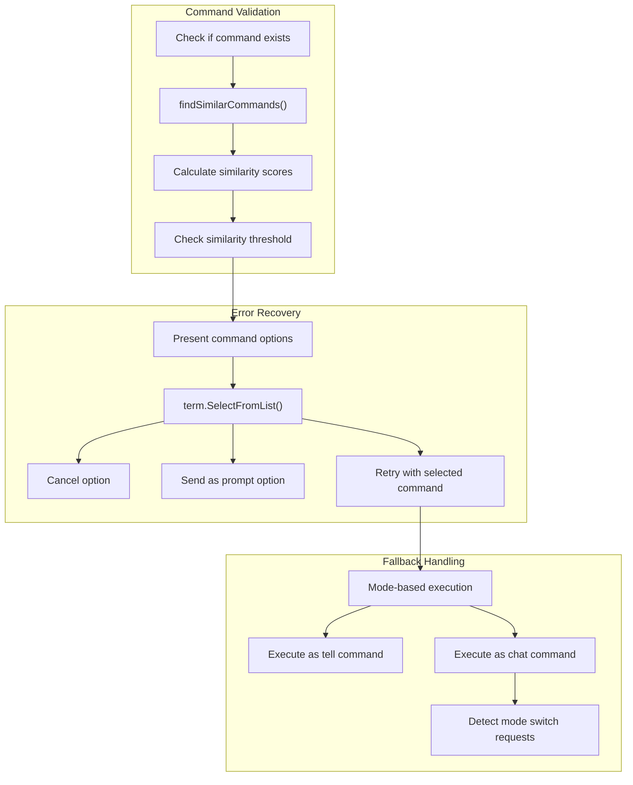

# REPL Interface

Relevant source files

The following files were used as context for generating this wiki page:

- [app/cli/cmd/current.go](app/cli/cmd/current.go)
- [app/cli/cmd/new.go](app/cli/cmd/new.go)
- [app/cli/cmd/plan_start_helpers.go](app/cli/cmd/plan_start_helpers.go)
- [app/cli/cmd/repl.go](app/cli/cmd/repl.go)
- [app/cli/cmd/root.go](app/cli/cmd/root.go)
- [app/cli/term/help.go](app/cli/term/help.go)

## Purpose and Scope

The REPL (Read-Eval-Print Loop) Interface provides an interactive command-line environment for Plandex that allows users to execute commands, switch between chat and tell modes, load files, and manage plans without repeatedly invoking the `plandex` binary. This document covers the interactive prompt system, command processing, autocomplete functionality, and mode management.

For information about individual CLI commands available within the REPL, see [Plan Execution Commands](#2.2) and [Context Management Commands](#2.3). For details about the streaming terminal UI that displays plan execution progress, see [Streaming Terminal UI](#2.5).

## REPL Architecture Overview

The REPL system is built around the `go-prompt` library and integrates closely with the main CLI command system:

**Sources:** [app/cli/cmd/repl.go:31-219](), [app/cli/cmd/root.go:29-38](), [app/cli/main.go:64-82]()

## Command Processing Flow

The REPL processes user input through a sophisticated parsing and execution pipeline:

**Sources:** [app/cli/cmd/repl.go:311-519](), [app/cli/cmd/repl.go:914-1035](), [app/cli/cmd/repl.go:1141-1367]()

## Mode Management and State

The REPL maintains state for different operational modes and multi-line editing:

| State Variable | Type | Purpose |
|----------------|------|---------|
| `lib.CurrentReplState.Mode` | `ReplModeType` | Current mode: `ReplModeTell` or `ReplModeChat` |
| `lib.CurrentReplState.IsMulti` | `bool` | Multi-line editing enabled |
| `replConfig` | `*shared.PlanConfig` | Current plan configuration |
| `sessionId` | `string` | Unique session identifier |
| `projectPaths` | `*types.ProjectPaths` | Active project file paths |

### Mode Switching

The REPL supports two primary modes with different behaviors:

**Sources:** [app/cli/cmd/repl.go:889-912](), [app/cli/cmd/repl.go:483-516](), [app/cli/cmd/repl.go:1177-1204]()

## Autocomplete and Suggestion System

The REPL provides intelligent autocomplete based on context, commands, and file paths:

**Sources:** [app/cli/cmd/repl.go:222-292](), [app/cli/cmd/repl.go:521-762](), [app/cli/cmd/repl.go:645-723]()

## File Reference Processing

The REPL supports `@` prefixed file references for quick context loading:

**Sources:** [app/cli/cmd/repl.go:354-394](), [app/cli/cmd/repl.go:936-966](), [app/cli/cmd/repl.go:257-289]()

## Multi-line Editing Support

The REPL provides multi-line editing capabilities with special handling:

| Feature | Single-line Mode | Multi-line Mode |
|---------|------------------|-----------------|
| Enter Behavior | Execute command | Add line break |
| Send Command | Automatic on enter | `\send` command |
| Mode Toggle | `\multi` to enable | `\multi` to disable |
| Visual Indicator | `1️⃣ Multi-line mode is disabled` | `🔢 Multi-line mode is enabled` |

**Sources:** [app/cli/cmd/repl.go:294-307](), [app/cli/cmd/repl.go:901-912](), [app/cli/cmd/repl.go:225-251]()

## Command Validation and Error Handling

The REPL includes sophisticated command validation and error recovery:

**Sources:** [app/cli/cmd/repl.go:1099-1120](), [app/cli/cmd/repl.go:420-460](), [app/cli/cmd/repl.go:483-516]()

## Integration with CLI Commands

The REPL seamlessly integrates with the main CLI command system:

| Integration Point | Implementation | Purpose |
|------------------|----------------|---------|
| Command Definitions | `term.CliCommands` array | Shared command metadata |
| Command Execution | `lib.ExecPlandexCommandWithParams()` | Execute CLI commands with session context |
| Session Tracking | `sessionId` parameter | Track REPL session for analytics |
| State Persistence | `lib.WriteHistory()`, `lib.WriteState()` | Maintain command history and REPL state |
| Configuration Access | `replConfig` variable | Access current plan configuration |

**Sources:** [app/cli/term/help.go:19-145](), [app/cli/cmd/repl.go:332-340](), [app/cli/cmd/repl.go:72-73]()