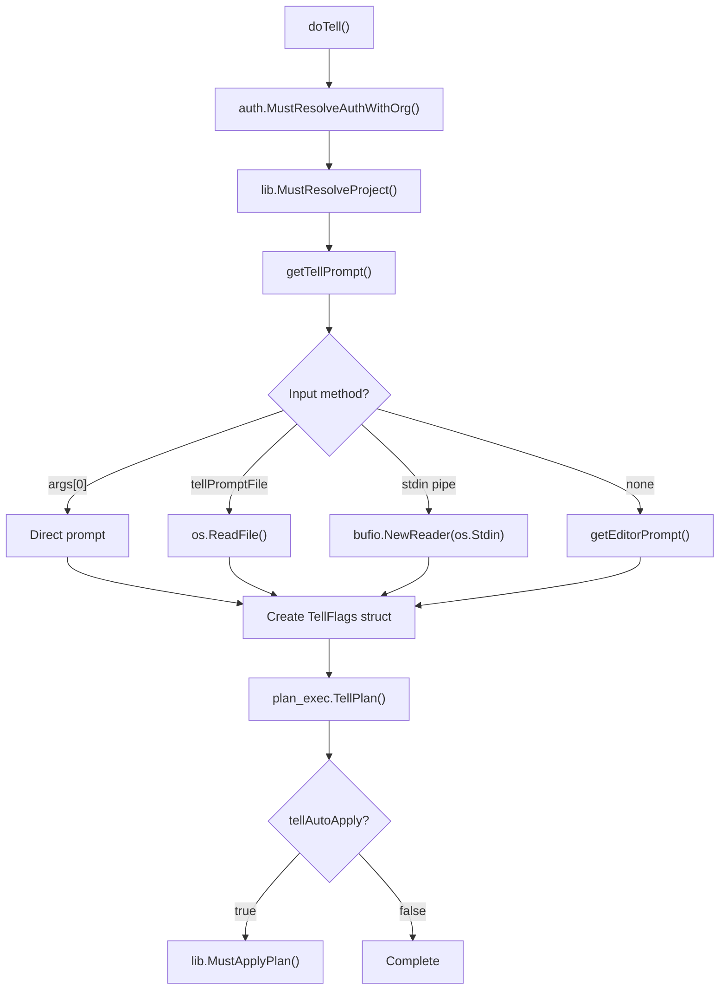
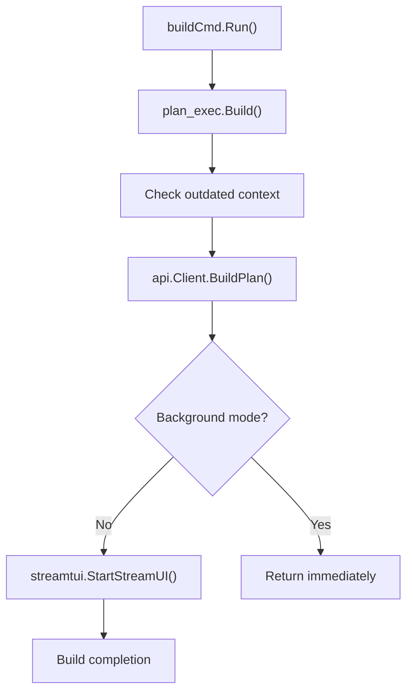
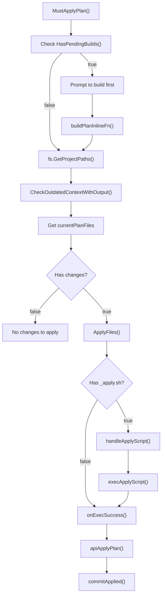
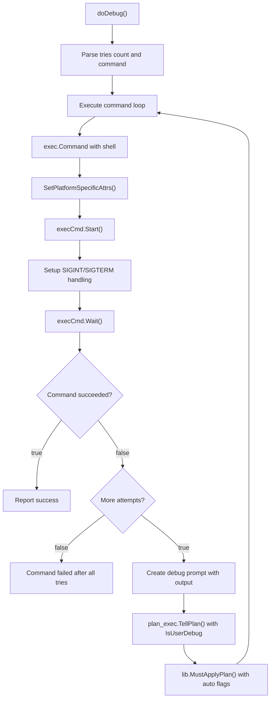
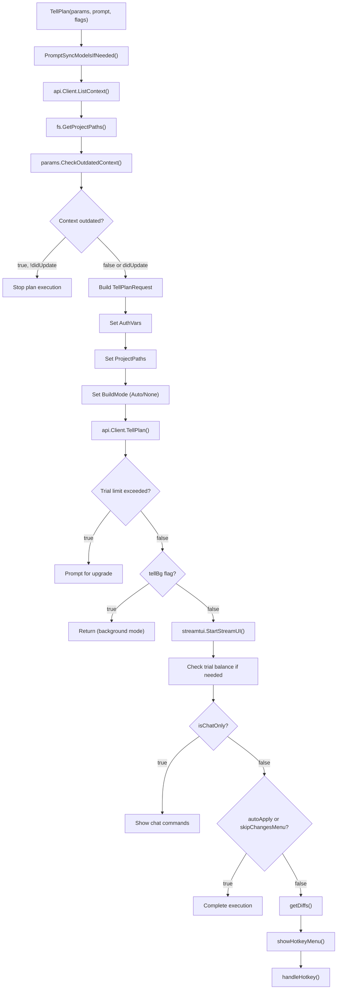
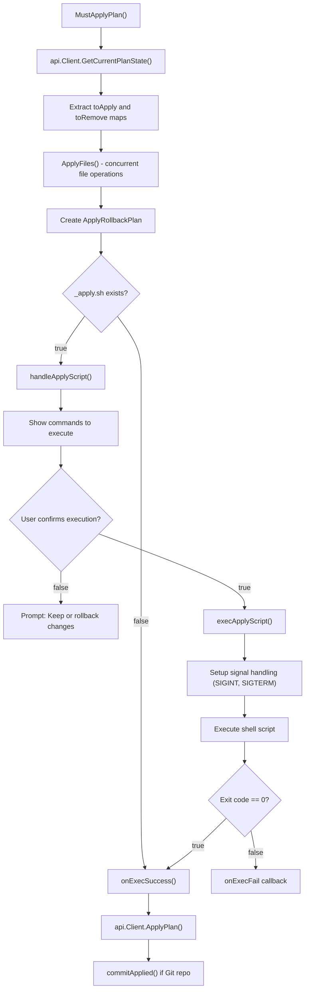
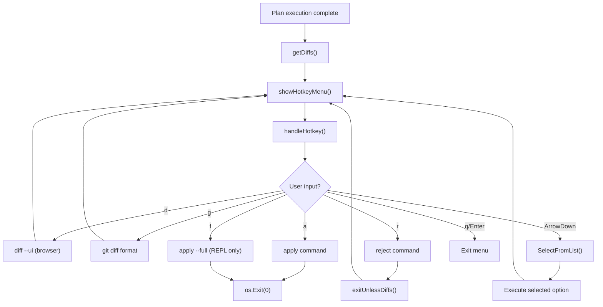
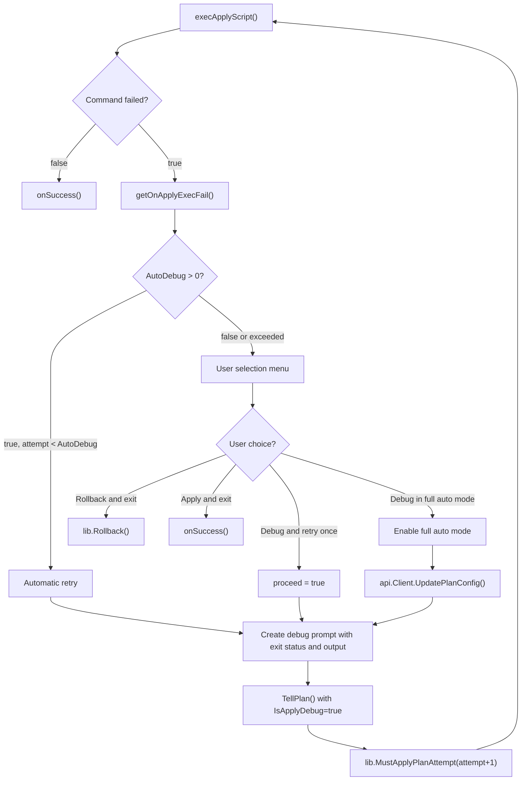

# Plan Execution Commands

<details>
<summary>Relevant source files</summary>

The following files were used as context for generating this wiki page:

- [app/cli/cmd/build.go](app/cli/cmd/build.go)
- [app/cli/cmd/chat.go](app/cli/cmd/chat.go)
- [app/cli/cmd/continue.go](app/cli/cmd/continue.go)
- [app/cli/cmd/debug.go](app/cli/cmd/debug.go)
- [app/cli/cmd/tell.go](app/cli/cmd/tell.go)
- [app/cli/lib/apply.go](app/cli/lib/apply.go)
- [app/cli/main.go](app/cli/main.go)
- [app/cli/plan_exec/action_menu.go](app/cli/plan_exec/action_menu.go)
- [app/cli/plan_exec/apply_exec.go](app/cli/plan_exec/apply_exec.go)
- [app/cli/plan_exec/build.go](app/cli/plan_exec/build.go)
- [app/cli/plan_exec/params.go](app/cli/plan_exec/params.go)
- [app/cli/plan_exec/tell.go](app/cli/plan_exec/tell.go)
- [app/cli/types/apply.go](app/cli/types/apply.go)
- [app/cli/types/exec.go](app/cli/types/exec.go)
- [app/cli/types/fs.go](app/cli/types/fs.go)

</details>


This document covers the core plan execution commands in Plandex that enable users to interact with AI models to implement coding tasks. These commands form the primary interface for sending prompts, continuing work, building changes, and managing the plan lifecycle.

For information about context management (loading files, URLs, notes), see [Context Management Commands](#2.3). For model configuration, see [Model Configuration Commands](#2.4).

## Command Overview

Plandex provides several commands for executing plans and interacting with AI models. These commands can be used both in standalone CLI mode and within the interactive REPL.

| Command | Alias | Description | Usage Context |
|---------|-------|-------------|---------------|
| `tell` | `t` | Send a prompt to implement a task | CLI/REPL |
| `continue` | `c` | Continue the current plan | CLI/REPL |
| `build` | `b` | Build pending changes without new prompts | CLI/REPL |
| `apply` | `a` | Apply pending changes to files | CLI/REPL |
| `chat` | `ch` | Ask questions without making changes | CLI/REPL |
| `debug` | `db` | Debug failing commands with AI assistance | CLI/REPL |

**Sources:** [app/cli/cmd/tell.go:24-31](), [app/cli/cmd/continue.go:18-23](), [app/cli/cmd/build.go:16-23](), [app/cli/lib/apply.go:37-42](), [app/cli/cmd/chat.go:15-22](), [app/cli/cmd/debug.go:31-37]()

## Core Execution Commands

### Tell Command

The `tell` command is the primary interface for describing tasks to AI models. It sends prompts to begin implementation work.

```bash
# Basic usage
plandex tell "Add a login form to the homepage"

# With file input
plandex tell -f requirements.txt

# With piped input
echo "Fix the validation bug" | plandex tell

# Implementation from chat discussion
plandex tell --from-chat
```

The command supports multiple input methods:
- Direct prompt argument
- File input via `-f` flag (`tellPromptFile`)
- Piped stdin data
- Interactive editor when no input provided
- Implementation flag (`--from-chat`) for transitioning from chat to implementation

**Tell Command Execution Flow:**



**Sources:** [app/cli/cmd/tell.go:41-100](), [app/cli/cmd/tell.go:102-142](), [app/cli/plan_exec/tell.go:26-286]()

### Continue Command

The `continue` command resumes an existing plan without providing additional prompts, allowing the AI to continue working on the current task.

```bash
# Basic continue
plandex continue

# Continue in chat mode (no file changes)
plandex continue --chat
```

The command reuses the same execution pipeline as `tell` but with the `IsUserContinue` flag set to true.

**Sources:** [app/cli/cmd/continue.go:36-87]()

### Build Command

The `build` command processes pending changes without sending new prompts to AI models. It validates and prepares file modifications for review.

```bash
# Build pending changes
plandex build

# Build in background
plandex build --bg
```

**Build Process Flow:**



**Sources:** [app/cli/cmd/build.go:38-102](), [app/cli/plan_exec/build.go:17-105]()

### Apply Command

The `apply` command takes built changes and applies them to the actual project files. It handles file modifications, execution of apply scripts, and Git integration.

```bash
# Apply all pending changes
plandex apply

# Apply with automatic confirmation
plandex apply --yes

# Apply and commit changes
plandex apply --commit

# Apply without executing scripts
plandex apply --no-exec
```

**Apply Command Process Flow:**



**Sources:** [app/cli/lib/apply.go:37-252](), [app/cli/lib/apply.go:622-750]()

### Chat Command

The `chat` command enables conversational interaction without making file changes. It's useful for asking questions and exploring ideas.

```bash
# Ask a question
plandex chat "How does the authentication system work?"

# Chat with file context
plandex chat -f question.txt
```

Chat mode sets the `IsChatOnly` flag, which prevents file modifications while allowing full AI interaction.

**Sources:** [app/cli/cmd/chat.go:39-64]()

### Debug Command

The `debug` command helps fix failing commands by running them repeatedly and using Plandex to analyze and fix failures automatically.

```bash
# Debug a failing command (default 5 tries)
plandex debug "npm test"

# Debug with custom retry count
plandex debug 3 "go build ./..."

# Debug with commit on success
plandex debug --commit "docker build -t myapp ."
```

**Debug Command Execution Flow:**



**Sources:** [app/cli/cmd/debug.go:44-269]()

## Execution Flags and Options

All execution commands share a common set of flags defined in `initExecFlags()`:

### Automation Flags

| Flag | Description | Default | Used By |
|------|-------------|---------|---------|
| `--bg` | Run in background | false | tell, continue, build |
| `--stop` | Stop after first response | false | tell, continue |
| `--no-build` | Skip building changes | false | tell, continue |
| `--auto-apply` | Automatically apply changes | false | tell, continue, build |
| `--auto-context` | Automatically load context | false | tell, continue, chat |
| `--smart-context` | Use smart context loading | false | tell, continue |
| `--no-exec` | Skip execution of apply scripts | false | tell, continue, build |
| `--auto-exec` | Automatically execute apply scripts | false | tell, continue, build |

### File and Editor Flags

| Flag | Description | Used By |
|------|-------------|---------|
| `-f, --file` | Read prompt from file | tell, chat |
| `--editor` | Specify editor (vim/nano) | tell |
| `--from-chat` | Begin implementation from chat | tell |

### Apply-Specific Flags

| Flag | Description | Default |
|------|-------------|---------|
| `--yes` | Auto-confirm file changes | false |
| `--commit` | Auto-commit after apply | false |
| `--no-commit` | Skip Git commit prompt | false |

### Debug-Specific Flags

| Flag | Description | Default |
|------|-------------|---------|
| `-c, --commit` | Commit after successful execution | false |

**Sources:** [app/cli/cmd/tell.go:36-38](), [app/cli/cmd/continue.go:25-34](), [app/cli/cmd/debug.go:41-42](), [app/cli/lib/apply.go:49-57]()

## Plan Execution Pipeline

The core execution logic is implemented in the `plan_exec` package, which orchestrates the interaction between CLI commands, API calls, and the streaming UI.

**Complete TellPlan Execution Flow:**



**Key Data Structures:**

- `ExecParams`: Contains `CurrentPlanId`, `CurrentBranch`, `AuthVars`, and `CheckOutdatedContext` function
- `TellFlags`: Contains execution flags like `TellBg`, `TellStop`, `AutoApply`, `IsChatOnly`, etc.
- `shared.TellPlanRequest`: API request with `Prompt`, `ConnectStream`, `BuildMode`, `ProjectPaths`, etc.
- `stream.OnStreamPlan`: Callback function for handling streaming responses

**Sources:** [app/cli/plan_exec/tell.go:26-286](), [app/cli/plan_exec/params.go:8-13](), [app/cli/plan_exec/action_menu.go:77-284]()

## Apply Execution Pipeline  

The apply process handles the actual modification of project files and execution of generated scripts.

**Apply Process Architecture:**



**Sources:** [app/cli/lib/apply.go:37-252](), [app/cli/lib/apply.go:254-574](), [app/cli/lib/apply.go:622-750]()

## Interactive Action Menu

After plan execution completes, users can interact with changes through a hotkey-driven menu system implemented in `action_menu.go`.

**Action Menu Flow:**



### Available Hotkeys

| Key | Command | Description | Context |
|-----|---------|-------------|---------|
| `d` | `diff ui` | Review diffs in browser UI | All |
| `g` | `git diff format` | Review diffs in git diff format | All |  
| `r` | `reject` | Reject some or all pending changes | All |
| `a` | `apply` | Apply all pending changes | All |
| `f` | `full auto` | Apply and debug in full auto mode | REPL only, with apply script |
| `↓` | dropdown | Show dropdown menu | All |
| `q`/`Enter` | exit | Exit menu | All |

**Sources:** [app/cli/plan_exec/action_menu.go:28-75](), [app/cli/plan_exec/action_menu.go:77-150](), [app/cli/plan_exec/action_menu.go:152-284]()

## Auto-Apply and Retry Logic

When execution fails (particularly with apply scripts), Plandex provides sophisticated retry and debugging capabilities.

**Apply Failure Handling:**



**Sources:** [app/cli/plan_exec/apply_exec.go:26-169](), [app/cli/lib/apply.go:254-318]()

## Error Handling and Validation

Plan execution includes comprehensive error handling for common scenarios:

### Context Validation
- Outdated context detection and auto-update prompts
- Missing context warnings
- File path validation

### API Error Handling  
- Trial message limits with upgrade prompts
- Authentication failures
- Model provider errors with fallbacks

### Build Validation
- Syntax error detection
- File modification conflicts
- Git repository state checks

**Sources:** [app/cli/plan_exec/tell.go:78-97](), [app/cli/plan_exec/tell.go:161-189]()