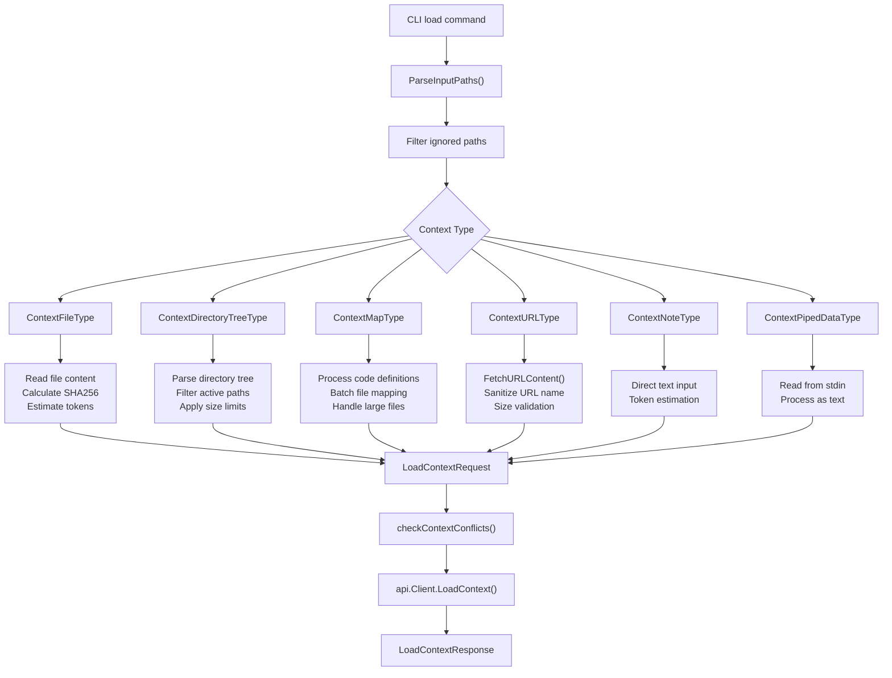
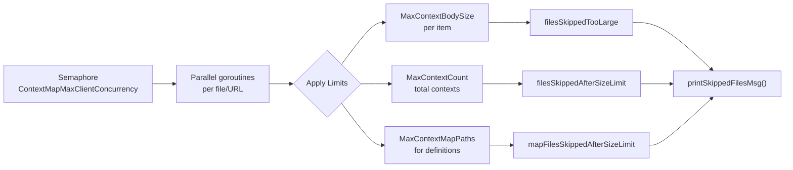
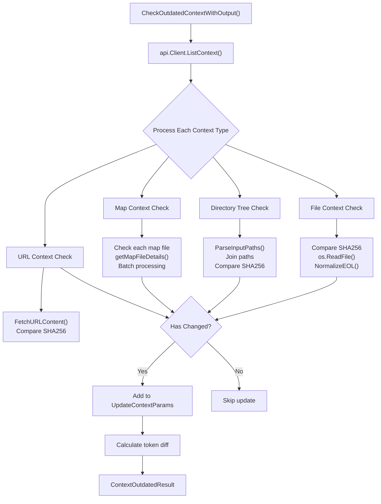
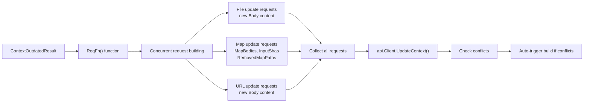
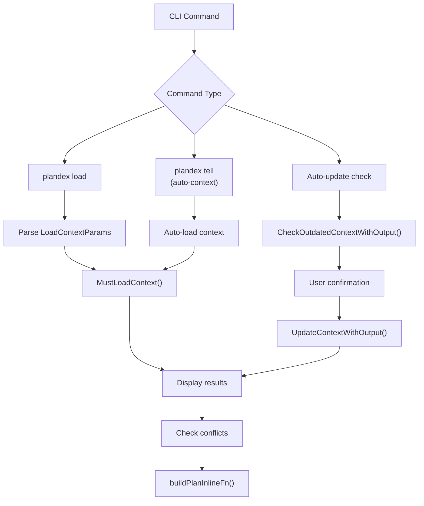

# Context Management Commands

<details>
<summary>Relevant source files</summary>

The following files were used as context for generating this wiki page:

- [app/cli/lib/context_load.go](app/cli/lib/context_load.go)
- [app/cli/lib/context_update.go](app/cli/lib/context_update.go)
- [app/cli/types/types.go](app/cli/types/types.go)

</details>


This document covers the CLI commands and underlying system for managing project context in Plandex plans. Context management includes loading files, directories, URLs, notes, and other content into a plan's context, as well as keeping that context synchronized with changes in the filesystem.

For information about the overall plan execution system that uses this context, see [Plan Execution System](#3). For details about the streaming terminal interface during context operations, see [Streaming Terminal UI](#2.5).

## Overview and Context Types

Plandex context management handles multiple types of content that can be loaded into a plan's working context. The system processes these context types through the `MustLoadContext` function and related infrastructure.

### Supported Context Types

| Context Type | Description | Source |
|--------------|-------------|--------|
| `ContextFileType` | Individual files with full content | Local filesystem |
| `ContextDirectoryTreeType` | Directory structures (names only) | Local filesystem |
| `ContextMapType` | Code definitions and structure maps | Local filesystem |
| `ContextURLType` | Web content from URLs | Remote web resources |
| `ContextNoteType` | User-provided text notes | Command line input |
| `ContextPipedDataType` | Data piped from other commands | Standard input |
| `ContextImageType` | Image files (base64 encoded) | Local filesystem |

Sources: [app/cli/lib/context_load.go:60-87](), [shared types for context types]()

## Context Loading Process

The context loading system processes different resource types through a unified pipeline that handles concurrent processing, size limits, and conflict detection.



Sources: [app/cli/lib/context_load.go:26-757](), [app/cli/lib/context_load.go:94-610]()

### Concurrent Processing and Limits

The context loading system uses goroutines with a semaphore to control concurrency and applies multiple size and count limits:



Sources: [app/cli/lib/context_load.go:155-156](), [app/cli/lib/context_load.go:358-399](), [app/cli/lib/context_load.go:752-756]()

## Context Update and Synchronization

The context update system detects when loaded context has become outdated compared to the filesystem and provides mechanisms to synchronize changes.

### Outdated Context Detection



Sources: [app/cli/lib/context_update.go:24-196](), [app/cli/lib/context_update.go:289-1025]()

### Update Request Processing

The system builds update requests through concurrent processing while maintaining consistency:



Sources: [app/cli/lib/context_update.go:936-961](), [app/cli/lib/context_update.go:209-287]()

## Key Data Structures

### LoadContextParams

The `LoadContextParams` struct controls how context loading behaves:

```go
type LoadContextParams struct {
    Note              string                // Direct text note content
    Recursive         bool                  // Load directories recursively  
    NamesOnly         bool                  // Directory tree mode (names only)
    ForceSkipIgnore   bool                  // Ignore .gitignore/.plandexignore
    ImageDetail       openai.ImageURLDetail // Image processing detail level
    DefsOnly          bool                  // Load code definitions only (maps)
    SkipIgnoreWarning bool                  // Suppress ignore warnings
    AutoLoaded        bool                  // Automatically loaded context
    SessionId         string                // Session identifier
}
```

Sources: [app/cli/types/types.go:10-20]()

### Context Processing Results

The `ContextOutdatedResult` tracks what changed during context checking:

```go
type ContextOutdatedResult struct {
    Msg             string                     // Status message
    UpdatedContexts []*shared.Context         // Contexts that changed
    RemovedContexts []*shared.Context         // Contexts that were deleted
    TokenDiffsById  map[string]int            // Token count changes by context ID
    NumFiles        int                       // Number of updated files
    NumUrls         int                       // Number of updated URLs  
    NumTrees        int                       // Number of updated directory trees
    NumMaps         int                       // Number of updated maps
    NumFilesRemoved int                       // Number of removed files
    NumTreesRemoved int                       // Number of removed trees
    ReqFn           func() (map[string]*shared.UpdateContextParams, error) // Update function
}
```

Sources: [app/cli/types/types.go:22-34]()

## CLI Command Integration

Context management commands integrate with the broader CLI system through several entry points:

### Command Processing Flow



Sources: [app/cli/lib/context_load.go:26](), [app/cli/lib/context_update.go:24](), [app/cli/lib/context_load.go:733-740]()