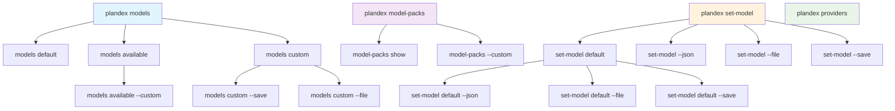
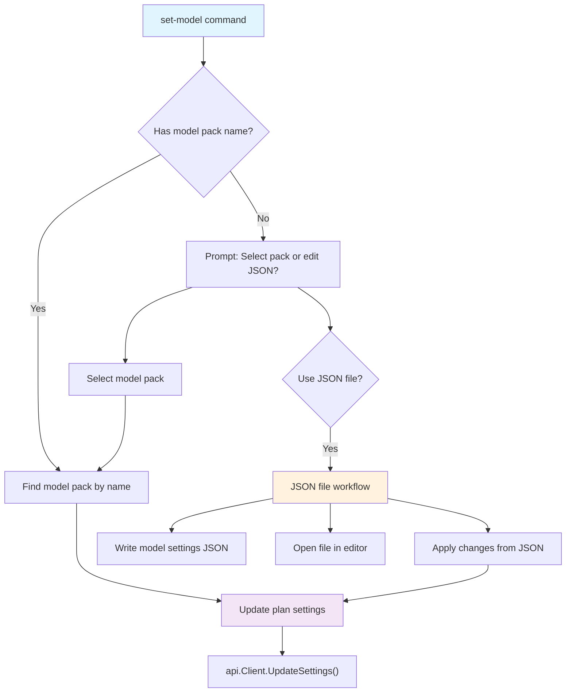
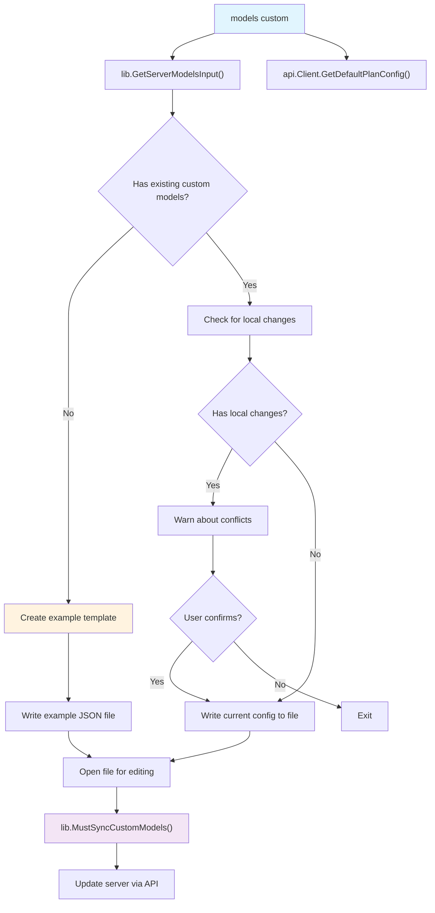
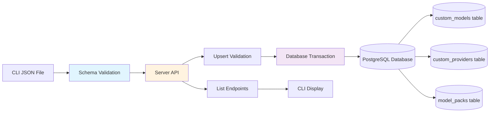

# Model Configuration Commands

<details>
<summary>Relevant source files</summary>

The following files were used as context for generating this wiki page:

- [app/cli/cmd/model_packs.go](app/cli/cmd/model_packs.go)
- [app/cli/cmd/model_providers.go](app/cli/cmd/model_providers.go)
- [app/cli/cmd/models.go](app/cli/cmd/models.go)
- [app/cli/cmd/set_model.go](app/cli/cmd/set_model.go)
- [app/cli/lib/model_settings.go](app/cli/lib/model_settings.go)
- [app/server/handlers/models.go](app/server/handlers/models.go)
- [app/shared/ai_models_custom.go](app/shared/ai_models_custom.go)

</details>


This document covers CLI commands for configuring and managing AI models in Plandex. This includes selecting model packs, creating custom models and providers, and managing model-specific settings for different AI roles.

For information about how models are integrated with the execution system, see [AI Model Integration and Task Control](#3.2). For details about model pack data structures and configuration schemas, see [Model Configuration and Management](#5.1).

## Purpose and Scope

Model configuration commands allow users to:
- View current model settings for plans and organization defaults
- Select and switch between built-in model packs
- Create and manage custom models, providers, and model packs
- Configure model-specific parameters like temperature and token limits
- Manage different AI model roles (planner, architect, coder, builder, etc.)

## Core Concepts

### Model Roles
Plandex assigns different AI models to specialized roles during plan execution:
- **Planner**: Orchestrates the overall development plan
- **Architect**: Designs system architecture and file structure
- **Coder**: Implements specific code changes
- **Builder**: Processes and validates file modifications
- **PlanSummary**: Generates plan summaries
- **Namer**: Creates names for plans and commits
- **CommitMsg**: Generates commit messages
- **ExecStatus**: Evaluates execution status

### Model Packs
Model packs are predefined configurations that assign specific models to each role. They include built-in packs (like "daily-driver" and "opus-planner") and custom user-defined packs.

### Custom Models and Providers
Users can define custom models that use various providers (OpenAI, Anthropic, custom endpoints, etc.) and create model packs that utilize these custom models.

Sources: [app/cli/cmd/models.go:364-507](), [app/shared/ai_models_custom.go:25-306]()

## Command Hierarchy



Sources: [app/cli/cmd/models.go:28-44](), [app/cli/cmd/set_model.go:23-35](), [app/cli/cmd/model_packs.go:51-59](), [app/cli/cmd/model_providers.go:42-47]()

## Viewing Model Configurations

### Current Plan Model Settings

The `plandex models` command displays the current model configuration for the active plan:

```bash
plandex models           # Show current plan's model settings
plandex models --all     # Show all model properties including temperature, top-p
```

This command calls the `models()` function which:
1. Retrieves the current plan via `api.Client.GetPlan()`
2. Fetches plan settings via `api.Client.GetSettings()`
3. Renders the model pack information using `renderSettings()`

The output includes:
- Current model pack name and description
- Models assigned to each role
- Token limits and model-specific parameters (with `--all` flag)

Sources: [app/cli/cmd/models.go:240-277]()

### Organization Default Settings

The `plandex models default` command shows organization-wide default model settings:

```bash
plandex models default
```

This retrieves default settings via `api.Client.GetOrgDefaultSettings()` and displays them using the same rendering logic as plan-specific settings.

Sources: [app/cli/cmd/models.go:279-302]()

### Available Models

List all available models (built-in and custom):

```bash
plandex models available         # List all models
plandex models available --custom # List only custom models
```

The `listAvailableModels()` function:
- Fetches custom models via `api.Client.ListCustomModels()`
- Displays built-in models from `shared.BuiltInBaseModels`
- Shows model capabilities (input tokens, output tokens, reserved tokens)

Sources: [app/cli/cmd/models.go:304-362]()

## Setting Model Configurations

### Model Pack Selection

Set a model pack for the current plan or organization defaults:

```bash
plandex set-model [model-pack-name]          # Set for current plan
plandex set-model default [model-pack-name]  # Set organization default
```

The model selection flow:



Sources: [app/cli/cmd/set_model.go:52-135](), [app/cli/cmd/set_model.go:137-379]()

### JSON-Based Configuration

For advanced configuration, users can edit model settings as JSON:

```bash
plandex set-model --json              # Edit current plan settings
plandex set-model default --json      # Edit default settings
plandex set-model --file path.json    # Use specific file
plandex set-model --save              # Apply changes from existing file
```

The JSON workflow:
1. Generates a JSON file with current settings via `lib.WriteModelSettingsFile()`
2. Opens the file for editing (with optional editor prompt)
3. Validates changes using schema validation
4. Applies changes via `lib.ApplyModelSettings()`

Sources: [app/cli/cmd/set_model.go:231-303](), [app/cli/lib/model_settings.go:73-151]()

## Managing Custom Models and Providers

### Custom Models Management

The `plandex models custom` command provides a comprehensive interface for managing custom models, providers, and model packs:

```bash
plandex models custom               # Manage custom configurations
plandex models custom --save        # Apply changes from file
plandex models custom --file path   # Use specific file path
```

The custom models workflow:



Sources: [app/cli/cmd/models.go:93-238]()

### Example Template Structure

When no custom models exist, the system generates an example template via `getExampleTemplate()`:

```json
{
  "$schema": "https://plandex.ai/schemas/models-input.schema.json",
  "providers": [
    {
      "name": "togetherai",
      "baseUrl": "https://api.together.xyz/v1",
      "apiKeyEnvVar": "TOGETHER_API_KEY"
    }
  ],
  "models": [
    {
      "modelId": "meta-llama/llama-4-maverick",
      "publisher": "meta-llama",
      "description": "Meta Llama 4 Maverick",
      "maxTokens": 1048576,
      "providers": [...]
    }
  ],
  "modelPacks": [
    {
      "name": "example-model-pack",
      "description": "Example model pack",
      "planner": "deepseek/r1",
      "architect": "deepseek/r1",
      "coder": {...}
    }
  ]
}
```

Sources: [app/cli/cmd/models.go:516-612]()

### Model Providers

View available model providers:

```bash
plandex providers                # List all providers
plandex providers --custom       # List only custom providers
```

The providers list shows:
- Built-in providers (OpenAI, Anthropic, Google, etc.)
- Base URLs and authentication requirements
- Custom providers (self-hosted only)

Sources: [app/cli/cmd/model_providers.go:49-163]()

### Model Packs Management

List and inspect model packs:

```bash
plandex model-packs              # List all model packs
plandex model-packs --custom     # List only custom packs
plandex model-packs show [name]  # Show detailed pack configuration
```

The `showModelPack()` function displays:
- Model pack metadata (name, description)
- Role-to-model assignments
- Fallback configurations (large-context, large-output, error fallbacks)
- Model parameters (temperature, top-p, token limits)

Sources: [app/cli/cmd/model_packs.go:125-202]()

## Server-Side Model Management

### Custom Models API

The server provides REST endpoints for managing custom models:

| Endpoint | Method | Purpose |
|----------|--------|---------|
| `/custom_models` | POST | Create/update custom models, providers, packs |
| `/custom_models` | GET | List custom models |
| `/custom_providers` | GET | List custom providers |
| `/model_packs` | GET | List custom model packs |

The `UpsertCustomModelsHandler` performs comprehensive validation:
- Checks for duplicate names/IDs
- Validates provider references
- Ensures model compatibility with cloud/local environments
- Performs atomic updates using database transactions

Sources: [app/server/handlers/models.go:19-339]()

### Data Flow for Custom Models



Sources: [app/server/handlers/models.go:290-328](), [app/shared/ai_models_custom.go:63-98]()

## Command Reference

| Command | Purpose | Key Flags |
|---------|---------|-----------|
| `plandex models` | Show current plan model settings | `--all` |
| `plandex models default` | Show organization default settings | |
| `plandex models available` | List available models | `--custom` |
| `plandex models custom` | Manage custom models/providers/packs | `--save`, `--file` |
| `plandex set-model [name]` | Set current plan model pack | `--json`, `--file`, `--save` |
| `plandex set-model default [name]` | Set organization default model pack | `--json`, `--file`, `--save` |
| `plandex model-packs` | List model packs | `--custom`, `--all` |
| `plandex model-packs show [name]` | Show model pack details | `--all` |
| `plandex providers` | List model providers | `--custom` |

Sources: [app/cli/cmd/models.go:46-91](), [app/cli/cmd/set_model.go:37-50](), [app/cli/cmd/model_packs.go:19-49](), [app/cli/cmd/model_providers.go:22-41]()