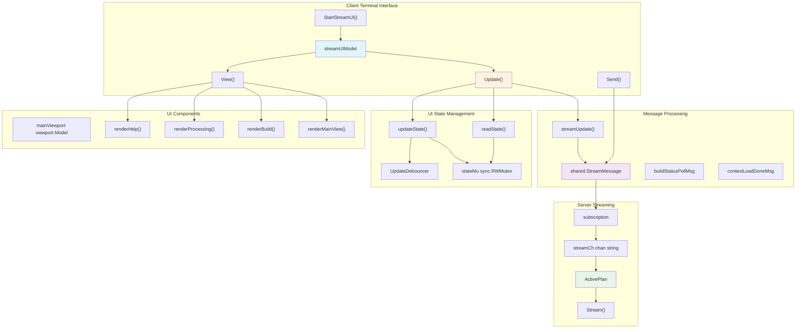
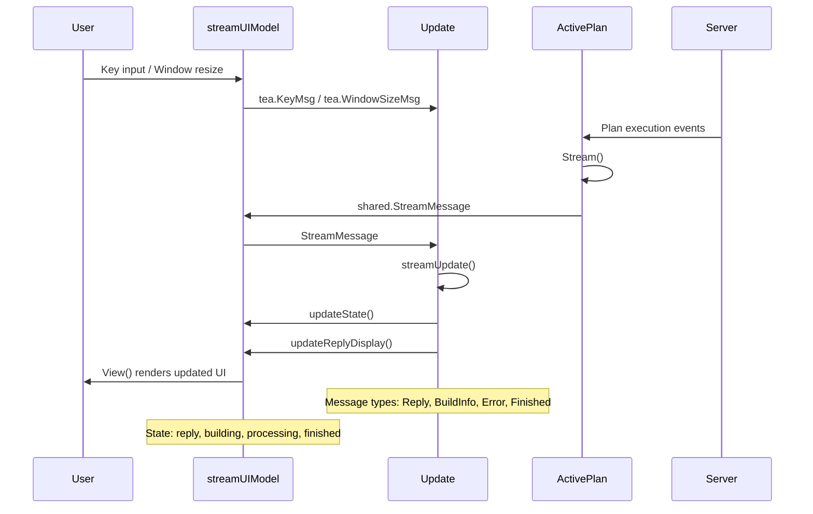
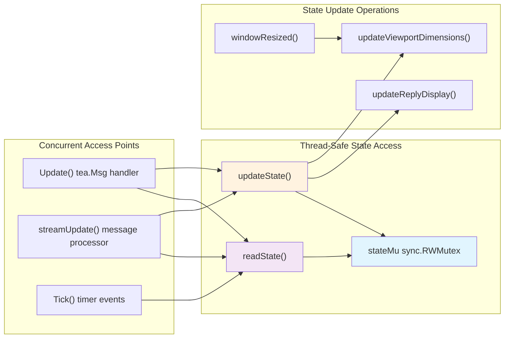
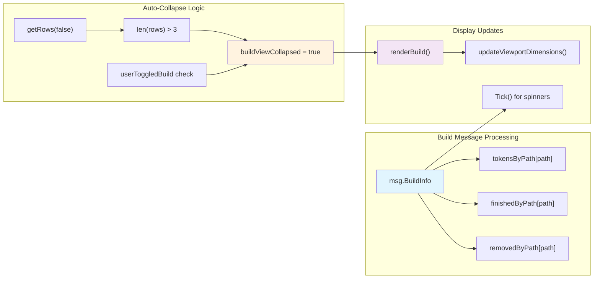
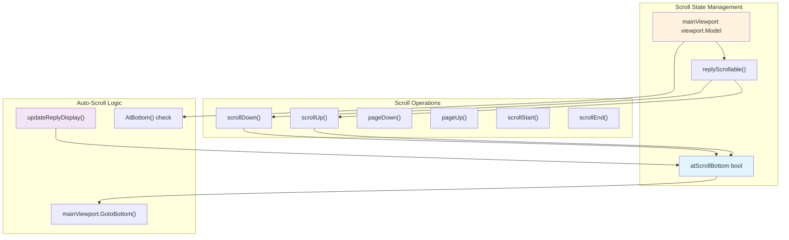
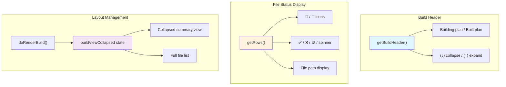
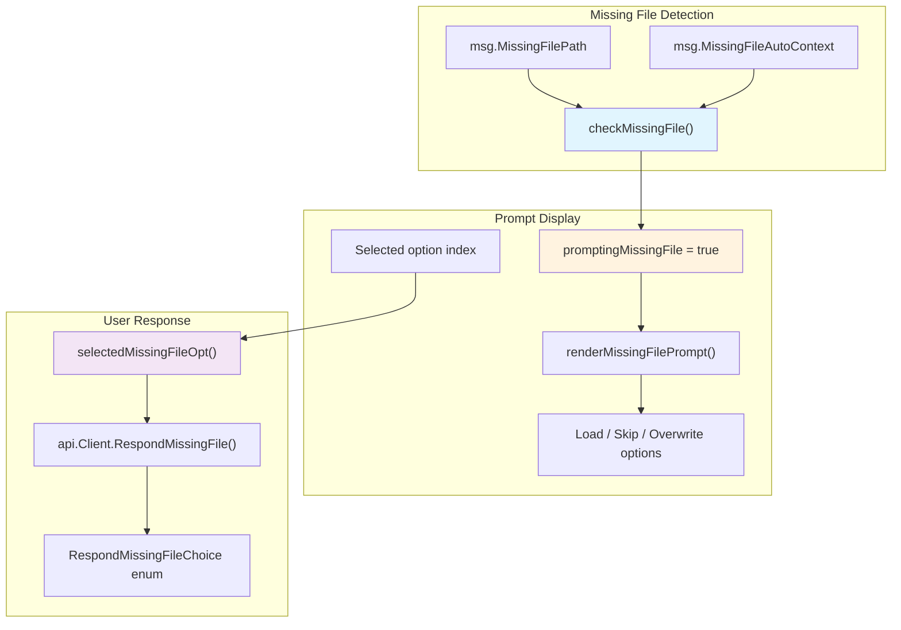
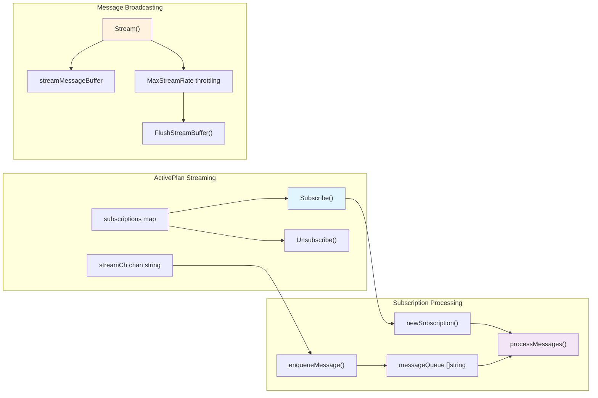

# Streaming Terminal UI

Relevant source files

The following files were used as context for generating this wiki page:

- [app/cli/stream_tui/model.go](app/cli/stream_tui/model.go)
- [app/cli/stream_tui/run.go](app/cli/stream_tui/run.go)
- [app/cli/stream_tui/update.go](app/cli/stream_tui/update.go)
- [app/cli/stream_tui/view.go](app/cli/stream_tui/view.go)
- [app/server/types/active_plan.go](app/server/types/active_plan.go)

The Streaming Terminal UI provides a real-time, interactive interface for monitoring and controlling plan execution in Plandex. It displays live AI responses, build progress, and allows users to interact with the running plan through keyboard commands. This component is built using the Bubble Tea framework and handles all user-facing aspects of active plan execution.

For information about plan execution logic and server-side coordination, see [Plan Execution System](#3). For details about the REPL interface used outside of plan execution, see [REPL Interface](#2.1).

## Architecture Overview

The streaming UI operates as a client-side terminal application that receives real-time updates from the server via WebSocket-like streaming connections. The architecture separates concerns between UI rendering, state management, and message processing.

### Streaming UI Component Architecture

Sources: [app/cli/stream_tui/model.go:38-88](), [app/cli/stream_tui/update.go:25-169](), [app/cli/stream_tui/view.go:17-36](), [app/server/types/active_plan.go:48-93]()

### Message Flow and State Synchronization

Sources: [app/cli/stream_tui/update.go:355-549](), [app/server/types/active_plan.go:186-311]()

## UI State Management

The `streamUIModel` struct maintains all UI state with thread-safe access patterns using read-write mutexes. State updates are coordinated through the `updateState()` and `readState()` functions to prevent race conditions during concurrent message processing.

### Core State Structure

| Field | Type | Purpose |
|-------|------|---------|
| `reply` | `string` | Accumulated AI response text |
| `mainDisplay` | `string` | Formatted display content |
| `processing` | `bool` | Indicates AI is generating response |
| `building` | `bool` | Indicates files are being built |
| `tokensByPath` | `map[string]int` | Token counts per file path |
| `finishedByPath` | `map[string]bool` | Build completion status per file |
| `mainViewport` | `viewport.Model` | Scrollable content viewport |
| `buildViewCollapsed` | `bool` | Build section visibility state |

Sources: [app/cli/stream_tui/model.go:38-88]()

### State Synchronization Patterns

Sources: [app/cli/stream_tui/model.go:228-238](), [app/cli/stream_tui/update.go:197-243]()

## Message Types and Processing

The streaming UI processes various message types from the server, each triggering specific UI updates and state changes. The `streamUpdate()` function serves as the central message dispatcher.

### Stream Message Types

```mermaid
graph TB
    subgraph "Core Message Types"
        StreamMessageReply["StreamMessageReply"]
        StreamMessageBuildInfo["StreamMessageBuildInfo"]
        StreamMessageError["StreamMessageError"]
        StreamMessageFinished["StreamMessageFinished"]
    end
    
    subgraph "Control Messages"
        StreamMessageMulti["StreamMessageMulti"]
        StreamMessageConnectActive["StreamMessageConnectActive"]
        StreamMessageDescribing["StreamMessageDescribing"]
        StreamMessageLoadContext["StreamMessageLoadContext"]
    end
    
    subgraph "Interactive Messages"
        StreamMessagePromptMissingFile["StreamMessagePromptMissingFile"]
        StreamMessageRepliesFinished["StreamMessageRepliesFinished"]
        StreamMessageAborted["StreamMessageAborted"]
    end
    
    subgraph "UI State Changes"
        updateReply["reply += msg.ReplyChunk"]
        updateBuilding["building = true"]
        setProcessing["processing = true/false"]
        showPrompt["promptingMissingFile = true"]
    end
    
    StreamMessageReply --> updateReply
    StreamMessageBuildInfo --> updateBuilding
    StreamMessageDescribing --> setProcessing
    StreamMessagePromptMissingFile --> showPrompt
    
    style StreamMessageReply fill:#e1f5fe
    style StreamMessageBuildInfo fill:#fff3e0
    style updateReply fill:#f3e5f5
    style updateBuilding fill:#e8f5e8
```

Sources: [app/cli/stream_tui/update.go:355-549](), [app/shared/stream.go]()

### Build Progress Message Handling

The UI tracks file build progress through `StreamMessageBuildInfo` messages, maintaining per-file token counts and completion status. Build display automatically collapses when too many files are being processed.

Sources: [app/cli/stream_tui/update.go:432-489](), [app/cli/stream_tui/view.go:77-141]()

## User Interactions and Controls

The streaming UI supports various keyboard controls for navigation, plan control, and interaction with prompts. The `keymap` struct defines all available key bindings and their handlers.

### Keyboard Controls

| Key(s) | Function | Context |
|--------|----------|---------|
| `s` | Stop plan execution | Always available |
| `b` | Send plan to background | When `canSendToBg` is true |
| `j/k` | Scroll down/up | When not prompting missing file |
| `d/u` | Page down/up | When not prompting missing file |
| `g/G` | Go to start/end | When not prompting missing file |
| `↑/↓` | Navigate build view | When building |
| `Enter` | Select option | When prompting missing file |

Sources: [app/cli/stream_tui/model.go:90-103](), [app/cli/stream_tui/update.go:89-136]()

### Scroll and Navigation Handling

Sources: [app/cli/stream_tui/update.go:275-353](), [app/cli/stream_tui/model.go:45-46]()

## Build Progress Display

The build progress section shows real-time status of file operations, with automatic collapsing for better space management. Progress is visualized using icons, token counts, and completion indicators.

### Build Display Components

Sources: [app/cli/stream_tui/view.go:147-175](), [app/cli/stream_tui/view.go:177-277]()

### File Status Indicators

The UI displays different indicators based on file processing state:

- **📄** - Regular file
- **🚀** - Command script (`_apply.sh`)
- **✅** - Build completed successfully
- **❌** - File removed/deleted
- **🪙 + number** - Token count during processing
- **Spinner** - Currently processing

Sources: [app/cli/stream_tui/view.go:205-223]()

## Missing File Prompts

When the AI needs to process a file not currently in context, the UI presents an interactive prompt allowing users to load the file, skip it, or allow overwriting.

### Missing File Prompt Flow

Sources: [app/cli/stream_tui/update.go:668-741](), [app/cli/stream_tui/update.go:622-666](), [app/cli/stream_tui/view.go:279-312]()

## Server-Side Streaming Infrastructure

The server maintains active plan subscriptions and manages message broadcasting to connected clients through the `ActivePlan` type and its streaming infrastructure.

### Subscription Management

Sources: [app/server/types/active_plan.go:339-384](), [app/server/types/active_plan.go:186-311](), [app/server/types/active_plan.go:390-436]()