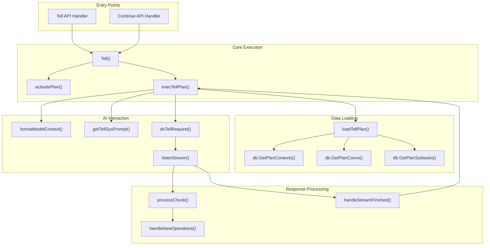
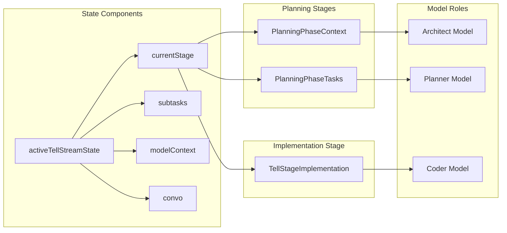
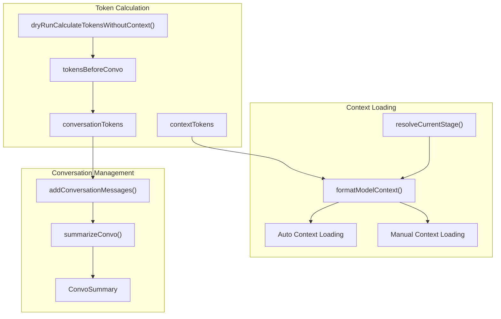
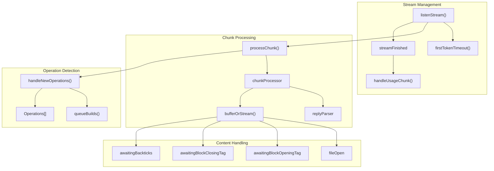
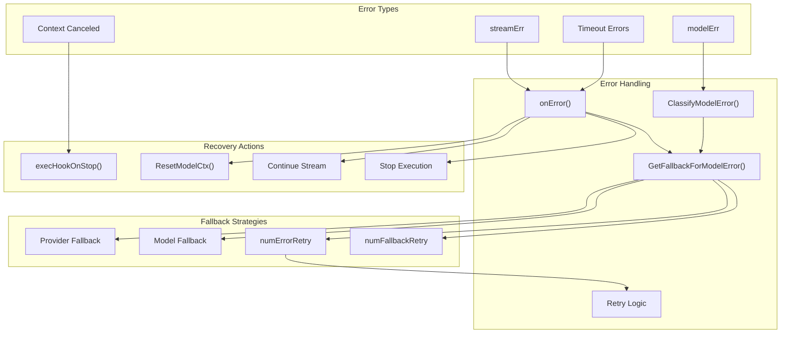
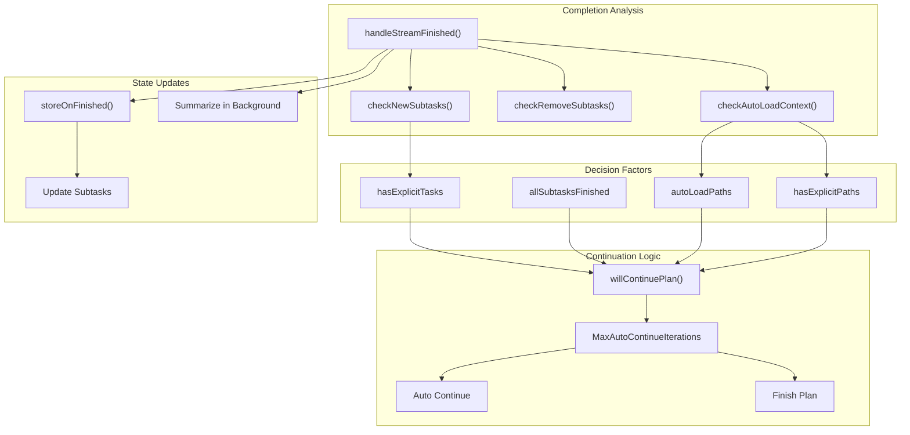

# Plan Execution System

Relevant source files

The following files were used as context for generating this wiki page:

- [app/server/model/plan/tell_exec.go](app/server/model/plan/tell_exec.go)
- [app/server/model/plan/tell_load.go](app/server/model/plan/tell_load.go)
- [app/server/model/plan/tell_state.go](app/server/model/plan/tell_state.go)
- [app/server/model/plan/tell_stream_finish.go](app/server/model/plan/tell_stream_finish.go)
- [app/server/model/plan/tell_stream_main.go](app/server/model/plan/tell_stream_main.go)
- [app/server/model/plan/tell_stream_processor.go](app/server/model/plan/tell_stream_processor.go)
- [app/server/model/plan/tell_summary.go](app/server/model/plan/tell_summary.go)

This document covers the core plan execution engine that processes user requests, coordinates with AI models, and generates file modifications. The system handles the complete lifecycle from initial user input through AI model interaction to file operations and auto-continuation logic.

For information about the CLI commands that trigger plan execution, see [Plan Execution Commands](#2.2). For details about file modification and building, see [File Modification Pipeline](#3.3). For AI model configuration and management, see [AI Model Integration](#5).

## Core Execution Flow

The plan execution system centers around the `Tell` function and its associated streaming pipeline. When a user provides input through commands like `tell` or `continue`, the system orchestrates a complex flow involving context loading, AI model interaction, and response processing.

**Execution Orchestration Flow**

Sources: [app/server/model/plan/tell_exec.go:32-71](), [app/server/model/plan/tell_load.go:20-427](), [app/server/model/plan/tell_stream_main.go:20-284]()

## Plan Stages and State Management

The execution system operates through distinct stages managed by the `activeTellStreamState` structure. Each stage determines the appropriate AI model role and prompt formatting strategy.

**Plan Stage Progression and Model Assignment**

The `currentStage` field in `activeTellStreamState` determines execution behavior:

| Stage | Model Role | Purpose | Token Limit Source |
|-------|------------|---------|-------------------|
| `PlanningPhaseContext` | Architect | Context analysis and file loading | `GetArchitectEffectiveMaxTokens()` |
| `PlanningPhaseTasks` | Planner | Task breakdown and planning | `GetPlannerEffectiveMaxTokens()` |
| `TellStageImplementation` | Coder | Code generation and file modification | `GetCoderEffectiveMaxTokens()` |

Sources: [app/server/model/plan/tell_state.go:14-69](), [app/server/model/plan/tell_exec.go:181-204]()

## Context and Token Management

The system performs sophisticated context loading and token management to stay within model limits while providing maximum relevant information.

**Context and Token Management Pipeline**

The system uses several strategies to manage context and tokens effectively:

- **Auto Context**: Automatically loads relevant files based on `activatePaths` and `activatePathsOrdered`
- **Token Estimation**: Pre-calculates token usage with `dryRunCalculateTokensWithoutContext()`
- **Conversation Summarization**: Uses `summarizeConvo()` to compress conversation history when token limits are exceeded
- **Smart Context**: Enables selective context loading based on relevance scoring

Sources: [app/server/model/plan/tell_exec.go:206-276](), [app/server/model/plan/tell_summary.go:22-231](), [app/server/model/plan/tell_summary.go:246-434]()

## Streaming Response Processing

The streaming system processes AI model responses in real-time, parsing operations and handling various content types including code blocks and file operations.

**Streaming Response Processing Architecture**

The `chunkProcessor` manages complex state for parsing structured content:

- **File Blocks**: Tracks `<PlandexBlock>` tags and converts them to markdown code blocks
- **Operation Parsing**: Detects file operations and queues them for building
- **Content Buffering**: Buffers partial content while waiting for complete tags
- **Stop Sequences**: Handles manual stop sequences and model finish reasons

Sources: [app/server/model/plan/tell_stream_main.go:20-284](), [app/server/model/plan/tell_stream_processor.go:29-593](), [app/server/model/plan/tell_state.go:71-81]()

## Error Handling and Retry Logic

The system implements comprehensive error handling with fallback mechanisms, retry logic, and model switching capabilities.

**Error Handling and Recovery System**

The system tracks error state through multiple fields in `activeTellStreamState`:

- `numErrorRetry`: Count of retry attempts for the current request
- `numFallbackRetry`: Count of provider/model fallback attempts  
- `modelErr`: Classified model error for fallback decision making
- `didProviderFallback`: Tracks whether provider fallback has been attempted

Sources: [app/server/model/plan/tell_stream_main.go:102-144](), [app/server/model/plan/tell_exec.go:500-508]()

## Auto-Continuation and Completion Logic

The system automatically determines when to continue execution based on task completion, new subtasks, and context changes.

**Auto-Continuation Decision Tree**

The `willContinuePlan()` function evaluates multiple conditions:

1. **New Subtasks**: If explicit tasks were added, continue to implement them
2. **Context Changes**: If new files were auto-loaded, continue with updated context  
3. **Iteration Limit**: Respect `MaxAutoContinueIterations = 200` to prevent infinite loops
4. **Task Completion**: Stop if all subtasks are marked as finished

The system also handles background operations like conversation summarization and context loading timeouts during continuation decisions.

Sources: [app/server/model/plan/tell_stream_finish.go:25-277](), [app/server/model/plan/tell_stream_finish.go:18]()

## Missing File Handling

When the AI attempts to modify files not present in the current context, the system implements a user interaction flow to handle the situation gracefully.

```mermaid
graph LR
    subgraph "Detection"
        ProcessChunk["processChunk()"]
        MissingFileCheck["currentFile not in context"]
        ProjectPathsCheck["req.ProjectPaths[currentFile]"]
    end
    
    subgraph "User Interaction"
        HandleMissingFile["handleMissingFile()"]
        SetStatus["SetPlanStatus(MissingFile)"]
        PromptUser["StreamMessagePromptMissingFile"]
        WaitResponse["Wait for User Choice"]
    end
    
    subgraph "Resolution"
        UserChoice["RespondMissingFileChoice"]
        ContinueExecution["Continue execTellPlan()"]
        UpdateContext["Update AllowOverwritePaths"]
    end
    
    ProcessChunk --> MissingFileCheck
    MissingFileCheck --> ProjectPathsCheck
    ProjectPathsCheck --> HandleMissingFile
    
    HandleMissingFile --> SetStatus
    HandleMissingFile --> PromptUser
    PromptUser --> WaitResponse
    
    WaitResponse --> UserChoice
    UserChoice --> UpdateContext
    UpdateContext --> ContinueExecution
```

**Missing File Resolution Workflow**

The system detects missing files when `currentFile` exists in `req.ProjectPaths` but not in `active.ContextsByPath` and not in `active.AllowOverwritePaths`. This triggers a 30-minute timeout waiting for user response through `active.MissingFileResponseCh`.

Sources: [app/server/model/plan/tell_stream_processor.go:595-726](), [app/server/model/plan/tell_stream_processor.go:115-121]()