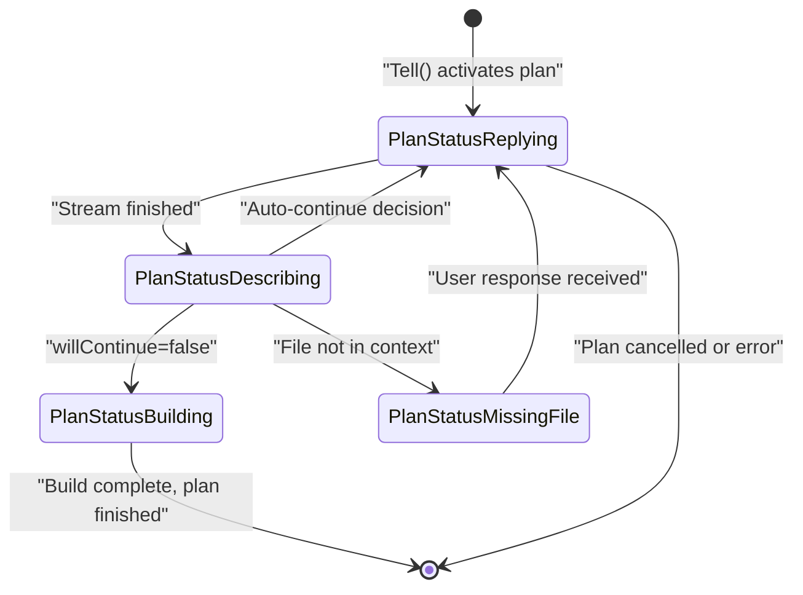
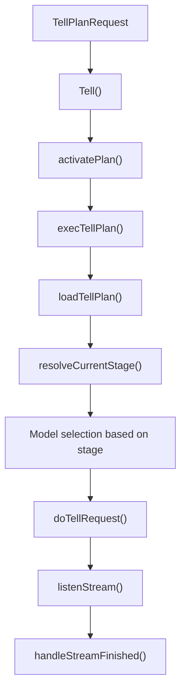
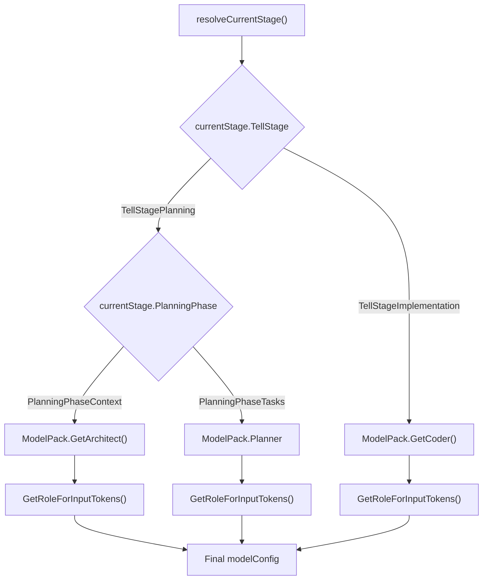
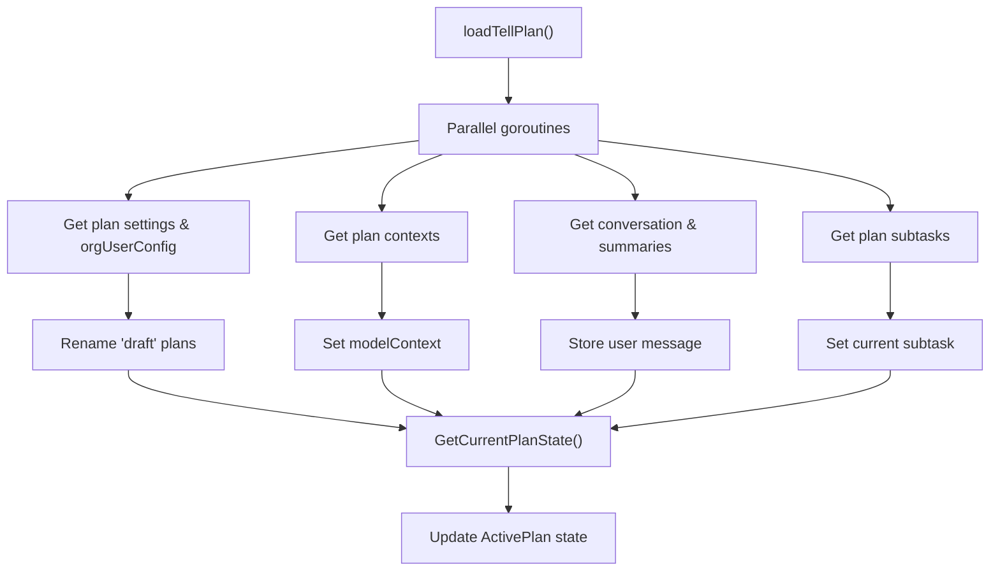
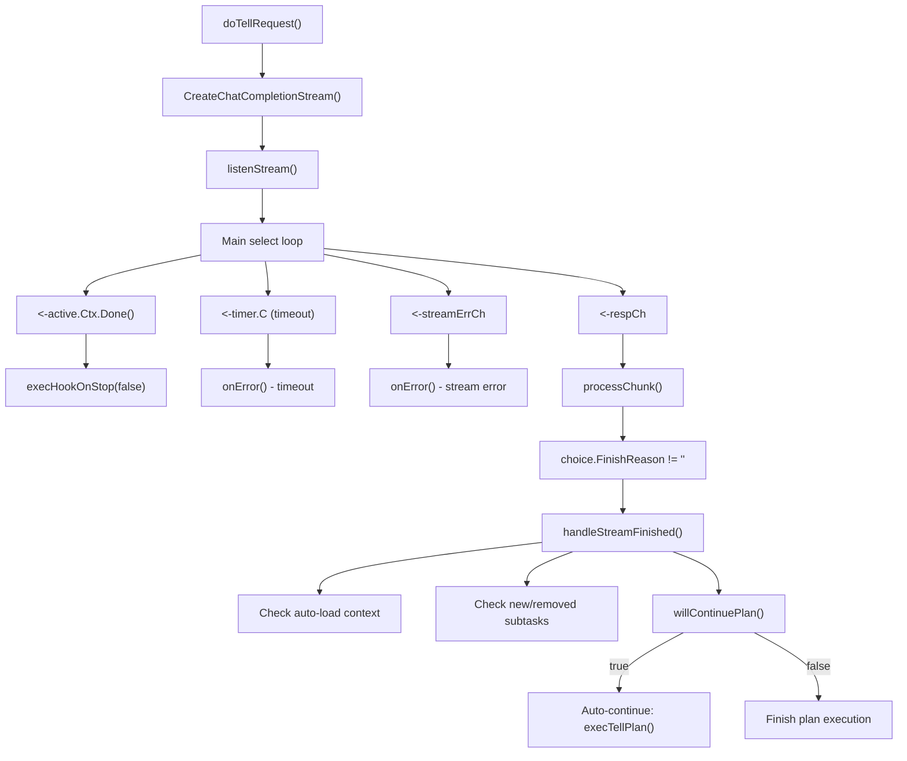
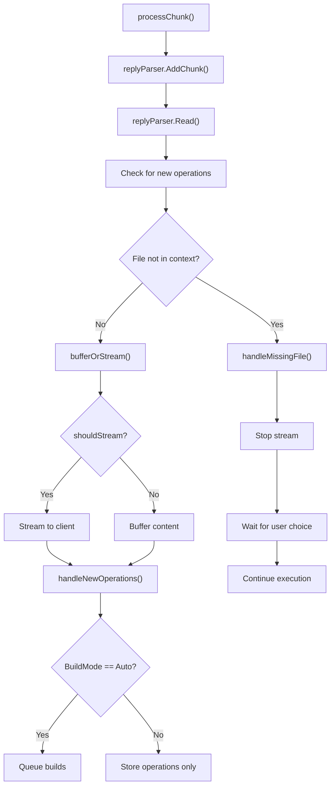
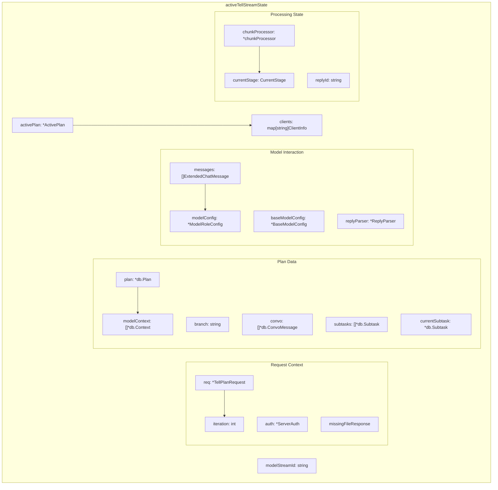
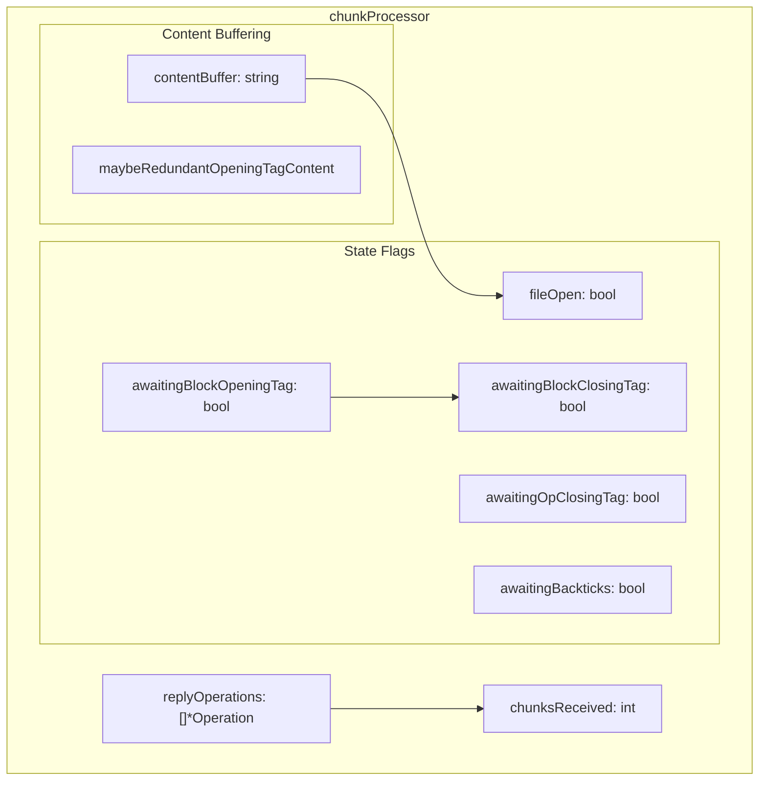
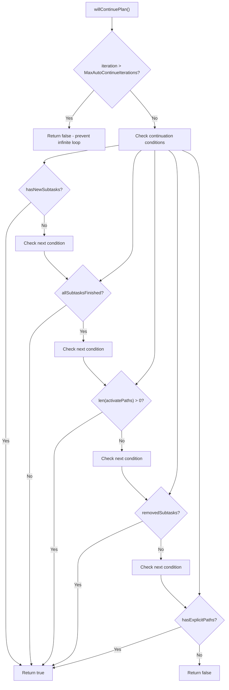
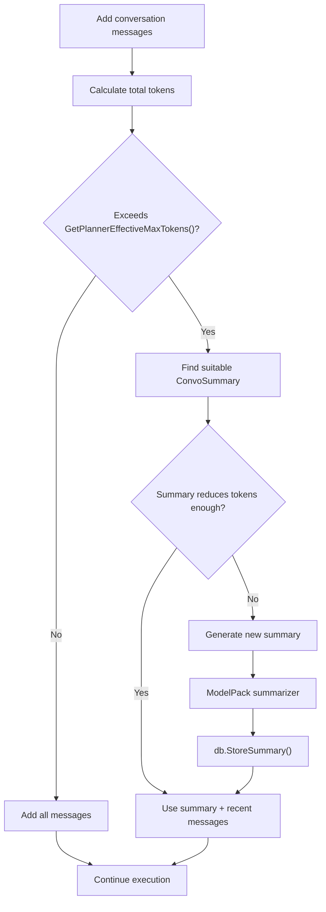

# Plan Lifecycle and States

Relevant source files

The following files were used as context for generating this wiki page:

- [app/server/model/plan/tell_exec.go](app/server/model/plan/tell_exec.go)
- [app/server/model/plan/tell_load.go](app/server/model/plan/tell_load.go)
- [app/server/model/plan/tell_state.go](app/server/model/plan/tell_state.go)
- [app/server/model/plan/tell_stream_finish.go](app/server/model/plan/tell_stream_finish.go)
- [app/server/model/plan/tell_stream_main.go](app/server/model/plan/tell_stream_main.go)
- [app/server/model/plan/tell_stream_processor.go](app/server/model/plan/tell_stream_processor.go)
- [app/server/model/plan/tell_summary.go](app/server/model/plan/tell_summary.go)

This document covers the plan execution lifecycle in Plandex, including the various states a plan transitions through from initial user prompt to final file modifications. It details the tell execution stages, streaming response processing, and active plan state management.

For information about the HTTP API endpoints that trigger these processes, see [HTTP API and Request Handlers](#4.1). For details about the AI model integration that powers plan execution, see [AI Model Integration and Task Control](#3.2).

## Plan State Overview

Plans in Plandex progress through several distinct database states during execution, with runtime coordination managed through `activeTellStreamState` and `ActivePlan` structures.

### Database Plan States

| State | Purpose | Set By |
|-------|---------|--------|
| `PlanStatusReplying` | Plan is actively generating AI responses | [tell_exec.go:140]() |
| `PlanStatusDescribing` | Plan is analyzing completion and next steps | [tell_stream_finish.go:61]() |
| `PlanStatusBuilding` | Plan is applying changes to files | [tell_stream_finish.go:251]() |
| `PlanStatusMissingFile` | Plan is waiting for user response about file overwrite | [tell_stream_processor.go:617]() |

**Plan State Transition Flow**

Sources: [tell_exec.go:140](), [tell_stream_finish.go:61](), [tell_stream_finish.go:251](), [tell_stream_processor.go:617]()

## Tell Execution Lifecycle

The tell execution process handles user prompts through a sophisticated multi-stage pipeline involving plan activation, stage determination, model selection, and streaming response processing.

### Main Execution Flow

**Tell Execution Entry Point**

Sources: [tell_exec.go:32-71](), [tell_exec.go:86-491](), [tell_load.go:20-427]()

### Tell Stages and Model Selection

The system uses different AI models based on the current execution stage:

| Stage | Phase | Model Used | Purpose |
|-------|-------|------------|---------|
| `TellStagePlanning` | `PlanningPhaseContext` | `GetArchitect()` | Load and analyze project context |
| `TellStagePlanning` | `PlanningPhaseTasks` | `Planner` | Break down work into subtasks |
| `TellStageImplementation` | - | `GetCoder()` | Generate code implementations |

**Stage and Model Selection Logic**

Sources: [tell_exec.go:181-204](), [tell_exec.go:397-409]()

### Plan Loading and State Initialization

**loadTellPlan Process**

Sources: [tell_load.go:56-338](), [tell_load.go:69-139](), [tell_load.go:141-169](), [tell_load.go:171-290](), [tell_load.go:292-309]()

## Streaming Response Processing

The system processes AI model responses through a sophisticated streaming pipeline that handles real-time content parsing, operation detection, and user interaction.

### Stream Processing Flow

**Main Streaming Loop**

Sources: [tell_stream_main.go:20-284](), [tell_stream_finish.go:25-277]()

### Chunk Processing and Operation Detection

**processChunk Flow**

Sources: [tell_stream_processor.go:29-156](), [tell_stream_processor.go:522-593](), [tell_stream_processor.go:595-726]()

### Content Buffering and Stream Management

The system implements sophisticated buffering to handle XML-like tags and code blocks properly:

| Buffer State | Purpose | Trigger |
|--------------|---------|---------|
| `awaitingBlockOpeningTag` | Buffer until `<PlandexBlock>` complete | Partial opening tag detected |
| `awaitingBlockClosingTag` | Buffer until `</PlandexBlock>` complete | Partial closing tag detected |
| `awaitingOpClosingTag` | Buffer until `<EndPlandexFileOps/>` complete | Partial operation tag detected |
| `awaitingBackticks` | Buffer until code block backticks handled | Backticks in file content |

Sources: [tell_stream_processor.go:165-520]()

## Active Plan State Management

The runtime state during plan execution is managed through two key structures: `activeTellStreamState` for execution state and `ActivePlan` for coordination and streaming.

### activeTellStreamState Structure

**Core State Components**

Sources: [tell_state.go:14-69]()

### Chunk Processing State

**chunkProcessor Structure**

Sources: [tell_state.go:71-81]()

### State Management Functions

| Function | Purpose | Returns |
|----------|---------|---------|
| `loadTellPlan()` | Load plan data from database | `activeTellStreamState` populated |
| `setActivePlan()` | Link to `ActivePlan` instance | Error if plan not active |
| `resolveCurrentStage()` | Determine execution stage/phase | `activatePaths`, `activatePathsOrdered` |
| `dryRunCalculateTokensWithoutContext()` | Token calculation without context | Token count, success flag |

Sources: [tell_load.go:20-427](), [tell_load.go:429-442](), [tell_exec.go:584-684]()

### Plan Continuation Logic

**willContinuePlan Decision Flow**

Sources: [tell_stream_finish.go:204-224](), [tell_stream_finish.go:18]()

## Conversation and Summary Management

Plan execution maintains conversation history and generates summaries when token limits are approached.

### Token Management Flow

The system automatically summarizes conversation history when approaching token limits, using the configured summarizer model.

Sources: [tell_summary.go:22-231](), [tell_summary.go:246-432](), [summarize.go:31-98]()