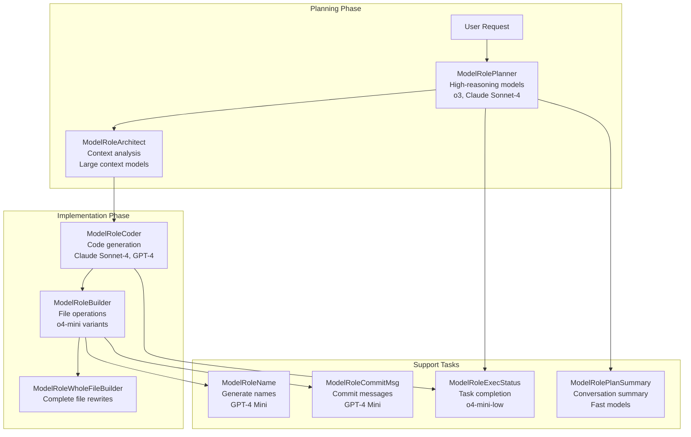
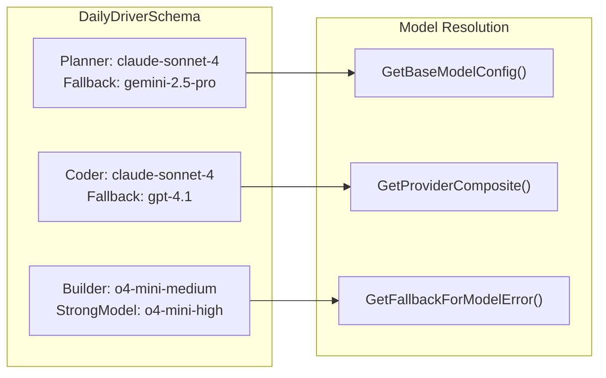
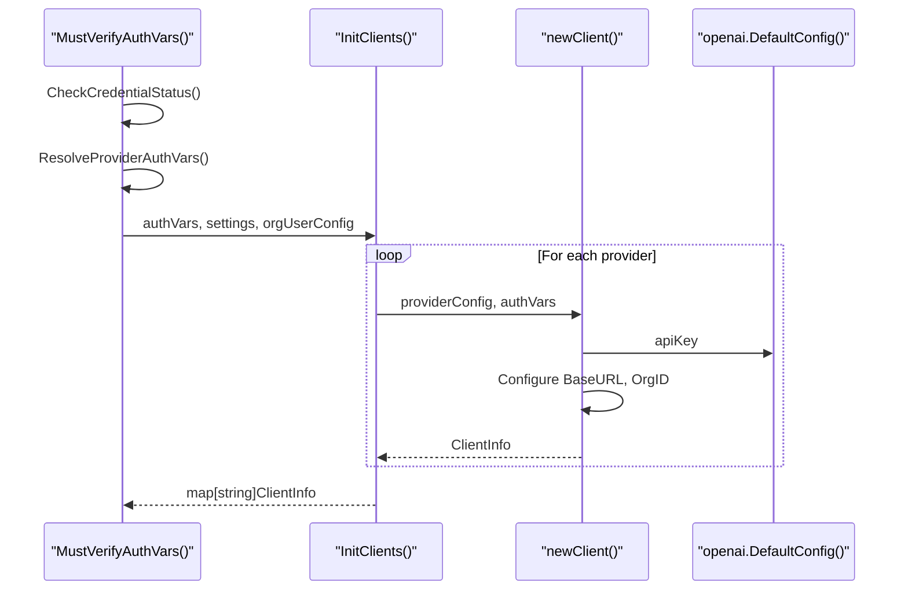
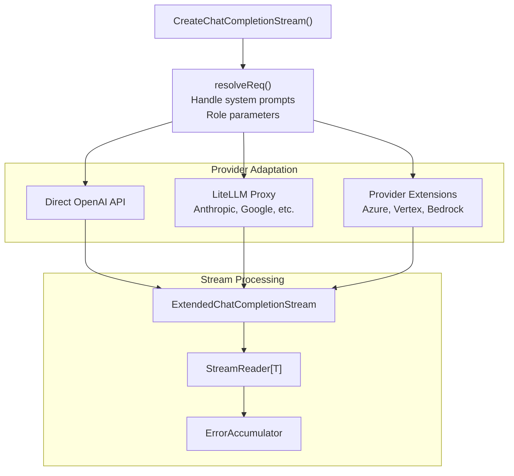
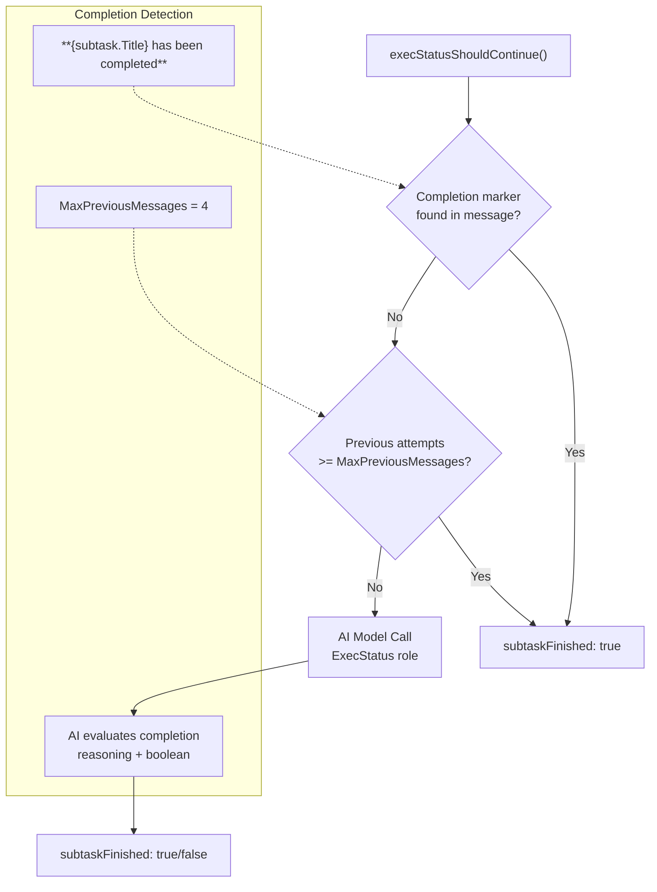
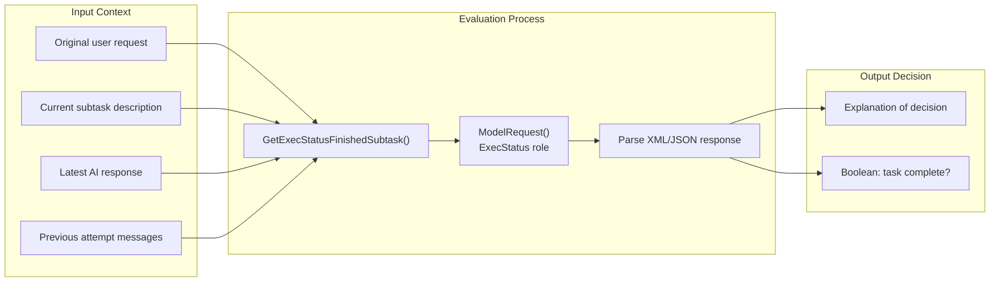
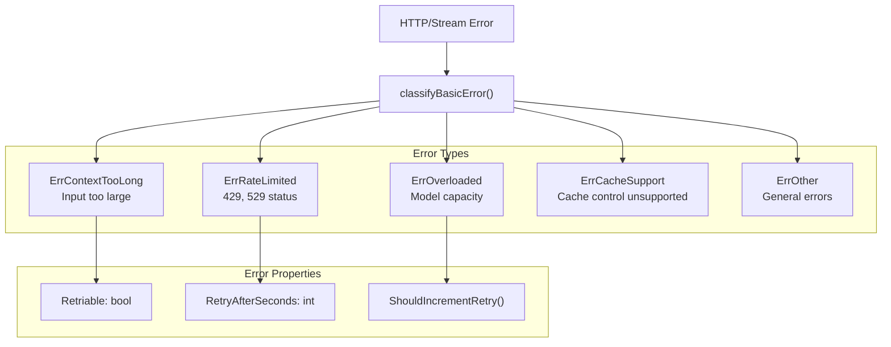
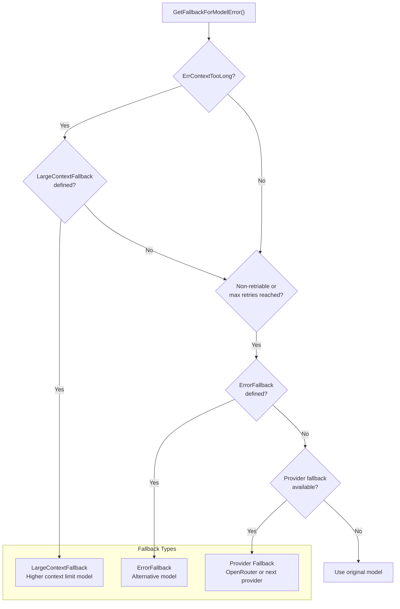
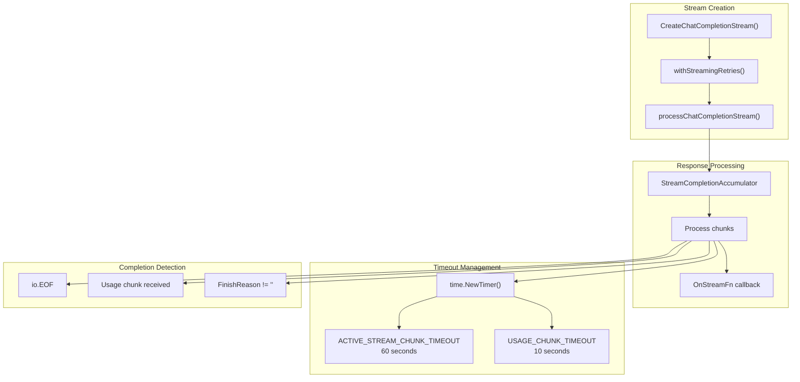

# AI Model Integration and Task Control

Relevant source files

The following files were used as context for generating this wiki page:

- [app/cli/lib/model_credentials.go](app/cli/lib/model_credentials.go)
- [app/server/model/client.go](app/server/model/client.go)
- [app/server/model/client_stream.go](app/server/model/client_stream.go)
- [app/server/model/model_error.go](app/server/model/model_error.go)
- [app/server/model/model_request.go](app/server/model/model_request.go)
- [app/server/model/name.go](app/server/model/name.go)
- [app/server/model/plan/build_exec.go](app/server/model/plan/build_exec.go)
- [app/server/model/plan/commit_msg.go](app/server/model/plan/commit_msg.go)
- [app/server/model/plan/exec_status.go](app/server/model/plan/exec_status.go)
- [app/server/model/plan/tell_stream_error.go](app/server/model/plan/tell_stream_error.go)
- [app/server/model/prompts/exec_status.go](app/server/model/prompts/exec_status.go)
- [app/server/model/summarize.go](app/server/model/summarize.go)
- [app/server/types/message.go](app/server/types/message.go)
- [app/shared/ai_models_available.go](app/shared/ai_models_available.go)
- [app/shared/ai_models_data_models.go](app/shared/ai_models_data_models.go)
- [app/shared/ai_models_errors.go](app/shared/ai_models_errors.go)
- [app/shared/ai_models_packs.go](app/shared/ai_models_packs.go)
- [app/shared/ai_models_providers.go](app/shared/ai_models_providers.go)
- [test/smoke_test.sh](test/smoke_test.sh)
- [test/test_utils.sh](test/test_utils.sh)

This document covers how Plandex integrates with multiple AI model providers and controls task execution flow. It explains the model configuration system, authentication mechanisms, streaming request handling, and the logic for determining when AI-generated tasks are complete.

For information about model configuration commands and user interfaces, see [Model Configuration Commands](#2.4). For details about the plan execution lifecycle, see [Plan Lifecycle and States](#3.1). For file modification processing, see [File Modification Pipeline](#3.3).

## Model Provider Architecture

Plandex supports multiple AI model providers through a unified configuration system that handles authentication, fallback logic, and provider-specific adaptations.

### Supported Providers

```mermaid
graph TB
    subgraph "Cloud Providers"
        OpenAI["ModelProviderOpenAI<br/>api.openai.com"]
        Anthropic["ModelProviderAnthropic<br/>via LiteLLM"]
        Google["ModelProviderGoogleAIStudio<br/>via LiteLLM"]
        Azure["ModelProviderAzureOpenAI<br/>via LiteLLM"]
        OpenRouter["ModelProviderOpenRouter<br/>openrouter.ai"]
        ClaudeMax["ModelProviderAnthropicClaudeMax<br/>Claude Subscription"]
    end
    
    subgraph "Local Providers"
        Ollama["ModelProviderOllama<br/>via LiteLLM"]
        Custom["ModelProviderCustom<br/>User-defined"]
    end
    
    subgraph "Enterprise Providers"
        Bedrock["ModelProviderAmazonBedrock<br/>via LiteLLM"]
        Vertex["ModelProviderGoogleVertex<br/>via LiteLLM"]
    end
    
    subgraph "Authentication Methods"
        APIKey["API Key<br/>Environment Variables"]
        AWS["AWS Credentials<br/>Profile/IAM"]
        OAuth["OAuth Token<br/>Claude Max"]
        ServiceAccount["Service Account<br/>Google Cloud"]
    end
    
    OpenAI --> APIKey
    Anthropic --> APIKey
    OpenRouter --> APIKey
    ClaudeMax --> OAuth
    Bedrock --> AWS
    Vertex --> ServiceAccount
    Ollama --> Local["No Authentication"]
```

**Sources:** [app/shared/ai_models_providers.go:36-77](), [app/shared/ai_models_providers.go:116-219]()

### Provider Configuration Schema

The `ModelProviderConfigSchema` defines how each provider is configured:

| Field | Purpose | Example |
|-------|---------|---------|
| `Provider` | Provider identifier | `ModelProviderOpenAI` |
| `BaseUrl` | API endpoint | `https://api.openai.com/v1` |
| `ApiKeyEnvVar` | Environment variable for API key | `OPENAI_API_KEY` |
| `ExtraAuthVars` | Additional authentication variables | AWS credentials, project IDs |
| `HasAWSAuth` | Uses AWS credential chain | Bedrock models |
| `HasClaudeMaxAuth` | Uses Claude subscription OAuth | Claude Max integration |
| `SkipAuth` | No authentication required | Local Ollama |

**Sources:** [app/shared/ai_models_providers.go:86-103](), [app/cli/lib/model_credentials.go:124-169]()

## Model Configuration and Roles

Plandex assigns specialized roles to different models within a model pack, allowing optimal model selection for specific tasks.

### Model Role Specialization

**Sources:** [app/shared/ai_models_packs.go:124-451](), [app/shared/ai_models_data_models.go:274-303]()

### Model Pack Configuration

Model packs define which models to use for each role. The `DailyDriverModelPack` demonstrates the configuration:

**Sources:** [app/shared/ai_models_packs.go:129-153](), [app/shared/ai_models_data_models.go:586-616]()

## AI Client Management

The client management system handles authentication, request routing, and provider-specific adaptations.

### Client Initialization Flow

**Sources:** [app/server/model/client.go:46-80](), [app/cli/lib/model_credentials.go:49-106]()

### Request Creation and Streaming

The `CreateChatCompletionStream` function handles model requests with fallback logic:

**Sources:** [app/server/model/client.go:107-214](), [app/server/model/client.go:216-397]()

## Task Execution Control

Plandex uses an AI-powered system to determine when coding tasks are complete, preventing infinite loops and ensuring progress.

### Task Completion Assessment

The `execStatusShouldContinue` function evaluates whether a subtask is finished:

**Sources:** [app/server/model/plan/exec_status.go:30-210](), [app/server/model/plan/exec_status.go:21-24]()

### AI Model Evaluation Logic

The system uses specialized prompts to evaluate task completion:

**Sources:** [app/server/model/plan/exec_status.go:128-161](), [app/server/model/prompts/exec_status.go:10-82]()

## Error Handling and Fallback

The system implements sophisticated error classification and fallback mechanisms to handle model failures gracefully.

### Error Classification System

**Sources:** [app/server/model/model_error.go:38-88](), [app/shared/ai_models_errors.go:10-29]()

### Fallback Resolution Logic

The `GetFallbackForModelError` method implements a sophisticated fallback strategy:

**Sources:** [app/shared/ai_models_errors.go:49-105](), [app/shared/ai_models_errors.go:111-149]()

## Streaming and Response Processing

Plandex processes AI responses through a streaming architecture that handles real-time updates and partial results.

### Stream Processing Architecture

**Sources:** [app/server/model/client_stream.go:19-84](), [app/server/model/client_stream.go:86-228]()

### Model Response Types

The system handles different response formats based on model capabilities:

| Output Format | Models | Processing |
|---------------|--------|------------|
| `ModelOutputFormatToolCallJson` | OpenAI models | JSON schema validation, function calls |
| `ModelOutputFormatXml` | Anthropic, Google | XML tag extraction |

**Sources:** [app/shared/ai_models_data_models.go:18-23](), [app/server/model/name.go:36-53]()