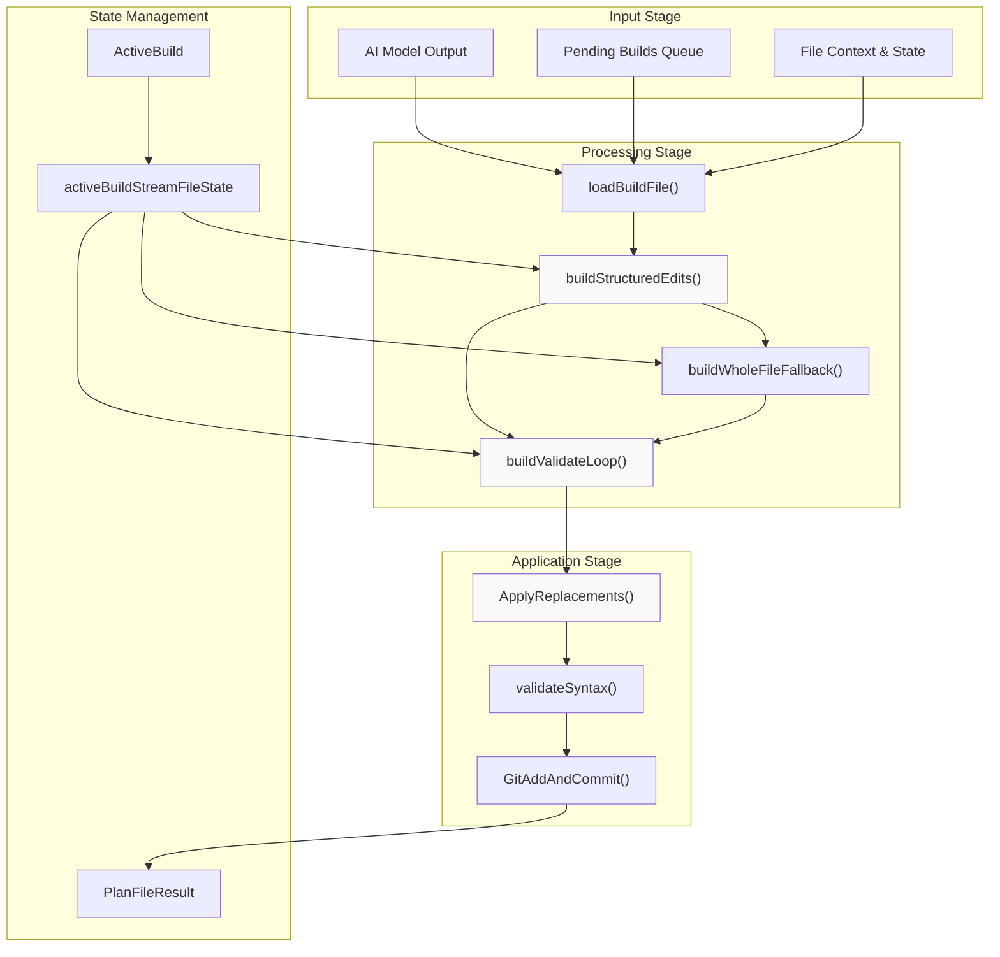
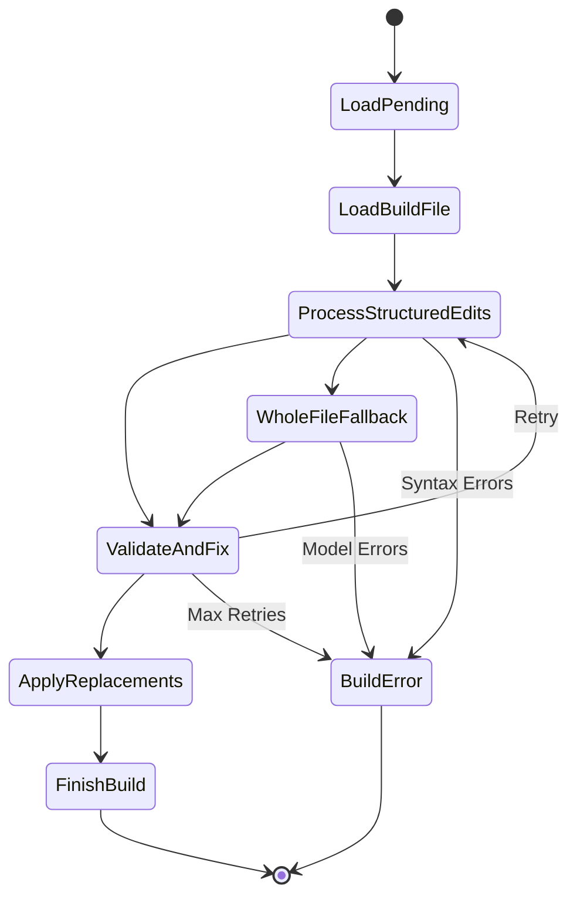
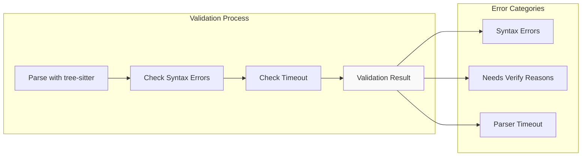

# File Modification Pipeline

<details>
<summary>Relevant source files</summary>

The following files were used as context for generating this wiki page:

- [app/server/model/plan/build_finish.go](app/server/model/plan/build_finish.go)
- [app/server/model/plan/build_load.go](app/server/model/plan/build_load.go)
- [app/server/model/plan/build_state.go](app/server/model/plan/build_state.go)
- [app/server/model/plan/build_structured_edits.go](app/server/model/plan/build_structured_edits.go)
- [app/server/model/plan/build_validate_and_fix.go](app/server/model/plan/build_validate_and_fix.go)
- [app/server/model/plan/build_whole_file.go](app/server/model/plan/build_whole_file.go)
- [app/server/model/plan/tell_stream_usage.go](app/server/model/plan/tell_stream_usage.go)
- [app/server/types/model.go](app/server/types/model.go)
- [app/shared/plan_result_replacements.go](app/shared/plan_result_replacements.go)
- [app/shared/streamed_change.go](app/shared/streamed_change.go)

</details>


## Purpose and Scope

The File Modification Pipeline is the core system responsible for transforming AI model outputs into actual file changes in Plandex. This system takes proposed content from AI models, processes it through structured edits, validates syntax, applies replacements, and commits the final results to Git repositories. The pipeline handles error recovery, syntax validation, and multiple processing strategies to ensure reliable file modifications.

For information about plan execution and AI model integration, see [Plan Execution System](#3) and [AI Model Integration](#5). For details about Git repository management, see [Repository Locking and Git Integration](#6.2).

## Pipeline Overview

The File Modification Pipeline operates as a multi-stage processing system that transforms AI-generated content into validated file changes:



**Sources:** [app/server/model/plan/build_load.go:17-157](), [app/server/model/plan/build_structured_edits.go:20-221](), [app/server/model/plan/build_finish.go:18-163]()

## Build State Management

The pipeline uses several key state structures to track build progress and manage file processing:

| State Structure | Purpose | Key Fields |
|----------------|---------|------------|
| `activeBuildStreamState` | Global build coordination | `modelStreamId`, `clients`, `plan`, `branch` |
| `activeBuildStreamFileState` | Per-file build tracking | `filePath`, `activeBuild`, `preBuildState`, `parser` |
| `ActiveBuild` | Individual build execution | `FileContent`, `FileDescription`, `Success`, `Error` |
| `PlanFileResult` | Final build output | `Path`, `Replacements`, `Content` |



**Sources:** [app/server/model/plan/build_state.go:16-49](), [app/server/types/model.go:7-13]()

## Structured Edits Processing

The primary file modification strategy uses structured edits with syntax validation and smart fallback mechanisms:

### Main Processing Flow

The `buildStructuredEdits()` function implements the core processing logic:

```mermaid
graph TD
    subgraph "Input Analysis"
        CheckType["Check Edit Type"]
        ReplaceOrRemove["Replace/Remove?"]
        CallFastApply1["Call Fast Apply Hook"]
    end
    
    subgraph "Primary Processing"
        ApplyChanges["syntax.ApplyChanges()"]
        ValidateSyntax1["validateSyntax()"]
        CheckValidity["Check Validity"]
    end
    
    subgraph "Fallback Processing"
        CallFastApply2["Call Fast Apply Hook"]
        BuildRace["buildRace()"]
        FastApplyResult["Fast Apply Result"]
    end
    
    subgraph "Output Generation"
        StripBlankLines["utils.StripAddedBlankLines()"]
        GetDiffReplacements["diff_pkg.GetDiffReplacements()"]
        CreatePlanResult["Create PlanFileResult"]
    end
    
    CheckType --> ReplaceOrRemove
    ReplaceOrRemove --> CallFastApply1
    CallFastApply1 --> ApplyChanges
    ReplaceOrRemove --> ApplyChanges
    
    ApplyChanges --> ValidateSyntax1
    ValidateSyntax1 --> CheckValidity
    
    CheckValidity --> StripBlankLines : Valid
    CheckValidity --> CallFastApply2 : Invalid
    CallFastApply2 --> BuildRace
    BuildRace --> FastApplyResult
    FastApplyResult --> StripBlankLines
    
    StripBlankLines --> GetDiffReplacements
    GetDiffReplacements --> CreatePlanResult
    
    style ApplyChanges fill:#f9f9f9
    style BuildRace fill:#f9f9f9
```

**Sources:** [app/server/model/plan/build_structured_edits.go:20-221](), [app/server/syntax/apply_changes.go]()

### Syntax Validation and Error Handling

The pipeline includes comprehensive syntax validation using tree-sitter parsers:



**Sources:** [app/server/model/plan/build_structured_edits.go:223-238](), [app/server/syntax/validate.go]()

## Validation and Fix Loop

When structured edits produce invalid results, the pipeline enters a validation and fix loop with AI model assistance:

### Validation Loop Architecture

```mermaid
graph TD
    subgraph "Loop Control"
        StartLoop["Start Validation Loop"]
        AttemptCounter["Attempt Counter"]
        MaxAttempts["Max Attempts Check"]
    end
    
    subgraph "Model Interaction"
        BuildPrompt["Build Validation Prompt"]
        ModelRequest["model.ModelRequest()"]
        ParseResponse["handleXMLResponse()"]
    end
    
    subgraph "Response Processing"
        CheckCorrect["Check <PlandexCorrect/>"]
        ExtractReplacements["Extract Replacements"]
        ApplyXMLReplacements["Apply XML Replacements"]
        ValidateResult["Validate Result"]
    end
    
    StartLoop --> AttemptCounter
    AttemptCounter --> MaxAttempts
    MaxAttempts --> BuildPrompt : Continue
    MaxAttempts --> ReturnFailed : Max Reached
    
    BuildPrompt --> ModelRequest
    ModelRequest --> ParseResponse
    
    ParseResponse --> CheckCorrect
    CheckCorrect --> ReturnSuccess : Correct
    CheckCorrect --> ExtractReplacements : Needs Fix
    ExtractReplacements --> ApplyXMLReplacements
    ApplyXMLReplacements --> ValidateResult
    ValidateResult --> AttemptCounter : Invalid
    ValidateResult --> ReturnSuccess : Valid
    
    style ModelRequest fill:#f9f9f9
    style ApplyXMLReplacements fill:#f9f9f9
```

**Sources:** [app/server/model/plan/build_validate_and_fix.go:44-159](), [app/server/model/plan/build_validate_and_fix.go:182-325]()

### XML Response Processing

The validation system processes structured XML responses from AI models:

| XML Tag | Purpose | Processing |
|---------|---------|------------|
| `<PlandexCorrect/>` | Indicates changes are valid | Return success immediately |
| `<PlandexReplacements>` | Contains fix instructions | Extract and apply replacements |
| `<Replacement>` | Individual fix operation | Parse old/new content with line numbers |
| `<Old>` | Content to replace | Extract with line number prefixes |
| `<New>` | Replacement content | Apply to target location |

**Sources:** [app/server/model/plan/build_validate_and_fix.go:327-453]()

## Replacement Application System

The final stage applies validated changes through a sophisticated replacement system:

### Replacement Processing

```mermaid
graph TD
    subgraph "Replacement Input"
        PlanResult["PlanFileResult"]
        ReplacementList["Replacements Array"]
        OriginalContent["Original File Content"]
    end
    
    subgraph "Application Logic"
        IterateReplacements["Iterate Replacements"]
        FindOldContent["Find Old Content"]
        CheckEntireFile["Check EntireFile Flag"]
        StringReplace["strings.Replace()"]
        UpdateIndices["Update lastInsertedIdx"]
    end
    
    subgraph "Error Handling"
        IndexNotFound["Index Not Found"]
        SetFailed["Set replacement.Failed"]
        ReturnPartial["Return Partial Result"]
    end
    
    PlanResult --> ReplacementList
    ReplacementList --> IterateReplacements
    OriginalContent --> IterateReplacements
    
    IterateReplacements --> FindOldContent
    FindOldContent --> CheckEntireFile
    CheckEntireFile --> StringReplace : Found
    FindOldContent --> IndexNotFound : Not Found
    
    StringReplace --> UpdateIndices
    UpdateIndices --> IterateReplacements : Next
    
    IndexNotFound --> SetFailed
    SetFailed --> ReturnPartial
    
    style StringReplace fill:#f9f9f9
    style UpdateIndices fill:#f9f9f9
```

**Sources:** [app/shared/plan_result_replacements.go:20-137]()

### Git Integration and Commit Process

Successfully processed files are committed to Git through the repository management system:

```mermaid
graph LR
    subgraph "Build Completion"
        FinishBuild["onFinishBuild()"]
        CheckStreaming["Check Still Streaming"]
        WaitForReply["Wait for Reply Done"]
    end
    
    subgraph "Git Operations"
        ExecRepoOperation["db.ExecRepoOperation()"]
        GetPlanState["GetCurrentPlanState()"]
        UpdateDescriptions["Update Build Descriptions"]
        GitAddAndCommit["repo.GitAddAndCommit()"]
    end
    
    subgraph "Finalization"
        CommitMessage["PendingChangesSummaryForBuild()"]
        UpdateActivePlan["Update Active Plan State"]
        NotifyCompletion["Notify Completion"]
    end
    
    FinishBuild --> CheckStreaming
    CheckStreaming --> WaitForReply
    WaitForReply --> ExecRepoOperation
    
    ExecRepoOperation --> GetPlanState
    GetPlanState --> UpdateDescriptions
    UpdateDescriptions --> GitAddAndCommit
    
    GitAddAndCommit --> CommitMessage
    CommitMessage --> UpdateActivePlan
    UpdateActivePlan --> NotifyCompletion
    
    style GitAddAndCommit fill:#f9f9f9
    style ExecRepoOperation fill:#f9f9f9
```



**Sources:** [app/server/model/plan/build_finish.go:18-163](), [app/server/db/git.go]()

## Error Handling and Retry Logic

The pipeline implements comprehensive error handling with exponential backoff and multiple retry strategies:

### Retry Mechanisms

| Component | Max Retries | Backoff Strategy | Error Types |
|-----------|-------------|------------------|-------------|
| Validation Loop | `MaxValidationFixAttempts` (3) | Linear with model switching | Syntax errors, AI failures |
| Whole File Fallback | `MaxBuildErrorRetries` (3) | Exponential with jitter | Model request failures |
| General Build Operations | `MaxBuildErrorRetries` (3) | Exponential with jitter | Network, parsing errors |

```mermaid
graph TD
    subgraph "Error Detection"
        SyntaxError["Syntax Error"]
        ModelError["Model Request Error"]
        ValidationError["Validation Error"]
        GitError["Git Operation Error"]
    end
    
    subgraph "Retry Logic"
        CheckRetryCount["Check Retry Count"]
        ExponentialBackoff["Exponential Backoff"]
        SwitchModel["Switch to Strong Model"]
        RetryOperation["Retry Operation"]
    end
    
    subgraph "Failure Handling"
        MaxRetriesReached["Max Retries Reached"]
        SetBuildError["Set Build Error"]
        NotifyError["Notify Error"]
        StreamError["Stream Error to Client"]
    end
    
    SyntaxError --> CheckRetryCount
    ModelError --> CheckRetryCount
    ValidationError --> CheckRetryCount
    GitError --> CheckRetryCount
    
    CheckRetryCount --> ExponentialBackoff : Retry Available
    CheckRetryCount --> MaxRetriesReached : No Retries Left
    
    ExponentialBackoff --> SwitchModel
    SwitchModel --> RetryOperation
    RetryOperation --> CheckRetryCount : Still Failing
    
    MaxRetriesReached --> SetBuildError
    SetBuildError --> NotifyError
    NotifyError --> StreamError
    
    style RetryOperation fill:#f9f9f9
    style SetBuildError fill:#f9f9f9
```

**Sources:** [app/server/model/plan/build_validate_and_fix.go:455-486](), [app/server/model/plan/build_whole_file.go:143-171](), [app/server/model/plan/build_finish.go:276-313]()

## Performance Optimizations

The pipeline includes several performance optimizations:

- **Parallel Processing**: Multiple files can be processed concurrently through build queues
- **Syntax Caching**: Tree-sitter parsers are cached and reused across builds
- **Fast Apply Hooks**: External tools can provide optimized merge strategies
- **Token Caching**: OpenAI prompt caching reduces API costs for repeated patterns
- **Incremental Updates**: Only changed portions of files are processed when possible

**Sources:** [app/server/model/plan/build_structured_edits.go:54-98](), [app/server/model/plan/build_load.go:17-157]()