# Server Architecture

Relevant source files

The following files were used as context for generating this wiki page:

- [app/cli/api/clients.go](app/cli/api/clients.go)
- [app/server/db/user_helpers.go](app/server/db/user_helpers.go)
- [app/server/handlers/sessions.go](app/server/handlers/sessions.go)
- [app/server/main.go](app/server/main.go)
- [app/server/routes/routes.go](app/server/routes/routes.go)
- [app/server/setup/setup.go](app/server/setup/setup.go)

This document covers the server-side components of Plandex, including the HTTP API server, request handlers, middleware, routing, and core server infrastructure. For information about plan execution logic and AI model integration, see [Plan Execution Engine](#4.3). For database schema and data models, see [Data Models and Shared Types](#4.2).

## Overview

The Plandex server is a Go-based HTTP API server that provides REST endpoints for plan management, context operations, and real-time plan execution. The server follows a layered architecture with clear separation between HTTP handling, business logic, and data persistence.

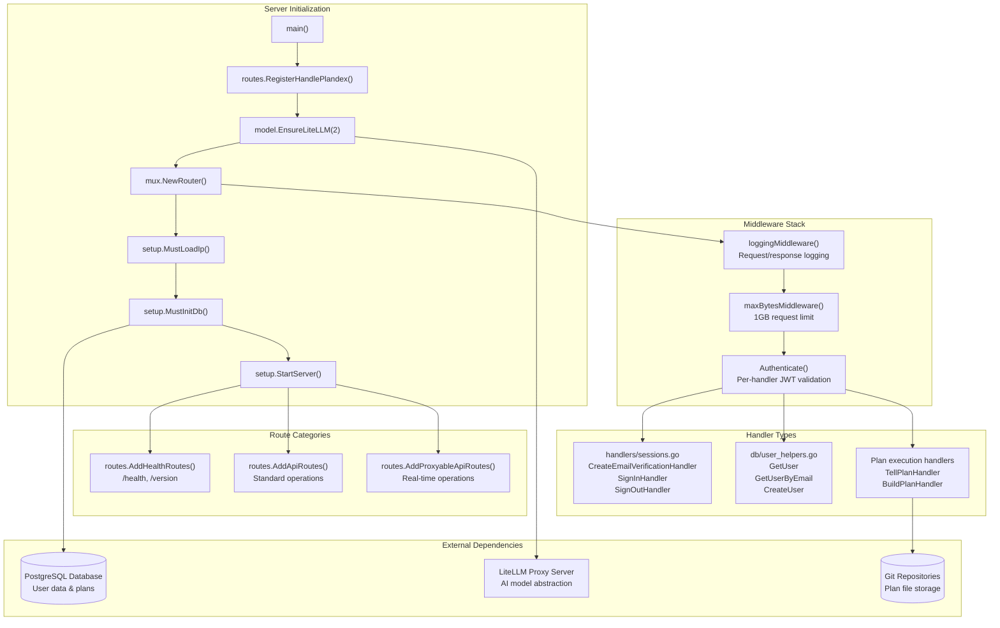

**Sources:** [app/server/main.go:14-38](), [app/server/setup/setup.go:66-185](), [app/server/routes/routes.go:20-203]()
</thinking>

## HTTP Server Configuration

The server configuration in `setup.go` implements comprehensive middleware, graceful shutdown, and database initialization. The `StartServer` function orchestrates the complete HTTP server lifecycle:

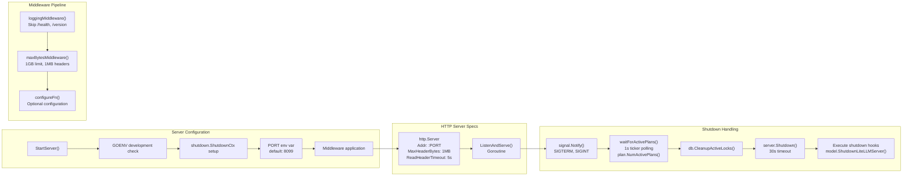

The middleware stack includes several critical components:
- `loggingMiddleware`: Logs request method, path, and duration while excluding monitoring endpoints
- `maxBytesMiddleware`: Uses `http.MaxBytesReader` to enforce the 1GB request body limit
- Database connection cleanup with deferred `db.Conn.Close()`
- Graceful shutdown with 60-second active plan timeout followed by 30-second HTTP shutdown timeout

**Sources:** [app/server/setup/setup.go:66-185](), [app/server/setup/setup.go:50-64](), [app/server/setup/setup.go:187-214]()

## Route Organization

Routes are organized using the `mux.Router` from Gorilla Mux with a configurable handler registration system. The `routes.go` file defines three distinct route categories:

| Route Function | Purpose | Handler Registration |
|---|---|---|
| `AddHealthRoutes` | System monitoring | `/health`, `/version` endpoints |
| `AddApiRoutes` | Standard CRUD operations | Plan, context, user management |
| `AddProxyableApiRoutes` | Real-time operations | Active plan streaming, status |

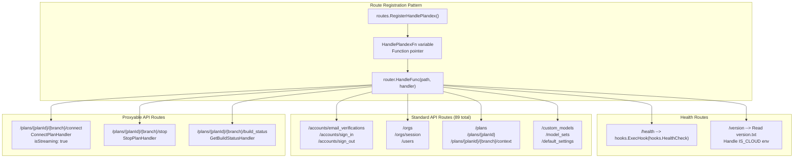

The route registration uses a function pointer pattern where `HandlePlandexFn` is set during server initialization in `main.go`, allowing for flexible handler configuration while maintaining type safety through the `PlandexHandler` type alias.

**Sources:** [app/server/routes/routes.go:15-28](), [app/server/routes/routes.go:89-190](), [app/server/routes/routes.go:192-203](), [app/server/main.go:18-20]()

## Authentication and Session Management

The server implements a comprehensive authentication system with email verification, sign-in codes, and JWT token management handled primarily in `handlers/sessions.go`:

```mermaid
graph TD
    subgraph "Email Verification Flow"
        CreateVerification["CreateEmailVerificationHandler"] --> CheckUser["GetUserByEmail()<br/>HasAccount determination"]
        CheckUser --> GeneratePin["GetRandomAlphanumeric(6)<br/>SHA256 hash"]
        GeneratePin --> StoreVerification["db.CreateEmailVerification()"]
        StoreVerification --> SendEmail["email.SendVerificationEmail()"]
    end
    
    subgraph "Sign-In Process"
        SignInRequest["SignInHandler"] --> ValidatePin["CheckEmailPinHandler<br/>db.ValidateEmailVerification()"]
        ValidatePin --> ValidateAndSignIn["ValidateAndSignIn()<br/>Create JWT token"]
        ValidateAndSignIn --> SetCookies["Set auth cookies<br/>for browser clients"]
    end
    
    subgraph "Cross-Client Authentication"
        CreateSignInCode["CreateSignInCodeHandler<br/>Authenticated endpoint"] --> GenerateCode["GetRandomAlphanumeric(6)<br/>SHA256 hash"]
        GenerateCode --> StoreCode["db.CreateSignInCode()"]
        StoreCode --> ShareCode["Return plain code<br/>for client transfer"]
    end
    
    subgraph "Session Management"
        SignOut["SignOutHandler"] --> InvalidateToken["UPDATE auth_tokens<br/>SET deleted_at = NOW()"]
        InvalidateToken --> ClearCookies["ClearAuthCookieIfBrowser()<br/>ClearAccountFromCookies()"]
    end
    
    subgraph "User Configuration"
        GetOrgConfig["GetOrgUserConfigHandler"] --> LoadConfig["db.GetOrgUserConfig()"]
        UpdateOrgConfig["UpdateOrgUserConfigHandler"] --> SaveConfig["db.UpdateOrgUserConfig()"]
    end
```

Key authentication features include:
- Local development mode bypass with `GOENV=development` and `LOCAL_MODE=1`
- PIN-based email verification with 6-character alphanumeric codes
- Cross-client sign-in codes for UI-to-CLI authentication transfer
- JWT token invalidation on sign-out with database cleanup
- Per-organization user configuration management

**Sources:** [app/server/handlers/sessions.go:18-136](), [app/server/handlers/sessions.go:176-209](), [app/server/handlers/sessions.go:252-285](), [app/server/handlers/sessions.go:287-346]()

## Database Integration and User Management

Database operations are centralized in the `db` package with comprehensive user and organization management in `user_helpers.go`:

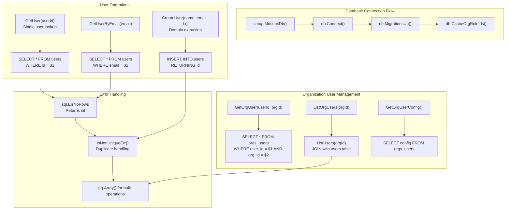

The database layer includes sophisticated error handling and transaction management:
- `sql.ErrNoRows` handling to distinguish between missing records and errors
- Domain extraction from email addresses for user categorization
- Bulk operations using PostgreSQL array parameters via `pq.Array()`
- Transaction support with `*sqlx.Tx` parameter passing
- Role-based access control with `NumUsersWithRole()` validation

**Sources:** [app/server/db/user_helpers.go:13-26](), [app/server/db/user_helpers.go:28-41](), [app/server/db/user_helpers.go:132-155](), [app/server/db/user_helpers.go:98-130](), [app/server/setup/setup.go:27-42]()

## Server Lifecycle and LiteLLM Integration

The server initialization process in `main.go` includes critical AI model proxy setup and graceful shutdown handling:

```mermaid
graph LR
    subgraph "Initialization Sequence"
        MainStart["main()"] --> LogConfig["log.SetFlags()<br/>LstdFlags | Lmicroseconds | Lshortfile"]
        LogConfig --> RouteReg["routes.RegisterHandlePlandex()<br/>Function pointer setup"]
        RouteReg --> LiteLLMSetup["model.EnsureLiteLLM(2)<br/>AI proxy startup"]
        LiteLLMSetup --> ShutdownReg["setup.RegisterShutdownHook()<br/>model.ShutdownLiteLLMServer()"]
    end
    
    subgraph "Router Configuration"
        RouterCreate["mux.NewRouter()"] --> HealthRoutes["routes.AddHealthRoutes(r)"]
        HealthRoutes --> ApiRoutes["routes.AddApiRoutes(r)"]
        ApiRoutes --> ProxyRoutes["routes.AddProxyableApiRoutes(r)"]
    end
    
    subgraph "Server Startup"
        IPLoad["setup.MustLoadIp()"] --> DBInit["setup.MustInitDb()"]
        DBInit --> ServerStart["setup.StartServer(r, nil, nil)"]
        ServerStart --> OsExit["os.Exit(0)"]
    end
    
    ShutdownReg --> RouterCreate
    ProxyRoutes --> IPLoad
```

Key lifecycle components include:
- LiteLLM proxy server management with retry count parameter (2 retries)
- Comprehensive logging configuration with microsecond timestamps and short file names  
- Shutdown hook registration for clean AI model proxy termination
- Fatal error handling with `panic()` for critical startup failures
- Graceful exit with `os.Exit(0)` after server shutdown completion

**Sources:** [app/server/main.go:14-38](), [app/server/main.go:22-28](), [app/server/setup/setup.go:44-48]()

## Client-Server Communication

The CLI communicates with the server through a sophisticated HTTP client architecture with retry logic, authentication, and timeout management:

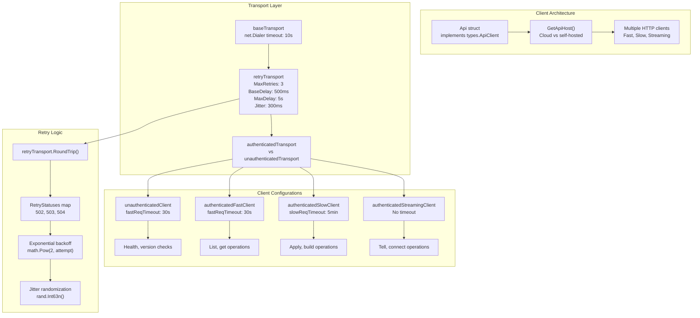

The client system includes sophisticated error handling and environment configuration:
- Dynamic API host selection based on `auth.Current.IsCloud` flag
- Development environment support via `PLANDEX_ENV` and `PLANDEX_API_HOST` variables
- Network timeout detection with `net.Error` interface checking
- Exponential backoff with jitter to prevent thundering herd problems
- Authentication header injection via `auth.SetAuthHeader()` and `auth.SetVersionHeader()`

**Sources:** [app/cli/api/clients.go:23-42](), [app/cli/api/clients.go:66-117](), [app/cli/api/clients.go:136-161](), [app/cli/api/clients.go:44-64]()
</old_str>
<new_str>
## HTTP Server Configuration

The server configuration in `setup.go` implements comprehensive middleware, graceful shutdown, and database initialization. The `StartServer` function orchestrates the complete HTTP server lifecycle:

The middleware stack includes several critical components:
- `loggingMiddleware`: Logs request method, path, and duration while excluding monitoring endpoints
- `maxBytesMiddleware`: Uses `http.MaxBytesReader` to enforce the 1GB request body limit
- Database connection cleanup with deferred `db.Conn.Close()`
- Graceful shutdown with 60-second active plan timeout followed by 30-second HTTP shutdown timeout

**Sources:** [app/server/setup/setup.go:66-185](), [app/server/setup/setup.go:50-64](), [app/server/setup/setup.go:187-214]()

## Route Organization

Routes are organized using the `mux.Router` from Gorilla Mux with a configurable handler registration system. The `routes.go` file defines three distinct route categories:

| Route Function | Purpose | Handler Registration |
|---|---|---|
| `AddHealthRoutes` | System monitoring | `/health`, `/version` endpoints |
| `AddApiRoutes` | Standard CRUD operations | Plan, context, user management |
| `AddProxyableApiRoutes` | Real-time operations | Active plan streaming, status |

The route registration uses a function pointer pattern where `HandlePlandexFn` is set during server initialization in `main.go`, allowing for flexible handler configuration while maintaining type safety through the `PlandexHandler` type alias.

**Sources:** [app/server/routes/routes.go:15-28](), [app/server/routes/routes.go:89-190](), [app/server/routes/routes.go:192-203](), [app/server/main.go:18-20]()

## HTTP Server Configuration

The server is configured in `setup.go` with specific timeouts, middleware, and graceful shutdown handling. The `StartServer` function sets up the complete HTTP server stack:

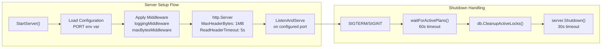

The server includes several key middleware components:
- `loggingMiddleware`: Logs all requests except `/health` and `/version` endpoints
- `maxBytesMiddleware`: Limits request body size to 1GB
- Authentication middleware: Handled per-route basis in handlers

**Sources:** [app/server/setup/setup.go:66-185](), [app/server/setup/setup.go:50-64](), [app/server/setup/setup.go:206-214]()

## Route Organization

Routes are organized into two main categories defined in `routes.go`:

| Route Category | Function | Purpose |
|---|---|---|
| `AddApiRoutes` | Standard API endpoints | Plan management, context, settings |
| `AddProxyableApiRoutes` | Real-time endpoints | Active plan operations, streaming |

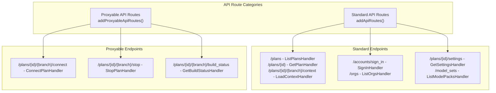

**Sources:** [app/server/routes/routes.go:73-185](), [app/server/routes/routes.go:187-198]()

## Authentication and Session Management

The server implements a comprehensive authentication system with email verification, sign-in codes, and JWT token management handled primarily in `handlers/sessions.go`:

Key authentication features include:
- Local development mode bypass with `GOENV=development` and `LOCAL_MODE=1`
- PIN-based email verification with 6-character alphanumeric codes
- Cross-client sign-in codes for UI-to-CLI authentication transfer
- JWT token invalidation on sign-out with database cleanup
- Per-organization user configuration management

**Sources:** [app/server/handlers/sessions.go:18-136](), [app/server/handlers/sessions.go:176-209](), [app/server/handlers/sessions.go:252-285](), [app/server/handlers/sessions.go:287-346]()

## Database Integration and User Management

Database operations are centralized in the `db` package with comprehensive user and organization management in `user_helpers.go`:

The database layer includes sophisticated error handling and transaction management:
- `sql.ErrNoRows` handling to distinguish between missing records and errors
- Domain extraction from email addresses for user categorization
- Bulk operations using PostgreSQL array parameters via `pq.Array()`
- Transaction support with `*sqlx.Tx` parameter passing
- Role-based access control with `NumUsersWithRole()` validation

**Sources:** [app/server/db/user_helpers.go:13-26](), [app/server/db/user_helpers.go:28-41](), [app/server/db/user_helpers.go:132-155](), [app/server/db/user_helpers.go:98-130](), [app/server/setup/setup.go:27-42]()

## Server Lifecycle and LiteLLM Integration

The server initialization process in `main.go` includes critical AI model proxy setup and graceful shutdown handling:

Key lifecycle components include:
- LiteLLM proxy server management with retry count parameter (2 retries)
- Comprehensive logging configuration with microsecond timestamps and short file names  
- Shutdown hook registration for clean AI model proxy termination
- Fatal error handling with `panic()` for critical startup failures
- Graceful exit with `os.Exit(0)` after server shutdown completion

**Sources:** [app/server/main.go:14-38](), [app/server/main.go:22-28](), [app/server/setup/setup.go:44-48]()

## Request Processing Pipeline

Each request goes through a standardized processing pipeline with middleware, authentication, and business logic layers:

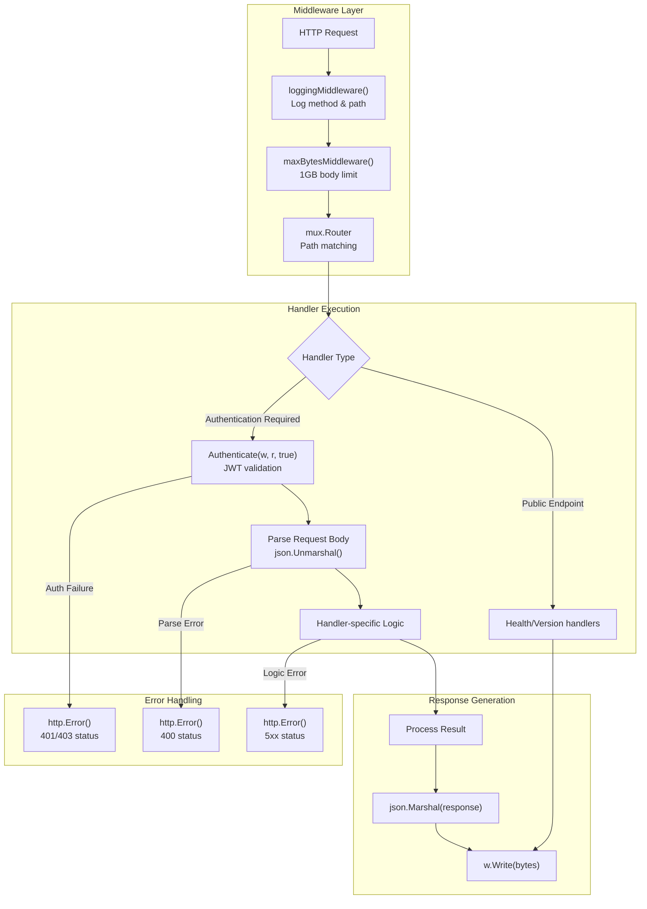

The pipeline includes comprehensive error handling at each stage:
- Middleware errors return early with appropriate HTTP status codes
- Authentication failures use standard HTTP error responses
- JSON parsing errors return 400 Bad Request
- Business logic errors map to appropriate 4xx/5xx status codes

**Sources:** [app/server/setup/setup.go:50-64](), [app/server/handlers/sessions.go:179-183](), [app/server/handlers/sessions.go:223-237]()

## Client-Server Communication

The CLI communicates with the server through HTTP clients with sophisticated retry and authentication logic:

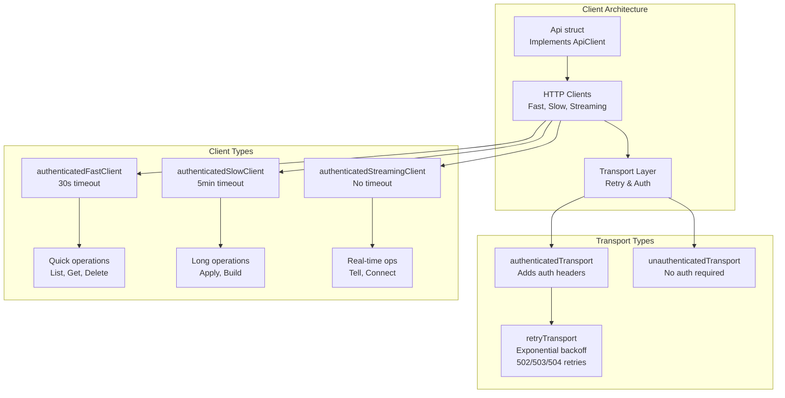

**Sources:** [app/cli/api/clients.go:18-160]()

## Server Lifecycle Management

The server implements graceful startup and shutdown procedures:

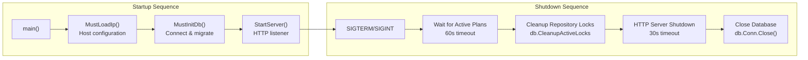

**Sources:** [app/server/main.go:12-28](), [app/server/setup/setup.go:20-42](), [app/server/setup/setup.go:119-185]()