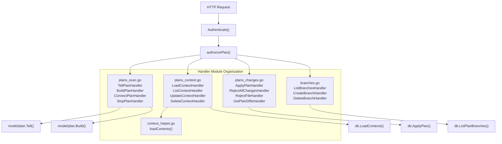
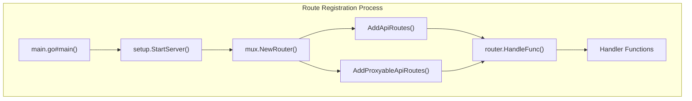
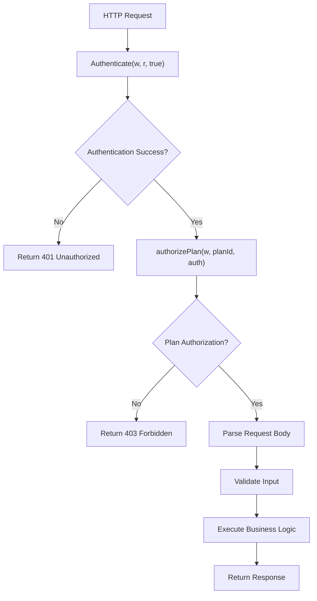
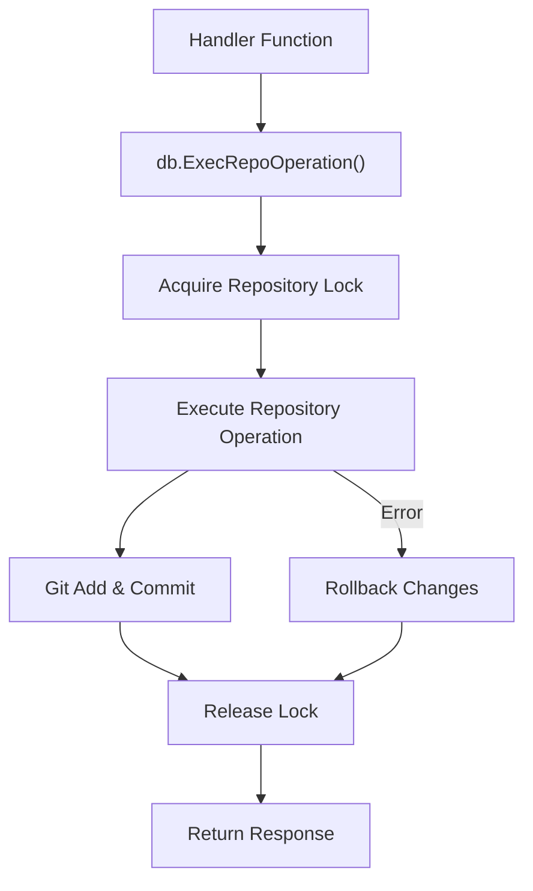
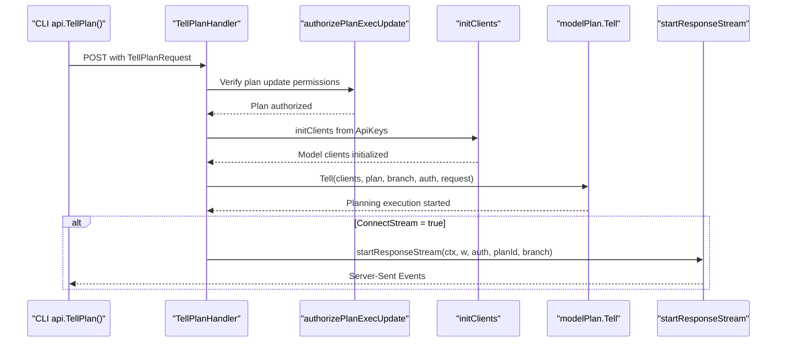
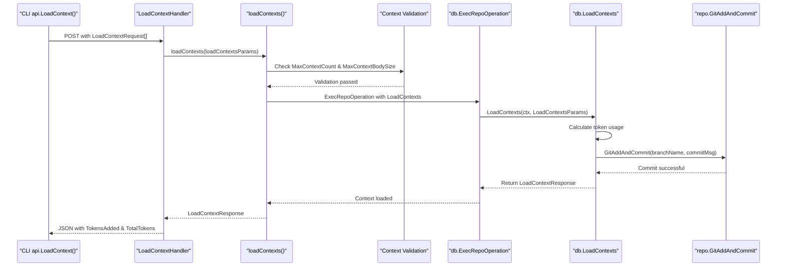
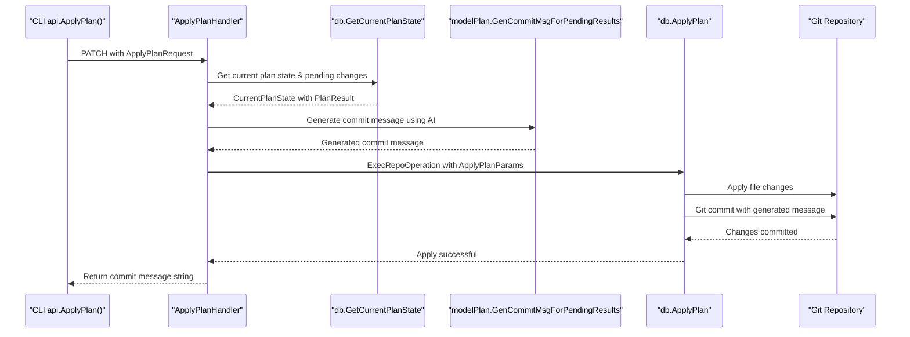
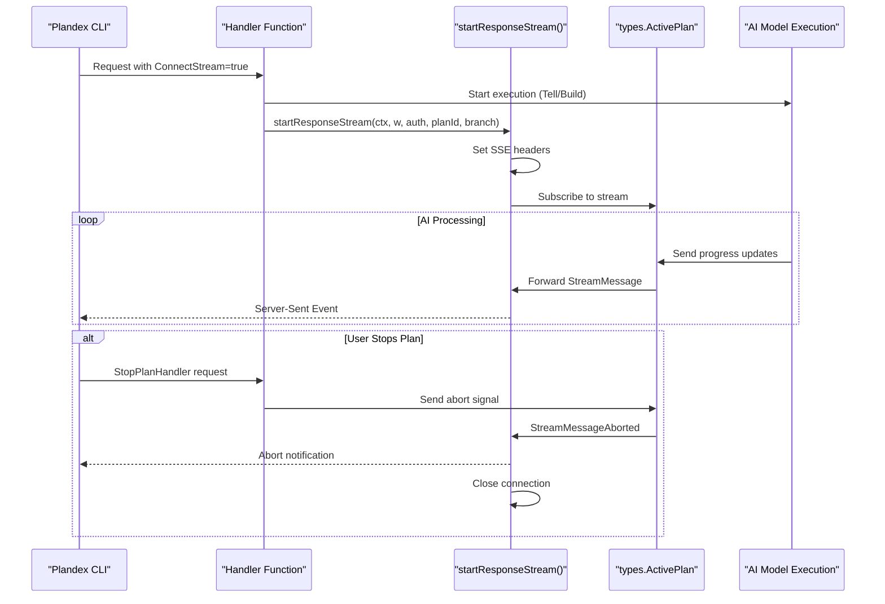
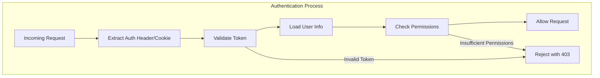

# HTTP API and Request Handlers

<details>
<summary>Relevant source files</summary>

The following files were used as context for generating this wiki page:

- [app/cli/api/clients.go](app/cli/api/clients.go)
- [app/cli/lib/git.go](app/cli/lib/git.go)
- [app/server/db/result_helpers.go](app/server/db/result_helpers.go)
- [app/server/db/user_helpers.go](app/server/db/user_helpers.go)
- [app/server/handlers/branches.go](app/server/handlers/branches.go)
- [app/server/handlers/client_helper.go](app/server/handlers/client_helper.go)
- [app/server/handlers/context_helper.go](app/server/handlers/context_helper.go)
- [app/server/handlers/plans_changes.go](app/server/handlers/plans_changes.go)
- [app/server/handlers/plans_context.go](app/server/handlers/plans_context.go)
- [app/server/handlers/plans_convo.go](app/server/handlers/plans_convo.go)
- [app/server/handlers/plans_exec.go](app/server/handlers/plans_exec.go)
- [app/server/handlers/plans_versions.go](app/server/handlers/plans_versions.go)
- [app/server/handlers/sessions.go](app/server/handlers/sessions.go)
- [app/server/handlers/settings.go](app/server/handlers/settings.go)
- [app/server/main.go](app/server/main.go)
- [app/server/routes/routes.go](app/server/routes/routes.go)
- [app/server/setup/setup.go](app/server/setup/setup.go)

</details>


This document details the REST API endpoints and their corresponding request handlers in the Plandex server. These handlers implement the HTTP interface between clients (primarily the Plandex CLI) and the server, enabling plan management, context operations, and user interactions.

The handlers are organized into several modules in the `app/server/handlers/` directory, each responsible for different aspects of the system functionality.

## Request Handler Architecture

The Plandex server implements RESTful HTTP handlers organized by functionality. Each handler module contains functions that process specific API requests, handle authentication, execute business logic, and return appropriate responses.



Sources: [app/server/handlers/plans_exec.go:1-589](), [app/server/handlers/plans_context.go:1-447](), [app/server/handlers/plans_changes.go:1-566](), [app/server/handlers/branches.go:1-207]()

## API Routes Registration

The Plandex server registers API routes in the `routes.go` file, configuring HTTP handlers using the Gorilla mux router. Routes are categorized into:

1. Regular API routes (`addApiRoutes`)
2. Proxyable API routes (`addProxyableApiRoutes`) - These can be handled by any server in a distributed setup



Sources: [app/server/main.go:11-28](), [app/server/routes/routes.go:72-185](), [app/server/setup/setup.go:62-95]()

## API Endpoints Overview

The following table summarizes the key API endpoints by category:

| Category | Example Endpoint | Description |
|----------|------------------|-------------|
| Authentication | `/accounts/sign_in` | User authentication and session management |
| Plan Management | `/plans` | List, create, update, and delete plans |
| Plan Execution | `/plans/{planId}/{branch}/tell` | Execute plans with AI models |
| Context Management | `/plans/{planId}/{branch}/context` | Manage context for AI models |
| Plan Changes | `/plans/{planId}/{branch}/apply` | Apply or reject generated changes |
| Branch Management | `/plans/{planId}/branches` | Manage Git branches |
| Organization | `/orgs` | Manage organizations and users |
| Projects | `/projects` | Manage projects |
| Model Configuration | `/model_sets` | Configure AI models |

Sources: [app/server/routes/routes.go:89-185](), [app/server/routes/routes.go:187-198]()

## Request Handler Common Patterns

Most handlers follow consistent patterns for authentication, authorization, and error handling.

### Authentication and Authorization Flow



**Core Authentication Functions:**
- `Authenticate(w http.ResponseWriter, r *http.Request, required bool) *types.ServerAuth`
- `authorizePlan(w http.ResponseWriter, planId string, auth *types.ServerAuth) *db.Plan`
- `authorizePlanExecUpdate(w http.ResponseWriter, planId string, auth *types.ServerAuth) *db.Plan`

The `authorizePlanExecUpdate` function adds an additional permission check for plan modification operations using `auth.HasPermission(shared.PermissionUpdateAnyPlan)`.

Sources: [app/server/handlers/plans_exec.go:575-588](), [app/server/handlers/plans_exec.go:26-40]()

### Repository Operation Pattern

Many handlers use `db.ExecRepoOperation()` to ensure proper Git repository locking and transaction management:



**ExecRepoOperationParams Structure:**
- `OrgId string` - Organization identifier
- `UserId string` - User identifier  
- `PlanId string` - Plan identifier
- `Branch string` - Git branch name
- `Scope db.LockScope` - Read or write lock scope
- `Reason string` - Operation description for logging

Sources: [app/server/handlers/plans_changes.go:151-177](), [app/server/handlers/plans_context.go:196-206]()

## Plan Execution Request Handlers

The plan execution handlers in `plans_exec.go` manage the core AI-powered planning and implementation workflow.

### TellPlanHandler Function

**Endpoint:** `POST /plans/{planId}/{branch}/tell`  
**Handler:** `TellPlanHandler(w http.ResponseWriter, r *http.Request)`

Initiates or continues a planning session with AI models. The handler processes `shared.TellPlanRequest` structures.

**Request Structure (TellPlanRequest):**
- `Prompt string` - User's natural language instruction
- `ApiKeys map[string]string` - API keys for different model providers  
- `ConnectStream bool` - Whether to establish streaming connection
- `AutoContext bool` - Enable automatic context loading
- `BuildMode BuildMode` - Auto or manual build mode
- `SessionId string` - Session identifier for tracking

**Handler Implementation Flow:**
1. `Authenticate(w, r, true)` - Verify user authentication
2. `authorizePlanExecUpdate(w, planId, auth)` - Check plan modification permissions  
3. `json.Unmarshal(body, &requestBody)` - Parse TellPlanRequest
4. `initClients()` - Initialize AI model clients from API keys
5. `modelPlan.Tell(clients, plan, branch, auth, &requestBody)` - Execute planning logic
6. `startResponseStream()` - Start streaming if ConnectStream=true



Sources: [app/server/handlers/plans_exec.go:23-98](), [app/shared/req_res.go:120-142]()

### BuildPlanHandler Function

**Endpoint:** `PATCH /plans/{planId}/{branch}/build`  
**Handler:** `BuildPlanHandler(w http.ResponseWriter, r *http.Request)`

Implements the plan by generating concrete code changes. Processes `shared.BuildPlanRequest` structures.

**Request Structure (BuildPlanRequest):**
- `ApiKeys map[string]string` - Model provider API keys
- `ConnectStream bool` - Enable streaming responses
- `SessionId string` - Session tracking identifier

**Implementation:** The handler follows similar authentication and client initialization patterns, then calls `modelPlan.Build()` to generate file modifications.

Sources: [app/server/handlers/plans_exec.go:100-170](), [app/shared/req_res.go:144-153]()

### ConnectPlanHandler Function

**Endpoint:** `PATCH /plans/{planId}/{branch}/connect`  
**Handler:** `ConnectPlanHandler(w http.ResponseWriter, r *http.Request)`

Establishes streaming connection to active plan execution. Uses `modelPlan.GetActivePlan()` to locate running plans and `startResponseStream()` for client communication.

Sources: [app/server/handlers/plans_exec.go:172-212]()

### StopPlanHandler Function

**Endpoint:** `DELETE /plans/{planId}/{branch}/stop`  
**Handler:** `StopPlanHandler(w http.ResponseWriter, r *http.Request)`

Terminates active plan execution by sending abort signals via `active.Stream()` and calling `modelPlan.Stop()`.

Sources: [app/server/handlers/plans_exec.go:214-288]()

### Build Plan

**Endpoint:** `PATCH /plans/{planId}/{branch}/build`

Implements the plan by generating code changes.

**Request Body:**
```json
{
  "apiKeys": {"openai": "key1", "anthropic": "key2"},
  "connectStream": true,
  "sessionId": "optional-session-id"
}
```

**Implementation Details:**
The handler authenticates the user, initializes AI model clients, calls `modelPlan.Build()` to generate code implementations, and optionally streams the results back to the client.

Sources: [app/server/handlers/plans_exec.go:100-170]()

### Connect Plan

**Endpoint:** `PATCH /plans/{planId}/{branch}/connect`

Establishes a streaming connection to an active plan.

**Implementation Details:**
Gets the active plan for the specified ID and branch. If no active plan exists locally, proxies the request to another server. Then starts a response stream to the client.

Sources: [app/server/handlers/plans_exec.go:172-212]()

### Stop Plan

**Endpoint:** `DELETE /plans/{planId}/{branch}/stop`

Terminates an active plan execution.

**Implementation Details:**
Gets the active plan, sends an abort message to the client, stores any partial reply, and stops the plan execution.

Sources: [app/server/handlers/plans_exec.go:214-288]()

## Context Management Endpoints

Contexts provide AI models with information about the codebase. These endpoints manage context loading and manipulation.

### LoadContextHandler Function

**Endpoint:** `POST /plans/{planId}/{branch}/context`  
**Handler:** `LoadContextHandler(w http.ResponseWriter, r *http.Request)`

Loads new contexts into a plan. Processes `shared.LoadContextRequest` which is an array of `LoadContextParams`.

**Request Structure (LoadContextParams):**
- `ContextType shared.ContextType` - File, URL, note, directory tree, piped data, image, or map
- `FilePath string` - Path for file contexts
- `Body string` - Content body for contexts
- `MapBodies shared.FileMapBodies` - For map-type contexts containing multiple files
- `ImageDetail openai.ImageURLDetail` - Detail level for image contexts
- `AutoLoaded bool` - Whether context was automatically loaded

**Handler Implementation:**
The handler delegates to `loadContexts()` helper function which handles validation, token calculation, and repository operations.



**Context Validation Logic:**
The `loadContexts()` helper in `context_helper.go` performs several validation checks:
- Total file count against `shared.MaxContextCount`
- Individual file size against `shared.MaxContextBodySize`  
- Map context paths against `shared.MaxContextMapPaths`
- Map file size against `shared.MaxContextMapSingleInputSize`

Sources: [app/server/handlers/plans_context.go:154-212](), [app/server/handlers/context_helper.go:29-280](), [app/shared/req_res.go:185-205]()

### List Contexts

**Endpoint:** `GET /plans/{planId}/{branch}/context`

Lists all contexts associated with a plan.

**Implementation Details:**
Executes a repository operation to get plan contexts and returns the list of contexts.

Sources: [app/server/handlers/plans_context.go:17-78]()

### Update Context

**Endpoint:** `PUT /plans/{planId}/{branch}/context`

Updates existing contexts in a plan.

Sources: [app/server/handlers/plans_context.go:214-318]()

### Delete Context

**Endpoint:** `DELETE /plans/{planId}/{branch}/context`

Removes contexts from a plan.

Sources: [app/server/handlers/plans_context.go:320-447]()

## Plan Changes Endpoints

These endpoints manage the changes produced by plan execution, allowing you to view, apply, or reject them.

### ApplyPlanHandler Function

**Endpoint:** `PATCH /plans/{planId}/{branch}/apply`  
**Handler:** `ApplyPlanHandler(w http.ResponseWriter, r *http.Request)`

Applies pending plan changes to the repository. Processes `shared.ApplyPlanRequest` and returns the generated commit message.

**Request Structure (ApplyPlanRequest):**
- `ApiKeys map[string]string` - Model provider API keys for commit message generation
- `SessionId string` - Session tracking identifier

**Handler Implementation Flow:**
1. `authorizePlan(w, planId, auth)` - Verify plan access
2. `db.GetPlanSettings(plan, true)` - Load plan configuration
3. `db.GetCurrentPlanState(currentPlanParams)` - Get pending changes
4. `modelPlan.GenCommitMsgForPendingResults()` - AI-generate commit message
5. `db.ApplyPlan()` - Apply changes and commit to repository



Sources: [app/server/handlers/plans_changes.go:106-236](), [app/shared/req_res.go:320-325]()

### RejectAllChangesHandler Function

**Endpoint:** `PATCH /plans/{planId}/{branch}/reject_all`  
**Handler:** `RejectAllChangesHandler(w http.ResponseWriter, r *http.Request)`

Rejects all pending changes in the plan. Calls `db.RejectAllResults()` and commits the rejection.

Sources: [app/server/handlers/plans_changes.go:238-287]()

### RejectFileHandler and RejectFilesHandler Functions

**Endpoints:** 
- `PATCH /plans/{planId}/{branch}/reject_file` 
- `PATCH /plans/{planId}/{branch}/reject_files`

**Handlers:** `RejectFileHandler` and `RejectFilesHandler`

Reject changes to specific files. Process `shared.RejectFileRequest` and `shared.RejectFilesRequest` respectively.

Sources: [app/server/handlers/plans_changes.go:289-417]()

### Reject Changes

**Endpoints:** 
- `PATCH /plans/{planId}/{branch}/reject_all`
- `PATCH /plans/{planId}/{branch}/reject_file`
- `PATCH /plans/{planId}/{branch}/reject_files`

Reject pending changes, either all changes or changes to specific files.

**Implementation Details:**
Execute repository operations to reject the specified changes and commit the rejection to the repository.

Sources: [app/server/handlers/plans_changes.go:238-417]()

### Get Plan Diffs

**Endpoint:** `GET /plans/{planId}/{branch}/diffs`

Retrieves diffs for pending changes.

Sources: [app/server/handlers/plans_changes.go:509-566]()

## Branch Management Endpoints

These endpoints manage Git branches for plans, allowing parallel work streams.

### List Branches

**Endpoint:** `GET /plans/{planId}/branches`

Lists all branches for a plan.

Sources: [app/server/handlers/branches.go:18-78]()

### Create Branch

**Endpoint:** `POST /plans/{planId}/{branch}/branches`

Creates a new branch from an existing branch.

Sources: [app/server/handlers/branches.go:80-158]()

### Delete Branch

**Endpoint:** `DELETE /plans/{planId}/branches/{branch}`

Deletes a branch.

Sources: [app/server/handlers/branches.go:160-207]()

## Request and Response Data Structures

The API handlers work with strongly-typed request and response structures defined in `shared/req_res.go` and `shared/data_models.go`.

### Core Request Types

| Handler Function | Request Type | Key Fields |
|------------------|--------------|------------|
| `TellPlanHandler` | `TellPlanRequest` | `Prompt`, `ApiKeys`, `ConnectStream`, `AutoContext` |
| `BuildPlanHandler` | `BuildPlanRequest` | `ApiKeys`, `ConnectStream`, `SessionId` |
| `LoadContextHandler` | `LoadContextRequest` | Array of `LoadContextParams` |
| `ApplyPlanHandler` | `ApplyPlanRequest` | `ApiKeys`, `SessionId` |
| `CreateBranchHandler` | `CreateBranchRequest` | `Name` |

### Core Response Types

| Handler Function | Response Type | Key Fields |
|------------------|---------------|------------|
| `LoadContextHandler` | `LoadContextResponse` | `TokensAdded`, `TotalTokens`, `MaxTokensExceeded` |
| `ListContextHandler` | `[]*shared.Context` | Array of context objects |
| `ApplyPlanHandler` | `string` | Generated commit message |
| `GetBuildStatusHandler` | `GetBuildStatusResponse` | `BuiltFiles`, `IsBuildingByPath` |

### Context Type System

Context types are defined as `shared.ContextType` constants:
- `ContextFileType` - Individual files
- `ContextURLType` - Web URLs  
- `ContextNoteType` - User notes
- `ContextDirectoryTreeType` - Directory structures
- `ContextPipedDataType` - Piped input data
- `ContextImageType` - Image files
- `ContextMapType` - File maps containing multiple files

Sources: [app/shared/req_res.go:120-372](), [app/shared/data_models.go:83-93](), [app/server/handlers/plans_exec.go:54-60]()

## Streaming Response Implementation

Several handlers support streaming responses using Server-Sent Events (SSE) for real-time updates during plan execution.

### startResponseStream Function

Handlers that support streaming call `startResponseStream(r.Context(), w, auth, planId, branch, isConnect)` to establish the streaming connection. This function:

1. Sets appropriate HTTP headers for SSE
2. Subscribes to the active plan's stream  
3. Forwards `shared.StreamMessage` events to the client
4. Handles stream abortion and cleanup

### Streaming-Enabled Handlers

| Handler | Stream Trigger | Purpose |
|---------|----------------|---------|
| `TellPlanHandler` | `req.ConnectStream = true` | Real-time planning updates |
| `BuildPlanHandler` | `req.ConnectStream = true` | Code generation progress |
| `ConnectPlanHandler` | Always streams | Connect to existing active plan |



Sources: [app/server/handlers/plans_exec.go:94-95](), [app/server/handlers/plans_exec.go:165-167](), [app/server/handlers/plans_exec.go:209]()

## Error Handling Patterns

Request handlers implement consistent error handling patterns with logging, appropriate HTTP status codes, and error response formatting.

### Common Error Handling Functions

**HTTP Error Responses:**
```go
http.Error(w, "Error message", http.StatusCode)
```

**API Error Structure:**
Handlers can return structured errors using `shared.ApiError` with fields for error type, status code, and message.

### Error Scenarios by Handler Type

| Error Type | Status Code | Example Handlers | Trigger Conditions |
|------------|-------------|------------------|-------------------|
| Authentication Failed | 401 | All handlers | `Authenticate()` returns nil |
| Authorization Failed | 403 | `authorizePlanExecUpdate` | User lacks plan update permission |
| Invalid Request Body | 400 | `TellPlanHandler`, `LoadContextHandler` | `json.Unmarshal()` fails |
| Plan Not Found | 404 | `authorizePlan` calls | Plan doesn't exist or access denied |
| Context Limits Exceeded | 400 | `LoadContextHandler` | Exceeds `MaxContextCount` or `MaxContextBodySize` |
| Repository Operation Failed | 500 | `ExecRepoOperation` calls | Git operations fail |
| Internal Server Error | 500 | All handlers | Unexpected runtime errors |

### Error Logging Pattern

Handlers consistently log errors with context:
```go
log.Printf("Error description: %v\n", err)
http.Error(w, "Error description: "+err.Error(), http.StatusInternalServerError)
```

Sources: [app/server/handlers/plans_exec.go:43-59](), [app/server/handlers/plans_exec.go:151-162](), [app/server/handlers/context_helper.go:54-81]()

## Health and Monitoring Endpoints

The server provides endpoints for health monitoring:

| Endpoint | Description |
|----------|-------------|
| `/health` | Basic health check - returns "OK" if server is running |
| `/version` | Returns the server version information |

Sources: [app/server/routes/routes.go:30-71]()

## API Authentication Flow



Sources: [app/server/handlers/plans_exec.go:558-571](), [app/server/handlers/sessions.go:211-250]()

## Conclusion

The Plandex API provides a comprehensive set of endpoints for interacting with the Plandex system. This document has outlined the key endpoints, their functionality, and implementation details. Clients like the Plandex CLI use these endpoints to manage plans, contexts, branches, and execute AI-powered coding operations.