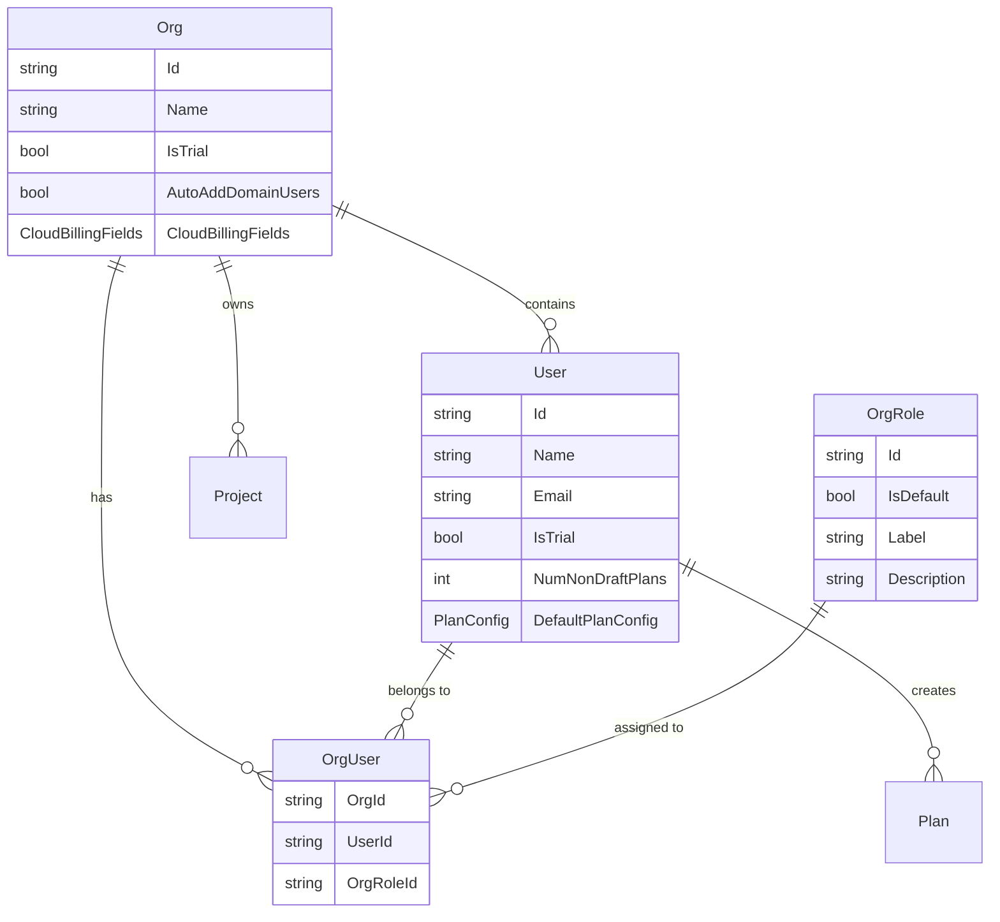
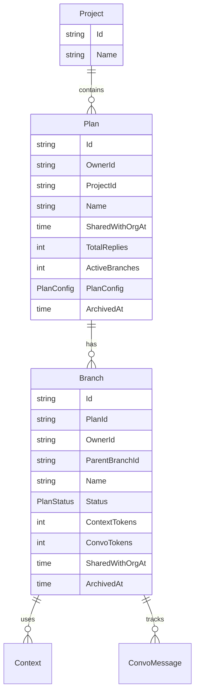
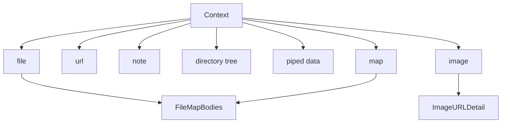
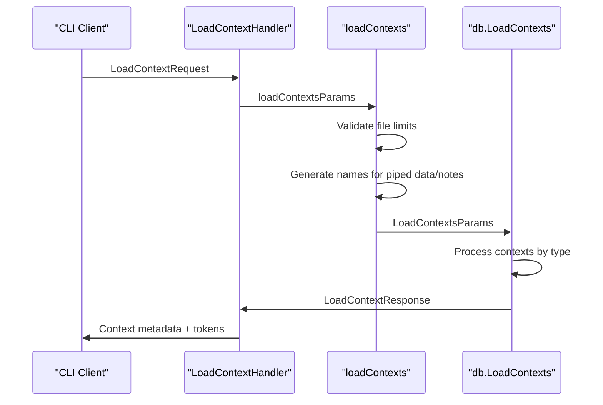
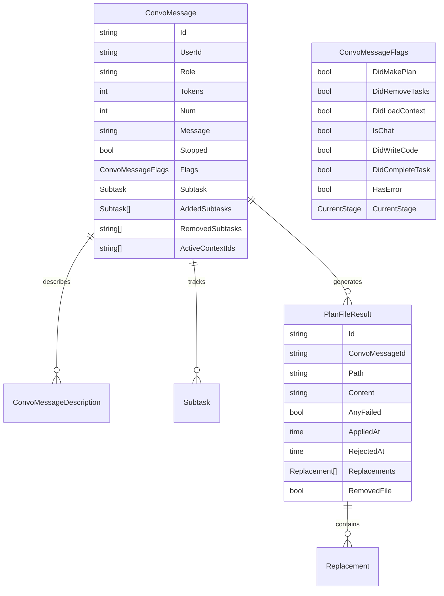
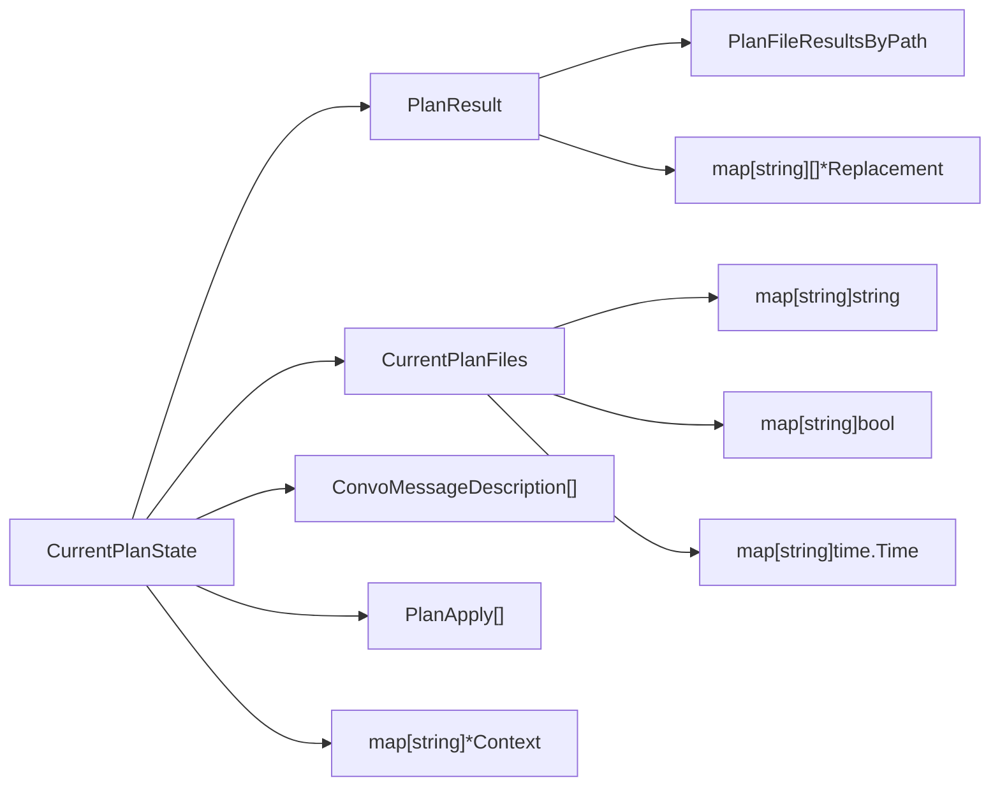
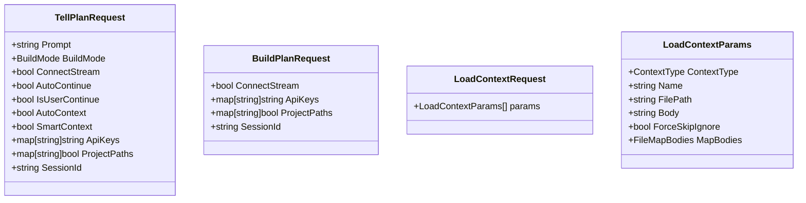
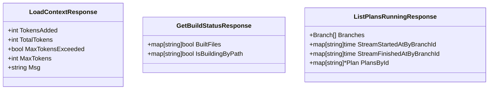
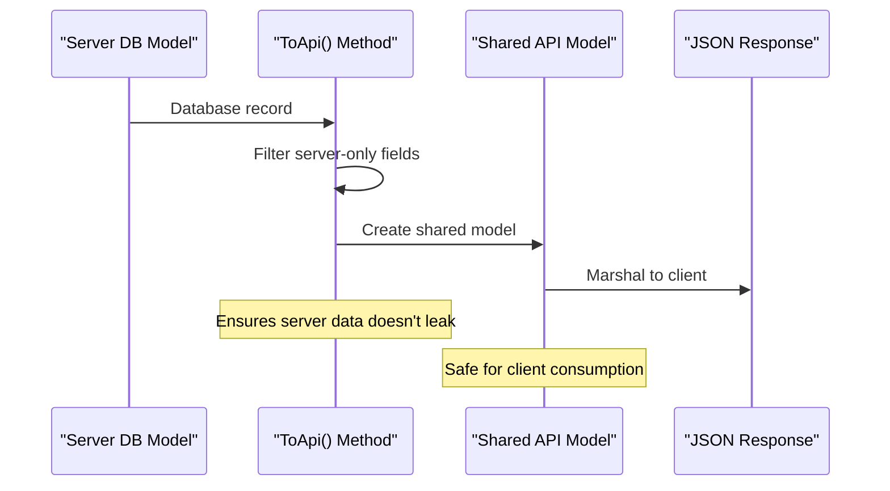
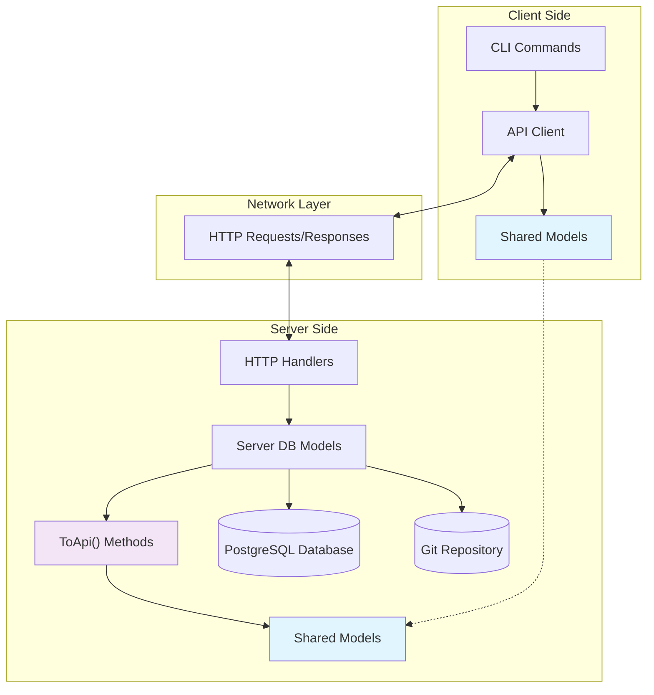

# Data Models and Shared Types

<details>
<summary>Relevant source files</summary>

The following files were used as context for generating this wiki page:

- [app/cli/api/methods.go](app/cli/api/methods.go)
- [app/cli/types/api.go](app/cli/types/api.go)
- [app/server/db/data_models.go](app/server/db/data_models.go)
- [app/shared/data_models.go](app/shared/data_models.go)
- [app/shared/req_res.go](app/shared/req_res.go)

</details>


This document covers the core data structures and type definitions used throughout the Plandex system. These models define the fundamental entities for organizations, plans, contexts, conversations, and file modifications that flow between the CLI client and server components.

For information about how these models are used in API communication, see [HTTP API and Request Handlers](#4.1). For details about the plan execution engine that processes these models, see [Plan Execution Engine](#4.3).

## Core Entity Models

The Plandex system is built around several fundamental entities that represent organizations, plans, and their associated data. These models are defined in the shared package and used consistently across client and server components.

### Organization and User Models

The system supports multi-tenant organizations with role-based access control:



**Sources:** [app/shared/data_models.go:10-66](), [app/server/db/data_models.go:24-109]()

### Project and Plan Hierarchy

Projects contain plans, which contain branches for different development paths:



**Sources:** [app/shared/data_models.go:49-81](), [app/server/db/data_models.go:111-190]()

## Context and Content Models

Context represents the various types of input data that can be loaded into a plan, including files, URLs, notes, and images.

### Context Type Hierarchy



The `Context` struct supports multiple content types through a flexible design:

- **File contexts** contain source code or text files
- **URL contexts** fetch and store web content  
- **Note contexts** store user-provided text
- **Image contexts** include visual content for AI analysis
- **Map contexts** represent directory structures with file mappings

**Sources:** [app/shared/data_models.go:83-117](), [app/server/db/data_models.go:387-460]()

### Context Loading and Management



**Sources:** [app/server/handlers/context_helper.go:29-280](), [app/server/handlers/plans_context.go:154-212]()

## Plan Execution Models

Plan execution involves conversation messages, file results, and build tracking that represent the AI's work on a plan.

### Conversation and Message Flow



**Sources:** [app/shared/data_models.go:138-267](), [app/server/db/data_models.go:462-581]()

### Plan State Management

The `CurrentPlanState` aggregates all plan data for client consumption:



**Sources:** [app/shared/data_models.go:269-299](), [app/server/handlers/plans_changes.go:19-104]()

## Request and Response Models

The system uses structured request/response models for all API communication, providing type safety and validation.

### Plan Execution Requests



**Sources:** [app/shared/req_res.go:120-207](), [app/server/handlers/plans_exec.go:54-84]()

### Response Models

Response models provide structured feedback and streaming capabilities:



**Sources:** [app/shared/req_res.go:209-334](), [app/cli/api/methods.go:267-301]()

## Model Conversion Patterns

The system maintains separation between server-side database models and client-facing API models through consistent conversion patterns.

### ToApi() Conversion Pattern



Database models include `ToApi()` methods that convert server-side data to client-safe shared models:

```go
// Server-side model (db package)
type Plan struct {
    Id       string
    OrgId    string  // Server-only
    OwnerId  string
    Name     string
    // ... other fields
}

// Conversion method
func (plan *Plan) ToApi() *shared.Plan {
    return &shared.Plan{
        Id:      plan.Id,
        OwnerId: plan.OwnerId,
        Name:    plan.Name,
        // OrgId omitted - server-only
    }
}
```

**Sources:** [app/server/db/data_models.go:141-155](), [app/server/handlers/plans_context.go:63-67]()

### Data Flow Architecture



This architecture ensures:
- **Type safety** across client-server boundaries
- **Data isolation** preventing server internals from leaking to clients
- **Consistent interfaces** through shared model definitions
- **Validation** at API boundaries through structured types

**Sources:** [app/cli/api/methods.go:75-133](), [app/server/handlers/plans_exec.go:23-98](), [app/server/db/data_models.go:11-15]()