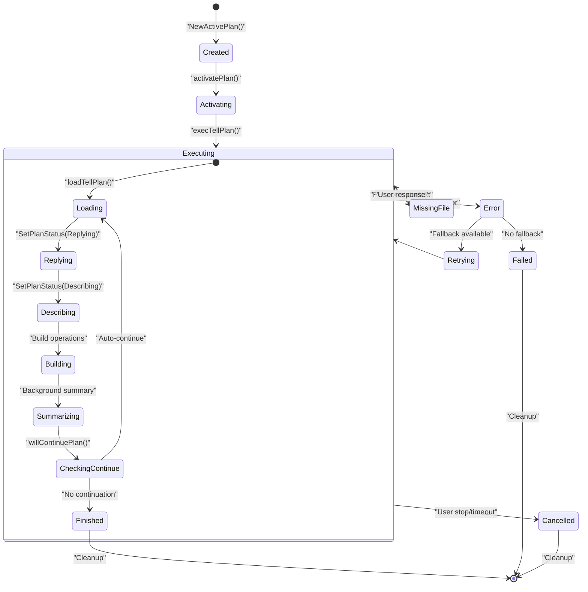
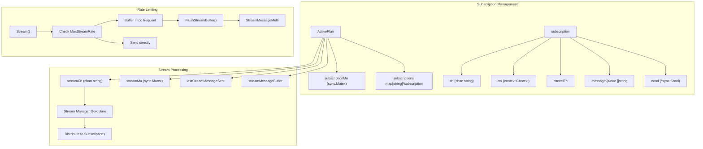
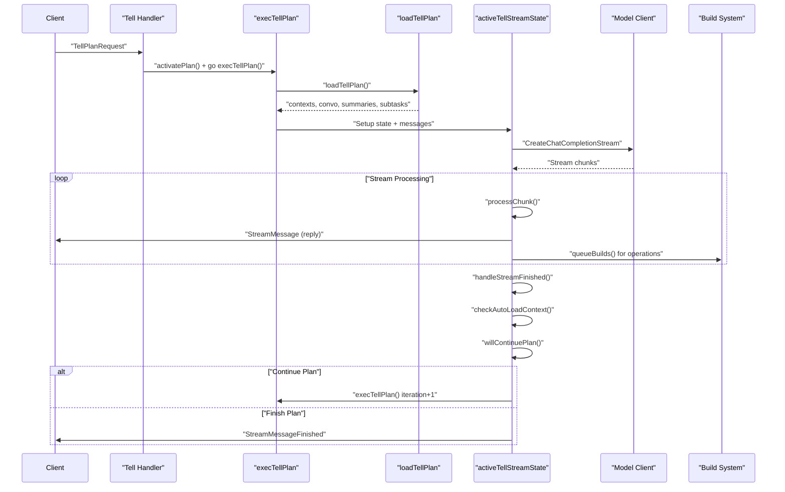
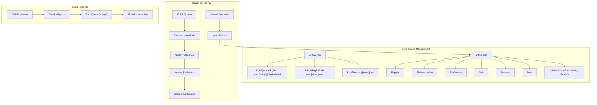

# Active Plan Management

Relevant source files

The following files were used as context for generating this wiki page:

- [app/cli/stream_tui/model.go](app/cli/stream_tui/model.go)
- [app/cli/stream_tui/run.go](app/cli/stream_tui/run.go)
- [app/cli/stream_tui/update.go](app/cli/stream_tui/update.go)
- [app/cli/stream_tui/view.go](app/cli/stream_tui/view.go)
- [app/server/model/plan/tell_exec.go](app/server/model/plan/tell_exec.go)
- [app/server/model/plan/tell_load.go](app/server/model/plan/tell_load.go)
- [app/server/model/plan/tell_state.go](app/server/model/plan/tell_state.go)
- [app/server/model/plan/tell_stream_finish.go](app/server/model/plan/tell_stream_finish.go)
- [app/server/model/plan/tell_stream_main.go](app/server/model/plan/tell_stream_main.go)
- [app/server/model/plan/tell_stream_processor.go](app/server/model/plan/tell_stream_processor.go)
- [app/server/model/plan/tell_summary.go](app/server/model/plan/tell_summary.go)
- [app/server/types/active_plan.go](app/server/types/active_plan.go)

This document covers the server-side management of active plans in Plandex, including real-time streaming, state management, and coordination between AI model execution and client interactions. For information about plan data storage and persistence, see [Database Schema and Migrations](#6.1). For details about AI model integration during plan execution, see [AI Model Integration and Task Control](#3.2).

## Core ActivePlan Structure

The `ActivePlan` struct serves as the central coordinator for all real-time plan operations, managing streaming, state, and communication between server components and connected clients.

```mermaid
graph TB
    subgraph "ActivePlan Core State"
        AP["ActivePlan"]
        AP --> ID["Id, UserId, OrgId"]
        AP --> Branch["Branch"]
        AP --> Prompt["Prompt, BuildOnly"]
        AP --> Session["SessionId"]
    end
    
    subgraph "Context Management"
        AP --> Ctx["Ctx (context.Context)"]
        AP --> CancelFn["CancelFn"]
        AP --> ModelStreamCtx["ModelStreamCtx"]
        AP --> CancelModelStreamFn["CancelModelStreamFn"]
        AP --> SummaryCtx["SummaryCtx"]
        AP --> SummaryCancelFn["SummaryCancelFn"]
    end
    
    subgraph "Streaming Infrastructure"
        AP --> StreamDoneCh["StreamDoneCh"]
        AP --> CurrentStreamingReplyId["CurrentStreamingReplyId"]
        AP --> CurrentReplyDoneCh["CurrentReplyDoneCh"]
        AP --> ModelStreamId["ModelStreamId"]
        AP --> streamCh["streamCh"]
        AP --> subscriptions["subscriptions map"]
    end
    
    subgraph "Content and State"
        AP --> Contexts["Contexts []*db.Context"]
        AP --> ContextsByPath["ContextsByPath map"]
        AP --> Operations["Operations []*shared.Operation"]
        AP --> CurrentReplyContent["CurrentReplyContent"]
        AP --> NumTokens["NumTokens"]
        AP --> MessageNum["MessageNum"]
    end
    
    subgraph "Build Management"
        AP --> BuildQueuesByPath["BuildQueuesByPath"]
        AP --> BuiltFiles["BuiltFiles map"]
        AP --> IsBuildingByPath["IsBuildingByPath map"]
        AP --> RepliesFinished["RepliesFinished"]
    end
```

The `ActivePlan` includes multiple context hierarchies to enable granular cancellation control. The main context manages the overall plan lifecycle, while separate contexts handle model streaming and background summarization tasks.

Sources: [app/server/types/active_plan.go:48-93]()

## Plan Lifecycle and State Management

Active plans follow a structured lifecycle from creation through completion, with specific state transitions and cleanup procedures.

The plan execution flow is managed primarily through the `execTellPlan` function, which coordinates between different execution phases and handles state transitions.

Sources: [app/server/model/plan/tell_exec.go:86-492](), [app/server/model/plan/tell_stream_finish.go:25-277]()

## Streaming and Subscription System

Active plans implement a sophisticated streaming system that allows multiple clients to subscribe to real-time updates with automatic buffering and rate limiting.

The streaming system includes automatic message buffering when updates arrive faster than the configured `MaxStreamRate` (70ms), combining multiple messages into `StreamMessageMulti` batches to reduce client-side processing overhead.

Sources: [app/server/types/active_plan.go:186-311](), [app/server/types/active_plan.go:339-378](), [app/server/types/active_plan.go:390-436]()

## Plan Execution Flow

The plan execution system coordinates AI model interactions, file operations, and client communication through a multi-phase process.

The execution flow includes automatic continuation logic that determines whether to proceed with additional iterations based on unfinished subtasks, new context, or explicit task additions.

Sources: [app/server/model/plan/tell_exec.go:86-492](), [app/server/model/plan/tell_load.go:20-427](), [app/server/model/plan/tell_stream_main.go:20-284]()

## Build Management System

Active plans manage file building operations through queued builds that process AI-generated operations into actual file modifications.

The build system processes operations concurrently per file path while maintaining ordering within each path's queue. Build status is tracked both server-side and communicated to clients via streaming updates.

Sources: [app/server/types/active_plan.go:24-37](), [app/server/types/active_plan.go:317-337](), [app/server/model/plan/tell_stream_processor.go:522-593]()

## Integration with Model Streaming

Active plans coordinate closely with AI model streaming, handling real-time content processing, error recovery, and context management.

```mermaid
graph TB
    subgraph "Model Integration"
        activeTellStreamState --> modelStreamId["modelStreamId"]
        activeTellStreamState --> clients["clients map[string]ClientInfo"]
        activeTellStreamState --> modelConfig["modelConfig *ModelRoleConfig"]
        activeTellStreamState --> baseModelConfig["baseModelConfig *BaseModelConfig"]
        activeTellStreamState --> fallbackRes["fallbackRes FallbackResult"]
    end
    
    subgraph "Stream Processing"
        activeTellStreamState --> messages["messages []ExtendedChatMessage"]
        activeTellStreamState --> replyParser["replyParser *ReplyParser"]
        activeTellStreamState --> chunkProcessor["chunkProcessor *chunkProcessor"]
        
        chunkProcessor --> replyOperations["replyOperations []*Operation"]
        chunkProcessor --> fileOpen["fileOpen bool"]
        chunkProcessor --> contentBuffer["contentBuffer string"]
        chunkProcessor --> awaitingBlockOpeningTag["awaitingBlockOpeningTag"]
        chunkProcessor --> awaitingBlockClosingTag["awaitingBlockClosingTag"]
    end
    
    subgraph "Error Handling"
        activeTellStreamState --> numErrorRetry["numErrorRetry int"]
        activeTellStreamState --> numFallbackRetry["numFallbackRetry int"]
        activeTellStreamState --> modelErr["modelErr *ModelError"]
        activeTellStreamState --> didProviderFallback["didProviderFallback bool"]
    end
    
    subgraph "Context Management"
        activeTellStreamState --> currentStage["currentStage CurrentStage"]
        activeTellStreamState --> subtasks["subtasks []*Subtask"]
        activeTellStreamState --> currentSubtask["currentSubtask *Subtask"]
        activeTellStreamState --> settings["settings *PlanSettings"]
    end
```

The integration includes sophisticated chunk processing that handles AI model output formatting, operation parsing, and real-time streaming to clients while maintaining context awareness and error recovery capabilities.

Sources: [app/server/model/plan/tell_state.go:14-82](), [app/server/model/plan/tell_stream_processor.go:29-156](), [app/server/model/plan/tell_stream_main.go:20-284]()