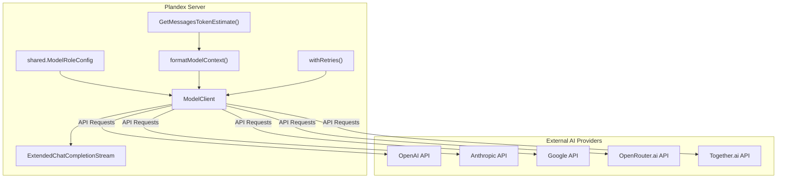
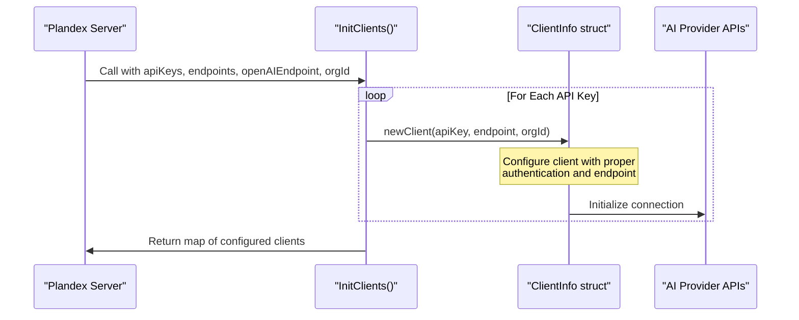
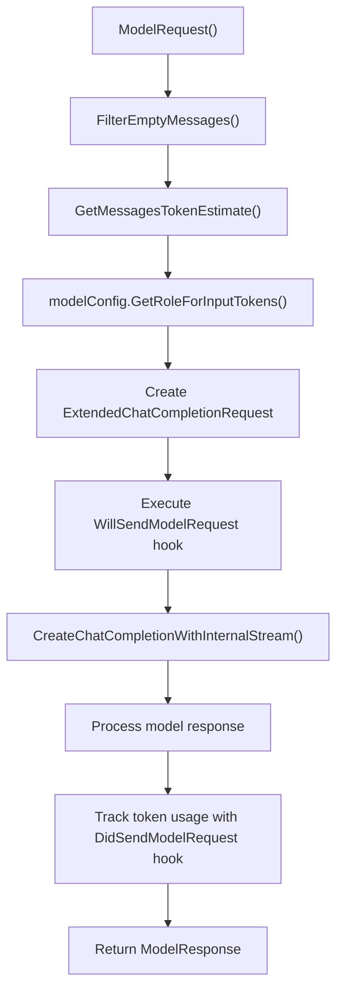
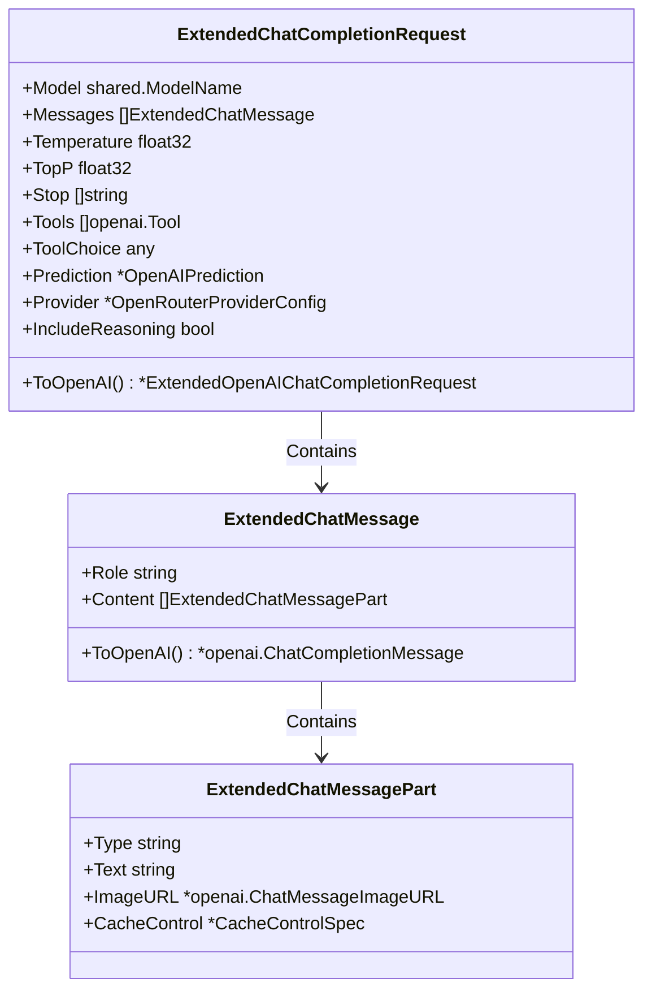
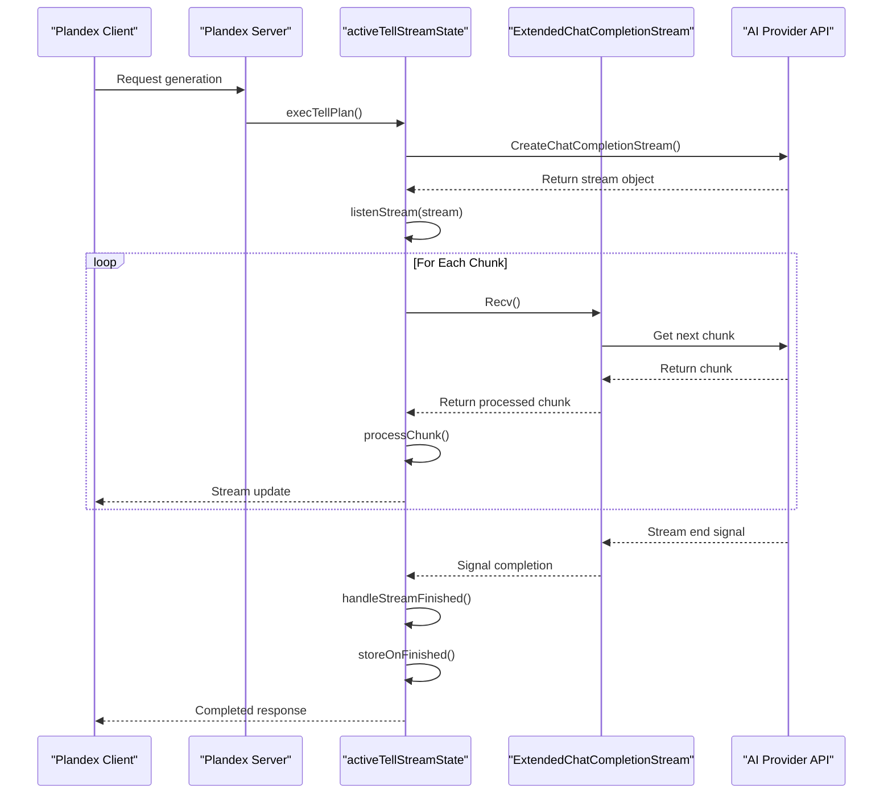
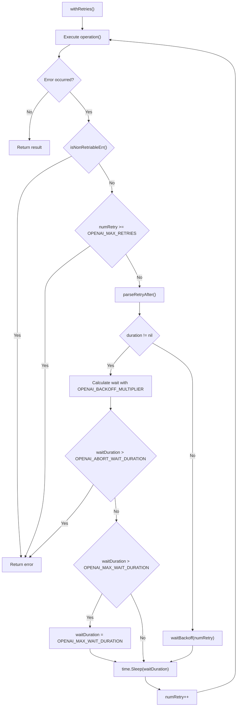
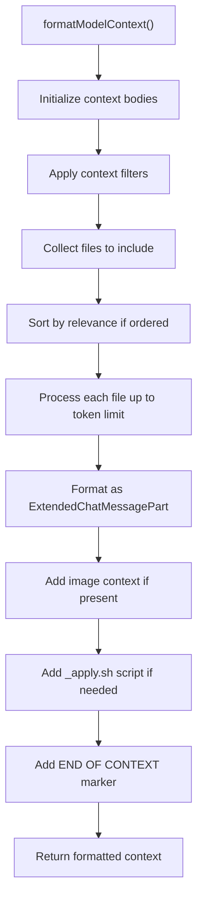
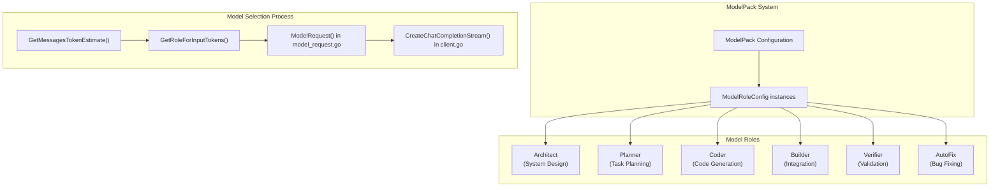
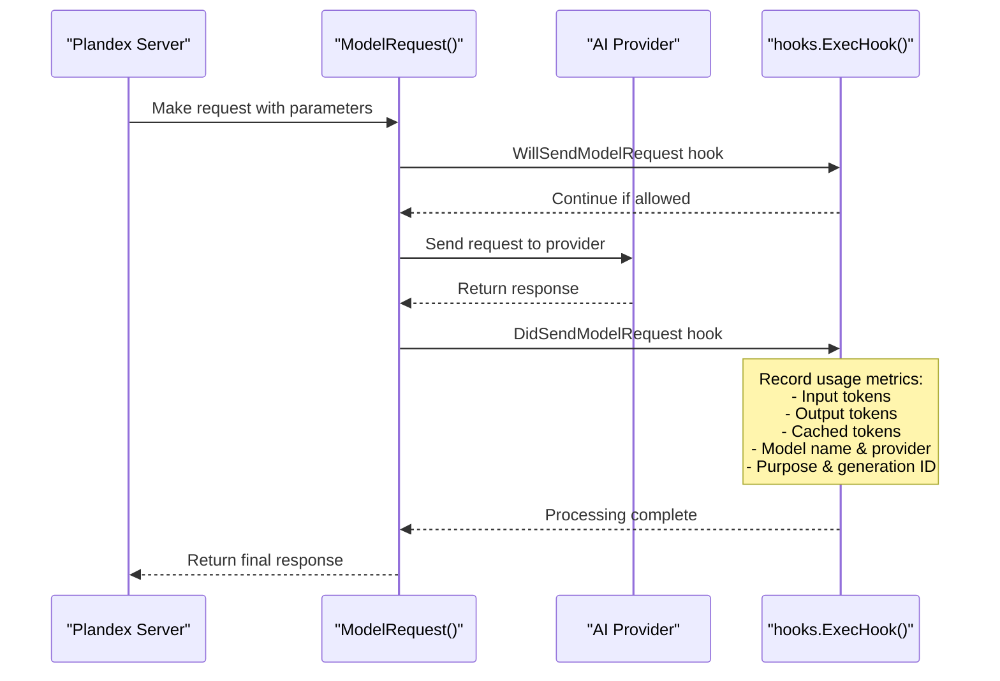

# AI Model Integration

<details>
<summary>Relevant source files</summary>

The following files were used as context for generating this wiki page:

- [app/cli/lib/model_credentials.go](app/cli/lib/model_credentials.go)
- [app/server/model/client.go](app/server/model/client.go)
- [app/server/model/client_stream.go](app/server/model/client_stream.go)
- [app/server/model/model_error.go](app/server/model/model_error.go)
- [app/server/model/plan/tell_stream_error.go](app/server/model/plan/tell_stream_error.go)
- [app/server/types/message.go](app/server/types/message.go)
- [app/shared/ai_models_available.go](app/shared/ai_models_available.go)
- [app/shared/ai_models_data_models.go](app/shared/ai_models_data_models.go)
- [app/shared/ai_models_errors.go](app/shared/ai_models_errors.go)
- [app/shared/ai_models_packs.go](app/shared/ai_models_packs.go)
- [app/shared/ai_models_providers.go](app/shared/ai_models_providers.go)
- [test/smoke_test.sh](test/smoke_test.sh)
- [test/test_utils.sh](test/test_utils.sh)

</details>


This document provides a technical overview of how Plandex integrates with AI models to enable its core code generation, planning, and task execution capabilities. It covers the client initialization process, request handling, response streaming, error management, context formation, and model role configuration. This system forms the bridge between the Plandex application and the external AI providers that power its intelligent coding features.

For information about specific model configurations and model packs, see [Model Configuration](#5.1). For details on context and token management strategies, see [Context and Token Management](#5.2).

## Architecture Overview

The AI model integration in Plandex consists of several interrelated components that work together to enable communication with various AI model providers and optimize the interaction for different scenarios.



Sources: `app/server/model/client.go`, `app/server/model/plan/tell_context.go`, `README.md`

## Supported AI Model Providers

Plandex supports multiple AI model providers, allowing users to leverage different models based on their capabilities, cost, and availability:

| Provider | Description | Environment Variable |
|----------|-------------|---------------------|
| OpenAI | Providers of GPT models | `OPENAI_API_KEY` |
| Anthropic | Providers of Claude models | `ANTHROPIC_API_KEY` |
| Google | Providers of Gemini models | `GOOGLE_API_KEY` |
| OpenRouter.ai | Gateway to multiple models | `OPENROUTER_API_KEY` |
| Together.ai | Providers of open-source models | `TOGETHER_API_KEY` |

### Client Initialization Process

The client initialization process establishes connections to the various AI providers using API keys and configuring appropriate endpoints:



Sources: `app/server/model/client.go:42-56`, `app/server/model/client.go:58-73`

## Client Configuration

Each AI provider requires specific configuration, which is handled through the `ClientInfo` struct and the initialization process:

```go
type ClientInfo struct {
    Client   *openai.Client
    ApiKey   string
    OrgId    string
    Endpoint string
}
```

Configuration options include:
- **Custom Endpoints**: Set via the `OPENAI_ENDPOINT` environment variable
- **Organization ID**: For OpenAI multi-org accounts via `OPENAI_ORG_ID`
- **Provider-specific Headers**: Such as OpenRouter's region and preference settings

Sources: `app/server/model/client.go:35-40`, `releases/server/versions/0.8.3.md:2-4`

## Request Processing Flow

The system uses a robust request processing flow to communicate with AI models:



Sources: `app/server/model/model_request.go:45-187`, `app/server/model/model_request.go:189-206`

## Message Formatting

Plandex extends the standard OpenAI message format to accommodate additional features:



Sources: `app/server/types/message.go:22-32`, `app/server/types/message.go:34-57`, `app/server/types/message.go:69-124`

## Streaming Response Handling

Streaming is a critical feature for providing real-time feedback during code generation. The system implements a sophisticated streaming mechanism:



The streaming system includes:
- **Timeout Management**: Handles inactivity with configurable timeouts
- **Retry Logic**: Automatically retries failed requests with backoff
- **Chunk Processing**: Parses and processes stream chunks
- **State Management**: Tracks and updates the state of the streaming process

Sources: `app/server/model/client.go:75-108`, `app/server/model/plan/tell_stream_main.go:17-251`, `app/server/model/plan/tell_stream_finish.go:17-248`

## Error Handling and Retries

The system implements robust error handling with sophisticated retry logic:



Key error handling features:
1. **Error Classification**: Categorizes errors as retryable or non-retryable
2. **Exponential Backoff**: Increases wait time between retries
3. **Rate Limit Handling**: Respects provider rate limit headers
4. **Maximum Retries**: Caps retry attempts to prevent endless loops

Sources: `app/server/model/client.go:408-434`, `app/server/model/client.go:436-440`, `app/server/model/client.go:544-589`

## Context Management

The context management system ensures AI models have the necessary information while optimizing token usage:



Context management features:
1. **Smart Context Selection**: Prioritizes relevant files based on current task
2. **Auto-Loading**: Automatically identifies and loads files referenced in the plan
3. **Token Management**: Ensures context stays within model token limits
4. **Context Caching**: Optimizes performance and costs through caching

Sources: `app/server/model/plan/tell_context.go:16-366`, `app/server/model/plan/tell_context.go:368-443`

## Model Roles System

Plandex uses a sophisticated role-based system for AI models, where different models are configured for specific tasks:



The role system allows for:
1. **Specialized Models**: Different models optimized for different tasks
2. **Parameter Tuning**: Role-specific temperature, top_p, and other settings
3. **Token Management**: Role-specific token limits and prioritization
4. **Cost Optimization**: Using lower-cost models for appropriate tasks

Sources: `app/server/model/model_request.go:16-44`, `app/server/model/model_request.go:73-74`

## Provider-Specific Optimizations

The system includes various optimizations for specific providers:

1. **OpenRouter optimizations**:
   - Adding the `:nitro` suffix to choose the fastest provider
   - Setting headers for region preferences and throughput
   - Configuring referer information

2. **OpenAI optimizations**:
   - Support for organization ID
   - Custom endpoints
   - Handling system prompt disabling for models that don't support it

3. **Streaming optimizations**:
   - Timeouts tuned by provider (30s for chunks, 5s for usage)
   - Provider-specific response parsing
   - Fallback handling for differently structured responses

Sources: `app/server/model/client.go:110-125`, `app/server/model/client.go:459-528`, `app/server/model/client.go:592-599`

## Usage Tracking

The system tracks AI model usage through hooks that record token usage, models used, and other metrics:



Usage tracking includes:
- Input, output, and cached token counts
- Model identification (name, provider, role)
- Purpose categorization
- Request timing metrics
- Content generation IDs

Sources: `app/server/model/model_request.go:151-184`

## Conclusion

Plandex's AI Model Integration system provides a robust, flexible interface to various AI providers while handling the complexities of token management, streaming, error handling, and provider-specific optimizations. This system forms the foundation for Plandex's AI-powered capabilities, allowing it to leverage multiple models for different aspects of the development process while maintaining a consistent interface for the rest of the application.