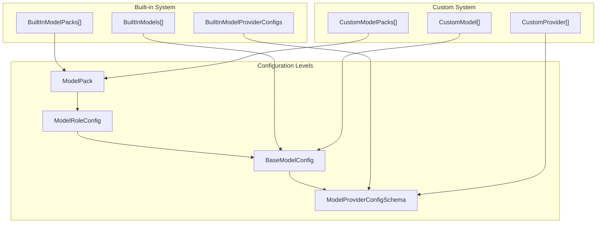
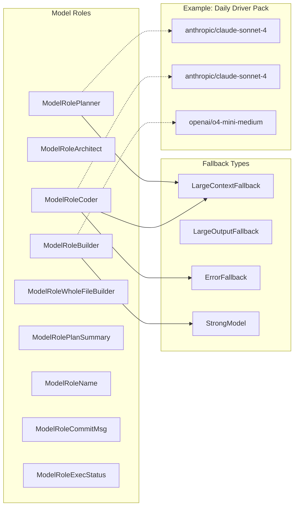
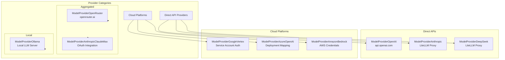
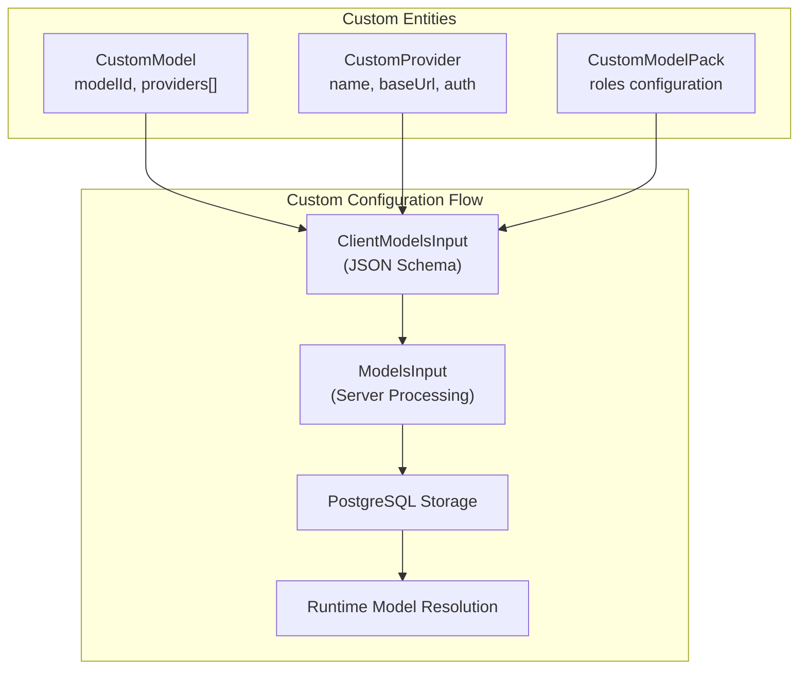
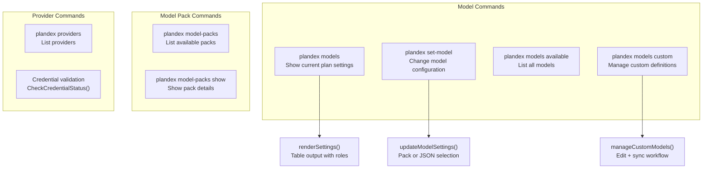
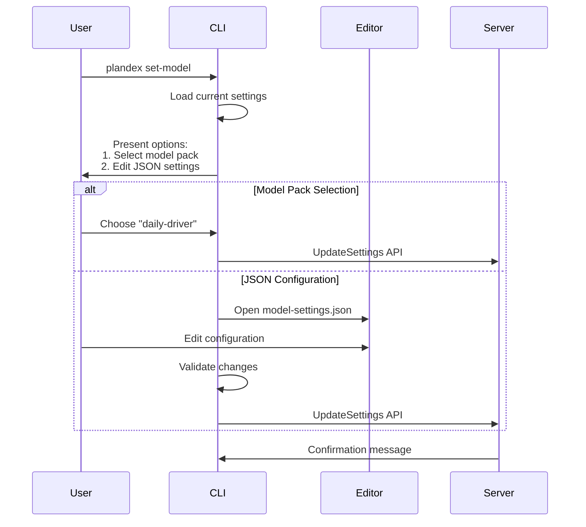
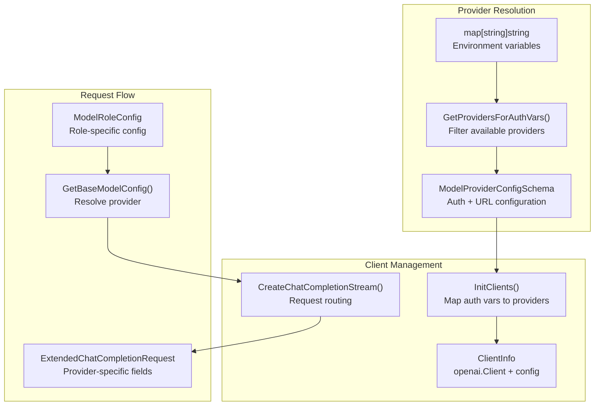
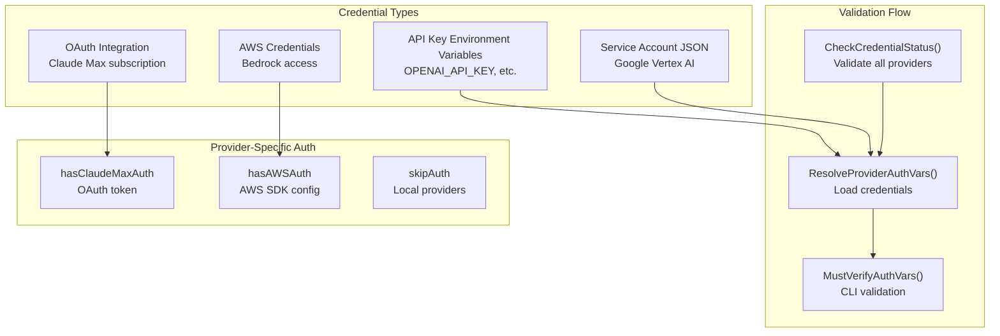
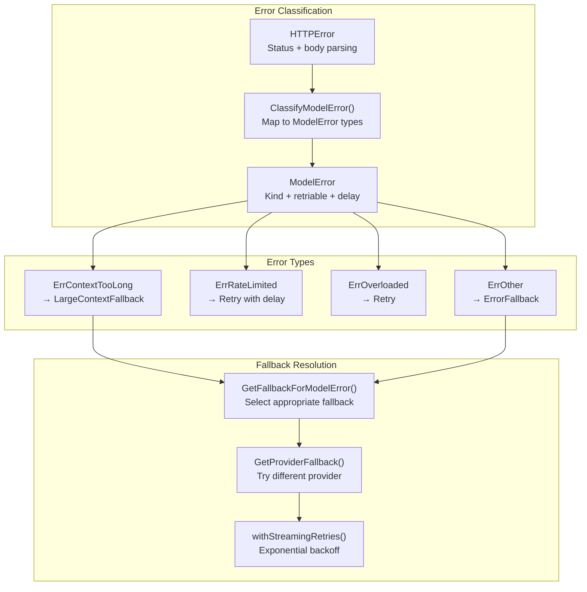

# Model Configuration and Management

<details>
<summary>Relevant source files</summary>

The following files were used as context for generating this wiki page:

- [app/cli/cmd/model_packs.go](app/cli/cmd/model_packs.go)
- [app/cli/cmd/model_providers.go](app/cli/cmd/model_providers.go)
- [app/cli/cmd/models.go](app/cli/cmd/models.go)
- [app/cli/cmd/set_model.go](app/cli/cmd/set_model.go)
- [app/cli/lib/model_credentials.go](app/cli/lib/model_credentials.go)
- [app/cli/lib/model_settings.go](app/cli/lib/model_settings.go)
- [app/server/handlers/models.go](app/server/handlers/models.go)
- [app/server/model/client.go](app/server/model/client.go)
- [app/server/model/client_stream.go](app/server/model/client_stream.go)
- [app/server/model/model_error.go](app/server/model/model_error.go)
- [app/server/model/plan/tell_stream_error.go](app/server/model/plan/tell_stream_error.go)
- [app/server/types/message.go](app/server/types/message.go)
- [app/shared/ai_models_available.go](app/shared/ai_models_available.go)
- [app/shared/ai_models_custom.go](app/shared/ai_models_custom.go)
- [app/shared/ai_models_data_models.go](app/shared/ai_models_data_models.go)
- [app/shared/ai_models_errors.go](app/shared/ai_models_errors.go)
- [app/shared/ai_models_packs.go](app/shared/ai_models_packs.go)
- [app/shared/ai_models_providers.go](app/shared/ai_models_providers.go)
- [test/smoke_test.sh](test/smoke_test.sh)
- [test/test_utils.sh](test/test_utils.sh)

</details>


This document covers Plandex's comprehensive model configuration and management system, including built-in and custom AI models, model providers, model packs, and the infrastructure for managing authentication, fallbacks, and client connections to various AI services.

For information about how models are used during plan execution, see [AI Model Integration and Task Control](#3.2). For details about context and token management, see [Context and Token Management](#5.2).

## Model Configuration Architecture

Plandex organizes AI models through a hierarchical configuration system that spans from individual model definitions to complete model packs assigned to specific roles.

### Model Configuration Hierarchy



**Sources:** [app/shared/ai_models_data_models.go:273-303](), [app/shared/ai_models_packs.go:24-41](), [app/shared/ai_models_available.go:49-586]()

### Model Role System

Plandex assigns specific AI models to different roles within the planning and execution workflow. Each role has distinct requirements and fallback mechanisms.



**Sources:** [app/shared/ai_models_packs.go:124-403](), [app/shared/ai_models_data_models.go:286-303]()

## Built-in Models and Providers

### Available Model Definitions

The system includes comprehensive definitions for models from major AI providers, with detailed token limits, capabilities, and provider mappings.

| Model Example | Max Tokens | Max Output | Reserved Output | Compatibility |
|---------------|------------|------------|-----------------|---------------|
| `openai/o3-high` | 200,000 | 100,000 | 40,000 | Full |
| `anthropic/claude-sonnet-4` | 200,000 | 128,000 | 40,000 | Full + Cache |
| `google/gemini-2.5-pro` | 1,048,576 | 65,535 | 65,535 | Full |
| `deepseek/r1` | 164,000 | 33,000 | 20,000 | Full |

**Sources:** [app/shared/ai_models_available.go:49-586]()

### Built-in Model Providers



**Sources:** [app/shared/ai_models_providers.go:116-219](), [app/shared/ai_models_providers.go:38-77]()

## Custom Models and Providers

### Custom Model Configuration

Users can define custom models and providers through JSON configuration files managed via the CLI.



**Sources:** [app/shared/ai_models_custom.go:57-62](), [app/server/handlers/models.go:19-59]()

### Example Custom Model Definition

The system supports defining custom models with provider mappings and authentication requirements:

```json
{
  "models": [{
    "modelId": "meta-llama/llama-4-maverick",
    "publisher": "meta-llama",
    "description": "Meta Llama 4 Maverick",
    "maxTokens": 1048576,
    "maxOutputTokens": 16000,
    "providers": [{
      "provider": "custom",
      "customProvider": "togetherai",
      "modelName": "meta-llama/Llama-4-Maverick-17B-128E-Instruct-FP8"
    }]
  }],
  "providers": [{
    "name": "togetherai",
    "baseUrl": "https://api.together.xyz/v1",
    "apiKeyEnvVar": "TOGETHER_API_KEY"
  }]
}
```

**Sources:** [app/cli/cmd/models.go:516-612]()

## CLI Commands for Model Management

### Primary Model Commands

The CLI provides comprehensive commands for inspecting and configuring models:



**Sources:** [app/cli/cmd/models.go:240-277](), [app/cli/cmd/set_model.go:52-93](), [app/cli/cmd/model_packs.go:61-122]()

### Model Selection Workflow



**Sources:** [app/cli/cmd/set_model.go:137-379]()

## Server-Side Model Client Management

### Client Initialization and Provider Resolution

The server manages AI model clients through a sophisticated provider resolution and authentication system:



**Sources:** [app/server/model/client.go:46-80](), [app/shared/ai_models_providers.go:229-288]()

### Authentication and Credential Management



**Sources:** [app/cli/lib/model_credentials.go:49-106](), [app/cli/lib/model_credentials.go:237-299]()

### Error Handling and Fallbacks

The system implements sophisticated error classification and fallback mechanisms:



**Sources:** [app/server/model/model_error.go:90-165](), [app/shared/ai_models_errors.go:49-105](), [app/server/model/client_stream.go:230-340]()