# Context and Token Management

Relevant source files

The following files were used as context for generating this wiki page:

- [app/cli/lib/context_load.go](app/cli/lib/context_load.go)
- [app/cli/lib/context_update.go](app/cli/lib/context_update.go)
- [app/cli/lib/model_credentials.go](app/cli/lib/model_credentials.go)
- [app/cli/types/types.go](app/cli/types/types.go)
- [app/server/model/client.go](app/server/model/client.go)
- [app/server/model/client_stream.go](app/server/model/client_stream.go)
- [app/server/model/model_error.go](app/server/model/model_error.go)
- [app/server/model/plan/tell_stream_error.go](app/server/model/plan/tell_stream_error.go)
- [app/server/types/message.go](app/server/types/message.go)
- [app/shared/ai_models_available.go](app/shared/ai_models_available.go)
- [app/shared/ai_models_data_models.go](app/shared/ai_models_data_models.go)
- [app/shared/ai_models_errors.go](app/shared/ai_models_errors.go)
- [app/shared/ai_models_packs.go](app/shared/ai_models_packs.go)
- [app/shared/ai_models_providers.go](app/shared/ai_models_providers.go)
- [test/smoke_test.sh](test/smoke_test.sh)
- [test/test_utils.sh](test/test_utils.sh)

This page covers how Plandex manages context loading, token counting, and memory optimization when interacting with AI models. This includes file processing, token estimation, context truncation strategies, and model-specific token limits.

For information about model configuration and selection, see [Model Configuration and Management](#5.1). For details about AI response processing, see [Response Processing and Error Handling](#5.3).

## Overview

Plandex's context and token management system ensures efficient use of AI model context windows while maintaining comprehensive project understanding. The system handles multiple context types, enforces token limits, and implements optimization strategies to maximize the useful information sent to models.

## Context Types and Loading

### Context Type Hierarchy

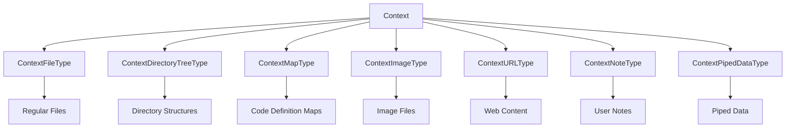

**Sources:** [app/cli/lib/context_load.go:429-438](), [app/shared/context.go]()

### Context Loading Limits

The system enforces multiple limits during context loading:

| Limit Type | Constant | Value | Purpose |
|------------|----------|-------|---------|
| Max Context Body Size | `MaxContextBodySize` | 500MB | Individual file size limit |
| Max Context Count | `MaxContextCount` | 1000 | Total number of context items |
| Max Context Map Paths | `MaxContextMapPaths` | 5000 | Map-type context limit |
| Context Map Max Batch Size | `ContextMapMaxBatchSize` | 50 | Files per map batch |
| Context Map Max Batch Bytes | `ContextMapMaxBatchBytes` | 50MB | Bytes per map batch |

**Sources:** [app/cli/lib/context_load.go:24](), [app/shared/constants.go](), [app/cli/lib/context_load.go:462-494]()

### Context Loading Flow

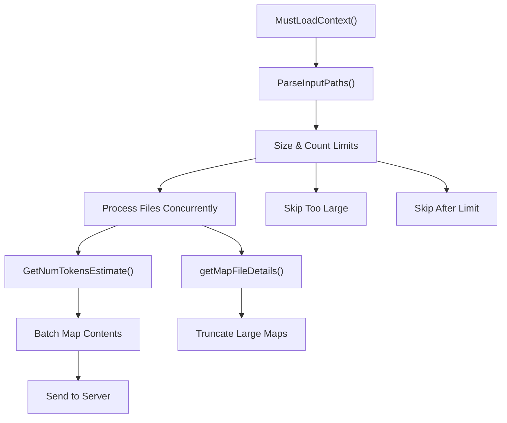

**Sources:** [app/cli/lib/context_load.go:26-757](), [app/cli/lib/context_load.go:482-551]()

## Token Counting and Estimation

### Token Estimation Methods

Plandex uses different token counting strategies based on content type:

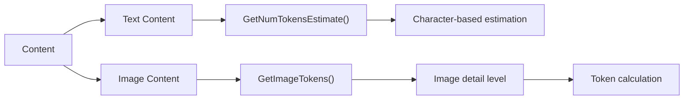

**Sources:** [app/cli/lib/context_update.go:459](), [app/cli/lib/context_update.go:450-451](), [app/shared/token_estimation.go]()

### Model-Specific Token Limits

Different models have varying token limits and management strategies:

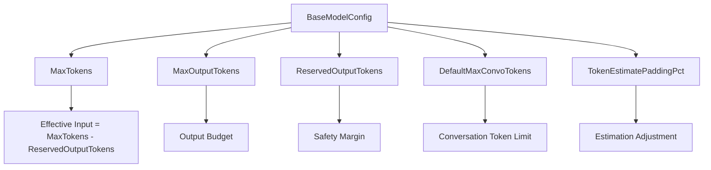

**Sources:** [app/shared/ai_models_available.go:14-21](), [app/shared/ai_models_data_models.go:31-50]()

## Context Optimization Strategies

### File Processing Pipeline

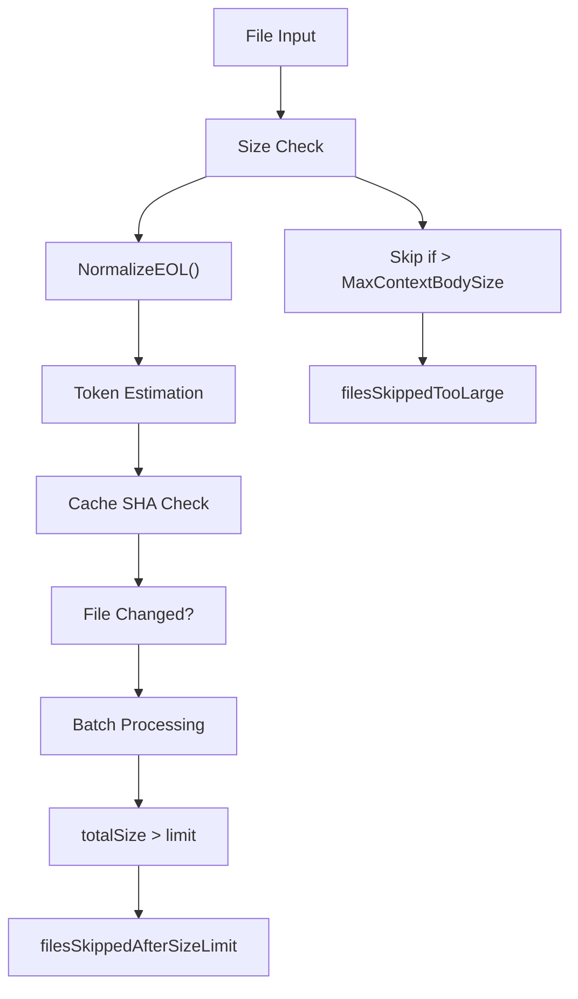

**Sources:** [app/cli/lib/context_load.go:454-480](), [app/cli/lib/context_update.go:418-439](), [app/shared/file_utils.go]()

### Map File Optimization

Map files receive special processing to handle large codebases efficiently:

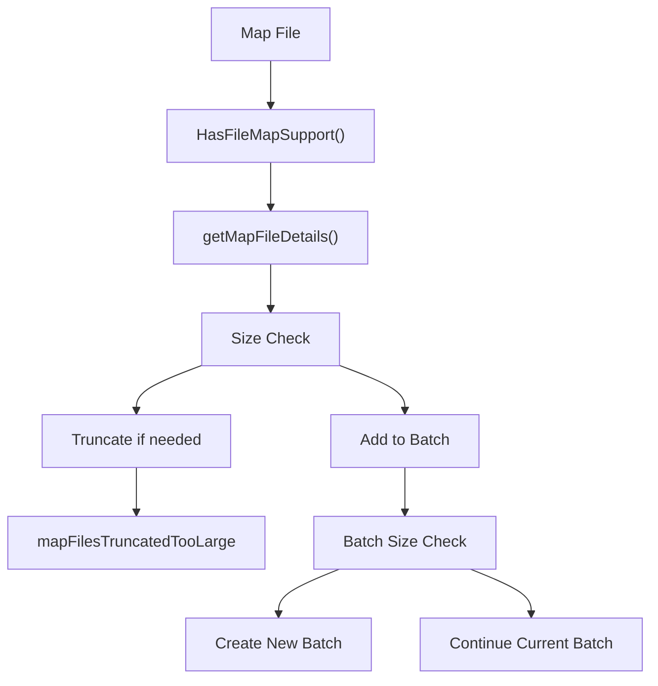

**Sources:** [app/cli/lib/context_load.go:482-510](), [app/cli/lib/context_load.go:620-663]()

## Model Context Management

### Context Resolution for Models

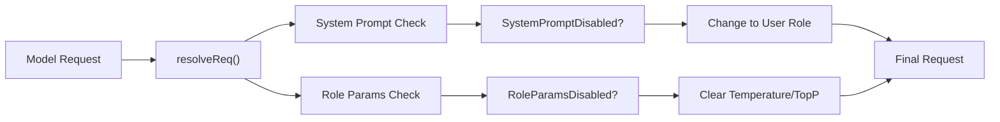

**Sources:** [app/server/model/client.go:502-532]()

### Cache Control Integration

For models supporting cache control (like Anthropic Claude):

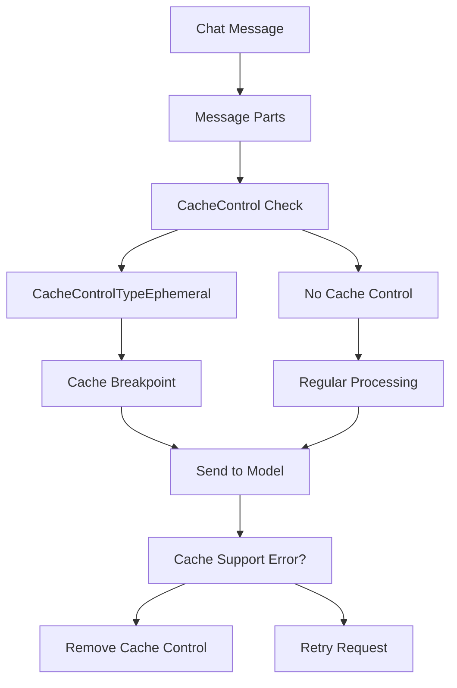

**Sources:** [app/server/model/client.go:189-197](), [app/server/types/message.go:12-27]()

## Context Update and Synchronization

### Outdated Context Detection

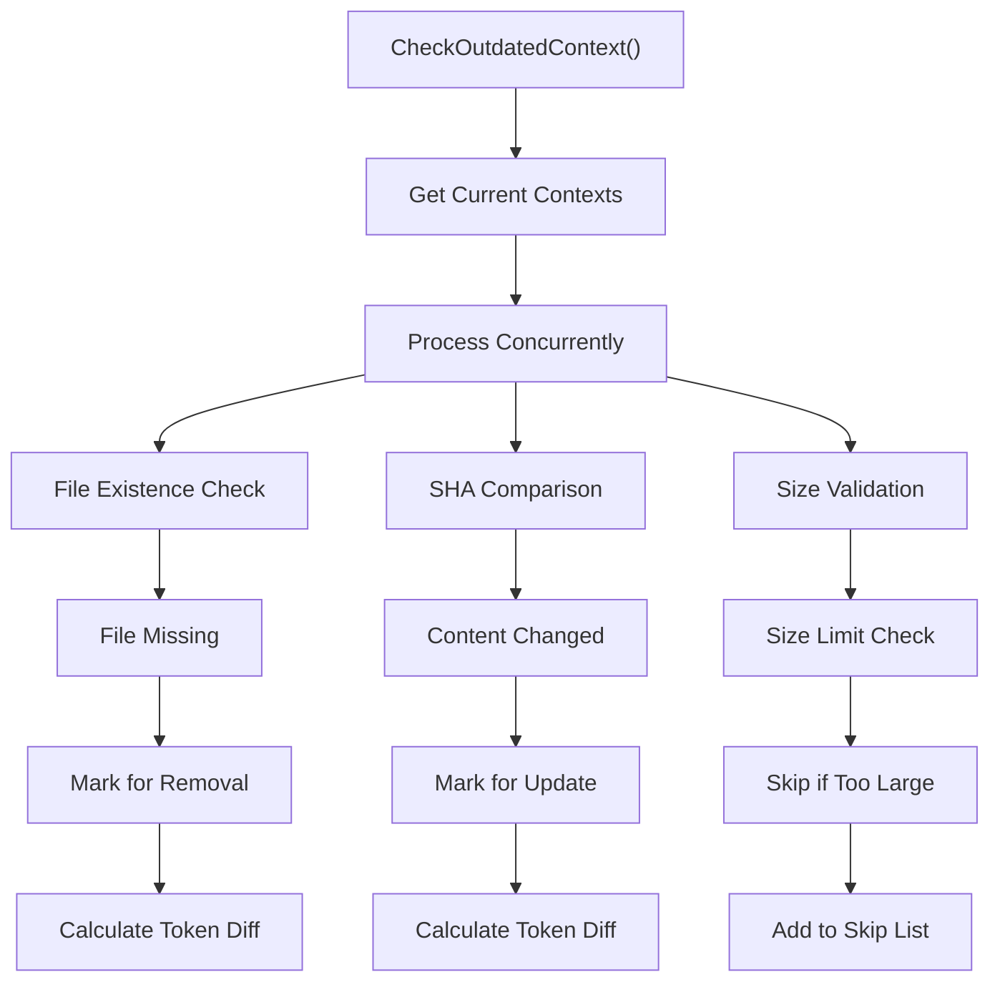

**Sources:** [app/cli/lib/context_update.go:291-616](), [app/cli/lib/context_update.go:368-475]()

### Context Update Pipeline

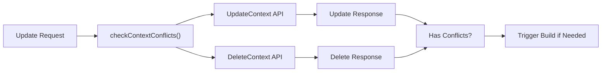

**Sources:** [app/cli/lib/context_update.go:224-287](), [app/cli/lib/context_update.go:672-676]()

## Performance and Error Handling

### Memory Management

The system implements several strategies to prevent memory issues:

| Strategy | Implementation | Purpose |
|----------|----------------|---------|
| Concurrent Processing | `sem := make(chan struct{}, ContextMapMaxClientConcurrency)` | Limit concurrent file processing |
| Size Limits | `MaxContextBodySize` checks | Prevent individual file overload |
| Batch Processing | Map file batching | Handle large numbers of files |
| Early Termination | Count and size limit checks | Stop processing when limits reached |

**Sources:** [app/cli/lib/context_load.go:155](), [app/cli/lib/context_update.go:359]()

### Error Recovery

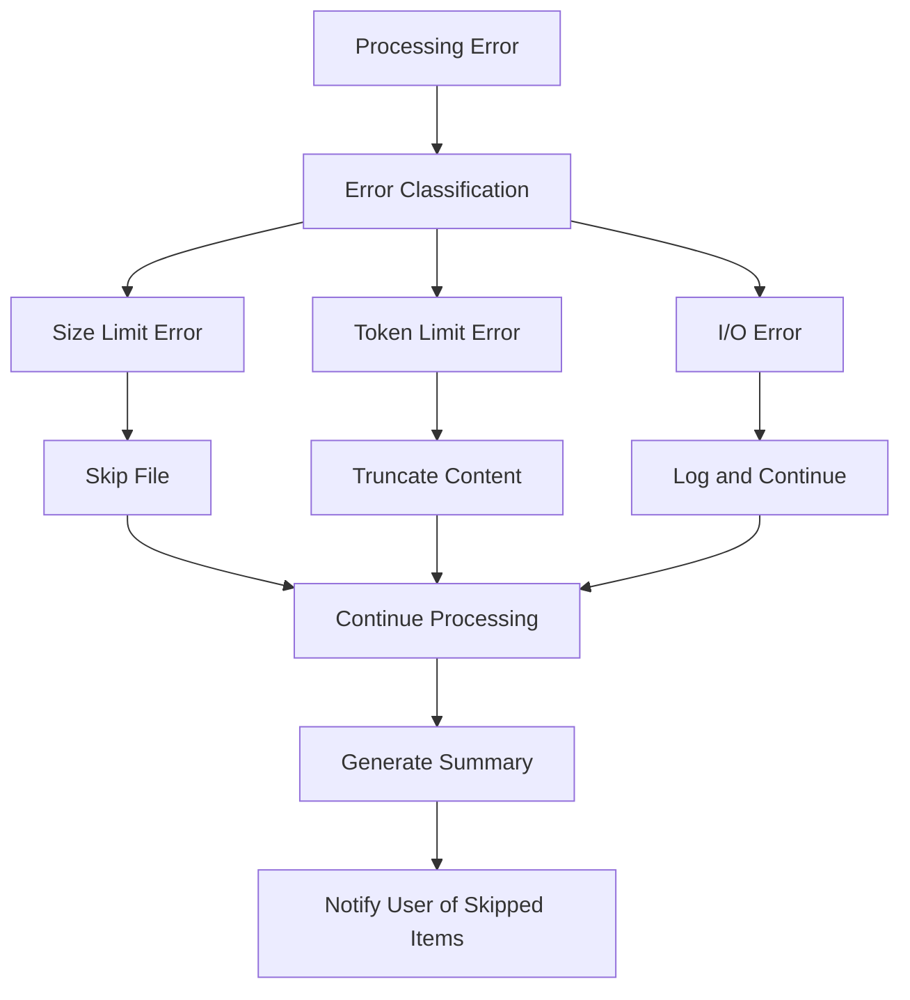

**Sources:** [app/cli/lib/context_load.go:752-756](), [app/cli/lib/context_update.go:322-324]()