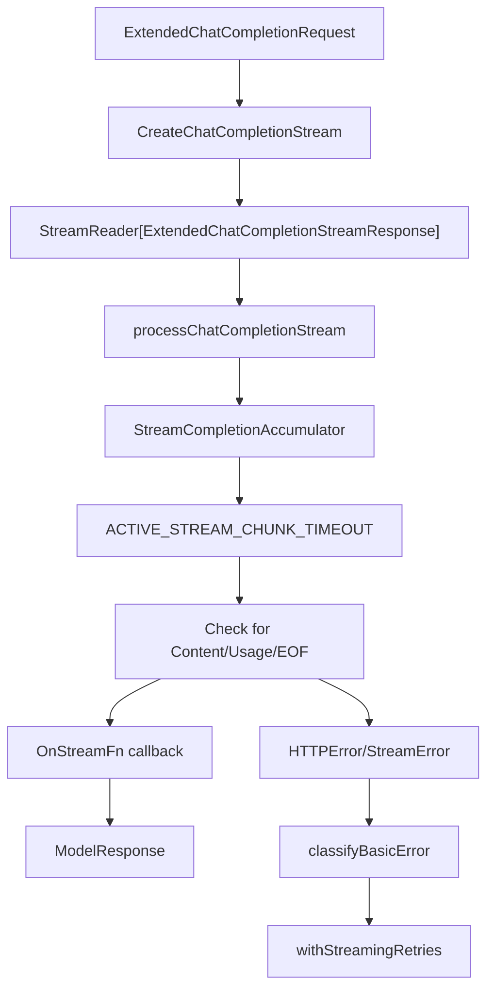
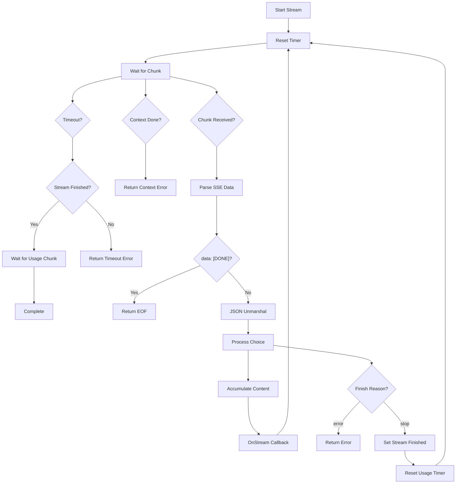
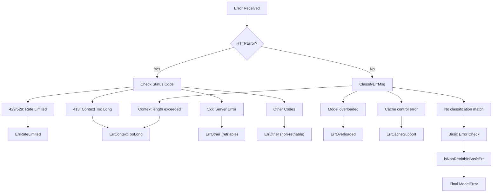
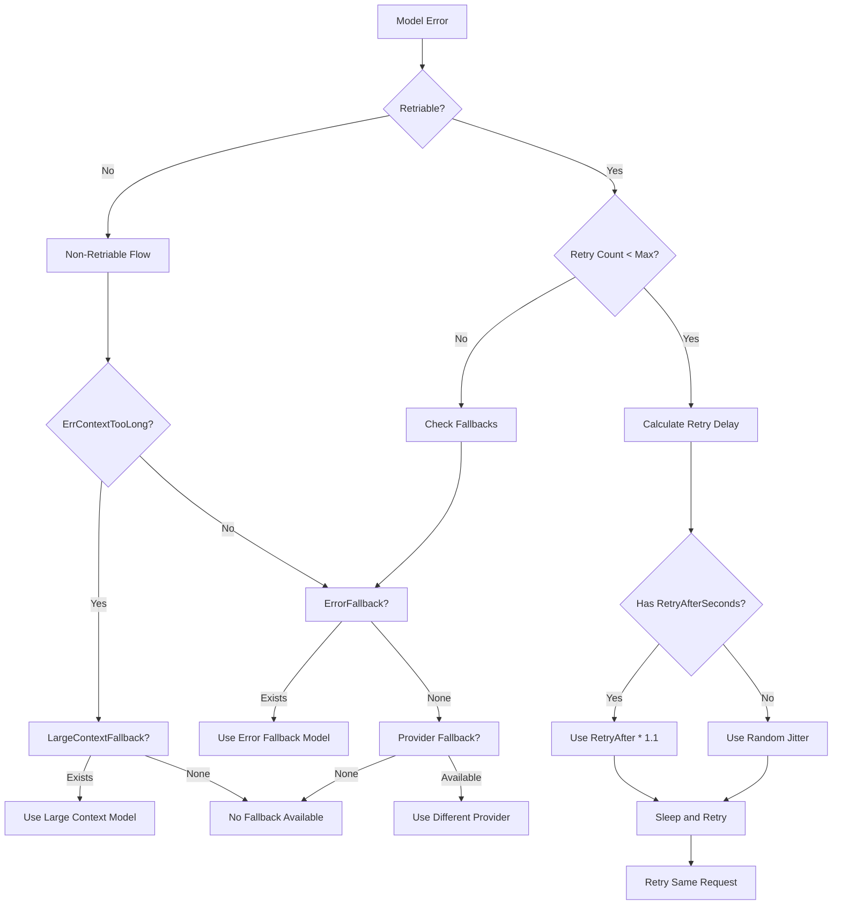
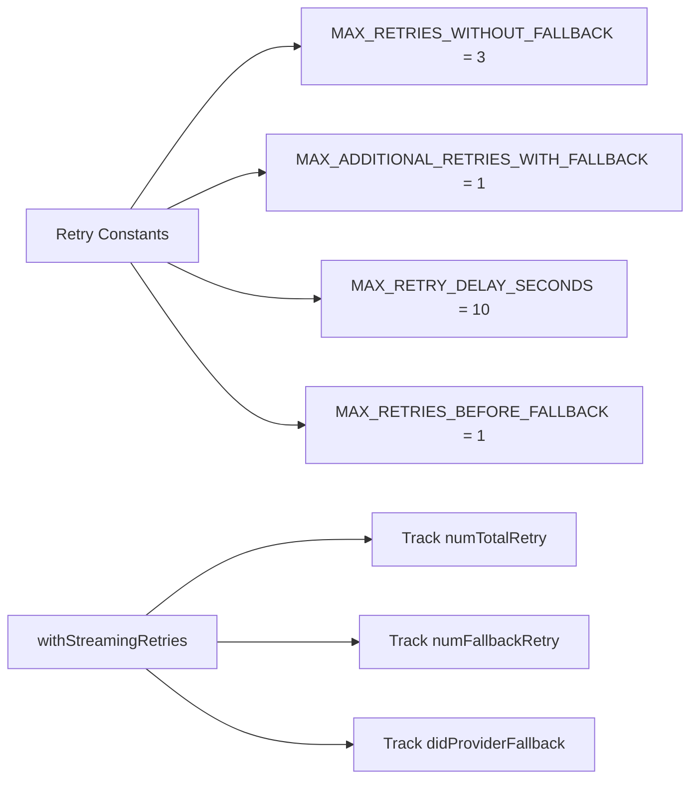
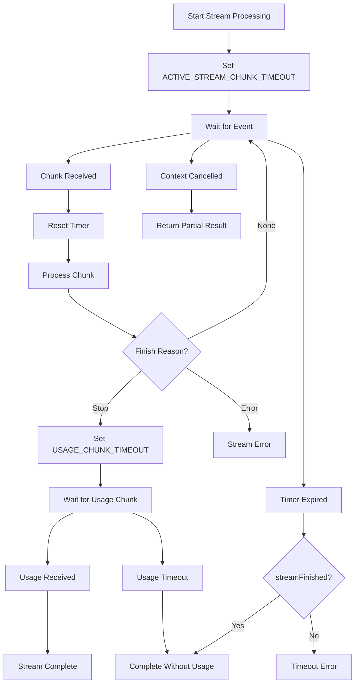
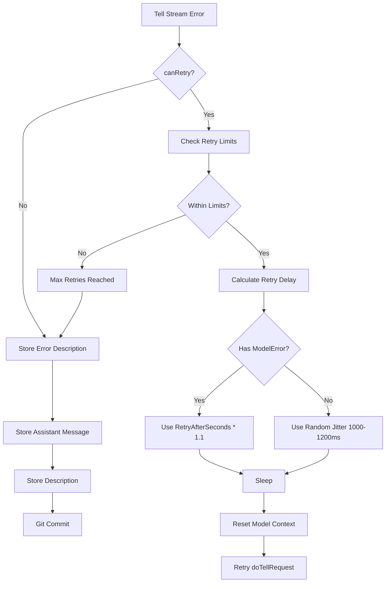

# Response Processing and Error Handling

Relevant source files

The following files were used as context for generating this wiki page:

- [app/cli/lib/model_credentials.go](app/cli/lib/model_credentials.go)
- [app/server/model/client.go](app/server/model/client.go)
- [app/server/model/client_stream.go](app/server/model/client_stream.go)
- [app/server/model/model_error.go](app/server/model/model_error.go)
- [app/server/model/plan/tell_stream_error.go](app/server/model/plan/tell_stream_error.go)
- [app/server/types/message.go](app/server/types/message.go)
- [app/shared/ai_models_available.go](app/shared/ai_models_available.go)
- [app/shared/ai_models_data_models.go](app/shared/ai_models_data_models.go)
- [app/shared/ai_models_errors.go](app/shared/ai_models_errors.go)
- [app/shared/ai_models_packs.go](app/shared/ai_models_packs.go)
- [app/shared/ai_models_providers.go](app/shared/ai_models_providers.go)
- [test/smoke_test.sh](test/smoke_test.sh)
- [test/test_utils.sh](test/test_utils.sh)

This page covers how Plandex processes streaming responses from AI models and handles various error conditions. It details the error classification system, retry logic, fallback mechanisms, and timeout management that ensure robust AI model interactions.

For model configuration and provider management, see [Model Configuration and Management](#5.1). For context processing and token management, see [Context and Token Management](#5.2).

## Overview

Plandex exclusively uses streaming requests for AI model interactions to enable real-time user feedback and more predictable cancellation behavior. The response processing system handles Server-Sent Events (SSE) streams, classifies errors, implements retry logic with exponential backoff, and provides multiple fallback strategies when primary models fail.

**Sources:** [app/server/model/client.go:25-27]()

## Streaming Response Processing

### Stream Architecture

The streaming system processes responses through several key components:

| Component | Purpose | Key Types |
|-----------|---------|-----------|
| `ExtendedChatCompletionStream` | Wrapper for OpenAI or custom streams | [app/server/model/client.go:82-87]() |
| `StreamReader` | Handles SSE parsing and JSON unmarshaling | [app/server/model/client.go:89-96]() |
| `ErrorAccumulator` | Tracks streaming errors with thread safety | [app/server/model/client.go:98-102]() |
| `StreamCompletionAccumulator` | Accumulates content and tracks timing | [app/server/types/message.go:255-273]() |

**Sources:** [app/server/model/client.go:82-102](), [app/server/model/client_stream.go:19-30]()

### Stream Processing Flow

The stream processing implements several timeout mechanisms:

- `ACTIVE_STREAM_CHUNK_TIMEOUT` (60 seconds): Maximum time between chunks
- `USAGE_CHUNK_TIMEOUT` (10 seconds): Time to wait for final usage chunk after stream completion

**Sources:** [app/server/model/client_stream.go:114-165](), [app/server/model/client.go:30-35]()

## Error Classification System

### Error Types and Classification

The error classification system recognizes several error types defined in `ModelErrKind`:

| Error Kind | Retriable | Purpose |
|------------|-----------|---------|
| `ErrContextTooLong` | No | Input exceeds model's context limit |
| `ErrOverloaded` | Yes | Model is temporarily overloaded |
| `ErrRateLimited` | Yes | Rate limit exceeded |
| `ErrSubscriptionQuotaExhausted` | Conditional | Claude Max subscription limit reached |
| `ErrCacheSupport` | Yes | Cache control not supported |
| `ErrOther` | Conditional | Generic error category |

**Sources:** [app/server/model/model_error.go:38-88](), [app/shared/ai_models_errors.go:10-29]()

### Retry-After Parsing

The system extracts retry timing from multiple sources:

1. `Retry-After` HTTP header (seconds or HTTP-date)
2. `X-RateLimit-Reset` header (epoch timestamp)
3. JSON body patterns like `"retry_after_ms": 1234`
4. Text patterns like "try again in 59 seconds"

**Sources:** [app/server/model/model_error.go:167-228]()

## Retry and Fallback Mechanisms

### Fallback Decision Tree

### Fallback Types and Priority

The fallback system implements a hierarchy of recovery strategies:

| Fallback Type | Trigger | Implementation |
|---------------|---------|----------------|
| **Large Context** | `ErrContextTooLong` | `ModelRoleConfig.LargeContextFallback` |
| **Error Fallback** | Non-retriable errors | `ModelRoleConfig.ErrorFallback` |
| **Provider Fallback** | Provider-level failures | Different provider for same model |
| **Strong Model** | Task complexity | `ModelRoleConfig.StrongModel` |

**Sources:** [app/shared/ai_models_errors.go:49-105](), [app/shared/ai_models_errors.go:111-149]()

### Retry Configuration

**Sources:** [app/server/model/client.go:32-35](), [app/shared/ai_models_errors.go:47]()

## Timeout Management

### Timeout Configuration

| Timeout Type | Duration | Purpose |
|--------------|----------|---------|
| `ACTIVE_STREAM_CHUNK_TIMEOUT` | 60 seconds | Maximum time between stream chunks |
| `USAGE_CHUNK_TIMEOUT` | 10 seconds | Time to wait for final usage information |

### Timeout Handling Flow

**Sources:** [app/server/model/client_stream.go:114-136](), [app/server/model/client_stream.go:196-202]()

## Error Recovery Strategies

### Plan-Level Error Handling

The plan execution system implements additional error recovery specifically for tell/chat operations:

### Cache Support Error Handling

A special case exists for cache control errors where the system removes cache control breakpoints and retries:

1. Detect `ErrCacheSupport` error
2. Set `noCacheSupportErr` flag  
3. Remove `CacheControl` from all message content parts
4. Retry with same model configuration

**Sources:** [app/server/model/plan/tell_stream_error.go:34-152](), [app/server/model/client.go:189-197]()

### Provider Fallback Selection

When error and context fallbacks are exhausted, the system attempts provider fallback:

1. **OpenRouter Priority**: If OpenRouter credentials are available and not using Claude Max subscription, prefer OpenRouter for its built-in fallback routing
2. **Second Provider**: Otherwise, use the second available provider in the priority list
3. **Model Compatibility**: Ensure the fallback provider supports the same model ID

**Sources:** [app/shared/ai_models_errors.go:111-149]()