# Data Storage and Management

Relevant source files

The following files were used as context for generating this wiki page:

- [app/server/db/db.go](app/server/db/db.go)
- [app/server/db/git.go](app/server/db/git.go)
- [app/server/db/locks.go](app/server/db/locks.go)
- [app/server/model/plan/state.go](app/server/model/plan/state.go)
- [app/server/model/plan/stop.go](app/server/model/plan/stop.go)
- [app/shared/plan_model_settings.go](app/shared/plan_model_settings.go)
- [releases/cli/versions/0.8.3.md](releases/cli/versions/0.8.3.md)
- [releases/server/versions/0.8.4.md](releases/server/versions/0.8.4.md)
- [releases/server/versions/2.1.3.md](releases/server/versions/2.1.3.md)

This page covers Plandex's data storage architecture, including database management, repository locking mechanisms, Git integration, and in-memory state management. It documents the persistence layer, concurrency control systems, and data serialization patterns that support plan execution and file management.

For information about API data models and request handling, see [Data Models and Shared Types](#4.2). For database schema details and migrations, see [Database Schema and Migrations](#6.1).

## Storage Architecture Overview

Plandex employs a multi-layered storage architecture combining PostgreSQL for persistent data, Git repositories for version control, and sophisticated in-memory state management for active operations.

### Storage Systems Diagram

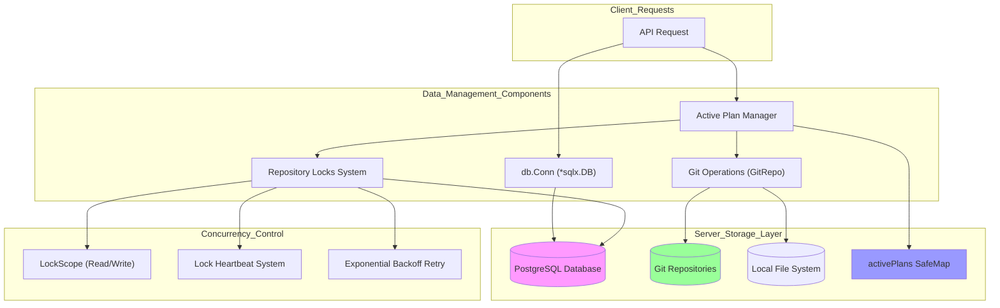

Sources: [app/server/db/db.go:18-94](), [app/server/db/locks.go:38-53](), [app/server/model/plan/state.go:17-19](), [app/server/db/git.go:32-40]()

## Database Connection and Configuration

The database layer centers around a global `*sqlx.DB` connection with specific PostgreSQL optimizations for concurrent operations.

### Database Connection Management

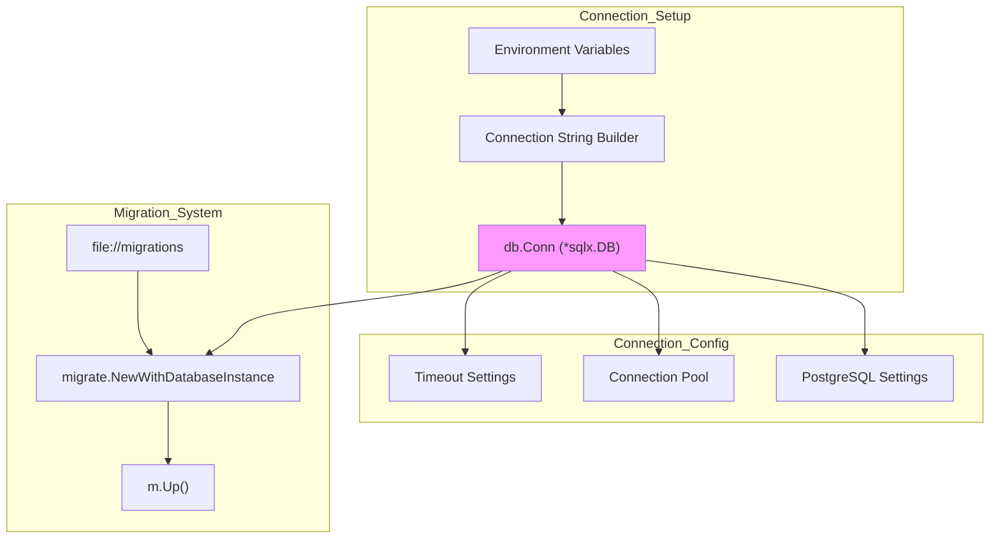

| Configuration Parameter | Production Value | Development Value | Purpose |
|------------------------|------------------|-------------------|---------|
| `StatementTimeout` | 30000ms | 30000ms | Query execution limit |
| `LockTimeout` | 4000ms | 4000ms | Row-level lock timeout |
| `IdleInTransactionSessionTimeout` | 90000ms | 90000ms | Idle transaction cleanup |
| `MaxOpenConns` | 50 | 10 | Connection pool size |
| `MaxIdleConns` | 20 | 5 | Idle connection limit |

The connection initialization includes automatic timezone setting to UTC and comprehensive timeout configuration to prevent hanging transactions during concurrent operations.

Sources: [app/server/db/db.go:20-94](), [app/server/db/db.go:96-175]()

## Repository Locking System

Plandex implements a sophisticated distributed locking mechanism to prevent concurrent modifications to Git repositories during plan execution.

### Lock Types and Scopes

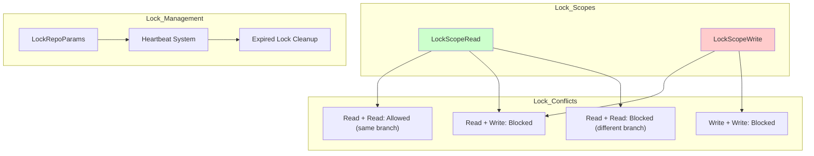

The `LockRepoParams` struct defines the complete context for lock acquisition:

| Field | Purpose |
|-------|---------|
| `OrgId` | Organization scope |
| `UserId` | User identification |
| `PlanId` | Plan identifier |
| `Branch` | Git branch target |
| `Scope` | Read or write lock |
| `PlanBuildId` | Build operation context |
| `Reason` | Debug logging context |

Sources: [app/server/db/locks.go:41-52](), [app/server/db/locks.go:249-278]()

### Lock Acquisition and Retry Logic

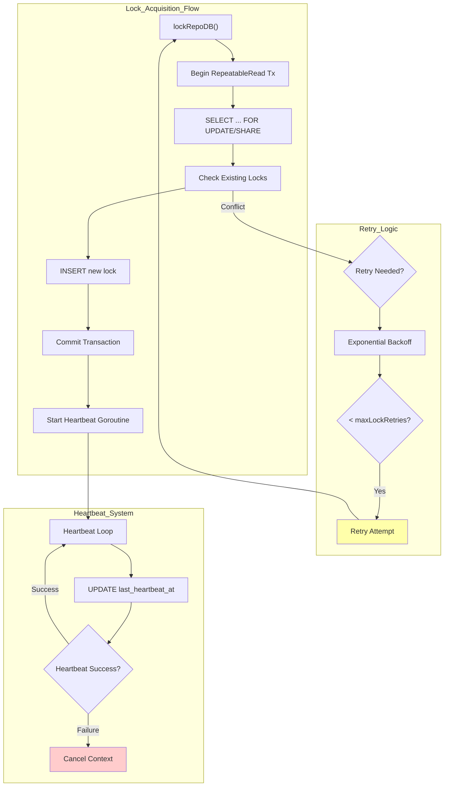

The retry mechanism uses exponential backoff with jitter to handle lock contention:

- **Initial retry delay**: 300ms
- **Backoff factor**: 2x
- **Jitter**: ±30%
- **Maximum retries**: 6 attempts
- **Delete retries**: 60 attempts with 50ms delay

Sources: [app/server/db/locks.go:54-290](), [app/server/db/locks.go:564-611]()

### Heartbeat and Lock Lifecycle

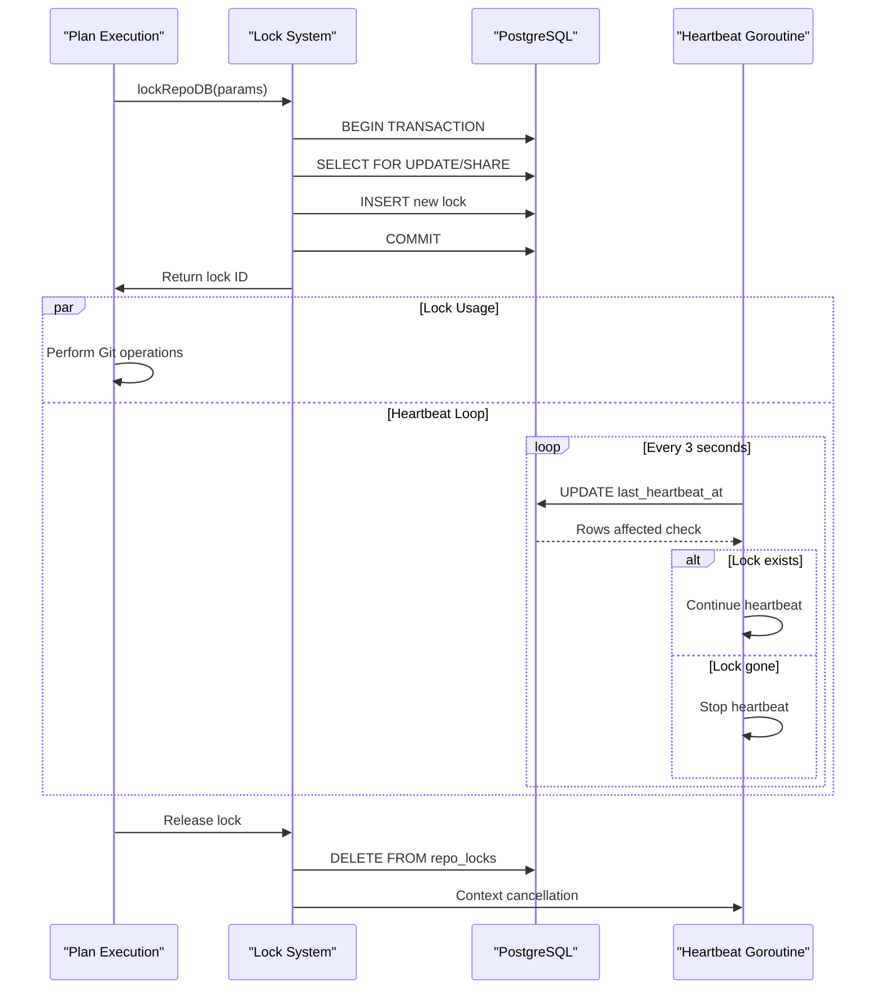

The heartbeat system maintains lock validity through regular database updates every 3 seconds, with a 60-second timeout for abandoned locks.

Sources: [app/server/db/locks.go:387-457](), [app/server/db/locks.go:480-521]()

## Git Integration and File Management

The Git integration layer provides version control operations with comprehensive lock file handling and retry mechanisms for concurrent access.

### GitRepo Operations

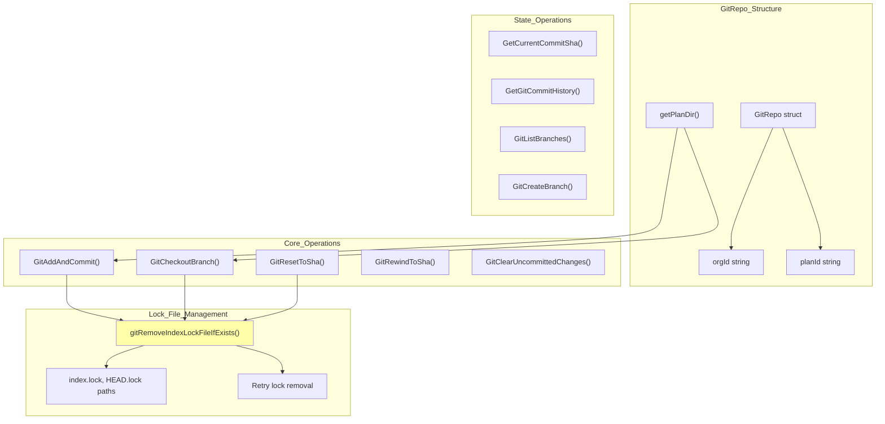

All Git write operations are wrapped in `gitWriteOperation()` which provides automatic retry logic for lock file conflicts and exponential backoff for transient failures.

Sources: [app/server/db/git.go:32-65](), [app/server/db/git.go:655-684](), [app/server/db/git.go:604-645]()

### Git Lock File Handling

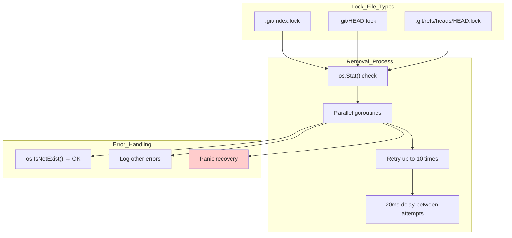

The lock file removal system uses parallel goroutines to handle multiple lock file types simultaneously, with comprehensive error handling for race conditions.

Sources: [app/server/db/git.go:604-645](), [app/server/db/git.go:557-602]()

## In-Memory State Management

Active plan state is managed through a thread-safe map structure that coordinates real-time plan execution and client subscriptions.

### Active Plan Lifecycle

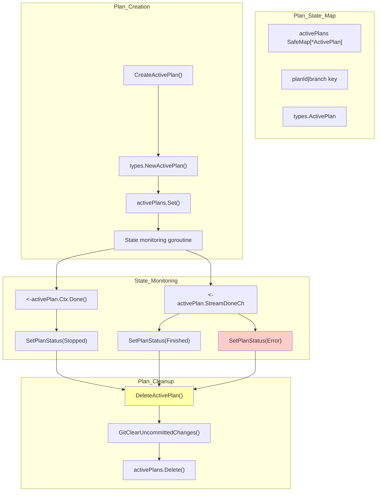

The `SafeMap` provides thread-safe operations for the global `activePlans` registry, enabling concurrent access from multiple request handlers while maintaining consistency.

Sources: [app/server/model/plan/state.go:17-29](), [app/server/model/plan/state.go:99-137]()

### Subscription and Real-Time Updates

```mermaid
graph TB
    subgraph "Subscription_System"
        SubscribePlan["SubscribePlan()"]
        GetActivePlan["GetActivePlan()"]
        Subscribe["activePlan.Subscribe(ctx)"]
        ReturnChannel["return id, chan string"]
    end
    
    subgraph "Update_Distribution"
        UpdateActive["UpdateActivePlan()"]
        SafeMapUpdate["activePlans.Update()"]
        StreamMessage["activePlan.Stream()"]
        AllSubscribers["Broadcast to all subscribers"]
    end
    
    subgraph "Cleanup_System"
        UnsubscribePlan["UnsubscribePlan()"]
        Unsubscribe["activePlan.Unsubscribe()"]
        ChannelClose["Close subscriber channel"]
    end
    
    SubscribePlan --> GetActivePlan
    GetActivePlan --> Subscribe
    Subscribe --> ReturnChannel
    
    UpdateActive --> SafeMapUpdate
    SafeMapUpdate --> StreamMessage
    StreamMessage --> AllSubscribers
    
    UnsubscribePlan --> Unsubscribe
    Unsubscribe --> ChannelClose
    
    style AllSubscribers fill:#9f9
```

The subscription system allows multiple clients to receive real-time updates from active plan execution through dedicated channels managed by the `ActivePlan` type.

Sources: [app/server/model/plan/state.go:143-174]()

## Data Serialization and Persistence

Plan configuration and model settings are stored as JSON in PostgreSQL using custom serialization interfaces.

### Plan Settings Storage

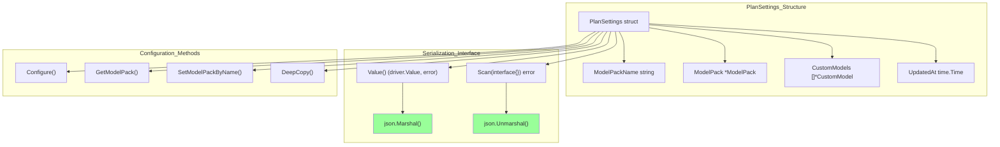

The `PlanSettings` type implements PostgreSQL's `driver.Valuer` and `sql.Scanner` interfaces for seamless JSON serialization to database columns.

| Method | Purpose | Implementation |
|--------|---------|----------------|
| `Scan()` | Deserialize from database | JSON unmarshal from bytes/string |
| `Value()` | Serialize to database | JSON marshal to bytes |
| `Configure()` | Runtime configuration | Set custom models and providers |
| `DeepCopy()` | Safe copying | Full JSON round-trip |

Sources: [app/shared/plan_model_settings.go:86-103](), [app/shared/plan_model_settings.go:238-249]()

## Concurrency Control and Safety

The storage layer implements multiple levels of concurrency control to ensure data consistency during simultaneous plan operations.

### Multi-Level Locking Strategy

```mermaid
graph TB
    subgraph "Database_Level"
        TransactionIsolation["REPEATABLE READ"]
        RowLevelLocks["FOR UPDATE/SHARE"]
        DeadlockDetection["Deadlock detection"]
    end
    
    subgraph "Application_Level"
        RepoLocks["Repository locks table"]
        HeartbeatMechanism["Heartbeat validation"]
        ExpiredCleanup["Expired lock cleanup"]
    end
    
    subgraph "Git_Level"
        IndexLockHandling["index.lock removal"]
        AtomicOperations["Atomic git commands"]
        RetryOnConflict["Retry on lock conflicts"]
    end
    
    subgraph "Memory_Level"
        SafeMapOps["Thread-safe map operations"]
        ChannelSync["Channel synchronization"]
        ContextCancellation["Context-based cleanup"]
    end
    
    TransactionIsolation --> RowLevelLocks
    RowLevelLocks --> DeadlockDetection
    
    RepoLocks --> HeartbeatMechanism
    HeartbeatMechanism --> ExpiredCleanup
    
    IndexLockHandling --> AtomicOperations
    AtomicOperations --> RetryOnConflict
    
    SafeMapOps --> ChannelSync
    ChannelSync --> ContextCancellation
    
    style DeadlockDetection fill:#ffa
    style ExpiredCleanup fill:#ffa
```

This multi-layered approach ensures that concurrent operations can proceed safely at the database, application, Git, and memory levels without data corruption or deadlocks.

Sources: [app/server/db/locks.go:105-141](), [app/server/db/locks.go:552-562](), [app/server/db/git.go:655-684]()