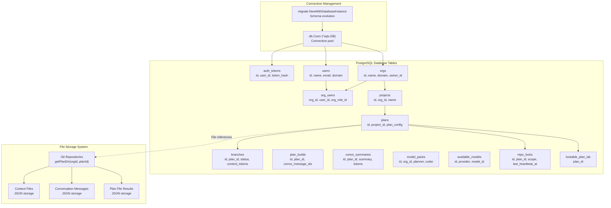
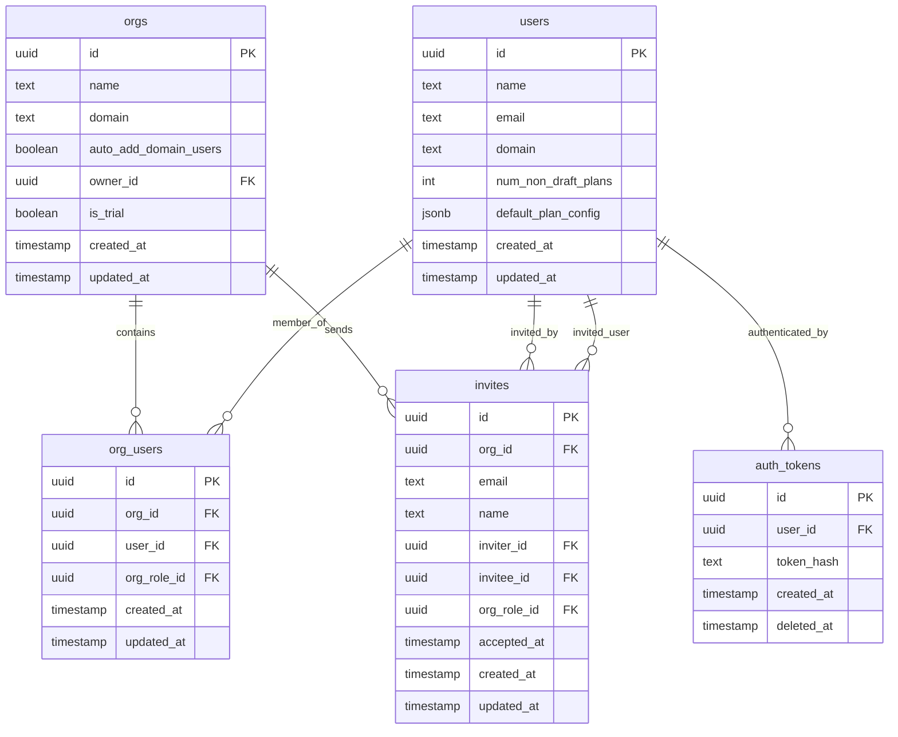
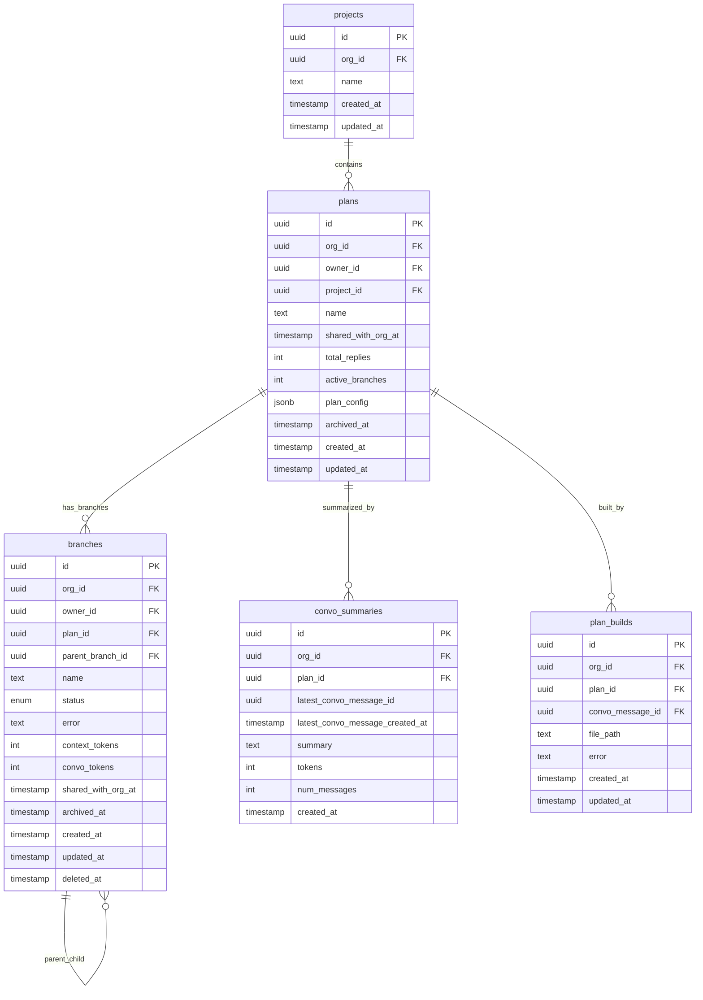
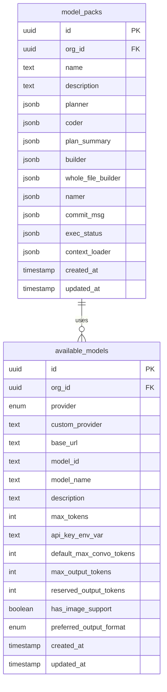
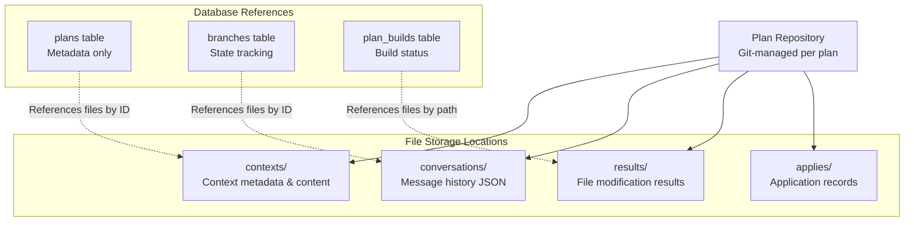
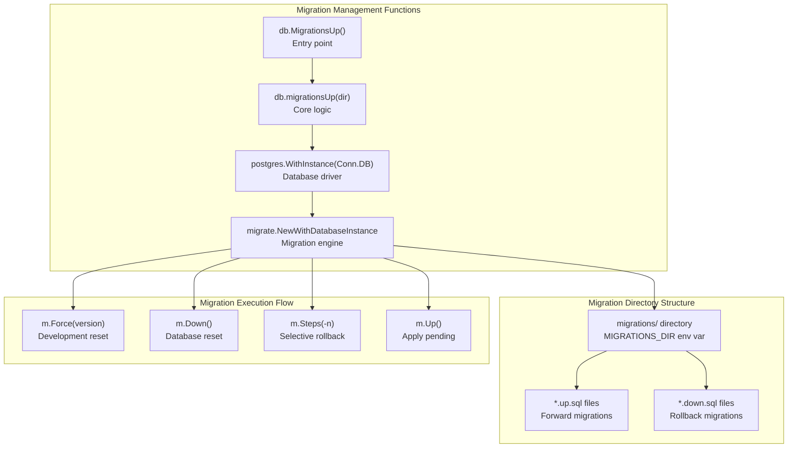
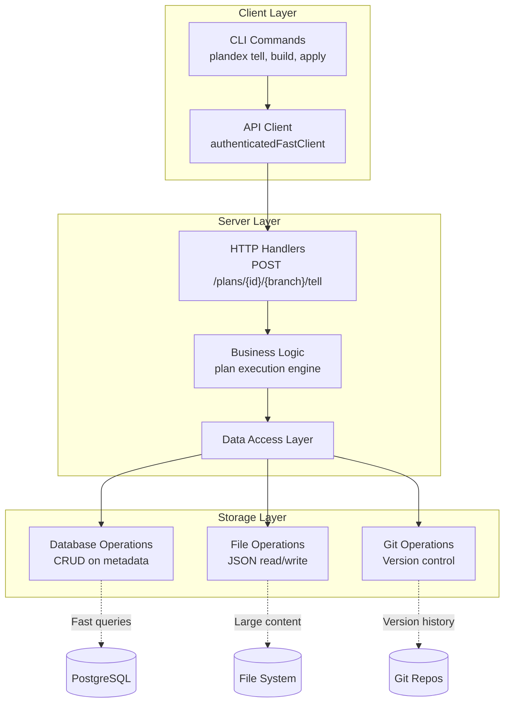

# Database Schema and Migrations

<details>
<summary>Relevant source files</summary>

The following files were used as context for generating this wiki page:

- [app/server/db/db.go](app/server/db/db.go)
- [app/server/db/git.go](app/server/db/git.go)
- [app/server/db/locks.go](app/server/db/locks.go)
- [app/server/migrations/2024013000_plan_build_convo_ids.down.sql](app/server/migrations/2024013000_plan_build_convo_ids.down.sql)
- [app/server/migrations/2024013000_plan_build_convo_ids.up.sql](app/server/migrations/2024013000_plan_build_convo_ids.up.sql)
- [app/server/model/plan/state.go](app/server/model/plan/state.go)
- [app/server/model/plan/stop.go](app/server/model/plan/stop.go)
- [app/shared/plan_model_settings.go](app/shared/plan_model_settings.go)
- [releases/cli/versions/0.8.3.md](releases/cli/versions/0.8.3.md)
- [releases/server/versions/0.8.4.md](releases/server/versions/0.8.4.md)
- [releases/server/versions/2.1.3.md](releases/server/versions/2.1.3.md)

</details>


This document covers Plandex's data persistence layer, including the PostgreSQL database schema, file-based storage system, and migration management. It details the core database tables, their relationships, and how data flows between different storage systems.

For information about Git repository management and concurrency control, see [Repository Locking and Git Integration](#6.2). For user authentication and access control details, see [Authentication and User Management](#6.3).

## Database Architecture Overview

Plandex uses PostgreSQL as the primary database with specific connection management and timeout configurations handled by the `db.Connect()` function. The database is configured with strict timeouts and connection pooling for production environments.

**Database Connection Configuration**

The system establishes connections through `db.Conn` with the following parameters:
- `statement_timeout`: 30 seconds
- `lock_timeout`: 4 seconds  
- `idle_in_transaction_session_timeout`: 90 seconds
- Connection pooling: 50 max open connections (production), 10 (development)



**Database vs File Storage Decision Matrix**

| Data Type | Storage | Timeout Sensitivity | Query Pattern |
|-----------|---------|-------------------|---------------|
| User authentication | PostgreSQL | High (4s lock timeout) | Frequent lookups |
| Plan status/metadata | PostgreSQL | Medium (30s statement) | Real-time updates |
| Conversation content | Files | Low | Sequential access |
| File build results | Files | Low | Version controlled |
| Repository locks | PostgreSQL | Critical (heartbeat every 3s) | Concurrency control |

Sources: [app/server/db/db.go:24-94](), [app/server/db/locks.go:27-32](), [app/server/db/git.go:37-40]()

## Core Database Tables

### User and Organization Management

The system uses a multi-tenant architecture with organizations containing users and projects.



**Key Database Entities:**
- `Org` struct maps to `orgs` table with trial status and domain-based auto-enrollment
- `User` struct maps to `users` table with plan count tracking for billing
- `AuthToken` provides session management with hashed token storage
- `OrgUser` manages many-to-many relationships between users and organizations

Sources: [app/server/db/data_models.go:24-109](), [app/shared/data_models.go:10-47]()

### Project and Plan Management

Projects contain plans, which have branches for parallel development workflows.



**Plan Status Enumeration:**
The `branches.status` field uses the `PlanStatus` enum to track execution state:
- Planning, building, applying phases
- Error and stopped states
- Completion status

Sources: [app/server/db/data_models.go:111-236](), [app/shared/data_models.go:54-81]()

### AI Model Configuration

Model management supports multiple AI providers with role-based configurations.



**Model Role Configuration:**
Each `ModelPack` contains role-specific configurations stored as JSONB:
- `planner`: Task breakdown and planning
- `coder`: Code generation and modification  
- `builder`: Syntax validation and building
- `namer`: File and commit naming
- `architect`: Context loading and analysis

Sources: [app/server/db/data_models.go:298-374](), [app/shared/data_models.go:308-327]()

## File-based Storage System

Large content is stored in files within the plan's Git repository to enable version control and efficient handling of code and conversation data.

### File Storage Structure



**File-stored Entity Examples:**

| Entity | Storage Pattern | Content Type |
|--------|----------------|--------------|
| `Context` | `contexts/{contextId}.json` | File content, metadata, tokens |
| `ConvoMessage` | `conversations/{messageId}.json` | AI conversations, flags, subtasks |
| `PlanFileResult` | `results/{resultId}.json` | Generated code, replacements |
| `ConvoMessageDescription` | `descriptions/{descId}.json` | Operation summaries, commit messages |

**Dual Storage Pattern:**
The system uses a dual storage pattern where:
1. Database stores metadata, relationships, and frequently-queried fields
2. Files store large content that's accessed less frequently
3. Both share the same struct definitions with `ToApi()` methods for client serialization

Sources: [app/server/db/data_models.go:387-626](), [app/shared/data_models.go:97-299]()

## Migration System

Plandex implements database schema migrations using the `golang-migrate` library with PostgreSQL driver integration. The migration system is managed through `db.MigrationsUp()` and `db.migrationsUp()` functions.

### Migration Infrastructure



**Migration Configuration and Safety Features**

The migration system includes several safety mechanisms:
- Development-only forced migration states for recovery
- Conditional down migrations (commented out by default)
- Error handling for `migrate.ErrNoChange` (no pending migrations)
- Automatic directory resolution via `MIGRATIONS_DIR` environment variable

**Migration File Naming Convention**: `YYYYMMDDNN_description.{up|down}.sql`

### Schema Evolution Example - Plan Build Conversation IDs

The `2024013000_plan_build_convo_ids` migration demonstrates the transformation from single conversation message tracking to multiple message support:

```sql
-- Up: Enable multiple conversation messages per build
ALTER TABLE plan_builds
  RENAME COLUMN convo_message_id TO convo_message_ids;

ALTER TABLE plan_builds
  ALTER COLUMN convo_message_ids TYPE UUID[] USING ARRAY[convo_message_ids];
```

```sql
-- Down: Revert to single conversation message  
ALTER TABLE plan_builds
  RENAME COLUMN convo_message_ids TO convo_message_id;

ALTER TABLE plan_builds
  ALTER COLUMN convo_message_id TYPE UUID USING (convo_message_id[1]);
```

This schema change enables the `PlanBuild` struct to reference multiple `ConvoMessage` entities, supporting complex AI conversation flows where builds span multiple interactions.

Sources: [app/server/db/db.go:96-175](), [app/server/migrations/2024013000_plan_build_convo_ids.up.sql:1-6](), [app/server/migrations/2024013000_plan_build_convo_ids.down.sql:1-5]()

## Data Access Patterns

The system implements a layered data access pattern with clear separation between database operations and file operations.



**Transaction Boundaries:**
- Database transactions for metadata consistency
- File operations within Git transactions for atomicity  
- Cross-system consistency through careful ordering of operations
- Repository locking prevents concurrent modifications

**Query Patterns:**
- Metadata queries hit PostgreSQL for fast access
- Content loading reads from files only when needed
- API responses use `ToApi()` methods to transform database models to client models
- Streaming operations bypass database for real-time updates

Sources: [app/cli/api/methods.go:1-1200](), [app/server/db/data_models.go:36-625](), [app/shared/data_models.go:1-399]()