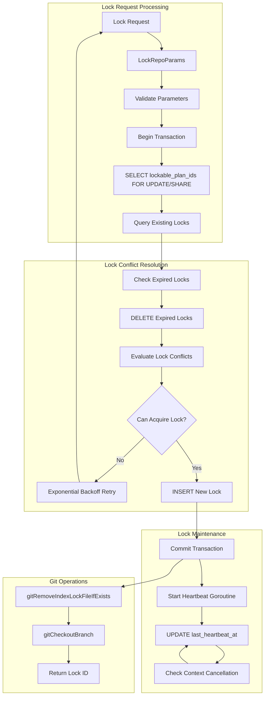
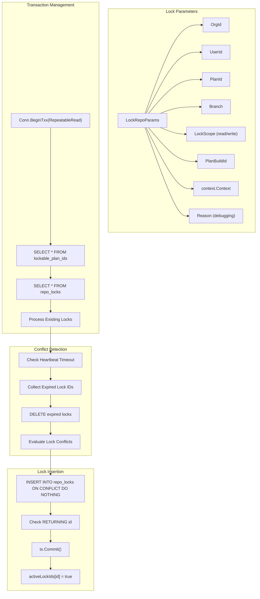
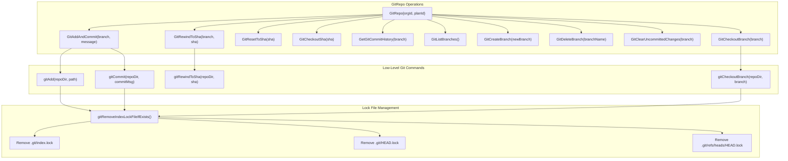
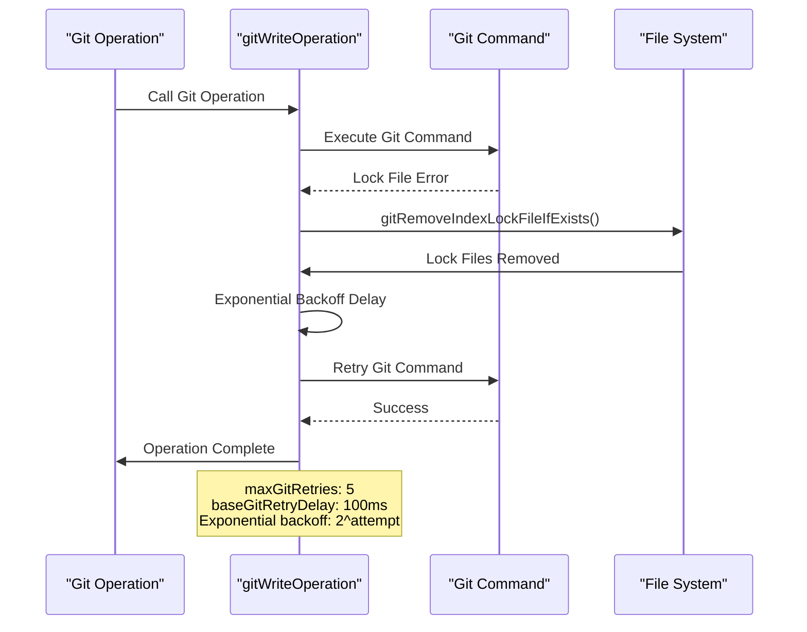
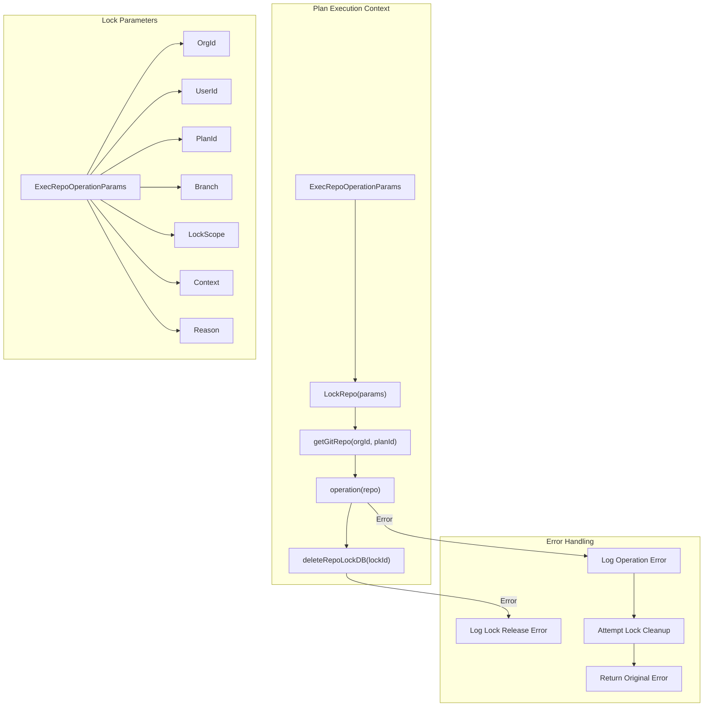
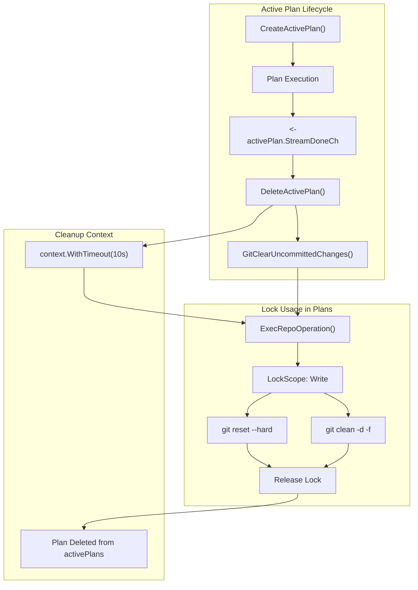
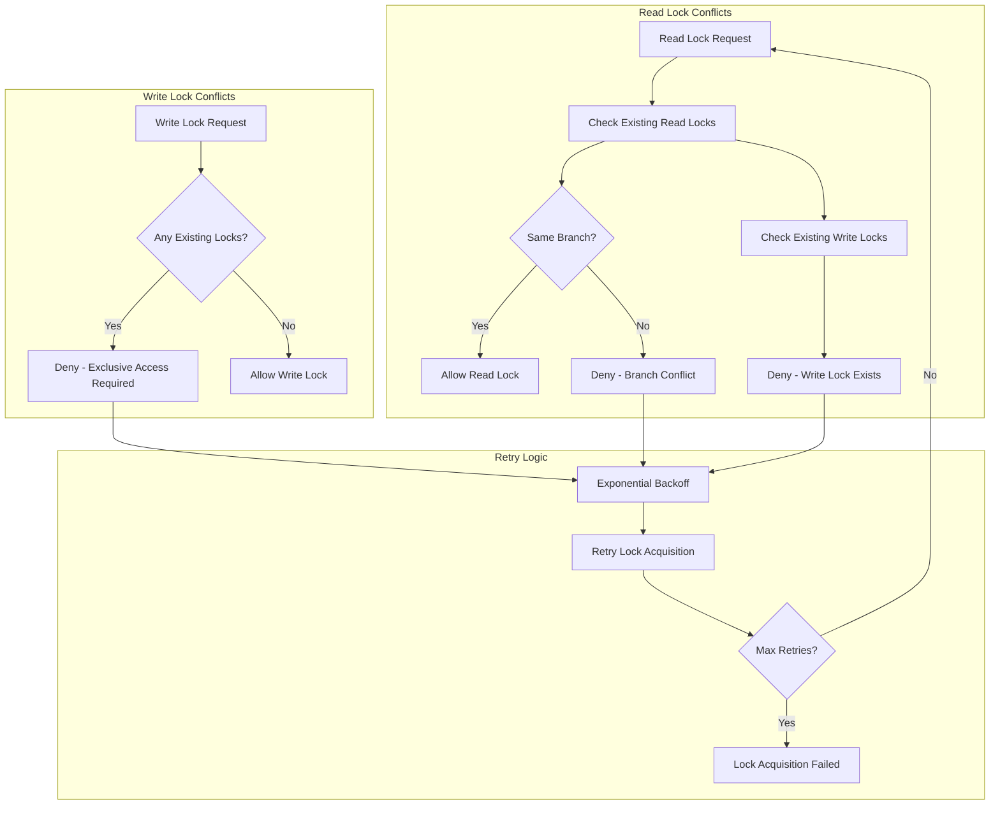
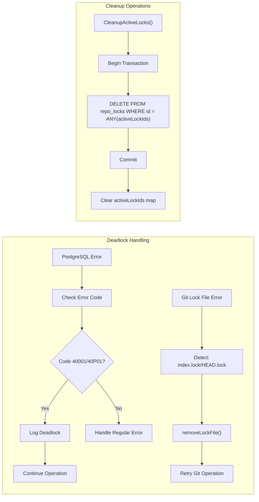
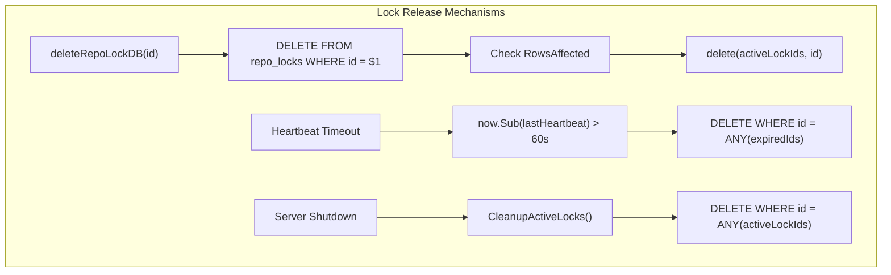

# Repository Locking and Git Integration

<details>
<summary>Relevant source files</summary>

The following files were used as context for generating this wiki page:

- [app/server/db/db.go](app/server/db/db.go)
- [app/server/db/git.go](app/server/db/git.go)
- [app/server/db/locks.go](app/server/db/locks.go)
- [app/server/model/plan/state.go](app/server/model/plan/state.go)
- [app/server/model/plan/stop.go](app/server/model/plan/stop.go)
- [app/shared/plan_model_settings.go](app/shared/plan_model_settings.go)
- [releases/cli/versions/0.8.3.md](releases/cli/versions/0.8.3.md)
- [releases/server/versions/0.8.4.md](releases/server/versions/0.8.4.md)
- [releases/server/versions/2.1.3.md](releases/server/versions/2.1.3.md)

</details>


This document covers Plandex's repository locking system and Git integration, which provides concurrency control for plan execution and manages Git operations across multiple plans and branches. This system ensures that only one operation can modify a repository at a time while allowing multiple read operations under specific conditions.

For information about plan execution workflow, see [Plan Execution System](#3). For database schema details, see [Database Schema and Migrations](#6.1).

## Lock Management System

Plandex implements a sophisticated database-backed locking system that coordinates access to Git repositories across multiple concurrent plan executions. The system uses PostgreSQL's row-level locking combined with application-level heartbeat monitoring.

### Lock Types and Scopes

The locking system supports two primary lock scopes defined in the `LockScope` type:

| Lock Scope | Purpose | Conflicts With |
|------------|---------|----------------|
| `LockScopeRead` | Repository read operations, branch checkout | Write locks, read locks on different branches |
| `LockScopeWrite` | Repository modifications, commits | All other locks (read and write) |

Read locks allow multiple concurrent operations on the same branch but prevent branch switching during execution. Write locks provide exclusive access for repository modifications.



*Sources: [app/server/db/locks.go:41-52](), [app/server/db/locks.go:54-478]()*

### Lock Acquisition Process

The `lockRepoDB` function implements the core lock acquisition logic with retry mechanisms and deadlock handling:



*Sources: [app/server/db/locks.go:54-478](), [app/server/db/locks.go:249-290]()*

### Heartbeat Mechanism

Each acquired lock starts a heartbeat goroutine that periodically updates the `last_heartbeat_at` timestamp to prove the lock holder is still active:

```mermaid
graph LR
    subgraph "Heartbeat Lifecycle"
        StartGoroutine["Start Heartbeat Goroutine"] --> HeartbeatInterval["Wait lockHeartbeatInterval (3s)"]
        HeartbeatInterval --> UpdateHeartbeat["UPDATE repo_locks SET last_heartbeat_at = NOW()"]
        UpdateHeartbeat --> CheckErrors["Check for Errors"]
        CheckErrors --> CheckRowsAffected["Check RowsAffected"]
        CheckRowsAffected --> ContinueLoop["Continue Loop"]
        ContinueLoop --> HeartbeatInterval
        
        CheckErrors -->|"Too Many Errors"| CancelContext["Cancel Context"]
        CheckRowsAffected -->|"0 Rows"| LockNotFound["Lock Not Found - Exit"]
        UpdateHeartbeat -->|"Context Cancelled"| ExitGoroutine["Exit Goroutine"]
    end
    
    subgraph "Constants"
        Constants["lockHeartbeatInterval: 3s<br/>lockHeartbeatTimeout: 60s<br/>maxLockRetries: 6"]
    end
```

*Sources: [app/server/db/locks.go:27-32](), [app/server/db/locks.go:387-457]()*

## Git Integration Architecture

The Git integration system provides repository management capabilities with automatic lock file handling and retry mechanisms for Git operations.

### GitRepo Structure and Operations

The `GitRepo` struct encapsulates Git operations for a specific organization and plan:



*Sources: [app/server/db/git.go:32-65](), [app/server/db/git.go:67-400](), [app/server/db/git.go:604-644]()*

### Git Write Operations with Retry Logic

All Git write operations are wrapped with `gitWriteOperation` which provides exponential backoff retry logic for lock file conflicts:



*Sources: [app/server/db/git.go:655-684](), [app/server/db/git.go:19-22]()*

## Repository Lock Integration with Plan Execution

The locking system integrates with the plan execution engine through the `ExecRepoOperation` wrapper function, which provides a standardized interface for executing Git operations with proper locking.

### ExecRepoOperation Workflow



*Sources: [app/server/model/plan/state.go:113-128](), [app/server/db/locks.go:42-52]()*

### Active Plan Integration

Active plans use the locking system to coordinate Git operations during plan execution and cleanup:



*Sources: [app/server/model/plan/state.go:99-137](), [app/server/db/git.go:333-383]()*

## Concurrency Control and Error Handling

The system implements multiple layers of concurrency control to handle race conditions, deadlocks, and system failures.

### Lock Conflict Resolution



*Sources: [app/server/db/locks.go:249-290](), [app/server/db/locks.go:564-598]()*

### Deadlock Detection and Recovery

The system includes deadlock detection for PostgreSQL serialization conflicts and Git lock file issues:



*Sources: [app/server/db/locks.go:552-562](), [app/server/db/locks.go:613-668](), [app/server/db/git.go:557-602]()*

### Lock Release and Cleanup

Lock cleanup happens through multiple mechanisms to ensure system reliability:

| Cleanup Trigger | Mechanism | Implementation |
|-----------------|-----------|----------------|
| Normal completion | `deleteRepoLockDB()` | Explicit lock release with retry |
| Context cancellation | Heartbeat goroutine exit | Automatic timeout detection |
| Server shutdown | `CleanupActiveLocks()` | Bulk cleanup of all active locks |
| Lock expiry | Heartbeat timeout | Automatic removal during lock acquisition |



*Sources: [app/server/db/locks.go:480-521](), [app/server/db/locks.go:215-247](), [app/server/db/locks.go:613-668]()*