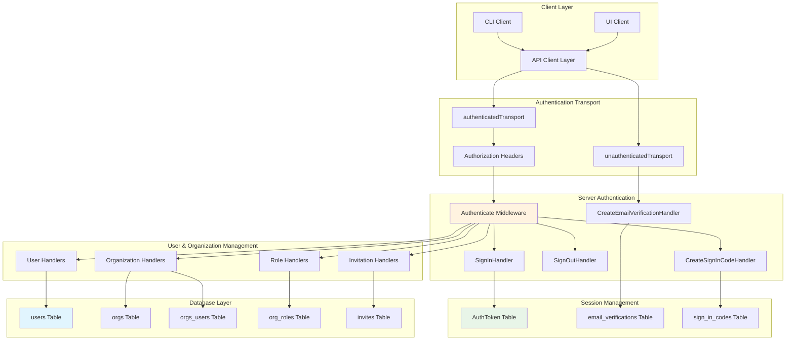
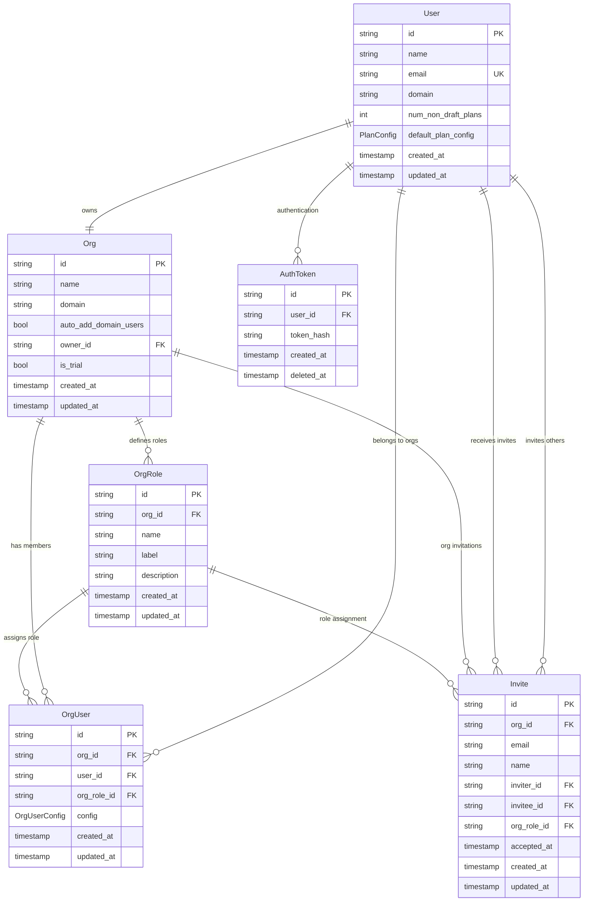
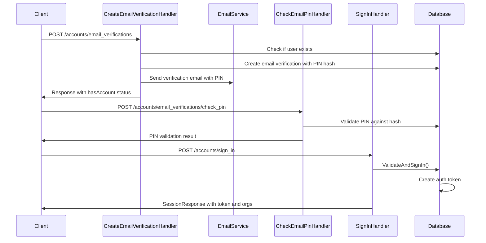
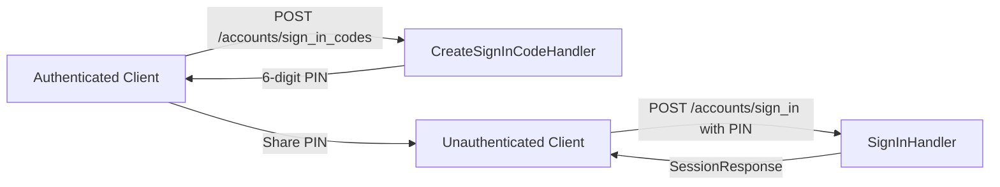
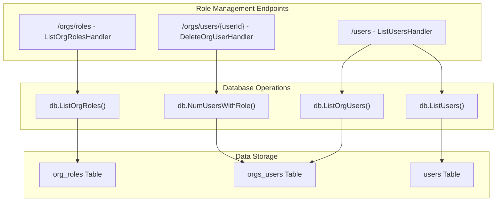
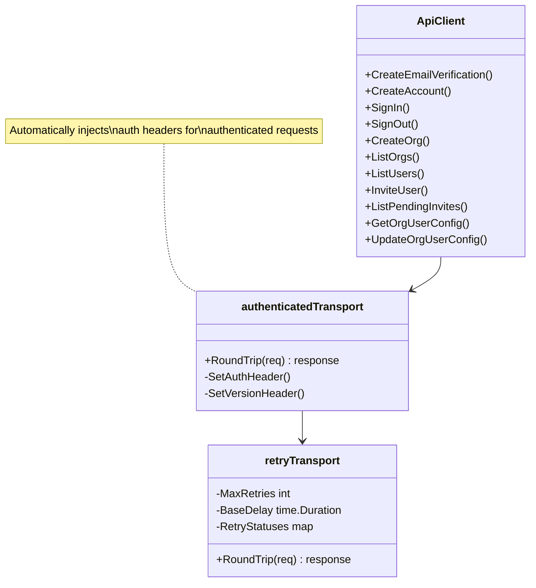

# Authentication and User Management

Relevant source files

The following files were used as context for generating this wiki page:

- [app/cli/api/clients.go](app/cli/api/clients.go)
- [app/cli/api/methods.go](app/cli/api/methods.go)
- [app/cli/types/api.go](app/cli/types/api.go)
- [app/server/db/data_models.go](app/server/db/data_models.go)
- [app/server/db/user_helpers.go](app/server/db/user_helpers.go)
- [app/server/handlers/sessions.go](app/server/handlers/sessions.go)
- [app/server/main.go](app/server/main.go)
- [app/server/routes/routes.go](app/server/routes/routes.go)
- [app/server/setup/setup.go](app/server/setup/setup.go)
- [app/shared/data_models.go](app/shared/data_models.go)
- [app/shared/req_res.go](app/shared/req_res.go)

This document covers Plandex's authentication and user management system, including user registration, login/logout flows, session management, organization membership, role-based access control, and invitation workflows. For information about data storage and database schema, see [Database Schema and Migrations](#6.1).

## System Architecture Overview

**Authentication and Authorization Flow**

Sources: [app/cli/api/clients.go:44-64](), [app/server/routes/routes.go:89-190](), [app/server/handlers/sessions.go:1-347](), [app/server/db/data_models.go:19-261]()

## Core Data Models

**User and Organization Relationship Model**

Sources: [app/shared/data_models.go:21-49](), [app/server/db/data_models.go:48-261]()

### Key Data Structures

| Model | Purpose | Key Fields |
|-------|---------|------------|
| `User` | Core user identity | `email`, `domain`, `name`, `default_plan_config` |
| `Org` | Organization/workspace | `name`, `auto_add_domain_users`, `is_trial`, `owner_id` |
| `OrgUser` | User-organization membership | `user_id`, `org_id`, `org_role_id`, `config` |
| `OrgRole` | Role-based permissions | `name`, `label`, `description` |
| `Invite` | Pending invitations | `email`, `inviter_id`, `invitee_id`, `accepted_at` |
| `AuthToken` | Session authentication | `user_id`, `token_hash`, `deleted_at` |

Sources: [app/shared/data_models.go:10-50](), [app/server/db/data_models.go:27-261]()

## Authentication Flow

**Email-Based Authentication Process**

Sources: [app/server/handlers/sessions.go:18-136](), [app/server/handlers/sessions.go:138-172](), [app/server/handlers/sessions.go:211-250]()

### Authentication Components

The authentication system uses several key components:

- **Email Verification**: PIN-based email verification using SHA256 hashing ([app/server/handlers/sessions.go:86-113]())
- **Authentication Tokens**: Server-side token management with hash storage ([app/server/db/data_models.go:19-25]())
- **Transport Layer**: Client-side automatic token injection via `authenticatedTransport` ([app/cli/api/clients.go:44-55]())
- **Session Management**: Token-based sessions with organization context ([app/shared/req_res.go:44-51]())

### Sign-in Code Flow

For cross-client authentication (e.g., UI to CLI), Plandex implements a sign-in code system:

Sources: [app/server/handlers/sessions.go:176-209](), [app/shared/req_res.go:27-31]()

## Authorization and Role Management

**Organization Role System**

Sources: [app/server/routes/routes.go:103-105](), [app/server/db/user_helpers.go:98-166]()

### Organization User Configuration

Each organization membership includes configuration through `OrgUserConfig`:

- **Config Storage**: JSON configuration stored in `orgs_users.config` column ([app/server/db/data_models.go:102]())
- **Retrieval**: `GetOrgUserConfigHandler` endpoint at `/org_user_config` ([app/server/handlers/sessions.go:287-312]())
- **Updates**: `UpdateOrgUserConfigHandler` for configuration changes ([app/server/handlers/sessions.go:314-346]())

Sources: [app/server/handlers/sessions.go:287-346](), [app/server/db/user_helpers.go:73-96]()

## API Endpoints and Routing

**Authentication and User Management Routes**

| Route Pattern | Method | Handler | Purpose |
|---------------|--------|---------|---------|
| `/accounts/email_verifications` | POST | `CreateEmailVerificationHandler` | Start email verification |
| `/accounts/email_verifications/check_pin` | POST | `CheckEmailPinHandler` | Validate PIN |
| `/accounts/sign_in_codes` | POST | `CreateSignInCodeHandler` | Generate cross-client auth code |
| `/accounts/sign_in` | POST | `SignInHandler` | User authentication |
| `/accounts/sign_out` | POST | `SignOutHandler` | Session termination |
| `/accounts` | POST | `CreateAccountHandler` | User registration |
| `/orgs/session` | GET | `GetOrgSessionHandler` | Current org context |
| `/orgs` | GET/POST | `ListOrgsHandler`/`CreateOrgHandler` | Organization management |
| `/users` | GET | `ListUsersHandler` | List org users |
| `/orgs/users/{userId}` | DELETE | `DeleteOrgUserHandler` | Remove user from org |
| `/invites` | POST | `InviteUserHandler` | Send invitation |
| `/invites/{type}` | GET | `List{Type}InvitesHandler` | List invitations |
| `/org_user_config` | GET/PUT | `GetOrgUserConfigHandler`/`UpdateOrgUserConfigHandler` | User-specific org config |

Sources: [app/server/routes/routes.go:92-111](), [app/server/routes/routes.go:188-189]()

### Client-Side API Implementation

The CLI implements a comprehensive API client with authentication management:

**API Client Interface**

Sources: [app/cli/types/api.go:17-119](), [app/cli/api/clients.go:44-64](), [app/cli/api/clients.go:66-117]()

## Session Management and Security

### Token Management

Authentication tokens are managed through several layers:

- **Server Storage**: `AuthToken` records in database with SHA256 hashed tokens ([app/server/db/data_models.go:19-25]())
- **Client Storage**: Handled by authentication system in CLI client
- **Token Lifecycle**: Creation on sign-in, deletion on sign-out ([app/server/handlers/sessions.go:260-266]())
- **Automatic Injection**: `authenticatedTransport` adds tokens to requests ([app/cli/api/clients.go:48-54]())

### Security Features

| Feature | Implementation | Location |
|---------|----------------|----------|
| PIN Hashing | SHA256 hash storage for email verification PINs | [app/server/handlers/sessions.go:94-96]() |
| Token Hashing | SHA256 hash storage for auth tokens | [app/server/db/data_models.go:22]() |
| Email Validation | Domain extraction and validation | [app/server/db/user_helpers.go:133-137]() |
| Request Retry | Exponential backoff with jitter for failed requests | [app/cli/api/clients.go:75-116]() |
| Local Dev Mode | Bypass email verification in development | [app/server/handlers/sessions.go:85-123]() |

Sources: [app/server/handlers/sessions.go:86-123](), [app/cli/api/clients.go:66-134]()

### Organization Context Management

Users operate within organization contexts, managed through:

- **Session Response**: `SessionResponse` includes available organizations ([app/shared/req_res.go:44-51]())
- **Organization Selection**: Client maintains current organization context
- **Multi-Organization Support**: Users can belong to multiple organizations ([app/server/db/data_models.go:97-114]())
- **Domain-Based Auto-Add**: Organizations can automatically add users from matching email domains ([app/server/db/data_models.go:31]())

Sources: [app/shared/req_res.go:44-51](), [app/server/db/data_models.go:27-46]()