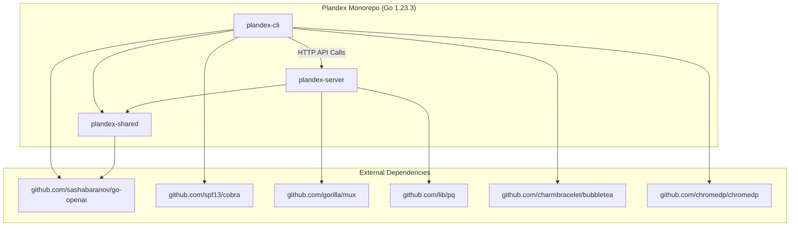
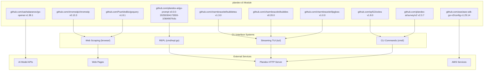
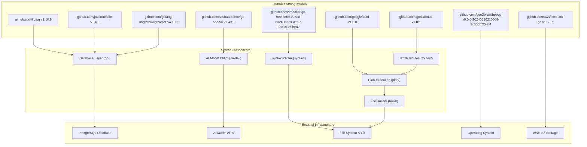
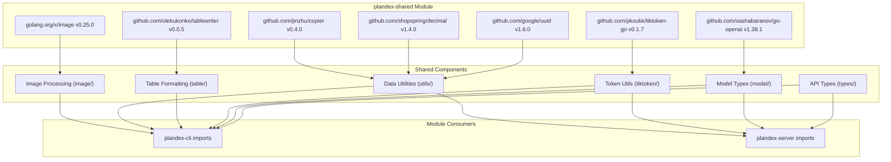
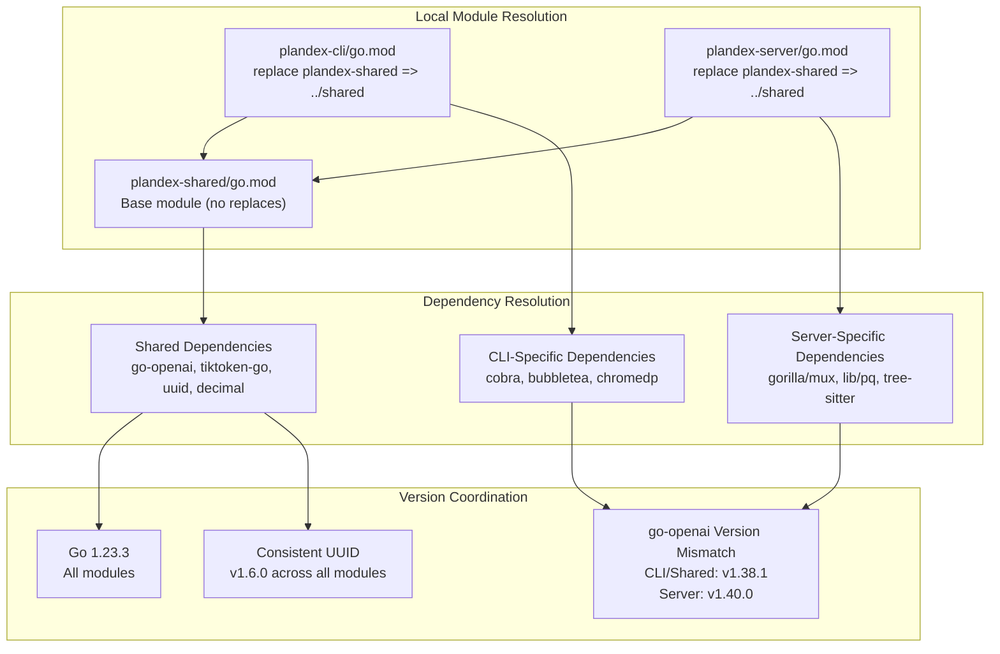
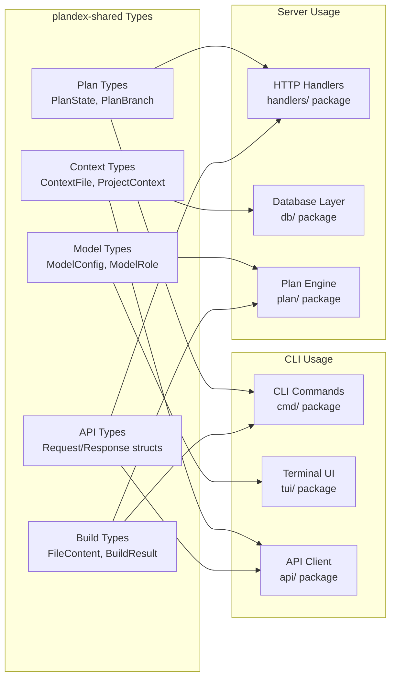
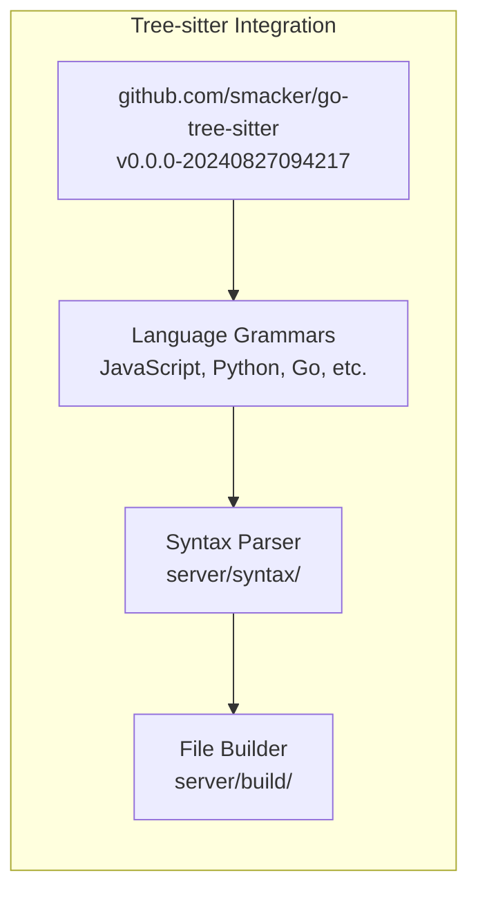
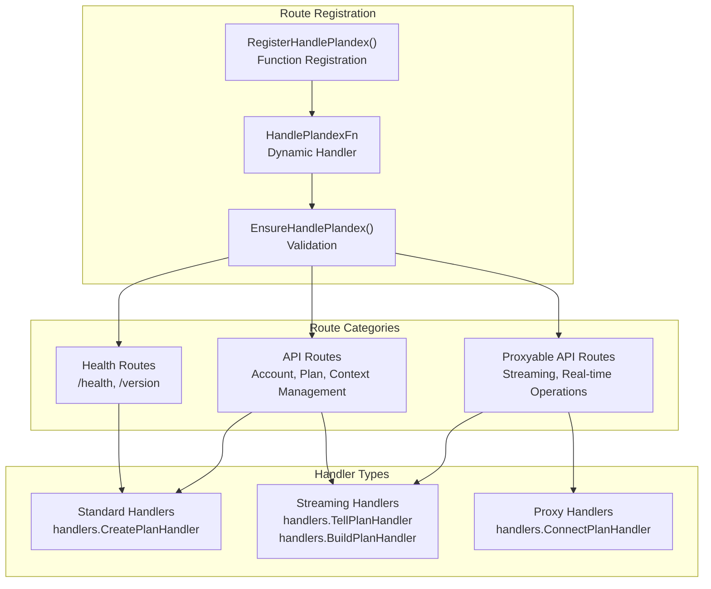

# Module Dependencies and Architecture

Relevant source files

The following files were used as context for generating this wiki page:

- [app/cli/go.mod](app/cli/go.mod)
- [app/cli/go.sum](app/cli/go.sum)
- [app/server/go.mod](app/server/go.mod)
- [app/server/go.sum](app/server/go.sum)
- [app/shared/go.mod](app/shared/go.mod)
- [app/shared/go.sum](app/shared/go.sum)
- [releases/cli/versions/2.0.8.md](releases/cli/versions/2.0.8.md)

This document details the Go module structure, dependency management, and architectural relationships between the main components of the Plandex codebase. It focuses on how the CLI, server, and shared modules are organized and their external dependencies.

For information about the overall system architecture and data flow, see [System Architecture Overview](#1.3). For details about the server-side components and business logic, see [Server Architecture](#4).

## Module Structure

Plandex is organized as a monorepo with three main Go modules using Go 1.23.3 that follow a clear separation of concerns:

**Module Dependency Architecture**

**Module Configuration and Replace Directives**

Each module uses local path replacement to depend on the shared module:

| Module | Path | Go Version | Shared Dependency |
|--------|------|------------|------------------|
| `plandex-cli` | `app/cli/` | 1.23.3 | `replace plandex-shared => ../shared` |
| `plandex-server` | `app/server/` | 1.23.3 | `replace plandex-shared => ../shared` |
| `plandex-shared` | `app/shared/` | 1.23.3 | N/A (base dependency) |

Sources: [app/cli/go.mod:1-3](), [app/cli/go.mod:106](), [app/server/go.mod:1-3](), [app/server/go.mod:53](), [app/shared/go.mod:1-3]()

## CLI Module Dependencies

The CLI module (`plandex-cli`) handles user interaction through multiple interfaces and communicates with the Plandex server via HTTP APIs.

**CLI Dependency Architecture**

**CLI Dependencies by Category**

| Category | Dependencies | Version | Purpose |
|----------|--------------|---------|---------|
| **Command Framework** | `github.com/spf13/cobra` | v1.8.0 | CLI command structure and argument parsing |
| **Interactive REPL** | `github.com/plandex-ai/go-prompt` | v0.0.0-20250304173555 | Custom REPL interface with autocomplete |
| **User Input** | `github.com/plandex-ai/survey/v2` | v2.3.7 | Form-based user input collection |
| **Terminal UI** | `github.com/charmbracelet/bubbletea` | v1.3.0 | Real-time streaming interface framework |
| | `github.com/charmbracelet/bubbles` | v0.20.0 | Pre-built UI components |
| | `github.com/charmbracelet/lipgloss` | v1.0.0 | Terminal styling and layout |
| **Web Automation** | `github.com/chromedp/chromedp` | v0.13.3 | Headless Chrome browser automation |
| | `github.com/PuerkitoBio/goquery` | v1.8.1 | HTML parsing and DOM manipulation |
| **AI Integration** | `github.com/sashabaranov/go-openai` | v1.38.1 | OpenAI API client |
| **Cloud Services** | `github.com/aws/aws-sdk-go-v2/config` | v1.29.14 | AWS SDK configuration |
| **Utilities** | `github.com/google/uuid` | v1.6.0 | UUID generation |
| | `github.com/fatih/color` | v1.18.0 | Terminal color output |
| | `github.com/briandowns/spinner` | v1.23.0 | Loading indicators |

Sources: [app/cli/go.mod:5-28](), [app/cli/go.mod:84-103]()

## Server Module Dependencies

The server module (`plandex-server`) implements the core business logic, database operations, and AI model integration.

**Server Dependency Architecture**

**Server Dependencies by Category**

| Category | Dependencies | Version | Purpose |
|----------|--------------|---------|---------|
| **HTTP Framework** | `github.com/gorilla/mux` | v1.8.1 | HTTP routing, middleware, and request handling |
| **Database** | `github.com/lib/pq` | v1.10.9 | PostgreSQL driver |
| | `github.com/jmoiron/sqlx` | v1.4.0 | SQL query builder and result mapping |
| | `github.com/golang-migrate/migrate/v4` | v4.18.3 | Database schema migrations |
| **AI Integration** | `github.com/sashabaranov/go-openai` | v1.40.0 | OpenAI API client (newer than CLI version) |
| **Code Analysis** | `github.com/smacker/go-tree-sitter` | v0.0.0-20240827094217 | Language-agnostic syntax tree parsing |
| **Cloud Services** | `github.com/aws/aws-sdk-go` | v1.55.7 | AWS service integration |
| **System Integration** | `github.com/gen2brain/beeep` | v0.0.0-20240516210008 | Cross-platform desktop notifications |
| **Core Utilities** | `github.com/google/uuid` | v1.6.0 | UUID generation for plans and sessions |
| | `github.com/pkg/errors` | v0.9.1 | Enhanced error handling |

**Version Discrepancies**
- The server uses `go-openai v1.40.0` while CLI and shared use `v1.38.1`
- Server uses AWS SDK v1 while CLI uses AWS SDK v2

Sources: [app/server/go.mod:5-12](), [app/server/go.mod:39-51]()

## Shared Module Dependencies

The shared module (`plandex-shared`) contains common types, utilities, and interfaces used by both CLI and server.

**Shared Module Architecture**

**Shared Dependencies by Category**

| Category | Dependencies | Version | Purpose |
|----------|--------------|---------|---------|
| **AI Integration** | `github.com/sashabaranov/go-openai` | v1.38.1 | Common AI model types and interfaces |
| **Token Management** | `github.com/pkoukk/tiktoken-go` | v0.1.7 | Token counting for AI context management |
| **Data Utilities** | `github.com/google/uuid` | v1.6.0 | UUID generation for entities |
| | `github.com/shopspring/decimal` | v1.4.0 | Precise decimal arithmetic |
| | `github.com/jinzhu/copier` | v0.4.0 | Struct copying utilities |
| **Output Formatting** | `github.com/olekukonko/tablewriter` | v0.0.5 | ASCII table formatting for CLI output |
| **Media Processing** | `golang.org/x/image` | v0.25.0 | Image manipulation and processing |

**Core Shared Types**
- Plan definitions and state management
- AI model configuration and response types  
- Context management structures
- File build and validation types
- HTTP API request/response contracts

Sources: [app/shared/go.mod:5-10](), [app/shared/go.mod:17-24]()

## Dependency Management Architecture

The Plandex codebase uses sophisticated dependency management patterns to support its multi-module architecture.

**Module Replace Directives**

**Cross-Module Type Sharing**

The shared module provides common interfaces and types that bridge CLI and server implementations:

Sources: [app/cli/go.mod:106](), [app/server/go.mod:53](), [app/shared/go.mod]()

## External Integration Architecture  

The Plandex modules integrate with multiple external services and systems through well-defined dependency interfaces.

**External Service Dependencies**

```mermaid
graph TB
    subgraph "AI Model Providers"
        openai_api["OpenAI API<br/>sashabaranov/go-openai"]
        anthropic_api["Anthropic API<br/>Direct HTTP"]
        google_api["Google AI API<br/>Direct HTTP"] 
        openrouter_api["OpenRouter API<br/>Direct HTTP"]
        local_llm["Local LLMs<br/>Ollama/Local"]
    end
    
    subgraph "Infrastructure Services"
        postgres_db["PostgreSQL<br/>lib/pq + jmoiron/sqlx"]
        aws_s3["AWS S3<br/>aws-sdk-go"]
        git_repos["Git Repositories<br/>os/exec + git commands"]
        file_system["File System<br/>os package"]
    end
    
    subgraph "Web Services"
        browser_automation["Web Scraping<br/>chromedp/chromedp"]
        html_parsing["HTML Processing<br/>PuerkitoBio/goquery"]
        http_apis["HTTP APIs<br/>net/http"]
    end
    
    subgraph "System Integration"
        desktop_notifications["Desktop Notifications<br/>gen2brain/beeep"]
        system_clipboard["Clipboard<br/>atotto/clipboard"]
        terminal_ui["Terminal UI<br/>charmbracelet ecosystem"]
    end
    
    subgraph "Plandex Modules"
        CLI_Module["plandex-cli"]
        Server_Module["plandex-server"]
        Shared_Module["plandex-shared"]
    end
    
    CLI_Module --> openai_api
    CLI_Module --> browser_automation
    CLI_Module --> html_parsing
    CLI_Module --> desktop_notifications
    CLI_Module --> system_clipboard
    CLI_Module --> terminal_ui
    
    Server_Module --> openai_api
    Server_Module --> anthropic_api
    Server_Module --> google_api
    Server_Module --> openrouter_api
    Server_Module --> local_llm
    Server_Module --> postgres_db
    Server_Module --> aws_s3
    Server_Module --> git_repos
    Server_Module --> file_system
    
    Shared_Module --> openai_api
```

**Custom Fork Dependencies**

Plandex maintains custom forks of several dependencies for specific functionality:

| Package | Original | Custom Fork | Modifications |
|---------|----------|-------------|---------------|
| `go-prompt` | `c-bata/go-prompt` | `plandex-ai/go-prompt v0.0.0-20250304173555` | REPL customizations |
| `survey` | `AlecAivazis/survey` | `plandex-ai/survey/v2 v2.3.7` | Enhanced input collection |

**Tree-sitter Language Support**

The server uses `go-tree-sitter` for multi-language syntax parsing:

Sources: [app/cli/go.mod:19-20](), [app/server/go.mod:47](), [app/cli/go.mod:8-9]()

## Route Registration System

The server uses a flexible route registration system that supports different handler types and middleware configurations:

**Route Categories**

| Category | Function | Routes | Purpose |
|----------|----------|--------|---------|
| **Health** | `AddHealthRoutes()` | `/health`, `/version` | System monitoring |
| **API** | `AddApiRoutes()` | Core business logic | Plan and context management |
| **Proxyable** | `AddProxyableApiRoutes()` | Real-time operations | Streaming and live connections |

Sources: [app/server/routes/routes.go:15-28](), [app/server/routes/routes.go:30-71](), [app/server/routes/routes.go:89-185](), [app/server/routes/routes.go:187-198]()