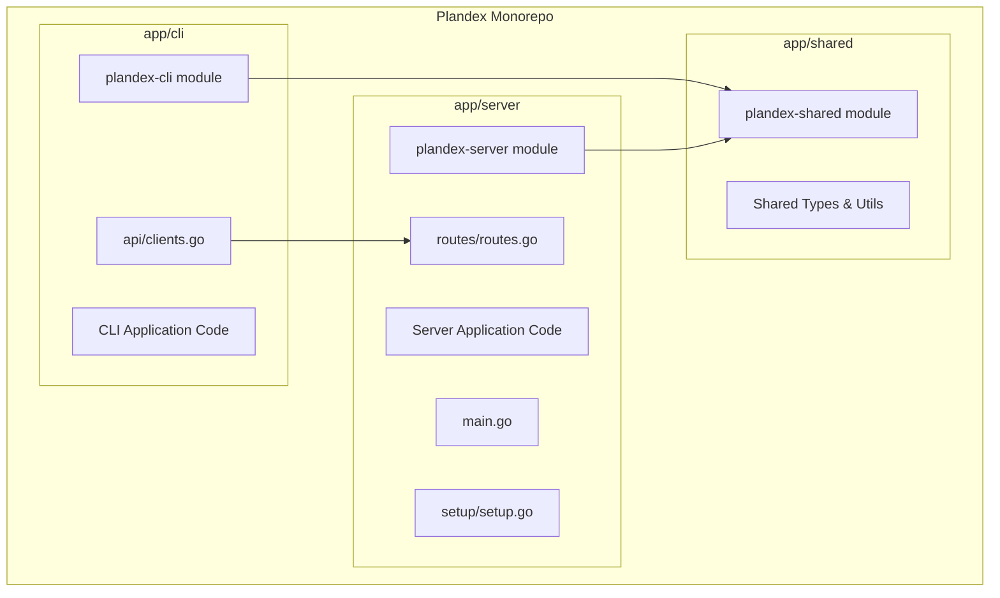
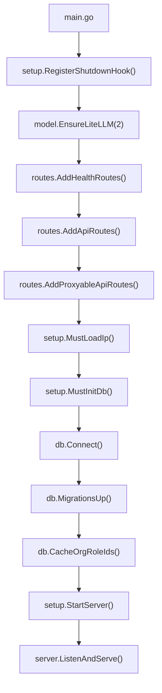
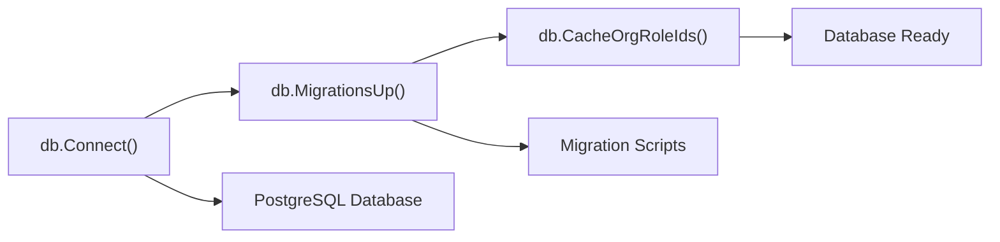
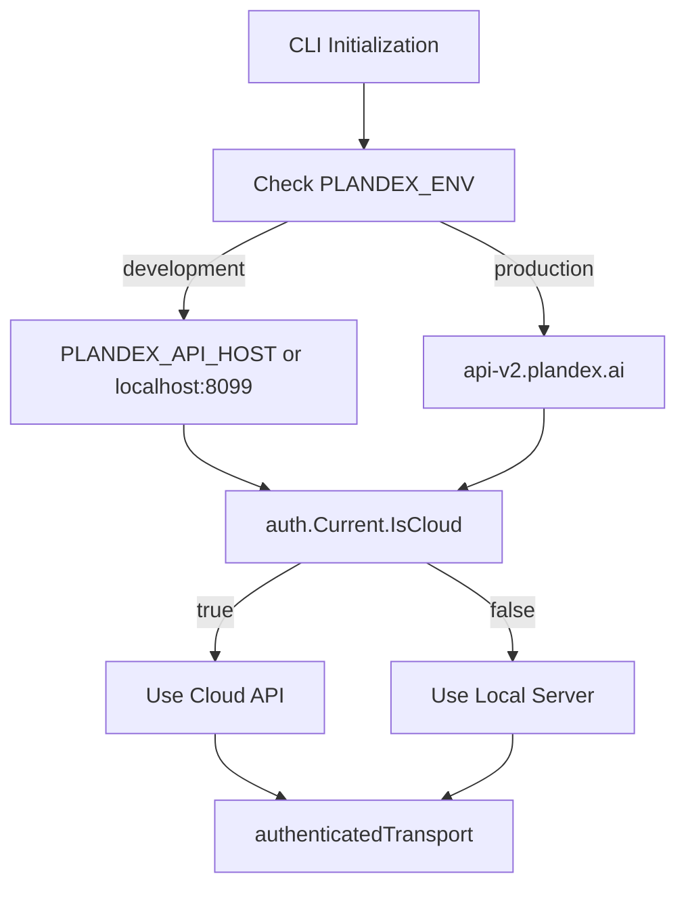
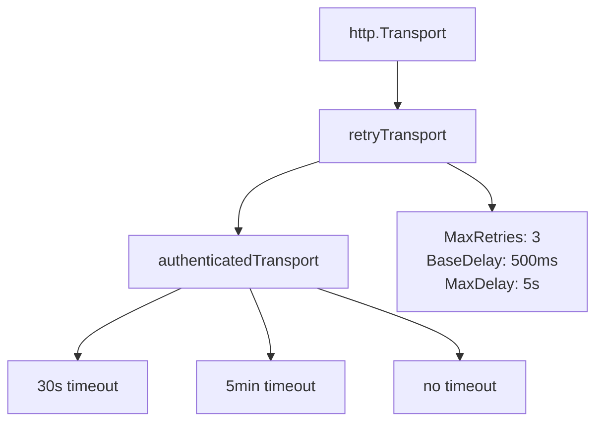
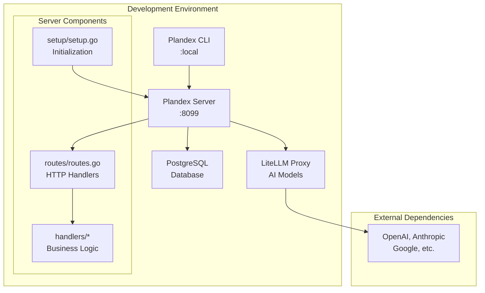
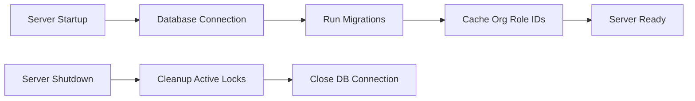

# Local Development Environment

<details>
<summary>Relevant source files</summary>

The following files were used as context for generating this wiki page:

- [app/cli/api/clients.go](app/cli/api/clients.go)
- [app/cli/go.mod](app/cli/go.mod)
- [app/cli/go.sum](app/cli/go.sum)
- [app/server/db/user_helpers.go](app/server/db/user_helpers.go)
- [app/server/go.mod](app/server/go.mod)
- [app/server/go.sum](app/server/go.sum)
- [app/server/handlers/sessions.go](app/server/handlers/sessions.go)
- [app/server/main.go](app/server/main.go)
- [app/server/routes/routes.go](app/server/routes/routes.go)
- [app/server/setup/setup.go](app/server/setup/setup.go)
- [app/shared/go.mod](app/shared/go.mod)
- [app/shared/go.sum](app/shared/go.sum)
- [releases/cli/versions/2.0.8.md](releases/cli/versions/2.0.8.md)

</details>


This document provides a comprehensive guide for setting up a local development environment for Plandex. It covers the server and CLI components, database configuration, and development workflow. For production deployment considerations, see [Self-Hosting Plandex](#7.3). For understanding the overall module architecture, see [Module Dependencies and Architecture](#7.1).

## Environment Structure

Plandex consists of three main Go modules organized in a monorepo structure with clear separation of concerns between client, server, and shared components.

### Module Architecture



**Sources:** [app/cli/go.mod:1-107](), [app/server/go.mod:1-54](), [app/shared/go.mod:1-25]()

### Development Dependencies

The development environment requires several key dependencies managed through Go modules:

| Component | Key Dependencies | Purpose |
|-----------|------------------|---------|
| CLI | `gorilla/mux`, `spf13/cobra`, `charmbracelet/bubbletea` | HTTP routing, CLI framework, TUI |
| Server | `jmoiron/sqlx`, `lib/pq`, `golang-migrate/migrate` | Database access, PostgreSQL driver, migrations |
| Shared | `sashabaranov/go-openai`, `pkoukk/tiktoken-go` | AI model integration, token counting |

**Sources:** [app/cli/go.mod:5-28](), [app/server/go.mod:5-51](), [app/shared/go.mod:5-24]()

## Server Development Setup

The server component handles API requests, plan execution, and database operations. The development setup involves database initialization, environment configuration, and server startup.

### Server Initialization Flow



**Sources:** [app/server/main.go:14-38](), [app/server/setup/setup.go:20-42]()

### Development Environment Variables

The server recognizes several environment variables for development configuration:

```go
// Development mode detection
GOENV=development           // Enables development features
PLANDEX_ENV=development    // CLI development mode  
LOCAL_MODE=1               // Bypasses email verification
PORT=8099                  // Server port (default)
IS_CLOUD=""                // Cloud deployment flag
```

**Sources:** [app/server/setup/setup.go:67-88](), [app/cli/api/clients.go:24-32](), [app/server/handlers/sessions.go:85]()

### Database Setup

The server requires PostgreSQL with automatic migration handling:



**Sources:** [app/server/setup/setup.go:27-42]()

### Local Server Startup

To start the server in development mode:

1. **Database**: Ensure PostgreSQL is running and accessible
2. **Environment**: Set `GOENV=development` 
3. **Run**: Execute `go run main.go` from `app/server/`
4. **Verify**: Server starts on port 8099 with health endpoint at `/health`

The server includes graceful shutdown handling that waits for active plans to complete before terminating.

**Sources:** [app/server/main.go:14-38](), [app/server/setup/setup.go:66-185]()

## CLI Development Setup

The CLI connects to either local development servers or the cloud API based on environment configuration.

### API Client Configuration



**Sources:** [app/cli/api/clients.go:23-42]()

### HTTP Client Architecture

The CLI implements sophisticated HTTP client handling with authentication, retries, and timeout management:



**Sources:** [app/cli/api/clients.go:66-162]()

### Development CLI Usage

For CLI development against a local server:

1. **Environment**: Set `PLANDEX_ENV=development`
2. **API Host**: Set `PLANDEX_API_HOST=http://localhost:8099` (optional)
3. **Build**: `go build` from `app/cli/`
4. **Run**: Execute CLI commands against local server

The CLI automatically detects development mode and adjusts API endpoints accordingly.

**Sources:** [app/cli/api/clients.go:24-32]()

## Development Workflow

### Local Development Architecture



**Sources:** [app/server/main.go:14-38](), [app/server/routes/routes.go:73-203](), [app/server/setup/setup.go:66-185]()

### Development Features

The development environment includes several debugging and development-specific features:

| Feature | Implementation | Purpose |
|---------|----------------|---------|
| Request Logging | `loggingMiddleware` | Logs all HTTP requests with timing |
| Local Mode | `LOCAL_MODE=1` | Bypasses email verification |
| Development Detection | `GOENV=development` | Enables dev-specific behavior |
| Graceful Shutdown | Signal handling | Waits for active plans completion |

**Sources:** [app/server/setup/setup.go:50-64](), [app/server/setup/setup.go:119-185](), [app/server/handlers/sessions.go:85-123]()

### Database Development

The server automatically handles database migrations and role caching during startup:



**Sources:** [app/server/setup/setup.go:27-42](), [app/server/setup/setup.go:155-158](), [app/server/setup/setup.go:75-82]()

This development environment setup ensures consistent behavior between local development and production while providing the necessary tools for debugging and testing Plandex components.