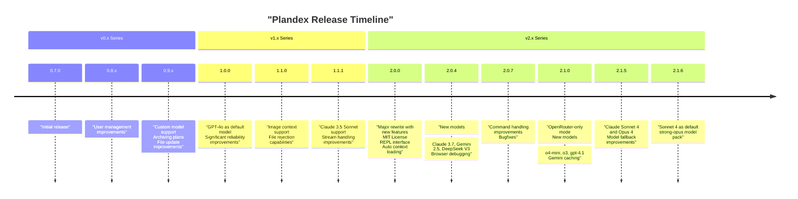
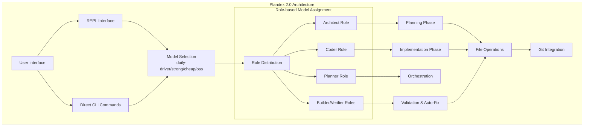
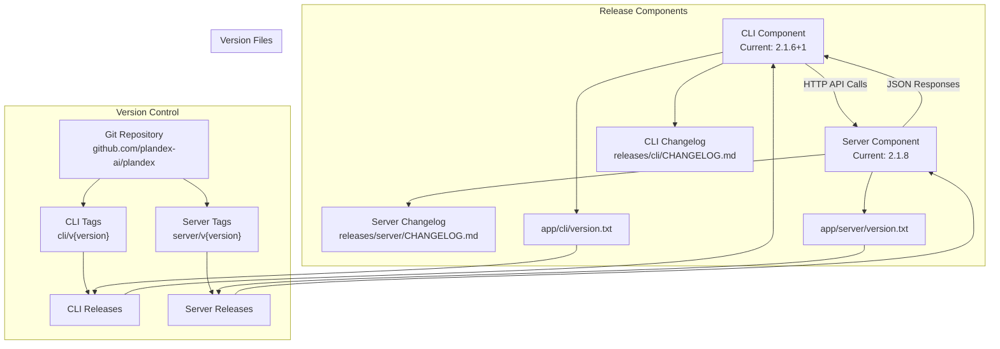
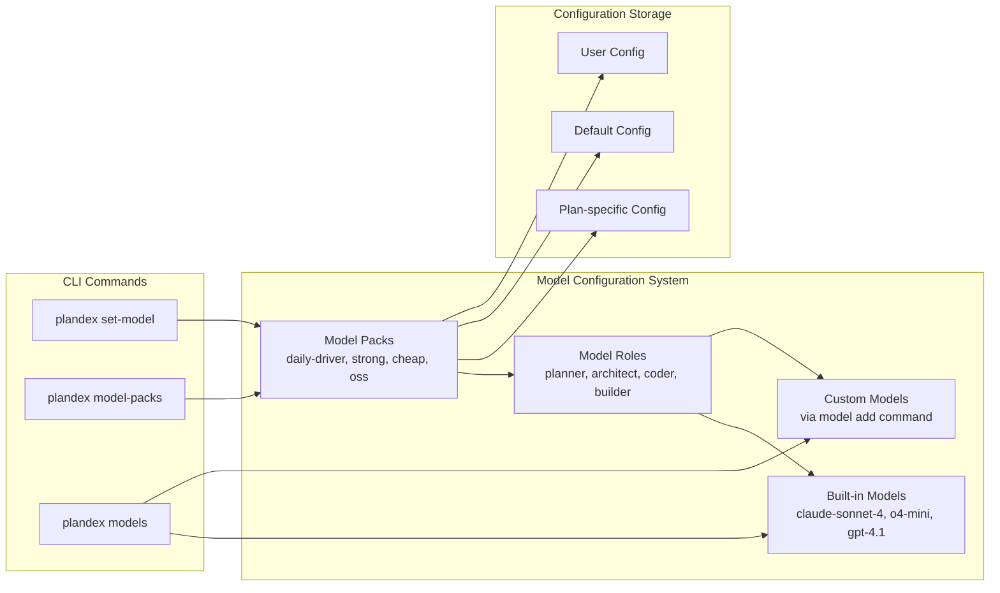

# Version History and Releases

Relevant source files

The following files were used as context for generating this wiki page:

- [app/cli/version.txt](app/cli/version.txt)
- [releases/cli/CHANGELOG.md](releases/cli/CHANGELOG.md)
- [releases/cli/versions/0.7.1.md](releases/cli/versions/0.7.1.md)
- [releases/cli/versions/2.0.0.md](releases/cli/versions/2.0.0.md)
- [releases/cli/versions/2.0.4.md](releases/cli/versions/2.0.4.md)
- [releases/server/versions/2.0.0.md](releases/server/versions/2.0.0.md)
- [releases/server/versions/2.0.4.md](releases/server/versions/2.0.4.md)

This page documents the release history and version information for Plandex, covering both the CLI and server components. It provides a chronological overview of major releases, key features introduced in each version, and notable bug fixes. For more detailed information about specific CLI and server releases, see [CLI Releases](#7.1) and [Server Releases](#7.2).

## Versioning Overview

Plandex uses semantic versioning (MAJOR.MINOR.PATCH) for both CLI and server components, with occasional build/hotfix indicators (like "+1"). The CLI and server components are versioned separately but typically align closely in their major and minor versions.

### Current Versions

| Component | Current Version | Release Date |
|-----------|----------------|--------------|
| CLI       | 2.1.6+1        | Latest       |
| Server    | 2.1.8          | Latest       |

Sources: [app/cli/version.txt:1](), [app/server/version.txt:1]()

## Release Timeline

The following timeline shows the major releases of Plandex from the initial release to the current version:

Sources: [releases/cli/CHANGELOG.md:55-174](), [releases/server/CHANGELOG.md:46-60]()

## Version 2.x Series (Current)

The 2.x series represents a major evolution of Plandex, with significant architectural improvements and new capabilities.

### Version 2.0.0 (Major Release)

Released as a beta version, 2.0.0 was described as a "new project with far more ambitious goals" rather than a simple update to 1.x. It included:

- **Architecture**: Complete redesign with a multi-model approach combining models from Anthropic, OpenAI, and Google
- **Developer Experience**: New REPL interface with fuzzy autocomplete and multi-line editing
- **Context Management**: Automatic context selection with tree-sitter project maps supporting 30+ languages
- **File Editing**: Improved reliability for large files up to 100k tokens
- **Automation**: Configurable levels from basic to full auto with command execution integration
- **Licensing**: Transition from AGPL 3.0 to MIT License

Sources: [releases/cli/CHANGELOG.md:55-174](), [releases/cli/versions/2.0.0.md](), [releases/server/versions/2.0.0.md]()

### Version 2.0.4

This release added important new model support and debugging capabilities:

- **Models**:
  - Claude Sonnet 3.7 thinking (available in the `reasoning` model pack)
  - Gemini 2.5 Pro (experimental) 
  - DeepSeek V3 03-24 (used in the `oss` pack)
  - OpenAI GPT 4.5
- **Debugging**: Browser application debugging via Chrome console logs
- **Reliability**: HTTP retry logic with exponential backoff
- **Model Pack Management**: New `model-packs update` and `model-packs show` commands

Sources: [releases/cli/CHANGELOG.md:11-41](), [releases/cli/versions/2.0.4.md](), [releases/server/versions/2.0.4.md]()

### Version 2.1.x Series (Latest)

The 2.1.x series builds upon the 2.0 foundation with significant model improvements, enhanced reliability, and expanded provider support.

#### Version 2.1.0

This major feature release introduced:

- **OpenRouter-Only Mode**: BYO key users can now use Plandex with only an `OPENROUTER_API_KEY`, eliminating the need for separate OpenAI accounts
- **New Model Integration**: 
  - Gemini 2.5 Pro Preview as default for 200k-1M token contexts
  - OpenAI o4-mini with high/medium/low reasoning effort levels (replacing o3-mini)
  - OpenAI o3 with reasoning effort levels and o3-high as default in `strong` pack
  - GPT-4.1, GPT-4.1-mini, and GPT-4.1-nano replacing GPT-4o models
- **Enhanced Fallback System**: Robust fallback and retry system for newly released models and preview models
- **Gemini Caching**: Prompt caching support for Gemini models, reducing costs and latency
- **REPL Improvements**: Better handling of mistyped commands and suggestions

#### Version 2.1.5-2.1.6+1

Recent releases focus on cutting-edge model integration:

- **Claude Sonnet 4**: Added as built-in model, promoted to default in daily-driver pack (2.1.6)
- **Claude Opus 4**: Available in new `strong-opus` and `opus-planner` model packs
- **Enhanced Reliability**: Additional retries for unresponsive models and provider rate limits
- **Error Handling**: Fixes for garbled error messages and lock acquisition issues

Sources: [releases/cli/CHANGELOG.md:1-103](), [releases/server/CHANGELOG.md:1-37]()

### Version 2.0.5 - 2.0.7

These releases focused on stability, reliability and user experience improvements:

- Error handling and model error messaging improvements
- Better handling of partial or mistyped commands in the REPL
- Consolidated Gemini 2.5 Pro Experimental into a single model pack
- Fixed whitespace handling and prevent '\send' command inclusion in multi-line mode

Sources: [releases/cli/CHANGELOG.md:104-153](), [releases/server/CHANGELOG.md:38-77]()

## Version 1.x Series

The 1.x series represented Plandex's first stable release, with several significant feature additions and improvements.

### Version 1.0.0

This marked the first stable release of Plandex:

- **GPT-4o Integration**: Made GPT-4o the default model, delivering 2x faster planning and execution
- **Reliability**: Introduction of automatic syntax and logic validation with auto-correction for file updates
- **Planning Engine**: Improved "memory" for handling long plans without skipping or repeating tasks
- **Cost Efficiency**: 50% cost reduction from GPT-4o's lower per-token pricing

### Version 1.1.0

Notable features in this release:

- **Image Context**: Support for loading images (png, jpeg, gif, webp) into context with GPT-4o
- **Improved Model Support**: Non-OpenAI models support for all roles including builder, verifier, and auto-fix
- **File Management**: Added `plandex reject` command to reject pending changes
- **Conversation Management**: Improved `plandex convo` command with plain text output and message range selection

Sources: [releases/cli/CHANGELOG.md:175-249](), [releases/server/CHANGELOG.md:61-67]()

## Version 0.x Series (Early Releases)

The 0.x series represented the initial development of Plandex, with rapid feature addition and stabilization.

### Version 0.7.0 - 0.8.x

Early releases focusing on core functionality and user management:

- Initial release of core functionality
- User management improvements: inviting users, listing users, and revoking invites
- Repository locking system
- SMTP email integration
- Context management capabilities

### Version 0.9.x

Key features added:

- Custom models and model packs integration
- Plan archiving functionality
- Significant file update improvements for accuracy and reliability
- Better handling of braces, parentheses, and code structures
- Introduction of the `plandex diff` command

Sources: [releases/cli/CHANGELOG.md:250-360](), [releases/server/CHANGELOG.md:144-163](), [releases/server/versions/0.8.1.md]()

## Component Relationship and Release Process

The following diagram illustrates how the CLI and server components interact and their versioning relationship:

**Model Pack Configuration Flow**

Sources: [releases/cli/CHANGELOG.md](), [releases/server/CHANGELOG.md](), [app/cli/version.txt:1](), [app/server/version.txt:1]()

## Feature Evolution

The following table highlights key features and their introduction/improvement across major versions:

| Feature | First Introduced | Major Improvements |
|---------|-----------------|-------------------|
| Model Integration | 0.7.0 | 0.9.0 (Custom models), 1.0.0 (GPT-4o), 2.0.0 (Multi-model approach), 2.1.0 (OpenRouter-only, o4-mini), 2.1.5-6 (Sonnet 4, Opus 4) |
| Context Management | 0.7.0 | 1.1.0 (Image support), 2.0.0 (Automatic selection), 2.1.0 (2M token window with Gemini) |
| File Operations | 0.7.0 | 0.9.0 (Accuracy), 1.0.0 (Validation), 2.0.0 (Large file support, up to 100k tokens) |
| User Interface | 0.7.0 (CLI) | 2.0.0 (REPL interface), 2.1.0 (Enhanced command suggestions) |
| Automation | 0.7.0 (Basic) | 2.0.0 (Configurable levels), 2.0.4 (Browser debugging) |
| Model Fallbacks | 2.1.0 | 2.1.0 (Robust fallback system), 2.1.5+ (Enhanced fallbacks for new models) |
| Caching | 2.0.0 (OpenAI/Anthropic) | 2.1.0 (Gemini caching support) |

**Model Pack Evolution Timeline**

```mermaid
gantt
    title "Model Pack Evolution Across Versions"
    dateFormat  X
    axisFormat %s
    
    section Core Packs
    daily-driver (GPT-based)    :0, 12
    daily-driver (Multi-model)  :12, 18
    daily-driver (Sonnet 4)     :18, 20
    
    section Specialized Packs
    strong (o1-based)           :12, 15
    strong (o3-based)           :15, 18
    strong-opus (Opus 4)        :18, 20
    
    section Cost-Effective
    cheap                       :12, 20
    oss (Open Source)           :12, 20
    
    section Experimental
    reasoning (Sonnet 3.7)      :16, 20
    gemini-preview              :15, 20
```

Sources: [releases/cli/CHANGELOG.md](), [releases/cli/versions/2.0.0.md](), [releases/cli/versions/2.0.4.md]()

## Upgrade Notes

Upgrading between minor versions within the same major version is generally straightforward. However, upgrading between major versions (e.g., 1.x to 2.x) may require additional steps:

- **1.x to 2.x**: Version 2.x is designed to run separately and independently from v1. Follow the quickstart guide as if you were a new user rather than upgrading in-place.
- **Cloud Users**: The Plandex Cloud service is automatically updated to the latest version.
- **Self-hosted Users**: Refer to the deployment documentation for instructions on upgrading self-hosted instances.

Sources: [releases/cli/CHANGELOG.md:159-161](), [releases/cli/versions/2.0.0.md:105-106]()