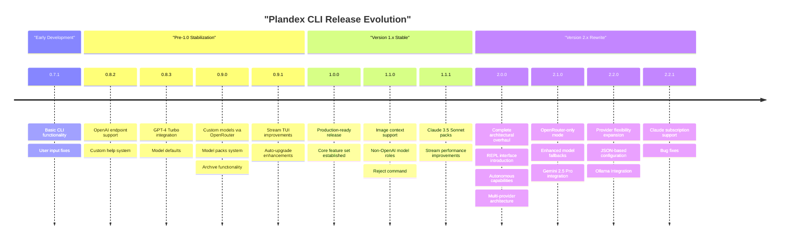
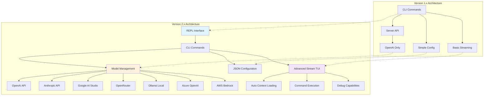
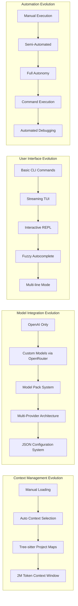

# CLI Release History

<details>
<summary>Relevant source files</summary>

The following files were used as context for generating this wiki page:

- [app/cli/version.txt](app/cli/version.txt)
- [releases/cli/CHANGELOG.md](releases/cli/CHANGELOG.md)
- [releases/cli/versions/0.7.1.md](releases/cli/versions/0.7.1.md)
- [releases/cli/versions/2.0.0.md](releases/cli/versions/2.0.0.md)
- [releases/cli/versions/2.0.4.md](releases/cli/versions/2.0.4.md)
- [releases/server/versions/2.0.0.md](releases/server/versions/2.0.0.md)
- [releases/server/versions/2.0.4.md](releases/server/versions/2.0.4.md)

</details>


This document tracks the version history and evolution of the Plandex CLI component, documenting feature additions, architectural changes, and major milestones from initial releases through the current version. It covers command-line interface improvements, user experience enhancements, model integration updates, and configuration system changes.

For server-side release history, see [Server Release History](#8.2). For overall system architecture information, see [System Architecture Overview](#1.3).

## Release Timeline and Major Milestones

The CLI has evolved through several major version families, each representing significant architectural and feature improvements:



Sources: [releases/cli/CHANGELOG.md:1-567](), [app/cli/version.txt:1-2]()

## Architecture Evolution Overview

The CLI architecture has undergone fundamental changes, particularly between version 1.x and 2.x:



Sources: [releases/cli/CHANGELOG.md:277-383](), [releases/cli/versions/2.0.0.md:1-122]()

## Major Version Milestones

### Version 0.x - Foundation Period

The early versions established core CLI functionality with basic plan execution and context management:

| Version | Key Features | Breaking Changes |
|---------|-------------|------------------|
| 0.7.1 | Basic CLI commands, user input handling | Initial implementation |
| 0.8.2 | `OPENAI_ENDPOINT` environment variable support | None |
| 0.8.3 | GPT-4 Turbo as default model | Model behavior changes |
| 0.9.0 | Custom models via `plandex models add`, Model packs system | New command structure |
| 0.9.1 | Stream TUI improvements, auto-upgrade with sudo | None |

### Version 1.x - Stable Release

Version 1.0.0 marked the first production-ready release with a stable feature set:

**Core Commands Established:**
- `plandex tell` - Plan initiation
- `plandex continue` - Plan continuation  
- `plandex build` - File building
- `plandex apply` - Change application
- `plandex load` - Context loading
- `plandex set-model` - Model configuration

**Version 1.1.x Enhancements:**
- Image context support via `plandex load path/to/image.png`
- `plandex reject` command for change rejection
- Claude 3.5 Sonnet model pack integration
- Non-OpenAI models for builder/verifier roles

### Version 2.x - Architectural Transformation

Version 2.0.0 introduced a complete rewrite with fundamentally different user interaction patterns:

**REPL Interface:**
The primary interaction mode shifted from individual CLI commands to an interactive REPL accessible via `plandex` command without arguments.

**Autonomous Capabilities:**
- `basic` mode - Manual operation like v1.x
- `semi-auto` mode - Automatic context loading (default)
- `full-auto` mode - Complete autonomy including command execution

**Multi-Provider Architecture:**
Expanded from OpenAI-only to supporting multiple AI providers with automatic fallback mechanisms.

Sources: [releases/cli/CHANGELOG.md:14-383](), [releases/cli/versions/2.0.0.md:7-91]()

## Feature Evolution Matrix



Sources: [releases/cli/CHANGELOG.md:314-356](), [releases/cli/versions/2.0.0.md:38-80]()

## Configuration System Evolution

The configuration management has undergone significant changes across versions:

### Version 1.x Configuration
- Environment variables: `OPENAI_API_KEY`, `OPENAI_ENDPOINT`
- Simple model selection via `plandex set-model`
- Basic model pack creation

### Version 2.x Configuration  
- JSON-based model configuration with IDE support
- Schema validation and autocomplete
- Multiple provider credentials management
- Unified custom configuration via `models custom` command

**Key Configuration Files:**
- Model settings: JSON schema-validated configuration
- Custom models: Centralized provider and model definitions
- Default settings: `set-model default` for new plan defaults

### Current Provider Support (v2.2.x)
The system now supports the following built-in providers:

| Provider | Environment Variable | Capabilities |
|----------|---------------------|--------------|
| OpenAI | `OPENAI_API_KEY` | Full feature set |
| Anthropic | `ANTHROPIC_API_KEY` | Direct API access |
| Google AI Studio | `GOOGLE_AI_STUDIO_API_KEY` | Gemini models |
| Google Vertex AI | Vertex credentials | Enterprise Gemini |
| Azure OpenAI | Azure credentials | Enterprise OpenAI |
| AWS Bedrock | AWS credentials | Bedrock models |
| OpenRouter | `OPENROUTER_API_KEY` | Aggregated access |
| Ollama | Local connection | Local model serving |
| DeepSeek | `DEEPSEEK_API_KEY` | DeepSeek models |
| Perplexity | `PERPLEXITY_API_KEY` | Perplexity models |

Sources: [releases/cli/CHANGELOG.md:17-31](), [releases/cli/CHANGELOG.md:43-68]()

## Command Interface Changes

### Traditional CLI Commands (All Versions)
Core commands that remain consistent across versions:

```bash
plandex tell "description"     # Initiate or continue plan
plandex continue              # Continue current plan  
plandex build                 # Build pending changes
plandex apply                 # Apply changes to files
plandex load <path>          # Load context
plandex changes              # Review pending changes
plandex diff                 # Show changes in git diff format
```

### Version 2.x REPL Commands
Interactive REPL-specific commands (prefixed with `\`):

```bash
\tell "description"          # Same as CLI tell
\continue                    # Same as CLI continue
\build                       # Same as CLI build
\apply                       # Same as CLI apply
\load <path>                # Same as CLI load
\set-model                  # Model configuration
\chat "message"             # Chat mode vs tell mode
\send                       # Send multi-line input
```

### Model Management Commands Evolution

**Version 1.x:**
```bash
plandex set-model           # Basic model selection
plandex models              # List available models
```

**Version 2.x:**
```bash
plandex models custom       # Unified custom model management
plandex set-model --json   # JSON configuration mode
plandex models default     # Set default models
plandex model-packs create # Custom model pack creation
```

Sources: [releases/cli/CHANGELOG.md:53-74](), [releases/cli/CHANGELOG.md:114-119]()

## Current State (Version 2.2.1)

The current CLI version represents a mature, multi-provider AI coding agent with the following key characteristics:

**Core Capabilities:**
- Interactive REPL as primary interface
- Multi-provider AI model support with automatic fallbacks
- JSON-based configuration with IDE integration
- Autonomous execution modes with configurable automation levels
- Claude Pro/Max subscription integration
- Built-in Ollama support for local models

**Active Development Areas:**
- Enhanced model provider integrations
- Improved error handling and retry mechanisms  
- Cost optimization through direct provider calls
- Advanced debugging capabilities

The CLI has evolved from a simple command-line interface for AI-assisted coding to a sophisticated autonomous coding agent capable of handling complex, multi-file projects with minimal human intervention.

Sources: [releases/cli/CHANGELOG.md:1-13](), [app/cli/version.txt:1-2]()