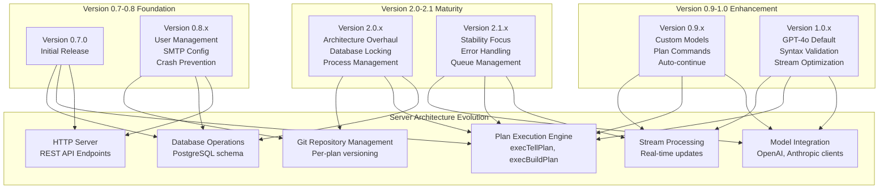
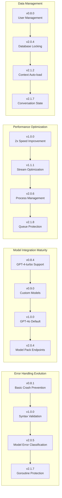

# Server Release History

Relevant source files

The following files were used as context for generating this wiki page:

- [app/server/version.txt](app/server/version.txt)
- [releases/server/CHANGELOG.md](releases/server/CHANGELOG.md)
- [releases/server/versions/0.8.1.md](releases/server/versions/0.8.1.md)

This document provides a comprehensive changelog of Plandex server versions, tracking API changes, backend improvements, stability enhancements, and feature additions. The server component handles plan execution, AI model integration, data persistence, and API endpoints that the CLI clients interact with.

For information about CLI version history and client-side changes, see [CLI Release History](#8.1).

## Current Server Version

The current server version is **2.1.8** as of the latest release.

Sources: [app/server/version.txt:1]()

## Release Timeline Overview

```mermaid
timeline
    title "Server Release Timeline"
    
    section Early Releases
        Version 0.7.0 : Initial Release
        Version 0.8.0 : User Management
                      : Backend Commands
        Version 0.8.1 : Crash Prevention
                      : Git Repository Fixes
        Version 0.8.2 : Organization Management
                      : File Update Reliability
        Version 0.8.3 : SMTP Configuration
                      : Custom OpenAI Endpoints
        Version 0.8.4 : New OpenAI Models
                      : Default Model Updates
    
    section Major Overhaul
        Version 0.9.0 : Custom Models Support
                      : Plan Management Commands
                      : Accuracy Improvements
        Version 0.9.1 : Auto-continue Logic
                      : Pipe Data Naming
    
    section 1.0 Milestone
        Version 1.0.0 : GPT-4o Integration
                      : Syntax Validation
                      : Planning Engine Overhaul
        Version 1.0.1 : Rate Limit Handling
                      : Error Fixes
        Version 1.1.0 : Stream Optimization
                      : Claude 3.5 Support
        Version 1.1.1 : Stream Handling
                      : Performance Improvements
    
    section 2.0 Architecture
        Version 2.0.0 : Major Architecture Update
        Version 2.0.2 : Context Auto-load Fix
        Version 2.0.3 : Crash Prevention
        Version 2.0.4 : Database Locking
                      : API Enhancements
        Version 2.0.5 : Model Reliability
                      : Error Handling
        Version 2.0.6 : Process Management
                      : Command Execution
    
    section Current Era
        Version 2.1.0 : Feature Additions
        Version 2.1.1 : Context Error Handling
        Version 2.1.2 : Auto-load Fixes
        Version 2.1.3 : Model Pack Fixes
        Version 2.1.4 : File Edit Improvements
        Version 2.1.5-2.1.8 : Stability Updates
                            : Conversation Fixes
```

Sources: [releases/server/CHANGELOG.md:1-249]()

## Server Component Release Impact

Sources: [releases/server/CHANGELOG.md:1-249]()

## Detailed Release History

### Version 2.1.x Series (Current) - Stability and Reliability Focus

| Version | Key Changes | Critical Fixes |
|---------|-------------|----------------|
| **2.1.8** | File map queue hang protection | Queue processing reliability |
| **2.1.7** | Conversation summary error fixes | Stream panic prevention, goroutine protection |
| **2.1.6+1** | See CLI release | Coordinated client-server updates |
| **2.1.6** | See CLI release | Feature parity maintenance |
| **2.1.5** | See CLI release | Synchronized functionality |
| **2.1.4** | File editing improvements | Removal of extraneous blank lines |
| **2.1.3** | Model pack error handling | Fix for `execTellPlan` panic with incomplete model packs |
| **2.1.2** | Context loading fixes | Auto-load context EOF error resolution |
| **2.1.1+1** | Enhanced error handling | Anthropic context length error message variations |
| **2.1.1** | See CLI release | Cross-component stability |
| **2.1.0+1** | Context length fallback | Improved retry mechanism for context exceeded errors |
| **2.1.0** | See CLI release | Major feature alignment |

Sources: [releases/server/CHANGELOG.md:1-37]()

### Version 2.0.x Series - Architecture Modernization

| Version | Focus Area | Major Improvements |
|---------|------------|-------------------|
| **2.0.6** | Process Management | Command execution cleanup, model request logging reduction |
| **2.0.5** | Model Reliability | Enhanced error handling, rate limit management, retry logic fixes |
| **2.0.4** | Database & API | Enhanced locking mechanisms, custom model endpoints, process lifecycle |
| **2.0.3** | Crash Prevention | Chat/tell operation fixes, panic handling, queue management |
| **2.0.2** | Context Loading | Auto-load hanging fixes for invalid context scenarios |
| **2.0.0+2** | DevOps | GitHub Action fixes for DockerHub deployment |
| **2.0.0+1** | Model Management | Custom model creation, version check fixes, container deployment |
| **2.0.0** | Major Release | See CLI 2.0.0 for comprehensive changes |

Sources: [releases/server/CHANGELOG.md:39-85]()

### Version 1.x Series - Performance and Intelligence Leap

#### Version 1.1.x - Stream Processing Optimization
- **1.1.1**: Stream handling improvements reducing terminal flickering and CPU usage
- **1.1.0**: Note naming automation, summarization fixes, verification improvements, rate limit handling

#### Version 1.0.x - GPT-4o Integration Milestone
- **1.0.1**: Error handling for verify state, Git operations, rate limit parsing with automatic retry
- **1.0.0**: Major release featuring GPT-4o as default model, automatic syntax validation, planning engine improvements

Key technical improvements in 1.0.0:
- 90% reduction in syntax errors through validation pipeline
- 2x performance improvement with GPT-4o
- Enhanced memory management for complex plans
- Automatic correction step for file updates

Sources: [releases/server/CHANGELOG.md:87-182]()

### Version 0.9.x Series - Customization and Accuracy

| Version | Primary Focus | Technical Enhancements |
|---------|---------------|----------------------|
| **0.9.1** | Auto-continue Logic | Summary incorporation, pipe data naming via `namer` role |
| **0.9.0** | Custom Models | Model packs, default models, file update accuracy, plan management commands |

Major 0.9.0 server-side additions:
- Support for `plandex diff` command
- Plan archiving/unarchiving functionality  
- `plandex summary` command backend
- `plandex rename` command support
- Enhanced commit message generation

Sources: [releases/server/CHANGELOG.md:183-201]()

### Version 0.8.x Series - Foundation and Stability

| Version | Core Improvements | Infrastructure |
|---------|------------------|----------------|
| **0.8.4** | Model Support | GPT-4-turbo integration, default model updates, file handling |
| **0.8.3** | Configuration | SMTP_FROM, OPENAI_ENDPOINT, OPENAI_ORG_ID environment variables |
| **0.8.2** | Organization Management | Domain-based auto-add, crash prevention, file update reliability |
| **0.8.1** | Crash Prevention | Git repo locking fixes, server stability, build improvements |
| **0.8.0** | User Management | Backend for `invite`, `users`, `revoke` commands, email improvements |

Sources: [releases/server/CHANGELOG.md:202-242](), [releases/server/versions/0.8.1.md:1-11]()

### Version 0.7.x Series - Initial Release

- **0.7.1**: SMTP fixes, `/version` endpoint addition
- **0.7.0**: Initial public release establishing core server functionality

Sources: [releases/server/CHANGELOG.md:243-249]()

## Key Technical Evolution Areas

Sources: [releases/server/CHANGELOG.md:1-249]()