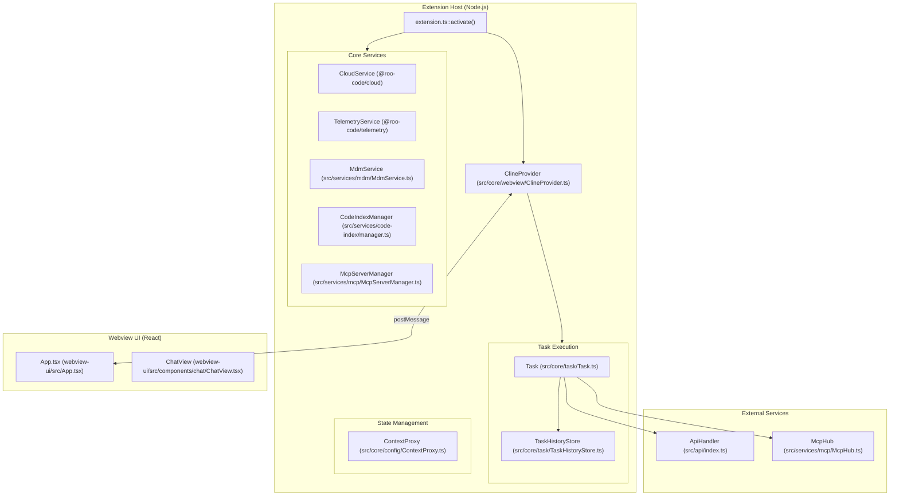
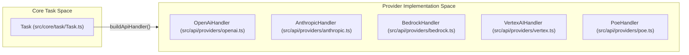

# Overview

Relevant source files

The following files were used as context for generating this wiki page:

- [CHANGELOG.md](CHANGELOG.md)
- [README.md](README.md)
- [apps/web-evals/package.json](apps/web-evals/package.json)
- [apps/web-roo-code/package.json](apps/web-roo-code/package.json)
- [apps/web-roo-code/src/components/ui/navigation-menu.tsx](apps/web-roo-code/src/components/ui/navigation-menu.tsx)
- [locales/ca/README.md](locales/ca/README.md)
- [locales/de/README.md](locales/de/README.md)
- [locales/es/README.md](locales/es/README.md)
- [locales/fr/README.md](locales/fr/README.md)
- [locales/ja/README.md](locales/ja/README.md)
- [locales/ko/README.md](locales/ko/README.md)
- [locales/pl/README.md](locales/pl/README.md)
- [locales/pt-BR/README.md](locales/pt-BR/README.md)
- [locales/tr/README.md](locales/tr/README.md)
- [locales/vi/README.md](locales/vi/README.md)
- [locales/zh-CN/README.md](locales/zh-CN/README.md)
- [package.json](package.json)
- [packages/build/tsconfig.json](packages/build/tsconfig.json)
- [pnpm-lock.yaml](pnpm-lock.yaml)
- [src/extension.ts](src/extension.ts)
- [src/package.json](src/package.json)
- [webview-ui/package.json](webview-ui/package.json)
- [webview-ui/src/components/common/MermaidBlock.tsx](webview-ui/src/components/common/MermaidBlock.tsx)
- [webview-ui/src/index.tsx](webview-ui/src/index.tsx)
- [webview-ui/tsconfig.json](webview-ui/tsconfig.json)
- [webview-ui/vite.config.ts](webview-ui/vite.config.ts)

This document provides a high-level introduction to Roo Code, its architecture, and core capabilities. It explains what Roo Code is, how its major components interact, and where to find detailed information about specific subsystems.

For detailed information about specific architectural components, see:
- [System Architecture Overview](#1.1) — High-level overview of Roo Code's architecture, showing the main components (Extension Host, Webview UI, External Services) and how they interact.
- [Monorepo Structure and Packages](#1.2) — Describe the monorepo organization, listing all packages and applications and their relationships.

**Sources:** [README.md:1-180](), [package.json:1-75]()

## What is Roo Code?

Roo Code is an AI-powered coding assistant delivered as a Visual Studio Code extension [src/package.json:2-6](). It provides an interactive chat-based interface where developers can request code generation, refactoring, debugging assistance, and codebase analysis [README.md:47-56](). The system orchestrates interactions with multiple Large Language Model (LLM) providers while managing file operations, terminal execution, and external tool integrations.

The extension is distributed through the VS Code Marketplace and can be installed locally for development via VSIX packages [README.md:121-155](). It maintains a monorepo structure containing the core extension, a standalone CLI application, and shared packages [package.json:1-51]().

**Sources:** [README.md:12-14](), [README.md:47-56](), [src/package.json:2-6](), [package.json:1-51]()

## Core Architecture

Roo Code is structured as three primary architectural layers that communicate through well-defined interfaces:

### System Architecture and Code Entities

The following diagram bridges the conceptual "Natural Language Space" with the specific "Code Entity Space" by mapping system components to their implementation classes and files.

**Sources:** [src/extension.ts:120-220](), [src/core/webview/ClineProvider.ts:1-100](), [src/core/task/Task.ts:1-50]()

## Key Capabilities

### Mode System

Roo Code adapts its behavior through a mode system that controls available tools, system prompts, and operational constraints [README.md:57-67]().

| Mode | Primary Use Case |
|------|------------------|
| Code | Everyday coding, edits, and file operations |
| Architect | Plan systems, specs, and migrations |
| Ask | Fast answers, explanations, and docs |
| Debug | Trace issues, add logs, isolate root causes |

**Sources:** [README.md:57-67]()

### Provider Integration

The system supports 20+ LLM providers (OpenAI, Anthropic, OpenRouter, etc.) through a unified interface [CHANGELOG.md:7-15](). Recent updates include support for Poe as a provider, OpenAI GPT-5.4, and Gemini 3.1 Pro [CHANGELOG.md:14-18](), [CHANGELOG.md:37-37](), [CHANGELOG.md:117-117]().

**Sources:** [CHANGELOG.md:3-100](), [src/extension.ts:51-51](), [CHANGELOG.md:14-14]()

### Tool Execution System

Tools enable the AI to interact with the development environment. The system provides native tools for file operations, command execution, and browser automation, alongside extensible MCP tool integration [README.md:47-56](). Custom tools can be bundled using the `customToolRegistry` [src/extension.ts:131-132]().

**Sources:** [README.md:47-56](), [src/extension.ts:155-157](), [src/extension.ts:131-132]()

## CLI Application

In addition to the VS Code extension, Roo Code provides a standalone CLI application [CHANGELOG.md:39-83](). The CLI supports headless task execution, session resumption, UUID-based session validation, and NDJSON stdin protocols [CHANGELOG.md:39-43](), [CHANGELOG.md:118-118]().

**Sources:** [CHANGELOG.md:39-83](), [CHANGELOG.md:118-119]()

## Multi-Language Support

Roo Code includes internationalization support for documentation and UI strings [README.md:21-43]().

- **Documentation**: README translations in 17+ languages located in `locales/` [locales/fr/README.md:1-43](), [locales/ja/README.md:1-43](), [locales/tr/README.md:1-43]().
- **UI Strings**: Initialized via `initializeI18n` based on the user's environment or stored preference [src/extension.ts:152-153]().

**Sources:** [README.md:21-43](), [src/extension.ts:152-153](), [locales/fr/README.md:1-43](), [locales/ja/README.md:1-43](), [locales/tr/README.md:1-43]()