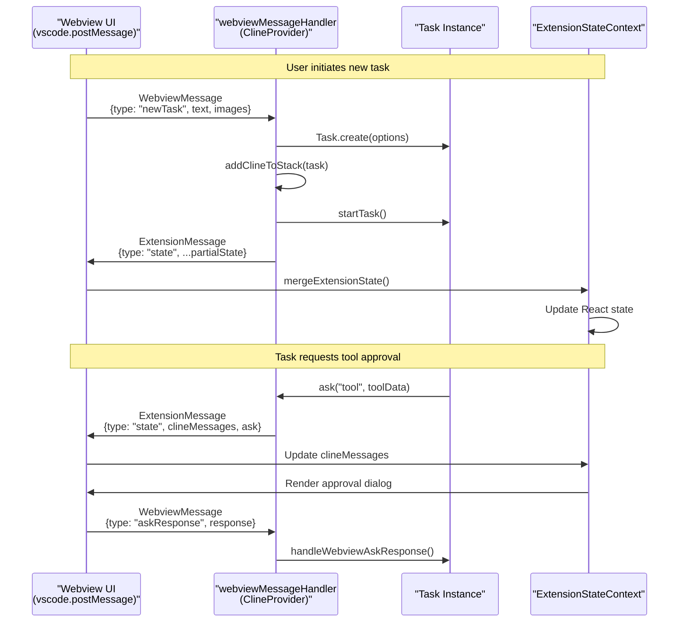
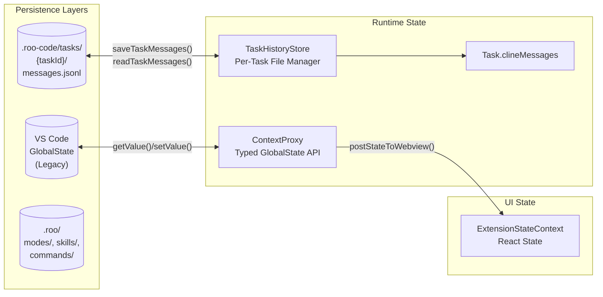
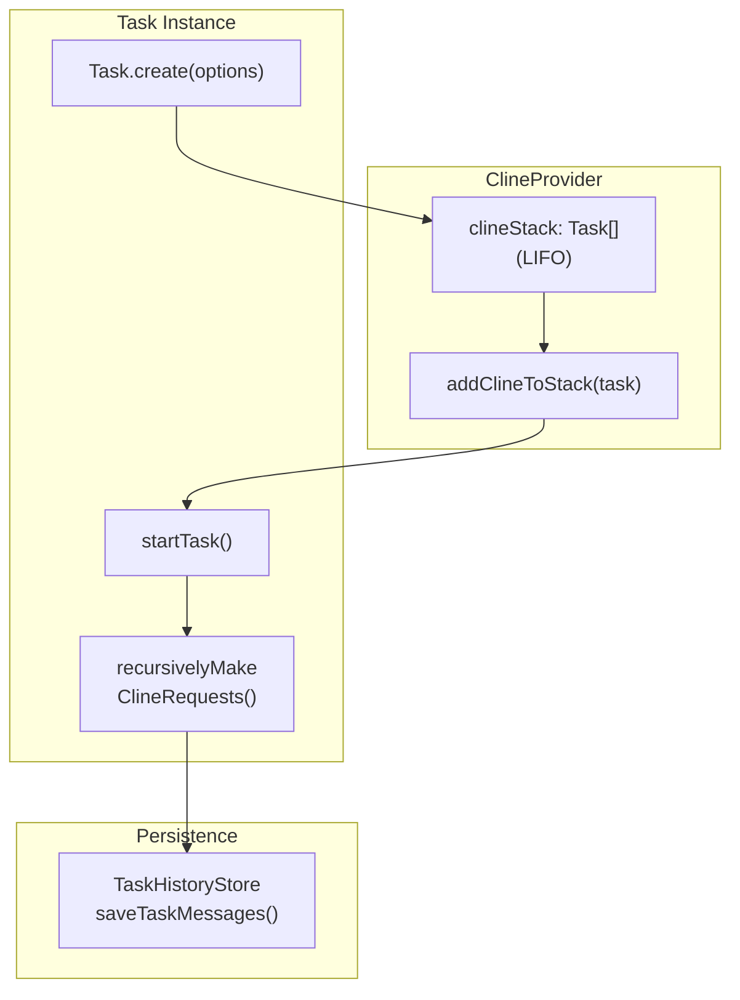
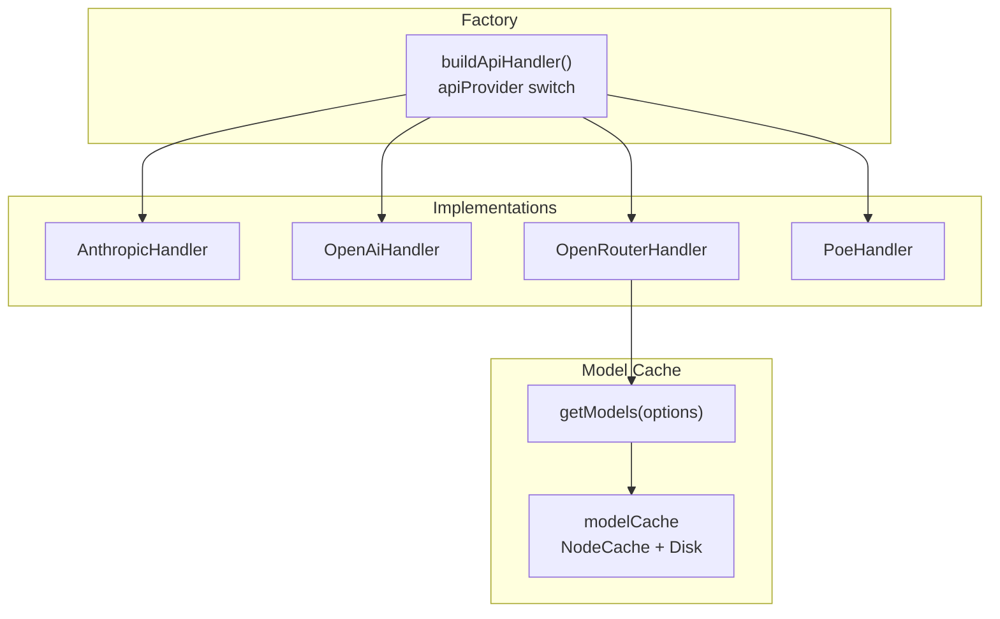

# System Architecture Overview

Relevant source files

The following files were used as context for generating this wiki page:

- [CHANGELOG.md](CHANGELOG.md)
- [apps/web-evals/package.json](apps/web-evals/package.json)
- [apps/web-roo-code/package.json](apps/web-roo-code/package.json)
- [apps/web-roo-code/src/components/ui/navigation-menu.tsx](apps/web-roo-code/src/components/ui/navigation-menu.tsx)
- [package.json](package.json)
- [packages/build/tsconfig.json](packages/build/tsconfig.json)
- [packages/ipc/README.md](packages/ipc/README.md)
- [packages/ipc/src/ipc-client.ts](packages/ipc/src/ipc-client.ts)
- [packages/ipc/src/ipc-server.ts](packages/ipc/src/ipc-server.ts)
- [packages/types/npm/package.metadata.json](packages/types/npm/package.metadata.json)
- [packages/types/src/__tests__/cloud.test.ts](packages/types/src/__tests__/cloud.test.ts)
- [packages/types/src/__tests__/ipc.test.ts](packages/types/src/__tests__/ipc.test.ts)
- [packages/types/src/api.ts](packages/types/src/api.ts)
- [packages/types/src/cloud.ts](packages/types/src/cloud.ts)
- [packages/types/src/events.ts](packages/types/src/events.ts)
- [packages/types/src/ipc.ts](packages/types/src/ipc.ts)
- [packages/types/src/task.ts](packages/types/src/task.ts)
- [packages/types/src/vscode-extension-host.ts](packages/types/src/vscode-extension-host.ts)
- [pnpm-lock.yaml](pnpm-lock.yaml)
- [releases/3.31.1-release.png](releases/3.31.1-release.png)
- [src/api/providers/fetchers/modelCache.ts](src/api/providers/fetchers/modelCache.ts)
- [src/core/webview/ClineProvider.ts](src/core/webview/ClineProvider.ts)
- [src/core/webview/__tests__/ClineProvider.spec.ts](src/core/webview/__tests__/ClineProvider.spec.ts)
- [src/core/webview/__tests__/webviewMessageHandler.spec.ts](src/core/webview/__tests__/webviewMessageHandler.spec.ts)
- [src/core/webview/webviewMessageHandler.ts](src/core/webview/webviewMessageHandler.ts)
- [src/extension.ts](src/extension.ts)
- [src/extension/__tests__/api-delete-queued-message.spec.ts](src/extension/__tests__/api-delete-queued-message.spec.ts)
- [src/extension/__tests__/api-send-message.spec.ts](src/extension/__tests__/api-send-message.spec.ts)
- [src/extension/api.ts](src/extension/api.ts)
- [src/package.json](src/package.json)
- [src/shared/WebviewMessage.ts](src/shared/WebviewMessage.ts)
- [webview-ui/package.json](webview-ui/package.json)
- [webview-ui/src/components/chat/ChatRow.tsx](webview-ui/src/components/chat/ChatRow.tsx)
- [webview-ui/src/components/chat/ChatView.tsx](webview-ui/src/components/chat/ChatView.tsx)
- [webview-ui/src/components/common/MermaidBlock.tsx](webview-ui/src/components/common/MermaidBlock.tsx)
- [webview-ui/src/components/settings/SettingsView.tsx](webview-ui/src/components/settings/SettingsView.tsx)
- [webview-ui/src/context/ExtensionStateContext.tsx](webview-ui/src/context/ExtensionStateContext.tsx)
- [webview-ui/src/index.tsx](webview-ui/src/index.tsx)
- [webview-ui/tsconfig.json](webview-ui/tsconfig.json)
- [webview-ui/vite.config.ts](webview-ui/vite.config.ts)

## Purpose and Scope

This document provides a high-level overview of Roo Code's system architecture, illustrating the three primary layers (Extension Host, Webview UI, and External Services) and how they interact. It maps architectural concepts to concrete code entities and explains the key communication patterns that enable Roo Code to function as an AI-powered VS Code extension.

For detailed information about specific subsystems:
- Extension lifecycle and initialization: see [Extension Activation and Lifecycle]()
- Message protocols between layers: see [Message Protocols]()
- Task execution flow: see [Task Lifecycle and Execution]()
- Provider integration details: see [API Handler Architecture]()

## Architectural Layers

Roo Code is organized into three distinct architectural layers that communicate through well-defined interfaces:

### Three-Layer Architecture

```mermaid
graph TB
    subgraph "Extension Host Process"
        ExtensionEntry["extension.ts<br/>activate()"]
        
        subgraph "Core Services"
            CloudService["CloudService<br/>Authentication & Sync"]
            TelemetryService["TelemetryService<br/>Analytics"]
            MdmService["MdmService<br/>Compliance"]
            CodeIndexManager["CodeIndexManager<br/>Semantic Search"]
            McpServerManager["McpServerManager<br/>MCP Integration"]
            SkillsManager["SkillsManager<br/>Skill Discovery"]
            MarketplaceManager["MarketplaceManager<br/>Extensions"]
        end
        
        subgraph "Provider Layer"
            ClineProvider["ClineProvider<br/>Central Orchestrator"]
            ContextProxy["ContextProxy<br/>GlobalState API"]
            ProviderSettingsManager["ProviderSettingsManager<br/>Profile CRUD"]
            CustomModesManager["CustomModesManager<br/>Mode Config"]
        end
        
        subgraph "Task Layer"
            TaskStack["clineStack: Task[]"]
            TaskInstance["Task<br/>AI Execution Context"]
            TaskHistoryStore["TaskHistoryStore<br/>.roo-code/tasks/"]
        end
    end
    
    subgraph "Webview UI Process"
        AppComponent["App.tsx<br/>Tab Management"]
        ExtensionStateContext["ExtensionStateContext<br/>State Provider"]
        
        subgraph "View Components"
            ChatView["ChatView"]
            SettingsView["SettingsView"]
            HistoryView["HistoryView"]
            MarketplaceView["MarketplaceView"]
            CloudView["CloudView"]
        end
    end
    
    subgraph "External Services"
        LLMProviders["LLM APIs<br/>OpenAI, Anthropic, etc."]
        RooRouter["Roo Code Router<br/>api.roocode.com"]
        MCPServers["MCP Servers<br/>External Tools"]
        QdrantDB["Qdrant<br/>Vector Database"]
    end
    
    ExtensionEntry --> ClineProvider
    ExtensionEntry --> CloudService
    ExtensionEntry --> TelemetryService
    ExtensionEntry --> MdmService
    ExtensionEntry --> CodeIndexManager
    ExtensionEntry --> McpServerManager
    
    ClineProvider --> ContextProxy
    ClineProvider --> ProviderSettingsManager
    ClineProvider --> CustomModesManager
    ClineProvider --> TaskStack
    ClineProvider --> SkillsManager
    ClineProvider --> MarketplaceManager
    
    TaskStack --> TaskInstance
    TaskInstance --> TaskHistoryStore
    
    ClineProvider <-->|"postMessage<br/>Protocol"| AppComponent
    AppComponent --> ExtensionStateContext
    ExtensionStateContext --> ChatView
    ExtensionStateContext --> SettingsView
    ExtensionStateContext --> HistoryView
    ExtensionStateContext --> MarketplaceView
    ExtensionStateContext --> CloudView
    
    TaskInstance --> LLMProviders
    TaskInstance --> RooRouter
    TaskInstance --> MCPServers
    CodeIndexManager --> QdrantDB
    
    CloudService -.->|Sync| ProviderSettingsManager
    ContextProxy --> GlobalState[("VS Code<br/>GlobalState")]
    TaskHistoryStore --> TaskFiles[(".roo-code/<br/>tasks/")]
```

**Sources:** [src/extension.ts:120-220](), [src/core/webview/ClineProvider.ts:126-150](), [webview-ui/src/context/ExtensionStateContext.tsx:149-160]()

## Component Responsibilities

The following table maps each major component to its primary responsibilities and key code locations:

| Component | Responsibility | Key File(s) | Layer |
|-----------|---------------|-------------|-------|
| `extension.activate()` | Entry point; initializes all services in dependency order | [src/extension.ts:120-220]() | Extension Host |
| `ClineProvider` | Central orchestrator; manages webview, task stack, and service integration | [src/core/webview/ClineProvider.ts:126-170]() | Extension Host |
| `ContextProxy` | Provides abstraction over `vscode.ExtensionContext.globalState` for typed state management | [src/core/config/ContextProxy.ts]() | Extension Host |
| `Task` | Represents a single AI execution context; manages conversation history and tool execution | [src/core/task/Task.ts]() | Extension Host |
| `TaskHistoryStore` | Per-task file-based persistence to `.roo-code/tasks/{taskId}/` | [src/core/task-persistence/index.ts]() | Extension Host |
| `ProviderSettingsManager` | CRUD operations for provider profiles (API configurations) | [src/core/config/ProviderSettingsManager.ts]() | Extension Host |
| `CustomModesManager` | Manages custom mode definitions from `.roo/modes/` | [src/core/config/CustomModesManager.ts]() | Extension Host |
| `CloudService` | Authentication, organization settings sync, task sharing | [packages/cloud/]() | Extension Host |
| `CodeIndexManager` | Semantic code search via embeddings and Qdrant | [src/services/code-index/manager.ts]() | Extension Host |
| `McpServerManager` | Manages MCP server lifecycle and connections | [src/services/mcp/McpServerManager.ts]() | Extension Host |
| `SkillsManager` | Discovers and loads skills from `.roo/skills/` | [src/services/skills/SkillsManager.ts]() | Extension Host |
| `ExtensionStateContext` | React context provider; maintains synchronized state from extension | [webview-ui/src/context/ExtensionStateContext.tsx:34-147]() | Webview UI |
| `ChatView` | Primary interaction UI; displays messages, handles input | [webview-ui/src/components/chat/ChatView.tsx:68-171]() | Webview UI |
| `SettingsView` | Configuration UI; manages provider profiles and auto-approve settings | [webview-ui/src/components/settings/SettingsView.tsx:124-230]() | Webview UI |

**Sources:** [src/extension.ts:120-220](), [src/core/webview/ClineProvider.ts:126-170](), [webview-ui/src/context/ExtensionStateContext.tsx:34-147]()

## Extension-Webview Communication

The extension host and webview communicate via VS Code's `postMessage` API, using a bidirectional message protocol:

### Message Flow Architecture

**Sources:** [src/core/webview/webviewMessageHandler.ts:92-197](), [src/core/webview/ClineProvider.ts:165-168](), [webview-ui/src/context/ExtensionStateContext.tsx:151-175]()

### Key Message Types

| Direction | Message Type | Purpose | Handler |
|-----------|-------------|---------|---------|
| Webview → Extension | `newTask` | Start new AI task with user input | [webviewMessageHandler.ts:164-202]() |
| Webview → Extension | `askResponse` | User response to tool/command approval | [webviewMessageHandler.ts:326-343]() |
| Webview → Extension | `updateSettings` | Save configuration changes | [webviewMessageHandler.ts:1021-1156]() |
| Extension → Webview | `state` | Partial state update (incremental) | [ClineProvider.ts:165-168]() |

**Sources:** [src/core/webview/webviewMessageHandler.ts:92-1458](), [src/core/webview/ClineProvider.ts:126-242]()

## State Management Architecture

Roo Code employs a multi-tiered state persistence strategy:

**State Layers:**

1. **VS Code GlobalState**: Stores user settings and API configurations. Accessed via `ContextProxy` wrapper. [src/extension.ts:169]()
2. **Per-Task Files**: Authoritative storage for task messages and history. [src/core/task-persistence/index.ts]()
3. **Configuration Files**: User-defined modes, skills, and commands stored in workspace `.roo/` folder. [src/core/webview/webviewMessageHandler.ts:5]()
4. **React State**: UI state synchronized from extension via `ExtensionStateContext`. [webview-ui/src/context/ExtensionStateContext.tsx:151]()

**Sources:** [src/core/config/ContextProxy.ts](), [src/core/task-persistence/index.ts](), [src/core/webview/ClineProvider.ts:153-156](), [webview-ui/src/context/ExtensionStateContext.tsx:148-175]()

## Task Execution Architecture

Tasks are the fundamental unit of AI interaction, managed by a stack-based execution model:

**Task Stack Management:**

- `ClineProvider.clineStack` maintains a LIFO stack of active tasks. [src/core/webview/ClineProvider.ts:139]()
- Stack operations: `addClineToStack` and `removeClineFromStack` manage task lifecycle within the orchestrator. [src/core/webview/ClineProvider.ts:139]()

**Sources:** [src/core/webview/ClineProvider.ts:126-242](), [src/core/task/Task.ts]()

## Provider System Architecture

The provider system abstracts multiple LLM APIs behind a unified interface:

**Provider Dispatch Logic:**

The `buildApiHandler()` factory function dispatches to provider-specific implementations. Dynamic providers (OpenRouter, Poe, xAI) use a tiered cache `modelCache` for model metadata. [src/api/providers/fetchers/modelCache.ts]()

**Sources:** [src/api/index.ts](), [src/api/providers/fetchers/modelCache.ts](), [src/core/webview/ClineProvider.ts:90]()

## Key Architectural Patterns

### 1. Process Isolation
The extension host and webview run in separate processes. Communication uses VS Code's `postMessage` API with structured `WebviewMessage` and `ExtensionMessage` types. [src/core/webview/webviewMessageHandler.ts:94]()

### 2. Dependency-Ordered Initialization
The extension activation sequence initializes services in order: `ContextProxy`, `CodeIndexManager`, `ClineProvider`, and `CloudService`. [src/extension.ts:120-220]()

### 3. State Synchronization with Sequence Guarding
To prevent stale state from overwriting newer updates, Roo Code uses `clineMessagesSeq` monotonic sequence numbering in `ClineProvider` and `mergeExtensionState` in the webview. [src/core/webview/ClineProvider.ts:168](), [webview-ui/src/context/ExtensionStateContext.tsx:166]()

**Sources:** [src/extension.ts:120-220](), [src/core/webview/ClineProvider.ts:165-168](), [webview-ui/src/context/ExtensionStateContext.tsx:151-175]()