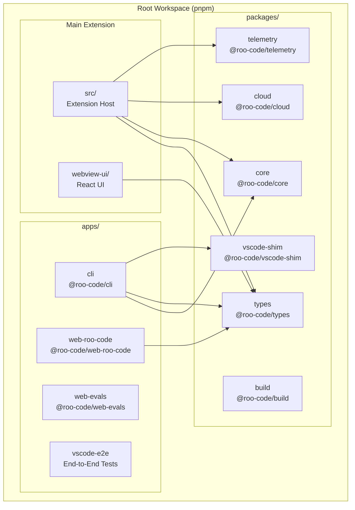
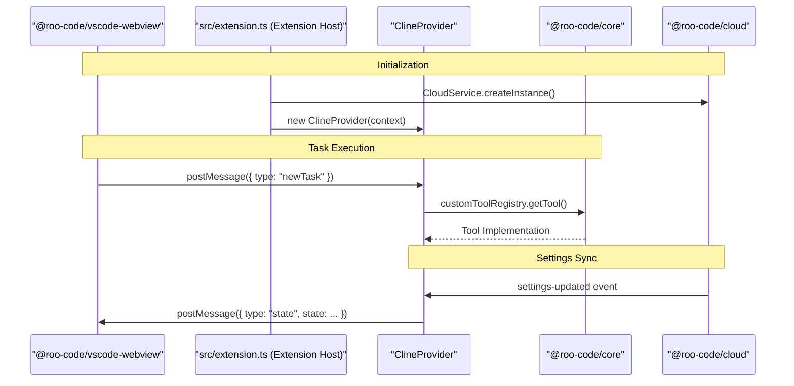

# Monorepo Structure and Packages

Relevant source files

The following files were used as context for generating this wiki page:

- [.changeset/README.md](.changeset/README.md)
- [.changeset/changelog-config.js](.changeset/changelog-config.js)
- [.changeset/config.json](.changeset/config.json)
- [.github/actions/setup-node-pnpm/action.yml](.github/actions/setup-node-pnpm/action.yml)
- [.github/actions/slack-notify/action.yml](.github/actions/slack-notify/action.yml)
- [.github/workflows/changeset-release.yml](.github/workflows/changeset-release.yml)
- [.github/workflows/code-qa.yml](.github/workflows/code-qa.yml)
- [.github/workflows/marketplace-publish.yml](.github/workflows/marketplace-publish.yml)
- [.github/workflows/nightly-publish.yml](.github/workflows/nightly-publish.yml)
- [.github/workflows/update-contributors.yml](.github/workflows/update-contributors.yml)
- [.nvmrc](.nvmrc)
- [.tool-versions](.tool-versions)
- [CHANGELOG.md](CHANGELOG.md)
- [apps/vscode-e2e/src/runTest.ts](apps/vscode-e2e/src/runTest.ts)
- [apps/vscode-nightly/esbuild.mjs](apps/vscode-nightly/esbuild.mjs)
- [apps/vscode-nightly/package.nightly.json](apps/vscode-nightly/package.nightly.json)
- [apps/vscode-nightly/turbo.json](apps/vscode-nightly/turbo.json)
- [apps/web-evals/next.config.ts](apps/web-evals/next.config.ts)
- [apps/web-evals/package.json](apps/web-evals/package.json)
- [apps/web-evals/turbo.json](apps/web-evals/turbo.json)
- [apps/web-roo-code/package.json](apps/web-roo-code/package.json)
- [apps/web-roo-code/src/components/ui/navigation-menu.tsx](apps/web-roo-code/src/components/ui/navigation-menu.tsx)
- [apps/web-roo-code/turbo.json](apps/web-roo-code/turbo.json)
- [knip.json](knip.json)
- [package.json](package.json)
- [packages/build/tsconfig.json](packages/build/tsconfig.json)
- [packages/types/npm/README.md](packages/types/npm/README.md)
- [packages/types/package.json](packages/types/package.json)
- [packages/types/scripts/generate-roomodes-schema.ts](packages/types/scripts/generate-roomodes-schema.ts)
- [packages/types/src/__tests__/index.test.ts](packages/types/src/__tests__/index.test.ts)
- [packages/types/src/__tests__/roomodes-schema-sync.spec.ts](packages/types/src/__tests__/roomodes-schema-sync.spec.ts)
- [packages/types/src/__tests__/roomodes-schema.spec.ts](packages/types/src/__tests__/roomodes-schema.spec.ts)
- [packages/types/src/roomodes-schema.ts](packages/types/src/roomodes-schema.ts)
- [packages/types/src/type-fu.ts](packages/types/src/type-fu.ts)
- [packages/types/tsup.config.ts](packages/types/tsup.config.ts)
- [pnpm-lock.yaml](pnpm-lock.yaml)
- [schemas/roomodes.json](schemas/roomodes.json)
- [scripts/find-missing-translations.js](scripts/find-missing-translations.js)
- [src/esbuild.mjs](src/esbuild.mjs)
- [src/extension.ts](src/extension.ts)
- [src/package.json](src/package.json)
- [webview-ui/package.json](webview-ui/package.json)
- [webview-ui/src/components/common/MermaidBlock.tsx](webview-ui/src/components/common/MermaidBlock.tsx)
- [webview-ui/src/index.tsx](webview-ui/src/index.tsx)
- [webview-ui/tsconfig.json](webview-ui/tsconfig.json)
- [webview-ui/vite.config.ts](webview-ui/vite.config.ts)

## Purpose and Scope

This document describes the monorepo organization of the Roo Code codebase, including the structure of packages, applications, and the build system. It covers workspace organization, package responsibilities, and data flow between components.

The Roo Code repository is a pnpm workspace monorepo orchestrated by Turborepo [package.json:3, 49](). It contains the primary VS Code extension, a React-based webview UI, several shared logic packages, and standalone applications including a CLI and evaluation tools.

---

## Workspace Organization

The repository is organized into several functional areas defined in the root workspace [pnpm-lock.yaml:19-199]():

- **`apps/`**: Standalone applications including CLI, web-based evaluation dashboards, and marketing sites.
- **`packages/`**: Shared libraries and configuration packages consumed by applications and the main extension.
- **`src/`**: The main VS Code extension source code (Extension Host logic).
- **`webview-ui/`**: The React-based user interface rendered within VS Code.

### Workspace Structure Diagram

**Sources:** [pnpm-lock.yaml:19-199](), [apps/cli/package.json:89-97](), [webview-ui/package.json:33](), [src/extension.ts:20-23]()

---

## Main Extension Packages

### Extension Host (`src/`)

The core of the VS Code extension. It manages the lifecycle of the AI agent, handles file system operations, and communicates with the VS Code API.

- **Entry Point**: The `activate` function in `src/extension.ts` initializes all core services including `MdmService`, `CloudService`, and `McpServerManager` [src/extension.ts:120-159]().
- **Orchestration**: Uses `ClineProvider` as the central coordinator for the webview and task execution [src/extension.ts:32, 188]().
- **Integration**: Registers VS Code commands like `roo-cline.plusButtonClicked` and `roo-cline.settingsButtonClicked` [src/package.json:72-102]().

**Sources:** [src/extension.ts:1-200](), [src/package.json:48-172]()

### Webview UI (`webview-ui/`)

A React 18 application built with Vite that provides the user interface [webview-ui/package.json:58, 107]().

- **Build Pipeline**: Configured to produce a single CSS bundle and a specialized `mermaid-bundle` for diagram rendering [webview-ui/vite.config.ts:114, 126-131]().
- **Styling**: Uses Tailwind CSS with custom VS Code theme integration [webview-ui/package.json:79](), [webview-ui/vite.config.ts:7]().
- **Components**: Includes `MermaidBlock` for rendering AI-generated diagrams [webview-ui/vite.config.ts:152-160]().

**Sources:** [webview-ui/package.json:1-110](), [webview-ui/vite.config.ts:1-198]()

---

## Shared Packages

### `@roo-code/types`

The foundational package containing TypeScript definitions used across the entire monorepo [pnpm-lock.yaml:92]().

- **Schemas**: Defines the JSON schema for `.roomodes` configuration files [CHANGELOG.md:7]().
- **Cloud/Auth**: Provides types for `CloudUserInfo` and `AuthState` [src/extension.ts:20]().
- **Distribution**: Published independently to NPM [package.json:28]().

**Sources:** [package.json:28](), [src/extension.ts:20](), [CHANGELOG.md:7]()

### Logic and Infrastructure Packages

- **`@roo-code/core`**: Contains shared business logic, including the `customToolRegistry` [src/extension.ts:23]().
- **`@roo-code/cloud`**: Implements the `CloudService` for authentication and settings sync [src/extension.ts:21, 63]().
- **`@roo-code/telemetry`**: Provides `TelemetryService` and `PostHogTelemetryClient` for usage tracking [src/extension.ts:22, 138-141]().
- **`@roo-code/vscode-shim`**: A compatibility layer used by the CLI to emulate VS Code APIs [pnpm-lock.yaml:95]().
- **`@roo-code/build`**: Shared build utilities and configurations [pnpm-lock.yaml:195]().

---

## Applications

### CLI (`apps/cli`)

A standalone terminal interface that shares core logic with the extension [CHANGELOG.md:39]().

- **Functionality**: Supports session resumption, task history, and stdin-stream modes [CHANGELOG.md:43, 48]().
- **Architecture**: Uses `vscode-shim` to run `@roo-code/core` logic in a headless environment [pnpm-lock.yaml:89-97]().

**Sources:** [CHANGELOG.md:39-65](), [pnpm-lock.yaml:84-131]()

### Web Evaluations (`apps/web-evals`)

A dashboard for running and analyzing AI performance evaluations [package.json:27]().

- **Infrastructure**: Utilizes Docker Compose to run PostgreSQL and Redis services for evaluation tracking [package.json:27]().

**Sources:** [package.json:27](), [pnpm-lock.yaml:199-226]()

---

## System Relationships and Data Flow

The following diagram illustrates how components across different packages interact during a typical user interaction.

**Sources:** [src/extension.ts:150-170](), [src/extension.ts:188](), [src/extension.ts:23, 132]()

---

## Build and Release Infrastructure

Roo Code uses a multi-stage build process to package the extension and CLI.

- **Task Orchestration**: `turbo` is used to run `build`, `bundle`, and `vsix` commands across the workspace [package.json:16-19]().
- **VSIX Packaging**: The `pnpm vsix` command bundles the extension host logic and the React webview into a single `.vsix` file [package.json:19](), [.github/workflows/marketplace-publish.yml:37]().
- **Versioning**: Managed via `changesets`, which automates version bumps and changelog generation [package.json:25, 31](), [.github/workflows/changeset-release.yml:47-51]().
- **Quality Assurance**: Automated workflows run `knip` for dead code detection, `lint`, `check-types`, and `unit-test` on every PR [.github/workflows/code-qa.yml:22-60]().

**Sources:** [package.json:1-51](), [.github/workflows/marketplace-publish.yml:34-53](), [.github/workflows/code-qa.yml:1-61]()