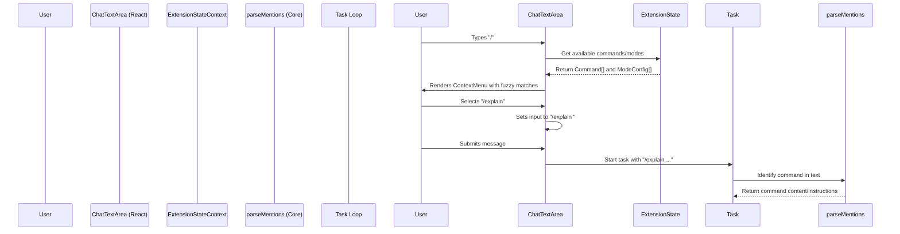
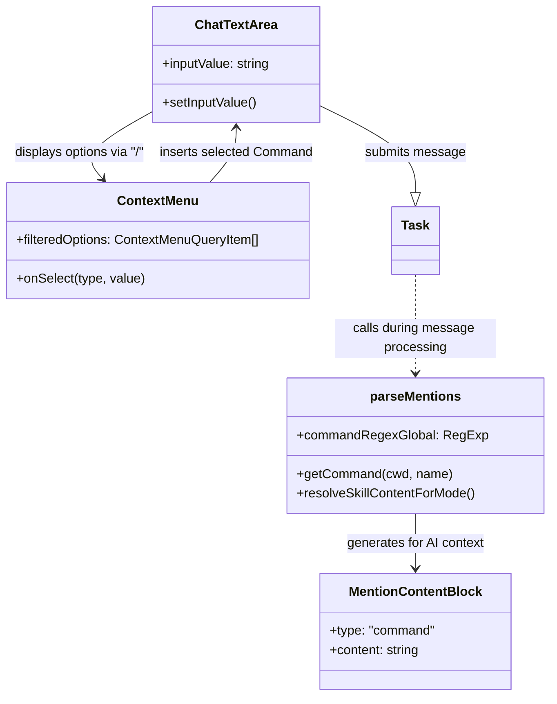

# Slash Commands System

Relevant source files

The following files were used as context for generating this wiki page:

- [src/__tests__/command-mentions.spec.ts](src/__tests__/command-mentions.spec.ts)
- [src/core/mentions/__tests__/processUserContentMentions.spec.ts](src/core/mentions/__tests__/processUserContentMentions.spec.ts)
- [src/core/mentions/index.ts](src/core/mentions/index.ts)
- [src/core/mentions/processUserContentMentions.ts](src/core/mentions/processUserContentMentions.ts)
- [src/core/task/Task.ts](src/core/task/Task.ts)
- [src/core/task/__tests__/Task.spec.ts](src/core/task/__tests__/Task.spec.ts)
- [src/core/tools/RunSlashCommandTool.ts](src/core/tools/RunSlashCommandTool.ts)
- [src/core/tools/SkillTool.ts](src/core/tools/SkillTool.ts)
- [src/core/tools/__tests__/runSlashCommandTool.spec.ts](src/core/tools/__tests__/runSlashCommandTool.spec.ts)
- [src/services/skills/__tests__/skillInvocation.spec.ts](src/services/skills/__tests__/skillInvocation.spec.ts)
- [src/shared/__tests__/context-mentions.spec.ts](src/shared/__tests__/context-mentions.spec.ts)
- [src/shared/context-mentions.ts](src/shared/context-mentions.ts)
- [webview-ui/src/__tests__/command-autocomplete.spec.ts](webview-ui/src/__tests__/command-autocomplete.spec.ts)
- [webview-ui/src/components/chat/ChatTextArea.tsx](webview-ui/src/components/chat/ChatTextArea.tsx)
- [webview-ui/src/components/chat/ContextMenu.tsx](webview-ui/src/components/chat/ContextMenu.tsx)
- [webview-ui/src/components/chat/__tests__/BatchFilePermission.spec.tsx](webview-ui/src/components/chat/__tests__/BatchFilePermission.spec.tsx)
- [webview-ui/src/components/common/CodeBlock.tsx](webview-ui/src/components/common/CodeBlock.tsx)
- [webview-ui/src/components/common/Thumbnails.tsx](webview-ui/src/components/common/Thumbnails.tsx)
- [webview-ui/src/components/common/__tests__/CodeBlock.spec.tsx](webview-ui/src/components/common/__tests__/CodeBlock.spec.tsx)
- [webview-ui/src/components/history/__tests__/BatchDeleteTaskDialog.spec.tsx](webview-ui/src/components/history/__tests__/BatchDeleteTaskDialog.spec.tsx)
- [webview-ui/src/components/ui/select-dropdown.tsx](webview-ui/src/components/ui/select-dropdown.tsx)
- [webview-ui/src/utils/__tests__/context-mentions.spec.ts](webview-ui/src/utils/__tests__/context-mentions.spec.ts)
- [webview-ui/src/utils/context-mentions.ts](webview-ui/src/utils/context-mentions.ts)

The Slash Commands System provides a quick-access interface for triggering reusable workflows, executing specific project scripts, and switching between AI assistant modes. By typing `/` in the chat input, users can discover and execute custom commands defined in the workspace or globally, as well as transition the assistant into different specialized roles.

---

## System Overview

The system operates as a specialized branch of the chat input's autocomplete infrastructure. While it shares the `ContextMenu` component with the `@`-mention system, it uses distinct logic for command discovery, fuzzy filtering, and selection handling.

### High-Level Workflow

Sources: [webview-ui/src/components/chat/ChatTextArea.tsx:159-205](), [src/core/mentions/index.ts:99-159](), [webview-ui/src/utils/context-mentions.ts:132-175]()

---

## Core Components

### 1. Command Discovery and Execution
Commands are discovered from the local workspace (`.roo/commands/`) and global storage. When a user submits a message starting with a slash command, the `parseMentions` utility identifies the command and injects its content into the prompt as structured data.

*   **Command Parsing**: `parseMentions` uses `commandRegexGlobal` to identify valid commands and caches their content using `getCommand`.
*   **RunSlashCommandTool**: The tool responsible for the lifecycle of a command execution.
*   **Skill Fallback**: If a slash command does not exist in `.roo/commands/`, the system attempts to resolve it as a "Skill" via `resolveSkillContentForMode` and `SkillTool`.

For technical details on how commands are loaded and executed, see **[Command Discovery and Execution](#10.1)**.

Sources: [src/core/mentions/index.ts:117-151](), [src/shared/context-mentions.ts:68-68](), [src/core/mentions/processUserContentMentions.ts:67-83]()

### 2. Mode Switching
The slash command menu also includes "Modes" (e.g., `/architect`, `/ask`, `/debug`). Selecting a mode triggers a transition in the assistant's behavior, system prompt, and available toolset.

*   **Mode Detection**: `parseMentions` returns a `mode` property if the first slash command in the text matches a defined mode slug.
*   **Mode Transitions**: The `Task` class handles `initializeTaskMode` to ensure the assistant operates with the correct rules and tools for the selected role.

For details on the transition workflow and UI, see **[Mode Switching via Commands](#10.2)**.

Sources: [src/core/mentions/index.ts:72-73](), [src/core/task/Task.ts:180-192](), [webview-ui/src/utils/context-mentions.ts:177-212]()

---

## UI Implementation

### Context Menu Logic
The `getContextMenuOptions` utility filters available commands and modes based on the user's current input string starting with `/`.

| Feature | Implementation |
| :--- | :--- |
| **Trigger** | `query.startsWith("/")` in `getContextMenuOptions` |
| **Fuzzy Matching** | Uses `Fzf` instance with `selector: (item) => item.searchStr` |
| **Section Headers** | Grouped into `ContextMenuOptionType.SectionHeader` for "Commands" and "Modes" |

### Chat Input Integration
The `ChatTextArea` manages the cursor position and text insertion when a command is selected from the menu. It handles escaping spaces in paths and ensuring a space follows the inserted command to prepare for arguments.

Sources: [webview-ui/src/utils/context-mentions.ts:134-215](), [webview-ui/src/components/chat/ChatTextArea.tsx:159-188](), [webview-ui/src/components/chat/ContextMenu.tsx:89-140]()

---

## Data Architecture

The following diagram bridges the user-facing slash commands to the internal code entities that manage them.

Sources: [webview-ui/src/utils/context-mentions.ts:99-122](), [src/core/mentions/index.ts:51-64](), [src/core/mentions/processUserContentMentions.ts:36-56]()

---

## Configuration and Management

Users can define and manage their slash commands through the filesystem and settings.
*   **Workspace Commands**: Markdown files in `.roo/commands/*.md`. The filename (sans extension) becomes the slash command name.
*   **Command Content**: The markdown content is provided to the AI as instructions when the command is used.
*   **Argument Hints**: Commands can define `argumentHint` in their metadata to guide users on what parameters to provide after the slash command.

Sources: [src/core/mentions/index.ts:153-159](), [webview-ui/src/utils/context-mentions.ts:113-122](), [src/__tests__/command-mentions.spec.ts:28-45]()

---

## Related Pages
*   **[Command Discovery and Execution](#10.1)**: Deep dive into `RunSlashCommandTool`, `.roo/commands` discovery, and skill fallbacks.
*   **[Mode Switching via Commands](#10.2)**: Detailed workflow for assistant role transitions and system prompt updates.
*   **[Context Mentions System](#7.3)**: Details on the `@`-mention system which shares the autocomplete infrastructure.
*   **[ChatTextArea Input System](#8.4)**: Technical implementation of the React text area and its autocomplete triggers.