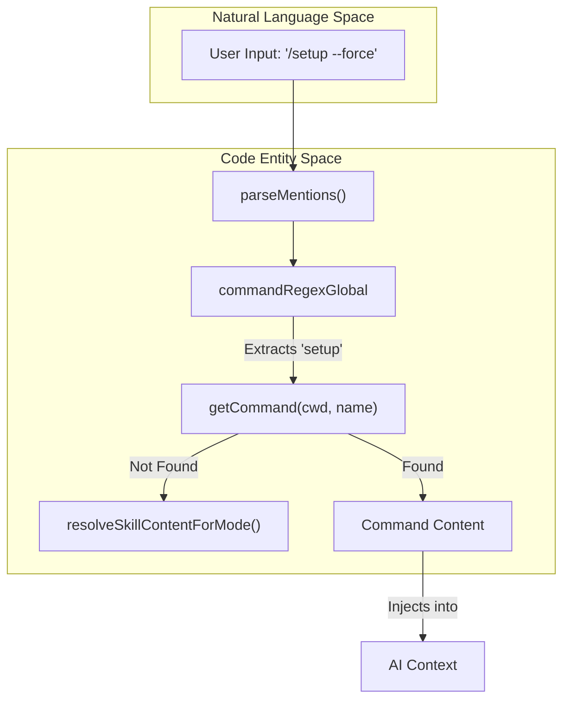
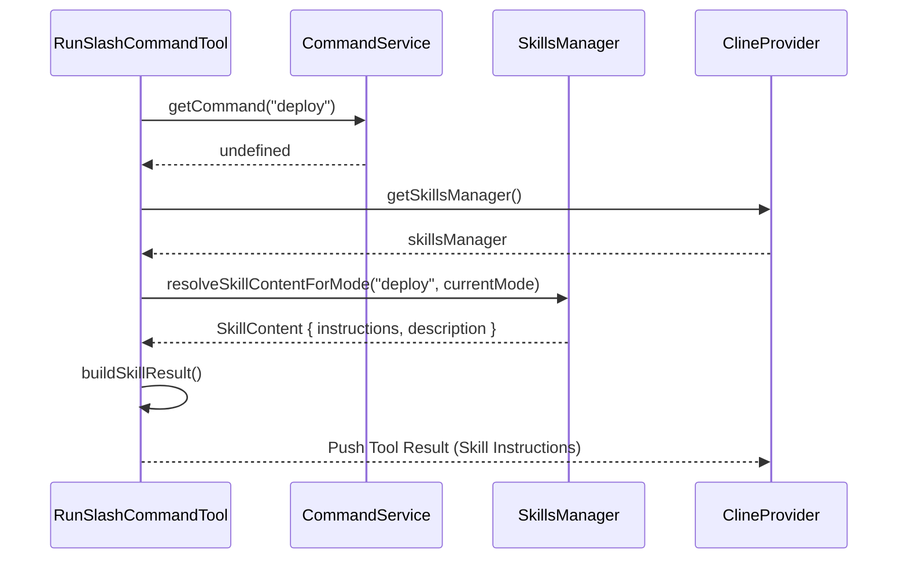

# Command Discovery and Execution

<details>
<summary>Relevant source files</summary>

The following files were used as context for generating this wiki page:

- [.roo/rules-docs-extractor/1_extraction_workflow.xml](.roo/rules-docs-extractor/1_extraction_workflow.xml)
- [.roo/rules-docs-extractor/2_verification_workflow.xml](.roo/rules-docs-extractor/2_verification_workflow.xml)
- [.roo/rules-docs-extractor/3_output_format.xml](.roo/rules-docs-extractor/3_output_format.xml)
- [.roo/rules-issue-writer/1_workflow.xml](.roo/rules-issue-writer/1_workflow.xml)
- [.roo/rules-issue-writer/3_best_practices.xml](.roo/rules-issue-writer/3_best_practices.xml)
- [.roo/rules-issue-writer/4_common_mistakes_to_avoid.xml](.roo/rules-issue-writer/4_common_mistakes_to_avoid.xml)
- [.roomodes](.roomodes)
- [src/__tests__/command-mentions.spec.ts](src/__tests__/command-mentions.spec.ts)
- [src/core/mentions/__tests__/processUserContentMentions.spec.ts](src/core/mentions/__tests__/processUserContentMentions.spec.ts)
- [src/core/mentions/index.ts](src/core/mentions/index.ts)
- [src/core/mentions/processUserContentMentions.ts](src/core/mentions/processUserContentMentions.ts)
- [src/core/task/Task.ts](src/core/task/Task.ts)
- [src/core/task/__tests__/Task.spec.ts](src/core/task/__tests__/Task.spec.ts)
- [src/core/tools/RunSlashCommandTool.ts](src/core/tools/RunSlashCommandTool.ts)
- [src/core/tools/SkillTool.ts](src/core/tools/SkillTool.ts)
- [src/core/tools/__tests__/runSlashCommandTool.spec.ts](src/core/tools/__tests__/runSlashCommandTool.spec.ts)
- [src/services/skills/__tests__/skillInvocation.spec.ts](src/services/skills/__tests__/skillInvocation.spec.ts)

</details>


This page describes the technical implementation of the slash command system in Roo Code. It covers how commands are discovered from the filesystem and global state, the execution logic within the `RunSlashCommandTool`, and the fallback mechanism to the Skills system.

## Overview

Slash commands provide a shortcut mechanism for users to trigger specific prompts or workflows using a `/` prefix. The system is designed to be extensible, allowing for built-in, global (user-level), and workspace-specific commands.

### Command Hierarchy and Precedence

Commands are resolved in a specific order of precedence:
1.  **Workspace Commands**: Located in the `.roo/commands/` directory of the current project.
2.  **Global Commands**: Stored in the VS Code `globalState`.
3.  **Built-in Commands**: Hardcoded commands provided by the extension (e.g., `/-help`).
4.  **Skills Fallback**: If no command matches, the system attempts to find a matching skill in `.roo/skills/`.

**Sources:** [src/core/tools/RunSlashCommandTool.ts:54-62](), [src/core/mentions/index.ts:120-151]()

---

## Command Discovery and Loading

### Workspace Command Discovery
Workspace commands are stored as individual Markdown files within the `.roo/commands/` folder. The filename (excluding the `.md` extension) serves as the command name. These files can contain YAML frontmatter to define metadata such as `description`, `argumentHint`, and `mode`.

**Sources:** [src/core/tools/RunSlashCommandTool.ts:86-93](), [src/__tests__/command-mentions.spec.ts:29-35]()

### Discovery Logic in Mentions
The `parseMentions` function orchestrates the discovery of commands when a user types a message. It uses `getCommand` to check for the existence of a command in the current workspace.

**Command Discovery Flow**



**Sources:** [src/core/mentions/index.ts:99-151](), [src/shared/context-mentions.ts:68]()

---

## Execution via RunSlashCommandTool

The `RunSlashCommandTool` is the primary execution engine for slash commands when invoked by the AI (if the experimental feature is enabled).

### Implementation Details
The tool is defined in `RunSlashCommandTool.ts` and inherits from `BaseTool`. It performs the following steps:
1.  **Experiment Check**: Verifies if `EXPERIMENT_IDS.RUN_SLASH_COMMAND` is enabled in the provider state [[src/core/tools/RunSlashCommandTool.ts:26-41]]().
2.  **Resolution**: Calls `getCommand` to fetch the command definition [[src/core/tools/RunSlashCommandTool.ts:55]]().
3.  **Skill Fallback**: If the command is not found, it attempts to resolve it as a skill using `resolveSkillContentForMode` [[src/core/tools/RunSlashCommandTool.ts:57-60]]().
4.  **Approval**: Requests user approval via `askApproval("tool", ...)` before "executing" (reading) the command content [[src/core/tools/RunSlashCommandTool.ts:95]]().
5.  **Mode Switching**: If the command metadata specifies a `mode`, the tool triggers `provider.handleModeSwitch(command.mode)` [[src/core/tools/RunSlashCommandTool.ts:102-108]]().
6.  **Result Construction**: Returns the command's Markdown content as the tool result, which the AI then processes as instructions [[src/core/tools/RunSlashCommandTool.ts:111-133]]().

**Sources:** [src/core/tools/RunSlashCommandTool.ts:19-153]()

---

## Skill Fallback Mechanism

A unique feature of Roo Code is the bridge between slash commands and the Skills system. If a user (or the AI) attempts to run a command that doesn't exist as a `.md` file in `.roo/commands/`, the system checks `.roo/skills/`.

### Skill Invocation Logic
The fallback is handled by `resolveSkillContentForMode` in the `skills` service. This function looks for a directory matching the command name inside the skills directory, respecting the current active mode.

**Skill Fallback Sequence**



**Sources:** [src/core/tools/RunSlashCommandTool.ts:57-72](), [src/core/mentions/index.ts:128-135](), [src/services/skills/skillInvocation.ts:20-28]()

### Skill Result Formatting
When a skill is used as a command, the output is formatted using `buildSkillResult`, which combines the skill's name, description, and the contents of its `SKILL.md` file.

**Sources:** [src/services/skills/skillInvocation.ts:68-105]()

---

## Command CRUD Operations

Commands are managed primarily through the filesystem, but the extension provides integration for creating and editing them via the Settings UI. The UI labels and validation rules are localized across multiple languages.

| Operation | Implementation Detail | Source |
| :--- | :--- | :--- |
| **Discovery** | Scans `.roo/commands/*.md` | [src/services/command/commands.ts]() |
| **Creation** | User creates `.md` file in workspace or via UI | [src/core/tools/RunSlashCommandTool.ts:55](), [webview-ui/src/i18n/locales/en/settings.json:85-93]() |
| **Metadata** | Parsed from YAML frontmatter | [src/core/tools/RunSlashCommandTool.ts:86-93]() |
| **Precedence** | Project files override global state | [src/core/mentions/index.ts:138-151]() |
| **Deletion** | Handled via UI with confirmation | [webview-ui/src/i18n/locales/en/settings.json:79-84]() |

### Command Content Structure
A typical command file (`.roo/commands/test.md`):
```markdown
---
description: "Run unit tests"
argumentHint: "[file path]"
mode: "architect"
---
Run the tests for the specified file using npm test.
```

When this command is resolved, the `RunSlashCommandTool` will:
1.  Switch the current mode to `architect` [[src/core/tools/RunSlashCommandTool.ts:102-108]]().
2.  Provide the text "Run the tests..." to the AI [[src/core/tools/RunSlashCommandTool.ts:130-133]]().

**Sources:** [src/core/tools/RunSlashCommandTool.ts:102-133]()

---

## Data Flow: From Input to Execution

1.  **Mention Parsing**: `processUserContentMentions` calls `parseMentions` to identify `/command` patterns in user messages [[src/core/mentions/processUserContentMentions.ts:69-79]]().
2.  **Content Injection**: If a valid command or skill is found, its content is added as a `MentionContentBlock` of type `command` [[src/core/mentions/index.ts:51-64]]().
3.  **UI Feedback**: The user's text is replaced with a reference like `Command 'setup' (see below for command content)` to inform the AI where to look [[src/core/mentions/index.ts:154-160]]().
4.  **Tool Execution**: Alternatively, the AI can proactively call the `run_slash_command` tool to fetch this same information programmatically [[src/core/tools/RunSlashCommandTool.ts:22-137]]().

**Sources:** [src/core/mentions/processUserContentMentions.ts:36-108](), [src/core/mentions/index.ts:99-181](), [src/core/tools/RunSlashCommandTool.ts:22-137]()