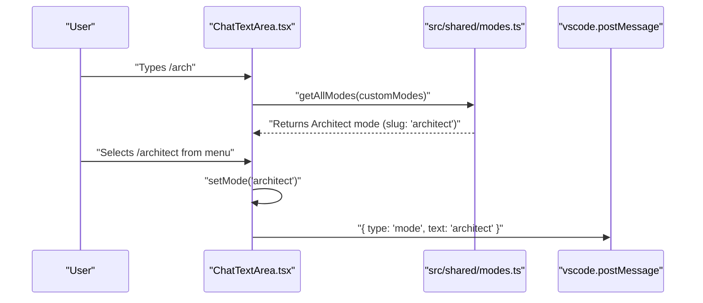
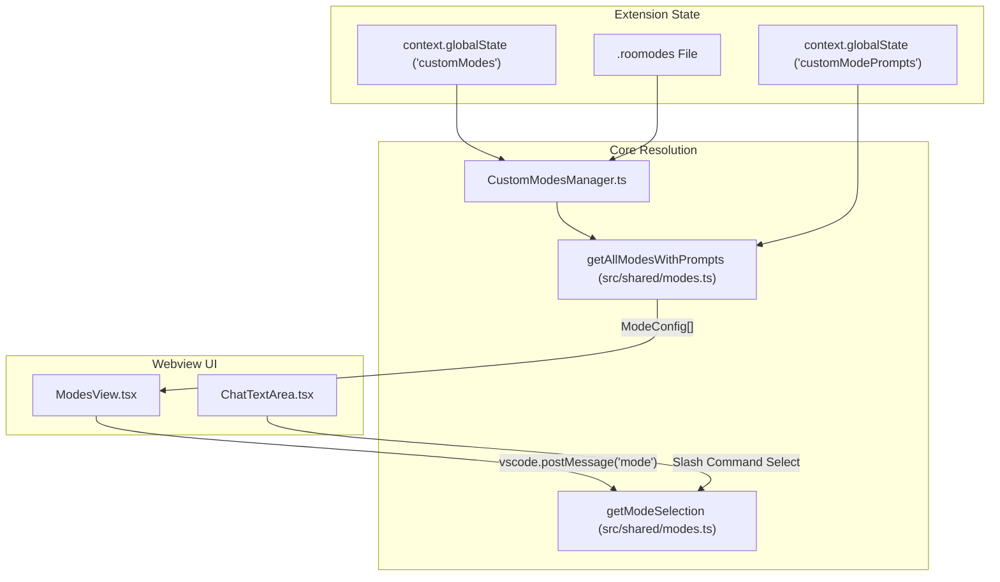

# Mode Switching via Commands

Relevant source files

The following files were used as context for generating this wiki page:

- [AGENTS.md](AGENTS.md)
- [packages/cloud/src/__tests__/CloudSettingsService.parsing.test.ts](packages/cloud/src/__tests__/CloudSettingsService.parsing.test.ts)
- [packages/types/src/tool-params.ts](packages/types/src/tool-params.ts)
- [src/core/assistant-message/__tests__/NativeToolCallParser.spec.ts](src/core/assistant-message/__tests__/NativeToolCallParser.spec.ts)
- [src/core/config/CustomModesManager.ts](src/core/config/CustomModesManager.ts)
- [src/core/config/__tests__/CustomModesManager.exportImportSlugChange.spec.ts](src/core/config/__tests__/CustomModesManager.exportImportSlugChange.spec.ts)
- [src/core/config/__tests__/CustomModesManager.spec.ts](src/core/config/__tests__/CustomModesManager.spec.ts)
- [src/core/prompts/tools/__tests__/filter-tools-for-mode.spec.ts](src/core/prompts/tools/__tests__/filter-tools-for-mode.spec.ts)
- [src/core/prompts/tools/filter-tools-for-mode.ts](src/core/prompts/tools/filter-tools-for-mode.ts)
- [src/core/prompts/tools/native-tools/__tests__/read_file.spec.ts](src/core/prompts/tools/native-tools/__tests__/read_file.spec.ts)
- [src/core/prompts/tools/native-tools/read_file.ts](src/core/prompts/tools/native-tools/read_file.ts)
- [src/core/task/build-tools.ts](src/core/task/build-tools.ts)
- [src/core/tools/__tests__/validateToolUse.spec.ts](src/core/tools/__tests__/validateToolUse.spec.ts)
- [src/core/tools/validateToolUse.ts](src/core/tools/validateToolUse.ts)
- [src/services/marketplace/SimpleInstaller.ts](src/services/marketplace/SimpleInstaller.ts)
- [src/services/marketplace/__tests__/SimpleInstaller.spec.ts](src/services/marketplace/__tests__/SimpleInstaller.spec.ts)
- [src/shared/__tests__/modes.spec.ts](src/shared/__tests__/modes.spec.ts)
- [src/shared/modes.ts](src/shared/modes.ts)
- [src/utils/__tests__/migrateSettings.spec.ts](src/utils/__tests__/migrateSettings.spec.ts)
- [src/utils/globalContext.ts](src/utils/globalContext.ts)
- [src/utils/migrateSettings.ts](src/utils/migrateSettings.ts)
- [webview-ui/src/__tests__/SearchableSelect.spec.tsx](webview-ui/src/__tests__/SearchableSelect.spec.tsx)
- [webview-ui/src/components/modes/ModesView.tsx](webview-ui/src/components/modes/ModesView.tsx)
- [webview-ui/src/components/modes/__tests__/ModesView.spec.tsx](webview-ui/src/components/modes/__tests__/ModesView.spec.tsx)
- [webview-ui/src/components/settings/ContextManagementSettings.tsx](webview-ui/src/components/settings/ContextManagementSettings.tsx)
- [webview-ui/src/components/settings/PromptsSettings.tsx](webview-ui/src/components/settings/PromptsSettings.tsx)
- [webview-ui/src/components/settings/__tests__/ContextManagementSettings.spec.tsx](webview-ui/src/components/settings/__tests__/ContextManagementSettings.spec.tsx)
- [webview-ui/src/components/ui/searchable-select.tsx](webview-ui/src/components/ui/searchable-select.tsx)
- [webview-ui/src/hooks/useEscapeKey.spec.ts](webview-ui/src/hooks/useEscapeKey.spec.ts)
- [webview-ui/src/hooks/useEscapeKey.ts](webview-ui/src/hooks/useEscapeKey.ts)

This page covers how the active mode is changed during a chat session through two distinct mechanisms: the user-facing slash command interface (`/slug` typed into the chat input) and the AI-initiated mode switching workflow. It explains the trigger conditions, UI rendering, selection handling, and the webview message that propagates the change to the extension host.

---

## Two Paths to Mode Switching

Mode changes during a session happen through three primary paths:

| Path | Initiator | Entry point | Message sent |
|------|-----------|-------------|--------------|
| **Slash command** | User types `/slug` in chat input | `handleMentionSelect` in `ChatTextArea.tsx` | `{ type: "mode", text: slug }` |
| **Mode selector** | User picks from `ModeSelector` UI | `handleModeChange` in `ChatTextArea.tsx` | `{ type: "mode", text: slug }` |
| **AI "Wants to switch"** | AI expresses intent to switch | `wantsToSwitch` in `AssistantMessage` | `ask("mode_switch_delayed", ...)` |

Sources: [webview-ui/src/components/chat/ChatTextArea.tsx:172-177](), [webview-ui/src/components/modes/ModesView.tsx:172-177](), [src/core/assistant-message/index.ts:1-3]()

---

## Slash Command Trigger and Context Menu

### Trigger Detection
Typing `/` at the start of the chat textarea (or after a space) triggers the slash command context menu. The system validates the trigger state based on cursor position and preceding characters to determine if the user is attempting to invoke a mode or a specialized command.

### Option Generation
The discovery of mode-switching commands involves several steps:
1. **Modes Discovery**: The system calls `getAllModes(customModes)` to retrieve both built-in `DEFAULT_MODES` and user-defined modes from extension state [src/shared/modes.ts:70-91]().
2. **Metadata Mapping**: Each mode entry is associated with a slug (e.g., `architect`) and a description derived from its `whenToUse` field or the first sentence of its `roleDefinition` [src/shared/modes.ts:145-158]().
3. **Tool Availability**: Each mode is mapped to specific tool groups via `getToolsForMode`, ensuring that switching modes correctly updates the available capabilities [src/shared/modes.ts:28-42]().

### Context Menu Rendering
The `ContextMenu` component renders mode entries prominently. When a user selects a mode like `/architect`, the UI immediately provides feedback by updating the visual state before persisting the change to the backend.

**Diagram: Slash command mode selection flow**

Sources: [src/shared/modes.ts:70-91](), [webview-ui/src/components/modes/ModesView.tsx:180-194](), [src/shared/modes.ts:28-42]()

---

## Selection Handling

When a mode is selected via the context menu or the mode selector dropdown, the following execution flow occurs:
1. **Visual State Update**: `setVisualMode(slug)` updates the UI immediately to prevent flickering during the round-trip to the extension host [webview-ui/src/components/modes/ModesView.tsx:180-186]().
2. **Extension Notification**: `vscode.postMessage({ type: "mode", text: slug })` sends the requested slug to the backend [webview-ui/src/components/modes/ModesView.tsx:172-177]().
3. **State Sync**: The component uses a `useEffect` hook to sync the local `visualMode` with the backend `mode` state once the extension confirms the change [webview-ui/src/components/modes/ModesView.tsx:215-217]().

---

## AI-Initiated Mode Switching

The system allows the AI to suggest a mode switch if it determines another mode is better suited for the current task. This is handled through the `AssistantMessage` processing logic and the `buildNativeToolsArray` which dynamically filters available tools based on the current mode [src/core/task/build-tools.ts:117-130]().

### Detection and Prompting
The system monitors the AI's response for intent to switch. If the AI suggests a switch, a specialized "ask" message is generated. This presents a UI prompt to the user to approve the transition, ensuring the AI does not switch contexts without explicit permission.

### Mode Transition Workflow
1. **Intent**: AI expresses a desire to switch modes based on the task evolution.
2. **User Approval**: The Webview displays a "Switch to [Mode]?" request.
3. **Execution**: Upon approval, the `ClineProvider` updates the active mode slug.
4. **Context Preservation**: The conversation history is preserved, but the system prompt is regenerated. The new prompt includes the updated `roleDefinition`, `baseInstructions`, and `whenToUse` sections specific to the target mode [src/shared/modes.ts:111-132]().

Sources: [src/shared/modes.ts:111-132](), [src/core/task/build-tools.ts:65-82](), [src/core/prompts/tools/filter-tools-for-mode.ts:152-163]()

---

## Mode Configuration Management

Mode switching relies on the resolution of mode definitions which can be built-in or customized by the user via the `CustomModesManager`.

### Resolution Logic
The function `getModeSelection` determines which configuration to apply [src/shared/modes.ts:111-132]():
1. **Custom Override**: If a custom mode with the matching slug exists (loaded from `.roomodes` or global settings), it takes full precedence [src/core/config/CustomModesManager.ts:183-215]().
2. **Built-in Base**: If no custom mode is found, it falls back to the built-in `modes` array.
3. **Prompt Merging**: It merges the base mode configuration with any `promptComponent` overrides stored in the extension state [src/shared/modes.ts:124-132]().

### Data Flow Diagram

Sources: [src/shared/modes.ts:111-132](), [src/shared/modes.ts:161-173](), [webview-ui/src/components/modes/ModesView.tsx:126-149](), [src/core/config/CustomModesManager.ts:47-63]()

---

## Technical Summary of Mode State

| Component | Responsibility |
|-----------|----------------|
| `getAllModesWithPrompts` | Merges built-in modes with custom overrides and prompt customizations from `globalState` [src/shared/modes.ts:161-173](). |
| `ModesView` | Manages the visual switching of modes and handles the `updatePrompt` message for customizing mode behavior [webview-ui/src/components/modes/ModesView.tsx:126-149](). |
| `getModeSelection` | Final arbiter of which `roleDefinition` and `baseInstructions` are sent to the LLM during prompt generation [src/shared/modes.ts:111-132](). |
| `FileRestrictionError` | Enforces mode-specific file access rules (e.g., regex patterns) after a switch has occurred [src/shared/modes.ts:135-143](). |
| `CustomModesManager` | Handles persistence of custom modes to YAML and watches for changes in `.roomodes` [src/core/config/CustomModesManager.ts:60-63](). |

Sources: [src/shared/modes.ts:135-143](), [src/shared/modes.ts:161-173](), [webview-ui/src/components/modes/ModesView.tsx:66-100](), [src/core/config/CustomModesManager.ts:47-55]()