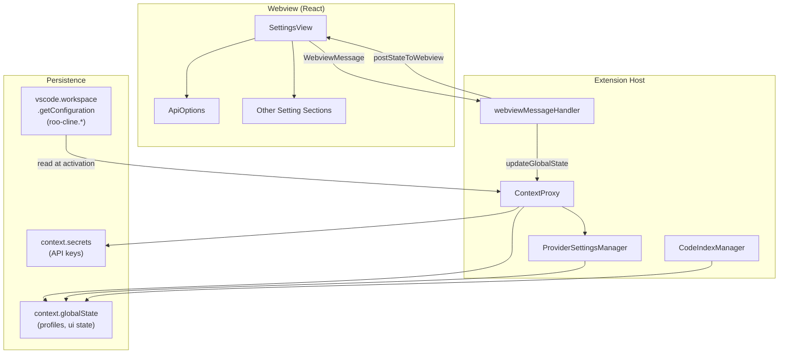
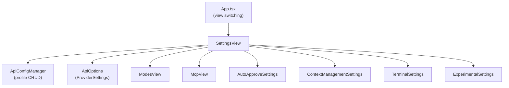
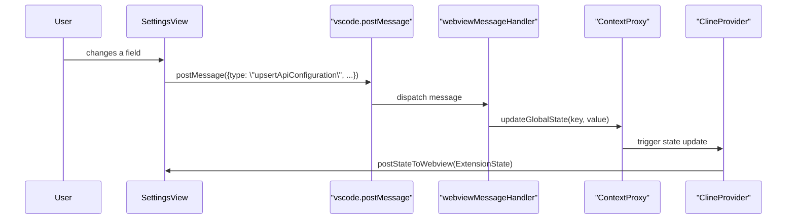

# Settings and Configuration

Relevant source files

The following files were used as context for generating this wiki page:

- [packages/types/src/vscode-extension-host.ts](packages/types/src/vscode-extension-host.ts)
- [src/api/providers/fetchers/modelCache.ts](src/api/providers/fetchers/modelCache.ts)
- [src/core/webview/ClineProvider.ts](src/core/webview/ClineProvider.ts)
- [src/core/webview/__tests__/ClineProvider.spec.ts](src/core/webview/__tests__/ClineProvider.spec.ts)
- [src/core/webview/__tests__/webviewMessageHandler.spec.ts](src/core/webview/__tests__/webviewMessageHandler.spec.ts)
- [src/core/webview/webviewMessageHandler.ts](src/core/webview/webviewMessageHandler.ts)
- [src/shared/WebviewMessage.ts](src/shared/WebviewMessage.ts)
- [webview-ui/src/components/chat/ChatRow.tsx](webview-ui/src/components/chat/ChatRow.tsx)
- [webview-ui/src/components/chat/ChatView.tsx](webview-ui/src/components/chat/ChatView.tsx)
- [webview-ui/src/components/settings/SettingsView.tsx](webview-ui/src/components/settings/SettingsView.tsx)
- [webview-ui/src/context/ExtensionStateContext.tsx](webview-ui/src/context/ExtensionStateContext.tsx)
- [webview-ui/src/i18n/locales/ca/settings.json](webview-ui/src/i18n/locales/ca/settings.json)
- [webview-ui/src/i18n/locales/de/settings.json](webview-ui/src/i18n/locales/de/settings.json)
- [webview-ui/src/i18n/locales/en/settings.json](webview-ui/src/i18n/locales/en/settings.json)
- [webview-ui/src/i18n/locales/es/settings.json](webview-ui/src/i18n/locales/es/settings.json)
- [webview-ui/src/i18n/locales/fr/settings.json](webview-ui/src/i18n/locales/fr/settings.json)
- [webview-ui/src/i18n/locales/hi/settings.json](webview-ui/src/i18n/locales/hi/settings.json)
- [webview-ui/src/i18n/locales/it/settings.json](webview-ui/src/i18n/locales/it/settings.json)
- [webview-ui/src/i18n/locales/ja/settings.json](webview-ui/src/i18n/locales/ja/settings.json)
- [webview-ui/src/i18n/locales/ko/settings.json](webview-ui/src/i18n/locales/ko/settings.json)
- [webview-ui/src/i18n/locales/pl/settings.json](webview-ui/src/i18n/locales/pl/settings.json)
- [webview-ui/src/i18n/locales/pt-BR/settings.json](webview-ui/src/i18n/locales/pt-BR/settings.json)
- [webview-ui/src/i18n/locales/tr/settings.json](webview-ui/src/i18n/locales/tr/settings.json)
- [webview-ui/src/i18n/locales/vi/settings.json](webview-ui/src/i18n/locales/vi/settings.json)
- [webview-ui/src/i18n/locales/zh-CN/settings.json](webview-ui/src/i18n/locales/zh-CN/settings.json)

This page is the parent overview for all user-facing settings, configuration profiles, and the settings UI in Roo Code. It describes the two storage layers, the VS Code configuration property schema, the high-level UI architecture, and how settings changes flow between the webview and the extension host. For details on each subsystem, see the child pages: Settings UI Architecture ([Settings UI Architecture](#11.1)), Provider Configuration Profiles ([Provider Configuration Profiles](#11.2)), Auto-Approve Configuration ([Auto-Approve Configuration](#11.3)), Context Management Settings ([Context Management Settings](#11.4)), Codebase Indexing Settings ([Codebase Indexing Settings](#11.5)), Terminal/Checkpoint/Notification Settings ([Terminal, Checkpoint, and Notification Settings](#11.6)), and Experimental Features ([Experimental Features](#11.7)).

For state management internals and the `ContextProxy` abstraction, see [State Management and Storage](#2.3).

---

## Settings Architecture Overview

Roo Code uses two distinct storage layers for settings:

| Layer | Mechanism | Typical Contents |
|---|---|---|
| **VS Code configuration** | `vscode.workspace.getConfiguration("roo-cline")` | Workspace-level properties declared in `contributes.configuration` in `package.json`. |
| **Extension global state** | `context.globalState` / `context.secrets` | Provider profiles, API keys, UI preferences, task history options, and experimental flags. |

The webview React UI (the `SettingsView` component) communicates changes to the extension host via typed `postMessage` calls handled by `webviewMessageHandler` [src/core/webview/webviewMessageHandler.ts:92-96](). The extension host persists changes via `ContextProxy` [src/core/webview/ClineProvider.ts:93]() and pushes updated state back to the webview via `postStateToWebview`.

**Settings Storage and Flow Architecture**

Sources: [src/core/webview/webviewMessageHandler.ts:92-101](), [src/core/webview/ClineProvider.ts:93-94](), [webview-ui/src/components/settings/SettingsView.tsx:124-147]()

---

## VS Code Configuration Properties

These properties are declared in the extension's `package.json` and appear in the VS Code Settings UI. They are typically workspace-scoped.

| Property | Type | Default | Description |
|---|---|---|---|
| `roo-cline.allowedCommands` | `string[]` | `["git log", ...]` | Commands auto-executable when auto-approve is enabled. |
| `roo-cline.terminal.integrated.inheritEnv` | `boolean` | `true` | Inherit environment variables in the integrated terminal. |
| `roo-cline.debug` | `boolean` | `false` | Show debug buttons for viewing raw conversation JSON. |

The `debug` mode specifically enables buttons in the task header to view `apiConversationHistory` and UI messages as prettified JSON in temporary files [webview-ui/src/i18n/locales/en/settings.json:65-68]().

---

## Extension Global State Schema

Settings not declared as VS Code configuration properties are stored in `context.globalState` (or `context.secrets` for sensitive values). Key categories include:

- **Provider profiles**: An array of `ProviderSettings` objects managed by `ProviderSettingsManager` [src/core/webview/ClineProvider.ts:94]().
- **API keys**: Stored in `context.secrets`.
- **UI preferences**: `language`, `soundEnabled`, `enterBehavior`, and `reasoningBlockCollapsed` [webview-ui/src/components/settings/SettingsView.tsx:149-206]().
- **Auto-approve settings**: `alwaysAllowReadOnly`, `alwaysAllowWrite`, `alwaysAllowExecute`, and `alwaysAllowMcp` [webview-ui/src/components/settings/SettingsView.tsx:150-163]().
- **Context management settings**: `maxOpenTabsContext`, `maxWorkspaceFiles`, and `autoCondenseContext` [webview-ui/src/components/settings/SettingsView.tsx:164-170]().

Sources: [webview-ui/src/components/settings/SettingsView.tsx:149-206](), [webview-ui/src/context/ExtensionStateContext.tsx:34-147]()

---

## Settings UI Component Map

The settings UI is a React component tree. `SettingsView` is the root component, organized into sections via a sidebar tab list [webview-ui/src/components/settings/SettingsView.tsx:88-92]().

**Settings Component Hierarchy**

Sources: [webview-ui/src/components/settings/SettingsView.tsx:66-83](), [webview-ui/src/components/settings/SettingsView.tsx:98-115]()

---

## Provider Configuration and Validation

`ApiOptions` is the central component for all provider-related settings. It manages a `ProviderSettings` object and dispatches changes through `setCachedStateField` [webview-ui/src/components/settings/SettingsView.tsx:230-232]().

**Key behaviors in Settings View:**
- **Unsaved Changes Detection**: The `SettingsView` tracks `isChangeDetected` to prevent accidental loss of configuration [webview-ui/src/components/settings/SettingsView.tsx:131]().
- **State Synchronization**: Uses `mergeExtensionState` to handle incoming state updates from the extension host while protecting `clineMessages` from stale pushes using `clineMessagesSeq` [webview-ui/src/context/ExtensionStateContext.tsx:151-170]().
- **Search Functionality**: Integrated search via `SettingsSearch` and `useSettingsSearch` allows users to find specific configuration keys across all sections [webview-ui/src/components/settings/SettingsView.tsx:84-85]().

Sources: [webview-ui/src/components/settings/SettingsView.tsx:124-232](), [webview-ui/src/context/ExtensionStateContext.tsx:166-170]()

---

## Settings Flow: UI to Extension Host

When a user changes a setting in the webview, the change propagates through a defined message path.

**Settings Change Propagation**

Sources: [src/core/webview/webviewMessageHandler.ts:92-101](), [webview-ui/src/components/settings/SettingsView.tsx:230-235]()

---

## Settings Categories and Child Pages

The following table summarizes the major settings categories and their detailed documentation:

| Category | Key Types / Files | Child Page |
|---|---|---|
| **Settings UI Architecture** | `SettingsView`, `SettingsSearch`, `TabList` | [Settings UI Architecture](#11.1) |
| **Provider Configuration Profiles** | `ApiConfigManager`, `ApiOptions`, `ProviderSettings` | [Provider Configuration Profiles](#11.2) |
| **Auto-Approve** | `AutoApproveSettings`, `allowedCommands`, `alwaysAllowWrite` | [Auto-Approve Configuration](#11.3) |
| **Context Management** | `ContextManagementSettings`, `maxOpenTabsContext`, `autoCondenseContext` | [Context Management Settings](#11.4) |
| **Codebase Indexing** | `CodeIndexManager`, `ollamaBaseUrl`, `qdrantUrl` | [Codebase Indexing Settings](#11.5) |
| **Terminal, Checkpoint, Notifications** | `TerminalSettings`, `CheckpointSettings`, `NotificationSettings` | [Terminal, Checkpoint, and Notification Settings](#11.6) |
| **Experimental Features** | `ExperimentalSettings`, `ExperimentId` | [Experimental Features](#11.7) |

Sources: [webview-ui/src/components/settings/SettingsView.tsx:66-85](), [webview-ui/src/i18n/locales/en/settings.json:28-45]()