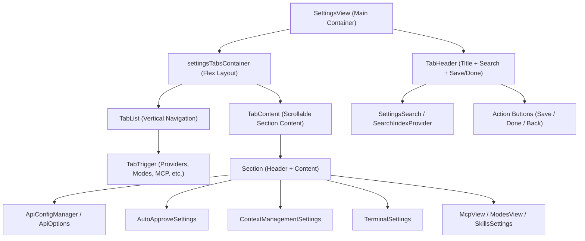
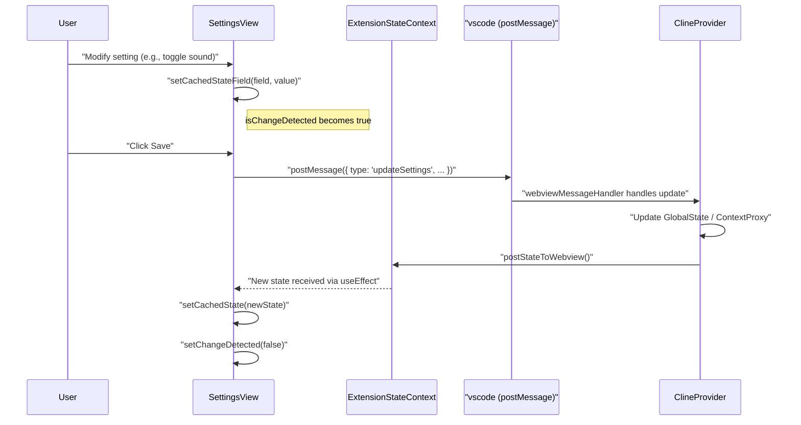
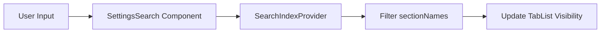

# Settings UI Architecture

Relevant source files

The following files were used as context for generating this wiki page:

- [packages/types/src/vscode-extension-host.ts](packages/types/src/vscode-extension-host.ts)
- [src/api/providers/fetchers/modelCache.ts](src/api/providers/fetchers/modelCache.ts)
- [src/core/webview/ClineProvider.ts](src/core/webview/ClineProvider.ts)
- [src/core/webview/__tests__/ClineProvider.spec.ts](src/core/webview/__tests__/ClineProvider.spec.ts)
- [src/core/webview/__tests__/webviewMessageHandler.spec.ts](src/core/webview/__tests__/webviewMessageHandler.spec.ts)
- [src/core/webview/webviewMessageHandler.ts](src/core/webview/webviewMessageHandler.ts)
- [src/shared/WebviewMessage.ts](src/shared/WebviewMessage.ts)
- [webview-ui/src/components/chat/ChatRow.tsx](webview-ui/src/components/chat/ChatRow.tsx)
- [webview-ui/src/components/chat/ChatView.tsx](webview-ui/src/components/chat/ChatView.tsx)
- [webview-ui/src/components/settings/ApiConfigManager.tsx](webview-ui/src/components/settings/ApiConfigManager.tsx)
- [webview-ui/src/components/settings/SettingsView.tsx](webview-ui/src/components/settings/SettingsView.tsx)
- [webview-ui/src/components/ui/alert-dialog.tsx](webview-ui/src/components/ui/alert-dialog.tsx)
- [webview-ui/src/components/ui/dialog.tsx](webview-ui/src/components/ui/dialog.tsx)
- [webview-ui/src/context/ExtensionStateContext.tsx](webview-ui/src/context/ExtensionStateContext.tsx)

## Purpose and Scope

This document describes the architecture of the Settings UI in Roo Code's webview, covering the `SettingsView` component structure, section organization, search functionality, unsaved changes detection, and validation system. The Settings UI provides a centralized interface for configuring all aspects of the extension, from AI providers to terminal behavior and experimental features.

---

## Component Architecture Overview

The Settings UI is centered around the `SettingsView` component, which is rendered as a full-screen React component when the user navigates away from the chat interface. It utilizes a tabbed navigation structure to manage the extensive configuration options.

### SettingsView Component Hierarchy

Sources: [webview-ui/src/components/settings/SettingsView.tsx:124-206](), [webview-ui/src/components/settings/SettingsView.tsx:63-83]()

---

## State Management and Persistence

The settings UI maintains a dual-state approach to facilitate unsaved changes detection and discard capabilities.

1.  **Remote State**: Managed by `ExtensionStateContext`, representing the current state persisted in the VS Code extension host [webview-ui/src/context/ExtensionStateContext.tsx:34-147]().
2.  **Local (Cached) State**: Managed within `SettingsView` via the `cachedState` hook. This state holds temporary modifications until the user explicitly clicks "Save" [webview-ui/src/components/settings/SettingsView.tsx:147-206]().

### Settings State Flow

Sources: [webview-ui/src/components/settings/SettingsView.tsx:230-265](), [src/core/webview/webviewMessageHandler.ts:92-101](), [webview-ui/src/context/ExtensionStateContext.tsx:151-175]()

---

## Section Organization System

Settings are partitioned into distinct sections defined by the `sectionNames` constant [webview-ui/src/components/settings/SettingsView.tsx:98-117]().

| Section Name | Component / Logic | Key Responsibilities |
| :--- | :--- | :--- |
| `providers` | `ApiConfigManager` | API profiles, keys, and model selection [webview-ui/src/components/settings/SettingsView.tsx:66-67]() |
| `autoApprove` | `AutoApproveSettings` | Permissions for file ops, commands, and MCP [webview-ui/src/components/settings/SettingsView.tsx:68]() |
| `modes` | `ModesView` | Custom agent mode definitions and prompts [webview-ui/src/components/settings/SettingsView.tsx:81]() |
| `mcp` | `McpView` | Model Context Protocol server management [webview-ui/src/components/settings/SettingsView.tsx:82]() |
| `contextManagement` | `ContextManagementSettings` | Context limits, condensing, and diagnostic inclusion [webview-ui/src/components/settings/SettingsView.tsx:71]() |
| `terminal` | `TerminalSettings` | Shell integration, timeouts, and output size [webview-ui/src/components/settings/SettingsView.tsx:72]() |
| `experimental` | `ExperimentalSettings` | Feature flags for upcoming capabilities [webview-ui/src/components/settings/SettingsView.tsx:73]() |
| `skills` | `SkillsSettings` | On-demand workflow and instruction management [webview-ui/src/components/settings/SettingsView.tsx:79]() |

Sources: [webview-ui/src/components/settings/SettingsView.tsx:98-117](), [webview-ui/src/components/settings/SettingsView.tsx:273-350]()

---

## Search and Filtering System

Roo Code implements a specialized search system for settings using a `SearchIndexProvider` and a `SettingsSearch` component [webview-ui/src/components/settings/SettingsView.tsx:84-85]().

### Search Implementation

1.  **Registry**: Sections register themselves with the `useSearchIndexRegistry` hook.
2.  **Indexing**: The system indexes section titles, labels, and descriptions.
3.  **Filtering**: When a user types in the search bar, the `SettingsView` filters the `sectionNames` to only show tabs that contain matching content [webview-ui/src/components/settings/SettingsView.tsx:370-385]().

Sources: [webview-ui/src/components/settings/SettingsView.tsx:84-85](), [webview-ui/src/components/settings/SettingsView.tsx:370-385]()

---

## Unsaved Changes and Validation

The `SettingsView` tracks whether the `cachedState` differs from the `extensionState` using the `isChangeDetected` boolean [webview-ui/src/components/settings/SettingsView.tsx:131]().

### Unsaved Changes Detection
-   **Change Detection**: Every time `setCachedStateField` is called, `isChangeDetected` is set to `true` [webview-ui/src/components/settings/SettingsView.tsx:230-234]().
-   **Navigation Guard**: The `checkUnsaveChanges` function (exposed via `useImperativeHandle`) intercepts navigation. If changes exist, it triggers an `AlertDialog` [webview-ui/src/components/settings/SettingsView.tsx:95]().

### Validation System
Validation occurs primarily at the field level within sub-components and is consolidated during the save process.

-   **API Config Validation**: `ApiConfigManager` validates profile names for uniqueness and emptiness [webview-ui/src/components/settings/ApiConfigManager.tsx:68-85](). It also checks if a profile is valid against the `organizationAllowList` [webview-ui/src/components/settings/ApiConfigManager.tsx:49-66]().
-   **Error Display**: Errors are displayed via the `errorMessage` state in `SettingsView`, which renders an descriptive text or alert icons [webview-ui/src/components/settings/SettingsView.tsx:132]().

### Discard Changes Dialog
When a user attempts to leave with unsaved changes, the `isDiscardDialogShow` state triggers an `AlertDialog` [webview-ui/src/components/settings/SettingsView.tsx:130]().

Sources: [webview-ui/src/components/settings/SettingsView.tsx:130-132](), [webview-ui/src/components/settings/ApiConfigManager.tsx:49-85]()

---

## Message Protocol Integration

The Settings UI relies on `webviewMessageHandler` in the extension host to process configuration updates.

| Message Type | Payload Example | Extension Host Action |
| :--- | :--- | :--- |
| `updateSettings` | `{ apiConfiguration: {...}, ... }` | Updates `GlobalState` via `ContextProxy` [src/core/webview/webviewMessageHandler.ts:98-101]() |
| `upsertApiConfiguration` | `{ name: "Work", config: {...} }` | Saves a named provider profile [packages/types/src/vscode-extension-host.ts:146]() |
| `deleteApiConfiguration` | `{ name: "OldConfig" }` | Removes a profile from storage [src/core/webview/ClineProvider.ts:1416-1425]() |
| `importSettings` | `N/A` | Opens file picker to load settings JSON [src/core/webview/webviewMessageHandler.ts:60]() |

Sources: [src/core/webview/webviewMessageHandler.ts:92-101](), [src/core/webview/webviewMessageHandler.ts:60](), [webview-ui/src/context/ExtensionStateContext.tsx:62-100]()