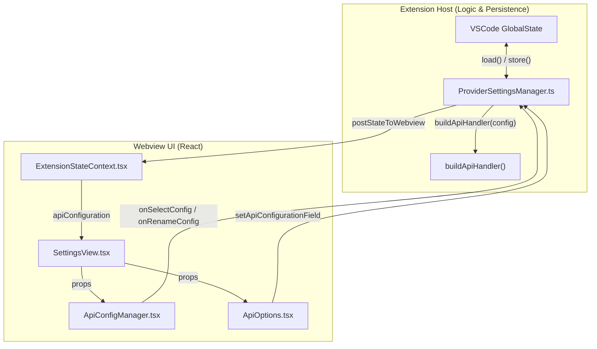
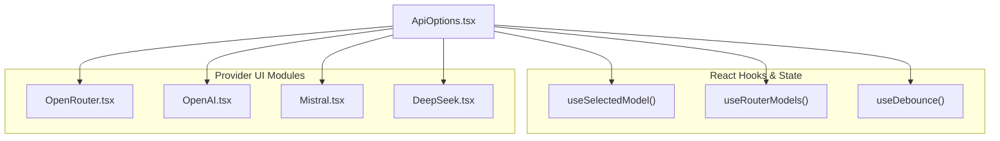

# Provider Configuration Profiles

Relevant source files

The following files were used as context for generating this wiki page:

- [src/api/index.ts](src/api/index.ts)
- [src/api/providers/anthropic.ts](src/api/providers/anthropic.ts)
- [src/api/providers/deepseek.ts](src/api/providers/deepseek.ts)
- [src/api/providers/fetchers/__tests__/lmstudio.test.ts](src/api/providers/fetchers/__tests__/lmstudio.test.ts)
- [src/api/providers/fetchers/lmstudio.ts](src/api/providers/fetchers/lmstudio.ts)
- [src/api/providers/mistral.ts](src/api/providers/mistral.ts)
- [src/api/providers/openai.ts](src/api/providers/openai.ts)
- [src/api/providers/openrouter.ts](src/api/providers/openrouter.ts)
- [src/api/providers/requesty.ts](src/api/providers/requesty.ts)
- [src/api/providers/unbound.ts](src/api/providers/unbound.ts)
- [src/shared/api.ts](src/shared/api.ts)
- [webview-ui/src/components/settings/ApiConfigManager.tsx](webview-ui/src/components/settings/ApiConfigManager.tsx)
- [webview-ui/src/components/settings/ApiOptions.tsx](webview-ui/src/components/settings/ApiOptions.tsx)
- [webview-ui/src/components/settings/providers/Gemini.tsx](webview-ui/src/components/settings/providers/Gemini.tsx)
- [webview-ui/src/components/settings/providers/LMStudio.tsx](webview-ui/src/components/settings/providers/LMStudio.tsx)
- [webview-ui/src/components/settings/providers/LiteLLM.tsx](webview-ui/src/components/settings/providers/LiteLLM.tsx)
- [webview-ui/src/components/settings/providers/Ollama.tsx](webview-ui/src/components/settings/providers/Ollama.tsx)
- [webview-ui/src/components/settings/providers/OpenAI.tsx](webview-ui/src/components/settings/providers/OpenAI.tsx)
- [webview-ui/src/components/settings/providers/OpenAICompatible.tsx](webview-ui/src/components/settings/providers/OpenAICompatible.tsx)
- [webview-ui/src/components/settings/providers/OpenRouter.tsx](webview-ui/src/components/settings/providers/OpenRouter.tsx)
- [webview-ui/src/components/settings/providers/Requesty.tsx](webview-ui/src/components/settings/providers/Requesty.tsx)
- [webview-ui/src/components/settings/providers/Unbound.tsx](webview-ui/src/components/settings/providers/Unbound.tsx)
- [webview-ui/src/components/settings/providers/VSCodeLM.tsx](webview-ui/src/components/settings/providers/VSCodeLM.tsx)
- [webview-ui/src/components/settings/providers/Vertex.tsx](webview-ui/src/components/settings/providers/Vertex.tsx)
- [webview-ui/src/components/settings/providers/__tests__/Gemini.spec.tsx](webview-ui/src/components/settings/providers/__tests__/Gemini.spec.tsx)
- [webview-ui/src/components/settings/providers/__tests__/Vertex.spec.tsx](webview-ui/src/components/settings/providers/__tests__/Vertex.spec.tsx)
- [webview-ui/src/components/ui/alert-dialog.tsx](webview-ui/src/components/ui/alert-dialog.tsx)
- [webview-ui/src/components/ui/dialog.tsx](webview-ui/src/components/ui/dialog.tsx)
- [webview-ui/src/utils/validate.ts](webview-ui/src/utils/validate.ts)

## Purpose and Scope

This document covers the provider configuration profile system, which allows users to save and switch between different AI API provider configurations. Configuration profiles store complete API settings including provider selection, authentication credentials, model preferences, and provider-specific options.

The system is managed by the `ProviderSettingsManager`, which handles persistence in VS Code's global storage and coordinates with the Webview UI through the `ApiConfigManager` and `ApiOptions` components.

---

## Configuration Profile Structure

### ProviderSettings and Profiles

Configuration profiles are structured data objects defined by the `ProviderSettings` type. The `ProviderSettingsManager` organizes these into a `ProviderProfiles` object which maps profile names to their respective settings.

**Core Profile Data (`ProviderProfiles`):**
- `currentApiConfigName`: The name of the currently active profile (e.g., `"default"`). [src/core/config/ProviderSettingsManager.ts:40]()
- `apiConfigs`: A record mapping unique names to `ProviderSettingsWithId` objects. [src/core/config/ProviderSettingsManager.ts:41]()
- `modeApiConfigs`: A mapping of mode slugs (e.g., `"code"`, `"architect"`) to specific profile IDs, allowing different modes to use different providers automatically. [src/core/config/ProviderSettingsManager.ts:42]()

**ProviderSettings Type Details:**
- `apiProvider`: The selected provider name (e.g., `"anthropic"`, `"openai"`, `"openrouter"`). [src/api/index.ts:112]()
- `apiModelId`: The primary model identifier used by most providers. [webview-ui/src/components/settings/ApiOptions.tsx:213]()
- **Provider-specific keys**: `openRouterApiKey`, `awsRegion`, `vertexProjectId`, `geminiApiKey`, etc. [webview-ui/src/utils/validate.ts:41-131]()
- **Behavioral settings**: `modelMaxTokens`, `modelTemperature`, `ollamaNumCtx`, `enableReasoningEffort`. [src/shared/api.ts:13-26](), [src/shared/api.ts:44-50]()

### Configuration Profile Data Flow

The following diagram illustrates how configuration flows from persistence to the UI and back.

**Profile Persistence and Sync Diagram**

Sources: [src/core/config/ProviderSettingsManager.ts:57-80](), [webview-ui/src/components/settings/ApiConfigManager.tsx:29-37](), [webview-ui/src/components/settings/ApiOptions.tsx:127-134](), [src/api/index.ts:112-185]()

---

## Profile Management Operations

### Initialization and Migrations

The `ProviderSettingsManager` is responsible for the lifecycle of these profiles. Upon activation, it runs an `initialize()` sequence to ensure data integrity and apply necessary updates. [src/core/config/ProviderSettingsManager.ts:102]()

**Key Initialization Tasks:**
- **ID Generation**: Ensures every configuration has a unique `id` for reliable cross-referencing. [src/core/config/ProviderSettingsManager.ts:132-137]()
- **Model Migrations**: Automatically updates deprecated model IDs to their modern equivalents (e.g., migrating `roo/code-supernova` to `roo/code-supernova-1-million`). [src/core/config/ProviderSettingsManager.ts:27-31](), [src/core/config/ProviderSettingsManager.ts:127]()
- **Legacy Cleanup**: Removes obsolete settings like `claudeCodePath` from older versions. [src/core/config/ProviderSettingsManager.ts:175-194]()

### CRUD Operations

Profile management is exposed through the `ApiConfigManager` component in the Settings UI:

1.  **Create (`onUpsertConfig`)**: Users can add a new profile. The manager generates a unique ID using `generateId()` and adds it to the `apiConfigs` record. [src/core/config/ProviderSettingsManager.ts:87-89](), [webview-ui/src/components/settings/ApiConfigManager.tsx:161-172]()
2.  **Switch (`onSelectConfig`)**: Changing the active profile updates `currentApiConfigName`. [webview-ui/src/components/settings/ApiConfigManager.tsx:121-124]()
3.  **Rename (`onRenameConfig`)**: Updates the key in the `apiConfigs` record while maintaining the same internal ID. [webview-ui/src/components/settings/ApiConfigManager.tsx:141-159]()
4.  **Delete (`onDeleteConfig`)**: Removes the configuration. The manager prevents the deletion of the last remaining profile. [webview-ui/src/components/settings/ApiConfigManager.tsx:174-179]()

---

## ApiOptions Component Architecture

The `ApiOptions` component is the central React orchestrator for individual provider configuration fields. It manages the complex state of various API providers and their unique requirements.

### Component Logic and State

**ApiOptions Internal Logic**

Sources: [webview-ui/src/components/settings/ApiOptions.tsx:155-167](), [webview-ui/src/components/settings/ApiOptions.tsx:182-186](), [webview-ui/src/components/settings/ApiOptions.tsx:193]()

### Dynamic Model Loading

For providers like **OpenRouter**, **Requesty**, and **Ollama**, model lists are not static. `ApiOptions` coordinates the fetching of these models:

- **OpenRouter**: Uses `useRouterModels` to fetch available models and `useOpenRouterModelProviders` to fetch specific provider endpoints for a given model. [webview-ui/src/components/settings/ApiOptions.tsx:193-205]()
- **Requesty**: Uses `fetchModel()` within the handler to populate the local `models` cache from the Requesty service URL. [src/api/providers/requesty.ts:74-77]()
- **Unbound**: Similarly uses `fetchModel()` to populate dynamic model info using the Unbound API key. [src/api/providers/unbound.ts:68-71]()
- **DeepSeek**: While using the OpenAI base, it specifically handles "reasoner" models with specialized R1 formatting. [src/api/providers/deepseek.ts:58-69]()

---

## Validation and Reasoning

### API Configuration Validation

The `validateApiConfiguration` function ensures that a profile is functional before it is used. [webview-ui/src/utils/validate.ts:16-37]()

**Validation Checks:**
- **Required Fields**: Checks for API keys or specific parameters (e.g., `awsRegion` for Bedrock, `vertexProjectId` for Vertex, `qwenCodeOauthPath` for Qwen). [webview-ui/src/utils/validate.ts:39-131]()
- **Organization Policy**: Ensures the selected provider and model are permitted by `OrganizationAllowList`. [webview-ui/src/utils/validate.ts:141-177]()
- **Dynamic Model Check**: Verifies that the selected model ID exists in the fetched model list for dynamic providers. [webview-ui/src/utils/validate.ts:223-240]()

### Reasoning and Thinking Budget

Roo Code supports advanced "Reasoning" models (like Claude 3.7 Sonnet or DeepSeek R1). The logic for these is centralized in `src/shared/api.ts`.

- **shouldUseReasoningBudget**: Determines if the `thinking` parameter should be sent based on model capabilities and user settings. [src/shared/api.ts:44-50]()
- **shouldUseReasoningEffort**: Determines if the `reasoning_effort` parameter (OpenAI style) should be used, supporting levels from `"none"` to `"high"`. [src/shared/api.ts:52-97]()
- **Max Output Tokens**: `getModelMaxOutputTokens` calculates limits, often clamping to 20% of context window for standard models, but allowing higher limits for reasoning models or GPT-5. [src/shared/api.ts:105-157]()

---

## Provider-Specific Details

### OpenRouter
The `OpenRouterHandler` includes complex error extraction from `metadata.raw` to surface specific upstream provider errors. [src/api/providers/openrouter.ts:92-120]() It also handles dynamic endpoint discovery through `getModelEndpoints`. [src/api/providers/openrouter.ts:168-172]()

### Mistral
The `MistralHandler` supports the native Mistral SDK and handles specialized `thinking` chunks in the stream delta. [src/api/providers/mistral.ts:123-132]() It forces `toolChoice: "any"` to ensure tool usage when tools are provided. [src/api/providers/mistral.ts:98-99]()

### DeepSeek
The `DeepSeekHandler` (subclass of `OpenAiHandler`) implements the `convertToR1Format` to merge consecutive same-role messages, which is a requirement for the DeepSeek API. [src/api/providers/deepseek.ts:61-69]() It also handles `reasoning_content` specific to DeepSeek's interleaved thinking output. [src/api/providers/deepseek.ts:114-121]()

### Unbound and Requesty
Both handlers implement `processUsageMetrics` to extract provider-specific token usage, including `cache_read_input_tokens` and `cache_creation_input_tokens` (Unbound) or `caching_tokens` (Requesty). [src/api/providers/unbound.ts:92-110](), [src/api/providers/requesty.ts:98-116]()

Sources: [src/api/providers/openrouter.ts](), [src/api/providers/mistral.ts](), [src/api/providers/deepseek.ts](), [src/api/providers/requesty.ts](), [src/api/providers/unbound.ts]()