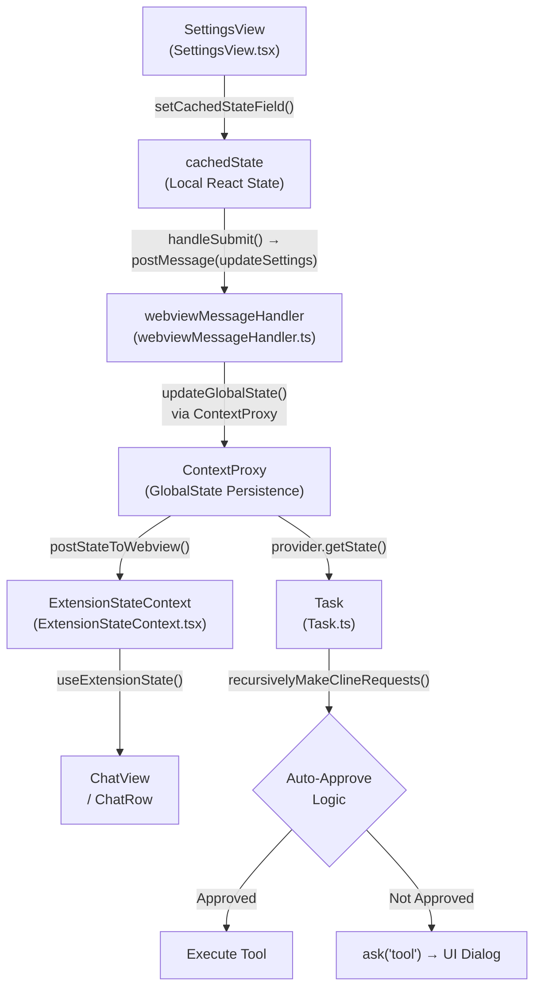
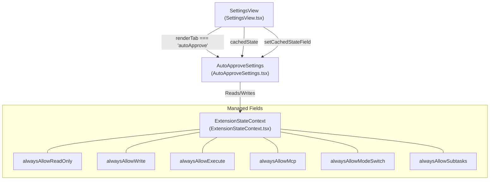
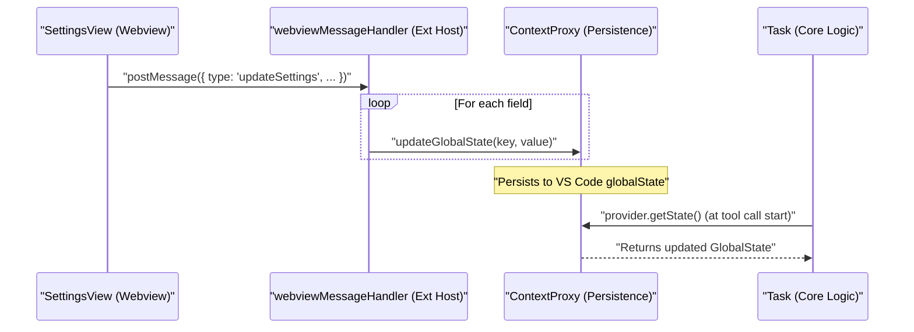
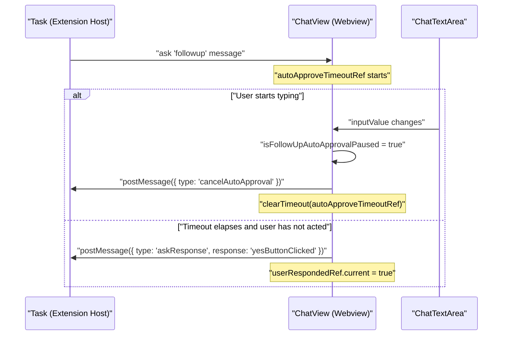
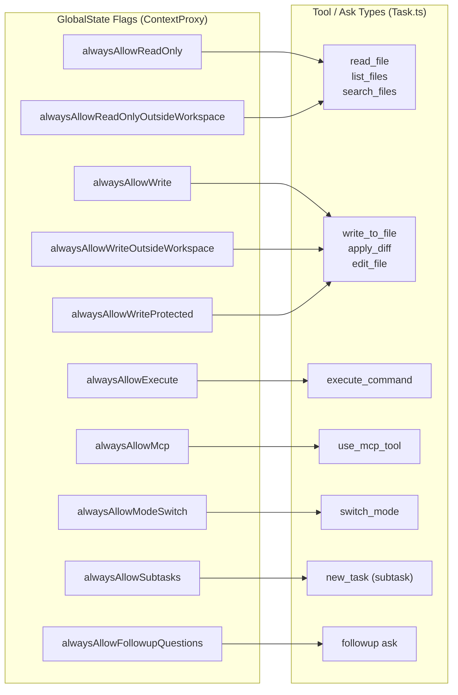

# Auto-Approve Configuration

Relevant source files

The following files were used as context for generating this wiki page:

- [packages/types/src/vscode-extension-host.ts](packages/types/src/vscode-extension-host.ts)
- [src/api/providers/fetchers/modelCache.ts](src/api/providers/fetchers/modelCache.ts)
- [src/core/webview/ClineProvider.ts](src/core/webview/ClineProvider.ts)
- [src/core/webview/__tests__/ClineProvider.spec.ts](src/core/webview/__tests__/ClineProvider.spec.ts)
- [src/core/webview/__tests__/webviewMessageHandler.spec.ts](src/core/webview/__tests__/webviewMessageHandler.spec.ts)
- [src/core/webview/webviewMessageHandler.ts](src/core/webview/webviewMessageHandler.ts)
- [src/shared/WebviewMessage.ts](src/shared/WebviewMessage.ts)
- [webview-ui/src/components/chat/ChatRow.tsx](webview-ui/src/components/chat/ChatRow.tsx)
- [webview-ui/src/components/chat/ChatView.tsx](webview-ui/src/components/chat/ChatView.tsx)
- [webview-ui/src/components/settings/SettingsView.tsx](webview-ui/src/components/settings/SettingsView.tsx)
- [webview-ui/src/context/ExtensionStateContext.tsx](webview-ui/src/context/ExtensionStateContext.tsx)
- [webview-ui/src/i18n/locales/ca/settings.json](webview-ui/src/i18n/locales/ca/settings.json)
- [webview-ui/src/i18n/locales/de/settings.json](webview-ui/src/i18n/locales/de/settings.json)
- [webview-ui/src/i18n/locales/en/settings.json](webview-ui/src/i18n/locales/en/settings.json)
- [webview-ui/src/i18n/locales/es/settings.json](webview-ui/src/i18n/locales/es/settings.json)
- [webview-ui/src/i18n/locales/fr/settings.json](webview-ui/src/i18n/locales/fr/settings.json)
- [webview-ui/src/i18n/locales/hi/settings.json](webview-ui/src/i18n/locales/hi/settings.json)
- [webview-ui/src/i18n/locales/it/settings.json](webview-ui/src/i18n/locales/it/settings.json)
- [webview-ui/src/i18n/locales/ja/settings.json](webview-ui/src/i18n/locales/ja/settings.json)
- [webview-ui/src/i18n/locales/ko/settings.json](webview-ui/src/i18n/locales/ko/settings.json)
- [webview-ui/src/i18n/locales/pl/settings.json](webview-ui/src/i18n/locales/pl/settings.json)
- [webview-ui/src/i18n/locales/pt-BR/settings.json](webview-ui/src/i18n/locales/pt-BR/settings.json)
- [webview-ui/src/i18n/locales/tr/settings.json](webview-ui/src/i18n/locales/tr/settings.json)
- [webview-ui/src/i18n/locales/vi/settings.json](webview-ui/src/i18n/locales/vi/settings.json)
- [webview-ui/src/i18n/locales/zh-CN/settings.json](webview-ui/src/i18n/locales/zh-CN/settings.json)

This page documents the auto-approve settings system: which operations can be approved without user interaction, how those settings are configured in the UI, how they are stored and propagated, and how the tool execution layer enforces them at runtime.

---

## Overview

Roo Code's auto-approve system lets users bypass the approval dialog for specific categories of AI tool actions. Each category (file reads, file writes, command execution, MCP calls, mode switches, subtasks, and follow-up questions) has an independent boolean flag. Two numeric limits—`allowedMaxRequests` and `allowedMaxCost`—provide guardrails that halt autonomous operation after a threshold is crossed, regardless of which flags are enabled.

The master toggle `autoApprovalEnabled` must be `true` for any per-category flag to take effect.

---

## Settings Reference

The table below lists every auto-approve setting, its type, its default, and the tool category it controls.

| Setting | Type | Default | Controls |
|---|---|---|---|
| `autoApprovalEnabled` | `boolean` | `false` | Master toggle: enables all auto-approval |
| `alwaysAllowReadOnly` | `boolean` | `false` | Reading files within the workspace |
| `alwaysAllowReadOnlyOutsideWorkspace` | `boolean` | `false` | Reading files outside the workspace |
| `alwaysAllowWrite` | `boolean` | `false` | Writing / editing files within workspace |
| `alwaysAllowWriteOutsideWorkspace` | `boolean` | `false` | Writing files outside the workspace |
| `alwaysAllowWriteProtected` | `boolean` | `false` | Writing files marked protected (`.rooprotect`) |
| `alwaysAllowExecute` | `boolean` | `false` | Running shell commands |
| `alwaysAllowMcp` | `boolean` | `false` | Calling MCP tools and resources |
| `alwaysAllowModeSwitch` | `boolean` | `false` | Switching active modes |
| `alwaysAllowSubtasks` | `boolean` | `false` | Spawning sub-tasks |
| `alwaysAllowFollowupQuestions` | `boolean` | `false` | Auto-answering AI follow-up questions |
| `followupAutoApproveTimeoutMs` | `number \| undefined` | `undefined` | Delay before follow-up is auto-approved (ms) |
| `allowedCommands` | `string[]` | `[]` | Allowlist of command patterns for execute |
| `deniedCommands` | `string[]` | `[]` | Denylist of command patterns for execute |
| `allowedMaxRequests` | `number \| null` | `null` | Stop auto-approving after N requests |
| `allowedMaxCost` | `number \| null` | `null` | Stop auto-approving after $N cost |

Sources: [webview-ui/src/context/ExtensionStateContext.tsx:54-57](), [webview-ui/src/context/ExtensionStateContext.tsx:108-110](), [webview-ui/src/components/settings/SettingsView.tsx:150-163]()

---

## Settings Data Flow

The `SettingsView` component manages the local `cachedState`. When changes are saved, they are sent to the extension host via `postMessage`. The `webviewMessageHandler` then updates the `ContextProxy`, which interfaces with VS Code's `globalState`.

**Auto-Approve Configuration Flow**

Sources: [src/core/webview/ClineProvider.ts:93-96](), [webview-ui/src/context/ExtensionStateContext.tsx:151-190](), [src/core/webview/webviewMessageHandler.ts:98-100]()

---

## UI Component Structure

The auto-approve settings are rendered in the **Auto-Approve** section of the settings panel. This is localized across multiple languages (e.g., "自动批准" in Chinese, "Genehmigen" in German).

The settings are categorized in the UI under sections like `autoApprove` defined in the localization files. For example, in `en/settings.json`, the section is titled "Auto-Approve".

Sources: [webview-ui/src/i18n/locales/en/settings.json:34-34](), [webview-ui/src/i18n/locales/zh-CN/settings.json:33-33](), [webview-ui/src/components/settings/SettingsView.tsx:68-68]()

---

## State Storage and Propagation

Each setting is a key in the `GlobalState` type. The `ContextProxy` class (accessed via `ClineProvider`) wraps VS Code's `globalState` API. When `webviewMessageHandler` receives the `updateSettings` message, it persists the values.

Sources: [webview-ui/src/context/ExtensionStateContext.tsx:151-190](), [src/core/webview/ClineProvider.ts:93-96](), [src/core/webview/webviewMessageHandler.ts:98-100]()

---

## Follow-up Question Auto-Approval

`alwaysAllowFollowupQuestions` and `followupAutoApproveTimeoutMs` implement a timed auto-approval for the `followup` ask type. This allows the agent to continue if the user doesn't intervene within a specific window.

**Follow-up auto-approve sequence**

Key code locations in `ChatView.tsx`:

| Ref / State | Purpose | Location |
|---|---|---|
| `autoApproveTimeoutRef` | Holds the pending auto-approval timer | [webview-ui/src/components/chat/ChatView.tsx:171]() |
| `userRespondedRef` | Prevents auto-approval after user has acted | [webview-ui/src/components/chat/ChatView.tsx:172]() |
| `isFollowUpAutoApprovalPaused` | `true` when `clineAsk === 'followup'` and user is typing | [webview-ui/src/components/chat/ChatView.tsx:205-207]() |

Sources: [webview-ui/src/components/chat/ChatView.tsx:171-216](), [webview-ui/src/components/chat/ChatView.tsx:491-496]()

---

## Request and Cost Limits

`allowedMaxRequests` and `allowedMaxCost` act as session-level circuit breakers. Once the cumulative request count or API cost for a task exceeds the configured threshold, auto-approval is suspended.

- `allowedMaxRequests: number | null` — `null` means no limit.
- `allowedMaxCost: number | null` — dollar value; `null` means no limit.

When the limit is hit, an `AutoApprovedRequestLimitWarning` is displayed in the chat interface.

Sources: [webview-ui/src/components/chat/ChatRow.tsx:48-48](), [webview-ui/src/context/ExtensionStateContext.tsx:77-78](), [webview-ui/src/components/settings/SettingsView.tsx:154-155]()

---

## Command Allow/Deny Lists

Users can manage permissions for specific command patterns. This is reflected in the UI where users can add or remove commands from allowed/denied lists.

- **`allowedCommands`**: Patterns that are automatically permitted if `alwaysAllowExecute` is enabled.
- **`deniedCommands`**: Patterns that always require manual approval.

The UI provides localized labels for these actions, managed through `SettingsView` and `AutoApproveSettings`.

Sources: [webview-ui/src/components/settings/SettingsView.tsx:152-153](), [webview-ui/src/context/ExtensionStateContext.tsx:75-76](), [webview-ui/src/components/settings/SettingsView.tsx:68-68]()

---

## Relationship Between Settings and Tool Categories

**Settings to tool category mapping**

Sources: [webview-ui/src/context/ExtensionStateContext.tsx:64-71](), [src/core/webview/ClineProvider.ts:93-96](), [webview-ui/src/components/settings/SettingsView.tsx:150-163]()