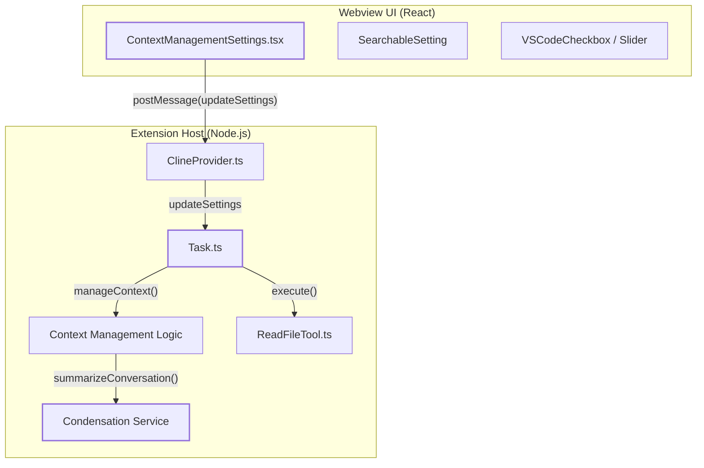
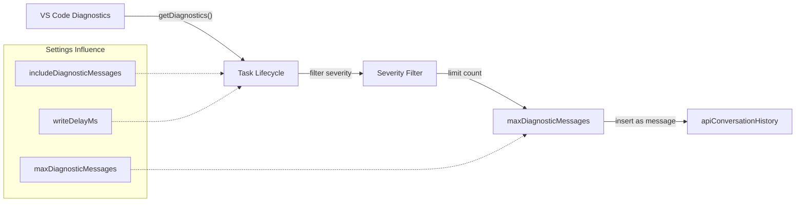

# Context Management Settings

Relevant source files

The following files were used as context for generating this wiki page:

- [AGENTS.md](AGENTS.md)
- [src/core/config/CustomModesManager.ts](src/core/config/CustomModesManager.ts)
- [src/core/config/__tests__/CustomModesManager.exportImportSlugChange.spec.ts](src/core/config/__tests__/CustomModesManager.exportImportSlugChange.spec.ts)
- [src/core/config/__tests__/CustomModesManager.spec.ts](src/core/config/__tests__/CustomModesManager.spec.ts)
- [src/services/marketplace/SimpleInstaller.ts](src/services/marketplace/SimpleInstaller.ts)
- [src/services/marketplace/__tests__/SimpleInstaller.spec.ts](src/services/marketplace/__tests__/SimpleInstaller.spec.ts)
- [src/utils/__tests__/migrateSettings.spec.ts](src/utils/__tests__/migrateSettings.spec.ts)
- [src/utils/globalContext.ts](src/utils/globalContext.ts)
- [src/utils/migrateSettings.ts](src/utils/migrateSettings.ts)
- [webview-ui/src/__tests__/SearchableSelect.spec.tsx](webview-ui/src/__tests__/SearchableSelect.spec.tsx)
- [webview-ui/src/components/modes/ModesView.tsx](webview-ui/src/components/modes/ModesView.tsx)
- [webview-ui/src/components/modes/__tests__/ModesView.spec.tsx](webview-ui/src/components/modes/__tests__/ModesView.spec.tsx)
- [webview-ui/src/components/settings/ContextManagementSettings.tsx](webview-ui/src/components/settings/ContextManagementSettings.tsx)
- [webview-ui/src/components/settings/PromptsSettings.tsx](webview-ui/src/components/settings/PromptsSettings.tsx)
- [webview-ui/src/components/settings/__tests__/ContextManagementSettings.spec.tsx](webview-ui/src/components/settings/__tests__/ContextManagementSettings.spec.tsx)
- [webview-ui/src/components/ui/searchable-select.tsx](webview-ui/src/components/ui/searchable-select.tsx)
- [webview-ui/src/hooks/useEscapeKey.spec.ts](webview-ui/src/hooks/useEscapeKey.spec.ts)
- [webview-ui/src/hooks/useEscapeKey.ts](webview-ui/src/hooks/useEscapeKey.ts)
- [webview-ui/src/i18n/locales/ca/settings.json](webview-ui/src/i18n/locales/ca/settings.json)
- [webview-ui/src/i18n/locales/de/settings.json](webview-ui/src/i18n/locales/de/settings.json)
- [webview-ui/src/i18n/locales/en/settings.json](webview-ui/src/i18n/locales/en/settings.json)
- [webview-ui/src/i18n/locales/es/settings.json](webview-ui/src/i18n/locales/es/settings.json)
- [webview-ui/src/i18n/locales/fr/settings.json](webview-ui/src/i18n/locales/fr/settings.json)
- [webview-ui/src/i18n/locales/hi/settings.json](webview-ui/src/i18n/locales/hi/settings.json)
- [webview-ui/src/i18n/locales/it/settings.json](webview-ui/src/i18n/locales/it/settings.json)
- [webview-ui/src/i18n/locales/ja/settings.json](webview-ui/src/i18n/locales/ja/settings.json)
- [webview-ui/src/i18n/locales/ko/settings.json](webview-ui/src/i18n/locales/ko/settings.json)
- [webview-ui/src/i18n/locales/pl/settings.json](webview-ui/src/i18n/locales/pl/settings.json)
- [webview-ui/src/i18n/locales/pt-BR/settings.json](webview-ui/src/i18n/locales/pt-BR/settings.json)
- [webview-ui/src/i18n/locales/tr/settings.json](webview-ui/src/i18n/locales/tr/settings.json)
- [webview-ui/src/i18n/locales/vi/settings.json](webview-ui/src/i18n/locales/vi/settings.json)
- [webview-ui/src/i18n/locales/zh-CN/settings.json](webview-ui/src/i18n/locales/zh-CN/settings.json)

This page documents the configuration and implementation of Roo Code's context management system. These settings control how the AI perceives its environment, how file content is ingested, and how conversation history is condensed or truncated to fit within model token limits.

## Overview

Context management settings are primarily managed through the `ContextManagementSettings` component and persisted via the VS Code configuration API. These settings directly influence the behavior of the `Task` lifecycle, tool execution (especially `read_file`), and the automated condensation logic.

Key configuration areas include:
- **Conversation Management**: Auto-condensation thresholds and truncation fallback.
- **Environment Limits**: Constraints on open tabs, workspace file listings, and git status.
- **File Read Controls**: Line limits, concurrency, and image size restrictions.
- **Diagnostic Integration**: Automatic collection of IDE errors and warnings.

**Sources:** [webview-ui/src/components/settings/ContextManagementSettings.tsx:1-20](), [webview-ui/src/i18n/locales/en/settings.json:37]()

## Settings Architecture

The context management settings flow from the React-based Webview UI to the Extension Host, where they are consumed by core services. The UI utilizes `SearchableSetting` and `VSCodeCheckbox` components to provide a consistent configuration experience.

Title: Context Settings Data Flow and Code Entities

**Sources:** [webview-ui/src/components/settings/ContextManagementSettings.tsx:22-60](), [webview-ui/src/i18n/locales/en/settings.json:37-45]()

## Context Condensation & Truncation

Roo Code employs a dual-strategy for managing growing conversation histories: **Intelligent Condensation** (summarization) and **Non-Destructive Truncation** (sliding window).

### 1. Auto-Condensation
When enabled via `autoCondenseContext`, the system monitors token usage. If the conversation exceeds a percentage of the context window (defined by `autoCondenseContextPercent`), it triggers a summarization request.

- **Thresholds**: The user can configure the percentage threshold at which condensation begins.
- **Process**: The system asks the LLM to condense history while preserving critical state and instructions.
- **Tool Handling**: The system transforms `tool_use` and `tool_result` blocks into standard text before sending them to the summarizer to ensure compatibility across different model providers.

### 2. Sliding Window Truncation
As a fallback or when condensation is disabled, the system uses truncation. This is "non-destructive" because it identifies visible messages and hides older segments to keep the active context within the model's limits.

- **Logic**: It typically hides a fraction of the history, often rounding to even numbers to keep user/assistant pairs together.
- **Markers**: A marker is often inserted into the message stream to indicate where history was hidden.

**Sources:** [webview-ui/src/i18n/locales/en/settings.json:37](), [webview-ui/src/components/settings/ContextManagementSettings.tsx:1-40]()

## Environment Details & Limits

The system collects workspace metadata to provide the LLM with situational awareness. These are governed by specific limits to prevent "context bloat."

| Setting | UI Label | Code Context | Impact |
| :--- | :--- | :--- | :--- |
| **Open Tabs** | Max Open Tabs | `maxOpenTabsContext` | Limits files listed from `vscode.window.tabGroups`. |
| **Workspace Files** | Max Workspace Files | `maxWorkspaceFiles` | Limits the file tree depth/breadth shown in the environment prompt. |
| **Git Status** | Max Git Status Files | `maxGitStatusFiles` | Limits number of modified files included in git context. |
| **Diagnostics** | Max Diagnostic Messages | `maxDiagnosticMessages` | Limits the number of LSP errors/warnings included after a write. |

**Sources:** [webview-ui/src/i18n/locales/en/settings.json:37-45](), [webview-ui/src/components/settings/ContextManagementSettings.tsx:1-100]()

## File Read & Image Limits

The `read_file` tool behavior is modified by several settings to ensure efficiency and cost-control.

### Line-Based Truncation
The system uses a line limit for reading files. If a file exceeds this limit, Roo Code provides a "folded" view or an index of important code definitions (classes, functions) while omitting implementation details to save tokens.

### Image Handling
For vision-capable models, image size is strictly enforced:
- **`maxImageFileSize`**: Limits the size of a single image attachment.
- **`maxTotalImageSize`**: Limits the cumulative size of all images in a single request.

**Sources:** [webview-ui/src/components/settings/ContextManagementSettings.tsx:1-50](), [webview-ui/src/i18n/locales/en/settings.json:162-167]()

## Diagnostic Collection Workflow

Roo Code can automatically pull "Problems" (LSP diagnostics) into the conversation to help the AI self-correct after a file edit.

Title: Diagnostic Collection and Filtering

The `writeDelayMs` setting is particularly important here; it introduces a pause after file operations (like `write_to_file`) to allow the language server to re-scan the file and produce updated diagnostics before the AI continues its loop.

**Sources:** [webview-ui/src/components/settings/ContextManagementSettings.tsx:60-90](), [webview-ui/src/i18n/locales/en/settings.json:37]()

## Subfolder Rules & .rooignore

Context management also respects file-system level rules:
- **`.rooignore`**: Ensures that files matching specific patterns are excluded from the context, even if mentioned or searched.
- **Subfolder Rules**: When enabled, Roo Code looks for `.roo/rules` or `AGENTS.md` in subdirectories and appends them to the system prompt if the current task is operating within those folders.
- **Custom Instructions**: Users can define global or mode-specific custom instructions that are injected into the system prompt to guide behavior across different context scenarios.

**Sources:** [webview-ui/src/components/settings/ContextManagementSettings.tsx:1-30](), [AGENTS.md:1-20](), [webview-ui/src/i18n/locales/en/settings.json:40]()